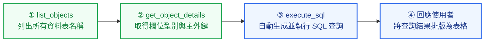

# 3. 自然語言查詢資料庫初體驗（免寫 SQL）

[← 回第 3 章目錄](../README.md)

> 🎯 **本單元目標**：在深入學習手寫 SQL 語法之前，先體驗 AI 的強大威力！你不需要寫任何一行程式碼，只要在對話框中用繁體中文問問題，AI 就會自動透過 MCP 工具探索資料表結構、撰寫 SQL 查詢，並整理成精美表格回答你。

---

## 📋 事前準備

- [ ] 已在資料庫管理工具（DBeaver）中匯入 [繁中網路商店範例資料庫 `shop.sql`](../../範例資料庫/中文範例資料庫/README.md#-網路商店-shop)
- [ ] 已設定好 Antigravity 的 PostgreSQL MCP 連線（無論是樹莓派 Docker 或是 Supabase 雲端環境）

---

## 1. 探索資料庫：讓 AI 當你的資料導遊

當你第一次面對陌生的資料庫時，不用自己一頁一頁點開資料表，直接讓 AI 帶你認識它的全貌。

請在 **Antigravity 對話框**中複製並送出以下提問：

> 💬 **提問 1：**「請查詢資料庫，裡面有哪些資料表？每張資料表主要儲存什麼資料內容？」

> 💬 **提問 2：**「`customers`、`orders`、`order_items`、`products` 這四張資料表之間有什麼關聯？請用清楚的文字或表格說明。」

> 💬 **提問 3：**「這家網路商店總共有幾位會員、幾項商品、幾筆訂單？」

> [!TIP]
> **標準答案核對**：150 位會員、47 項商品、700 筆訂單。

---

### 🔍 觀察 AI 背後的思考與動作

當你送出提問後，點開對話框中 AI 的「工具呼叫（Tool Calls）」展開紀錄，你會發現 AI 是依照以下流程一步步完成任務的：



AI 會**先了解資料表架構，再撰寫對應的查詢語法**。在第 ③ 步中 AI 所執行的指令就是標準 **SQL 語法**，在接下來的第 4 章中，你將親手學會自己寫出這些語法。

---

## 2. 中文提問實戰練習

我們設計了兩組常見的職場業務提問。請將問題貼給 AI，並對照右側的標準答案以驗證 AI 的查詢能力：

### 🟢 基礎單表查詢

| # | 在對話框中提問 | 參考標準答案 |
|:---:|---|---|
| **1** | 最貴的商品是什麼？售價多少錢？ | 機械式鍵盤，2,490 元 |
| **2** | 目前有哪些商品缺貨（庫存數量為 0）？ | 無線藍牙耳機、方格筆記本 A5、地瓜脆片、竹纖維毛巾 3 入、素面圓領 T 恤、護唇膏，共 6 項 |
| **3** | 哪一個縣市的會員人數最多？前兩名分別是誰？ | 第 1 名新北市（24 位），第 2 名高雄市（23 位） |
| **4** | 每種付款方式各有幾筆訂單？請由多到少排序。 | 信用卡 328 筆、LINE Pay 163 筆、貨到付款 130 筆、ATM 轉帳 79 筆 |

---

### 🔵 進階多表關聯與統計查詢

| # | 在對話框中提問 | 參考標準答案 |
|:---:|---|---|
| **5** | 2025 年（只計算已完成的訂單）賣出數量最多的前 3 項商品為何？ | 防曬乳 SPF50（85 件）、USB-C 快充線（75 件）、竹纖維毛巾 3 入（73 件） |
| **6** | 累積營業額最高的商品分類是哪一個？ | 3C周邊 |
| **7** | 累積消費金額最高的會員是哪一位？（只算已完成的訂單） | 徐淑宜 |
| **8** | 有幾位註冊會員從來沒有下過任何訂單？ | 18 位 |
| **9** | 哪一個月份的訂單數量最多？共有幾筆？ | 12 月，共 89 筆 |
| **10** | 組織架構中，總經理王大明底下直接管轄幾位主管？ | 4 位 |

> [!NOTE]
> ### 💡 答案與預期不同時，如何精準追問？
> 如果 AI 算出來的數字與答案不同，直接追問：**「請列出你執行的 SQL，並說明你的計算邏輯是什麼？」**  
> 常見原因包括：AI 是否漏掉了 `status = '已完成'` 的條件，或是誤把「銷售金額」當成「銷售數量」。**Prompt 描述得越具體、邊界條件越清楚，AI 查出來的數據就越精準。**

---

### 📊 進階應用：讓 AI 整理報表與商業洞察

查出資料只是第一步，AI 還能進一步將冰冷的數據轉為職場決策報表：

* 📈 **繪製趨勢圖**：
  > 「請統計每個月的訂單總數與累積營業額，整理成清楚的 Markdown 表格，並幫我分析哪幾個月是淡旺季。」
* 📝 **撰寫主管簡報摘要**：
  > 「根據 2025 年的營收與熱銷商品數據，為部門主管寫一段約 150 字的年度業績簡報摘要與建議。」
* 📦 **生成庫存警報清單**：
  > 「找出目前庫存低於 20 件的商品，整理為補貨建議表（包含商品名稱、現有庫存、單價），並依庫存由少到多排序。」

---

## 3. 檢視 AI 背後的 SQL

挑選剛才 AI 回答的任一題，向 AI 發出這道追問：

> 💬 **追問：**「請把你剛才查詢時執行的 SQL 語法完整貼給我，並逐行解釋每行指令的作用。」

你將會看到類似這樣的語法結構：

```sql
SELECT name, price
FROM products
ORDER BY price DESC
LIMIT 1;
```

此時看不懂完全沒有關係。**這正是第 4 章的核心學習目標**！學完 SQL 語法之後，你就不再只是被動接受 AI 給的答案，而是具備審查、修正並抓出 AI 潛在錯誤的真功夫。

---

## 4. 準備第 4 章：建立 `cafe_shop` 範例資料庫

在進入第 4 章之前，我們將轉換到貼近日常營運的「暖光咖啡門市」場景進行手寫 SQL 訓練：

請打開 **DBeaver**，新建一個資料庫 `cafe_shop`，並執行繁中範例檔 [`cafe_shop.sql`](../../範例資料庫/中文範例資料庫/cafe_shop.sql) 完成建庫。

> [!IMPORTANT]
> `cafe_shop` 與本單元使用的 `shop` 資料庫擁有部分同名的資料表（如 `products`、`orders` 等），**請務必各自建立為獨立的資料庫**，切勿匯入同一個資料庫內，避免資料表結構遭到覆蓋！

---

| 上一步 | 目錄 | 下一步 |
|:---|:---:|---:|
| [⬅️ 回第 3 章導覽](../README.md) | [🏠 課程首頁](../../README.md) | [進入第 4 章：SQL 語法與練功 ➡️](../../SQL語法教學/README.md) |
