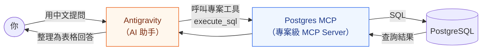
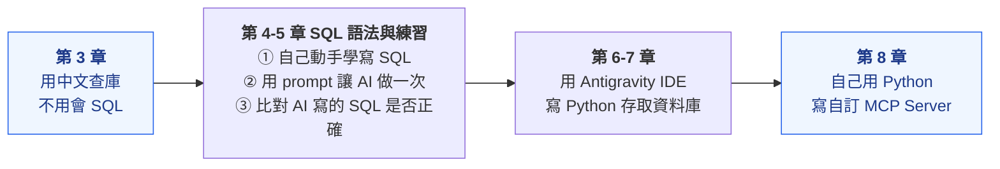

# 第 3 章：安裝現成 MCP，用中文查詢資料庫

還沒學 SQL 也沒關係。只要在 Antigravity 專案中掛載別人寫好的開源 MCP Server，**用中文問問題，AI 就會自動幫你查詢資料庫**。

> 「最貴的商品是什麼？」「哪些商品缺貨了？」「哪個月的訂單最多？」
> → AI 透過專案的 MCP 工具查詢 PostgreSQL → 整理成精美表格回答你

---

## 什麼是 MCP？

**MCP（Model Context Protocol）** 是 AI 連接外部工具與資料庫的標準規格：

| 名詞 | 白話說明 |
|---|---|
| **MCP Client** | AI 這一端，本課程使用 **Antigravity** |
| **專案級 MCP** | 只有開啟本專案時才會啟動的 MCP 設定，不需全域安裝，不污染系統環境 |
| **MCP Server** | 提供「工具」給 AI 呼叫的程式，本章使用現成的開源映像檔 `postgres-mcp` |
| **Tool（工具）** | MCP Server 的功能，例如 `list_objects`（列出資料表）、`execute_sql`（執行 SQL） |

---

## 本章單元

| 單元 | 內容 |
|:---:|---|
| ⭐ **[3-1 在 Antigravity 中設定專案級 Postgres MCP](./1_antigravity設定.md)** | 免全域安裝！在專案 `.agents/mcp_config.json` 中掛載 MCP，開啟專案即自動連線 |
| ⭐ **[3-2 第一次用中文查詢資料庫](./2_用中文查詢資料庫/)** | 不用會寫 SQL，用中文查詢網路商店資料（附答案）；體驗 AI 查庫的威力 |

---

## 接下來的學習路線：自己寫 SQL 與 AI 輔助

在第 3 章體驗完「AI 自動查庫」後，接下來的第 4、5 章我們將學習：
**「自己動手學寫 SQL，並由 Antigravity AI 在旁邊輔助、驗證與比對！」**

---

👉 **下一步：[3-1 在 Antigravity 中設定專案級 Postgres MCP](./1_antigravity設定.md)**
