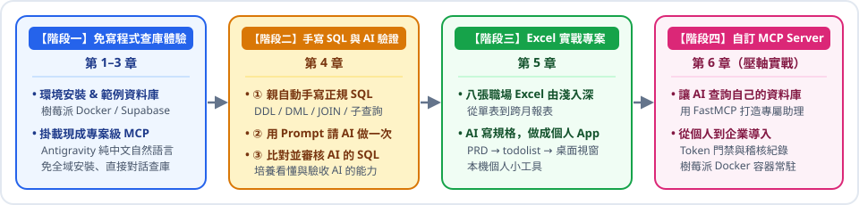

# 🐘 PostgreSQL 職場實戰學習指南

 

**專為上班族（會計、出納、總務、業務、人資）量身打造！**  
**告別混亂 Excel 痛點 ➡️ 透過 AI 轉換為關聯式 SQL 交易檔 ➡️ 在 DBeaver 親自動手執行 ➡️ 打造專屬個人本機桌面小 App（PyQt5 / Tkinter）**

---

## 🗺️ 學習路線

---

## 🎯 核心教學理念與安全規範

> [!IMPORTANT]
> **本專案的核心目標是「讓學員扎實學會 SQL 與資料庫架構」，嚴格遵循以下三大規範：**
> 
> 1. **AI 是助教，手寫才是真功夫**：學員**不可以叫 MCP 寫入資料庫**（建表、新增、修改、刪除），但**可以讓 MCP 讀取**資料庫的結構和資料。AI 提供建議與 SQL，學員必須親自在 **DBeaver** 中檢視並手動執行。第 5 章的實戰專案不受此限。
> 2. **拒絕線上架站繁瑣，聚焦個人本機桌面軟體**：捨棄需要伺服器與雲端維運的 Web / Streamlit 線上版，專注使用 **PyQt5**（高質感商業管理視窗）與 **Tkinter**（Python 內建、免繁複環境安裝），開發在自己電腦上即開即用的個人管理小工具。
> 3. **SQL 自己寫，App 由 AI 做**：每則需求的 SQL 都由學員親手寫好並在 DBeaver 跑過。桌面 App 的 Python 由 AI 產生，學員依 `todolist.md` 逐項驗收畫面，並確認每句 SQL 都看得懂。

---

## 🚀 第一次來？這樣開始

1. **選環境**：有樹莓派走 [Docker 方案](./raspberry_docker安裝/)，沒有就走 [Supabase 雲端方案](./supabase安裝/)（最快）。
2. **照順序走**：第 1 章走到第 6 章，每一章都接著前一章。第 4 章學完一個段落，就可以接著做第 5 章對應的實戰專案。
3. **每課都親手打**：看懂不等於會寫。每課結尾的 ✅ 過關檢查都打勾了，再往下走。
4. **卡住了**：先看該課的「⚠️ 常見卡關」，再把 SQL 和錯誤訊息貼給 AI，問它「錯在哪裡，為什麼」。

| 章 | 主題 | 完成後你能 |
|:---:|---|---|
| 1 | [環境安裝](./環境安裝/) | 用 DBeaver 連上自己的資料庫 |
| 2 | [範例資料庫](./範例資料庫/) | 練習匯入資料，建好範例資料庫 |
| 3 | [用中文查詢資料庫](./MCP操作資料庫/) | 不寫 SQL 也能問 AI 查資料 |
| 4 | [SQL 語法與練功](./SQL語法教學/) | **親手寫出跨表報表，並抓出 AI 的錯** |
| 5 | [Excel 實戰專案](./app_projects/) | 把工作上的 Excel 變成資料庫和個人小工具 |
| 6 | [自訂 MCP Server](./mcp_server/) | 讓 AI 只能呼叫你設計的工具 |

**只想學 SQL？** 做完第 1、2 章，直接跳到第 4 章。

---

<b>為自己的日常工作賦能，從手寫每一句 SQL 開始！</b>

