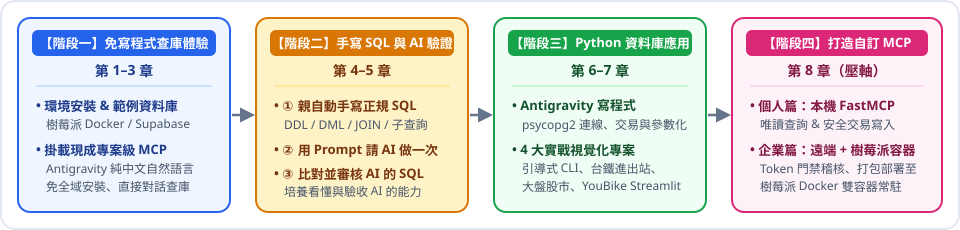

# PostgreSQL 學習指南

結合自然語言 AI、手寫 SQL 基礎、Python 應用開發，到最後自行打造自訂 MCP Server 的完整 PostgreSQL 實戰指南。

## 學習四階段路線

| 階段 | 章節 | 你會學到 | 使用工具與環境 |
|:---:|---|---|---|
| **一** | [1. 環境安裝](#1-環境安裝) | 安裝 PostgreSQL（樹莓派 Docker / Supabase）與 DBeaver 圖形工具 | Docker / Supabase / DBeaver |
| **一** | [2. 範例資料庫](#2-範例資料庫) | 匯入網路商店、圖書館、台鐵等繁中範例資料庫 | DBeaver 匯入 |
| **一** | [3. 現成 MCP 中文查庫](#3-安裝現成-mcp用中文查詢資料庫) | **一般人用的 Antigravity**：掛載**專案級 MCP**（免全域安裝），純自然語言問問題，AI 自動查庫 | Antigravity + 專案級 MCP |
| **二** | [4. SQL 語法與 AI 輔助](#4-sql-語法) | **親自學寫 SQL**：DDL/DML，每課搭配 prompt 讓 AI 做一次，學習審核與比對 AI 的 SQL | DBeaver + Antigravity 對話 |
| **二** | [5. SQL 實戰練習](#5-sql-練習) | 關聯資料庫實戰、外來鍵、JOIN、GROUP BY、子查詢多題演練 | DBeaver 手寫查詢 |
| **三** | [6. Python 串接](#6-python-串接psycopg2) | **在 Antigravity 中寫程式**：用 psycopg2 從 Python 進行資料庫 CRUD 與交易管理 | Antigravity (Python) |
| **三** | [7. 實戰專案開發](#7-實戰專案) | 建立引導式 CLI 工具與 Streamlit 互動視覺化 Web 應用 | Antigravity |
| **四** | [8. 自訂 MCP Server](#8-自訂-mcp-server個人本機開發到企業容器化導入) | **壓軸單元**：打造自訂 MCP Server，封裝專屬商業邏輯與 Token 安全防護 | Antigravity + FastMCP |

---

## 1. 環境安裝

本課程環境包含 **PostgreSQL 資料庫**、**DBeaver 管理工具** 與 **專案專屬 MCP Server**，所有安裝與設定步驟均收錄於各教學模組內：

| 環境 / 安裝方式 | 包含內容 | 教學連結 |
|---|---|:---:|
| ⭐ **Raspberry Pi（Docker）** | 樹莓派 Docker 安裝、PostgreSQL、DBeaver SSH 隧道、專案 MCP 與 Docker Compose 雙容器整合 | [查看教學](./raspberry_docker安裝/) |
| ⭐ **Supabase（雲端託管）** | 免硬體！申請免費雲端 PostgreSQL、DBeaver 直連與 Antigravity 專案級 MCP 設定 | [查看教學](./supabase安裝/) |
| **Linux / Raspberry Pi（原生安裝）** | 透過 apt 原生安裝 PostgreSQL 服務與連線設定 | [查看教學](./server安裝/) |
| **其它作業系統（Windows / macOS）** | 官方原生安裝檔下載 | [PostgreSQL 官網下載](https://www.postgresql.org/download/) |

> 💡 連線字串格式：`postgresql://使用者名稱:密碼@主機:埠號/資料庫名稱`

---

## 2. 範例資料庫

📁 [範例資料庫總覽](./範例資料庫/)

| 範例 | 大小 | 說明 |
|---|---|---|
| ⭐ [繁體中文範例資料庫](./範例資料庫/中文範例資料庫/) | 50–90 KB | 網路商店、學校選課、圖書館借閱；各一個 `.sql` 檔，執行就能匯入，附 ER 圖與練習題。**初學者首選** |
| [台鐵車站進出站人數](./範例資料庫/#2-台鐵車站進出站人數) | 9.4 MB | 真實公開資料，約 40 萬筆 |
| [其它範例 CSV 檔](./範例資料庫/#3-其它範例-csv-檔) | 4 KB–35 MB | 練習建立資料表與匯入 CSV |

---

## 3. 安裝現成 MCP，用中文查詢資料庫

還沒學 SQL、不想碰程式碼也沒關係：
只要在 **Antigravity 專案**中設定好現成的開源 MCP Server（**免全域安裝**，只有打開本專案才會啟動），**直接用中文問問題，AI 就會自動查詢資料庫並整理成表格回答你**！ 👉 [章節總覽](./MCP操作資料庫/)

| 單元 | 內容 |
|:---:|---|
| ⭐ **[3-1 在專案中設定 Postgres MCP](./MCP操作資料庫/1_antigravity設定.md)** | **免全域安裝！** 在專案 `.agents/mcp_config.json` 設定，開啟專案即自動連線，完全不污染電腦環境 |
| ⭐ **[3-2 第一次用中文查詢資料庫](./MCP操作資料庫/2_用中文查詢資料庫/)** | 不用會寫 SQL，用中文提問網路商店資料（附答案）；體驗 AI 自動查庫的便利 |

---

## 4. SQL 語法與 AI 輔助

在第 3 章體驗了 AI 查庫後，**第 4 章我們要自己動手學會寫 SQL**！
每一課先學正規 SQL 語法，最後的「🤖 **不寫 SQL，用 Prompt 完成**」單元，再用 prompt 讓 Antigravity AI 做一次，**親自對照 AI 寫的 SQL 和自己學的是否一樣**，學會如何驗證 AI 的正確性。

### DDL：資料定義語言

建立、修改資料庫與資料表的**結構**。 👉 [DDL 概念](./上課用sql/DDL%28定義資料語言%29.md)

| # | 單元 | 內容 |
|:---:|---|---|
| 1 | [建立資料庫](./上課用sql/1建立資料庫.md) | `CREATE DATABASE` |
| 2 | [資料表與基本型別](./上課用sql/2_0基本型別.md) | 數值、文字、日期等資料型別 |
| 3 | [建立資料表](./上課用sql/2建立資料表.md) | `CREATE TABLE` |
| 4 | [匯入 CSV](./上課用sql/2_1匯入csv.md) | 將 CSV 匯入資料表，包含台鐵進出站關聯資料庫 |
| 5 | [限制](./上課用sql/4限制.md) | `PRIMARY KEY`、`NOT NULL`、`UNIQUE` |

### DML：資料操作語言

新增、查詢、修改、刪除資料表裡的**資料**。 👉 [DML 概念](./上課用sql/DML%28資料操作語言%29.md)

| # | 單元 | 內容 |
|:---:|---|---|
| 1 | [新增資料](./上課用sql/3新增資料.md) | `INSERT INTO` |
| 2 | [取得資料](./上課用sql/6取得資料.md) | `SELECT`、`WHERE`、`ORDER BY` |
| 3 | [修改和刪除](./上課用sql/5修改和刪除.md) | `UPDATE`、`DELETE` |
| 4 | [FOREIGN KEY](./上課用sql/7_0FOREIGN_KEY.md) | 外來鍵與資料表關聯 |
| 5 | [JOIN](./上課用sql/JOIN.md) | 合併多張資料表 |
| 6 | [JSON 應用](./上課用sql/16json.md) | `JSON` / `JSONB` 欄位 |

### 關聯資料庫實作案例

從零建立一個關聯資料庫，並練習各種查詢。建議先看[適合初學者的版本](./上課用sql/7.0適合初學者關聯資料庫.md)。第 2～9 課的 prompt 請看 👉 [🤖 關聯資料庫實作：用 Prompt 操作](./上課用sql/關聯資料庫實作_用Prompt操作.md)

| # | 單元 | # | 單元 |
|:---:|---|:---:|---|
| 1 | [創建關聯資料庫](./上課用sql/7創建關聯資料庫.md) | 6 | [聯集 UNION](./上課用sql/12聯集.sql) |
| 2 | [新增資料](./上課用sql/8新增關聯資料庫資料.sql) | 7 | [連結 JOIN](./上課用sql/13連結.sql) |
| 3 | [搜尋資料](./上課用sql/9搜尋關聯資料庫.sql) | 8 | [子查詢 SubQuery](./上課用sql/14子查詢.sql) |
| 4 | [聚合函式](./上課用sql/10聚合函式.sql) | 9 | [ON DELETE 動作](./上課用sql/15on_delete_action.sql) |
| 5 | [萬用字元](./上課用sql/11萬用字元.sql) | | |

---

## 5. SQL 練習

| 練習 | 使用資料 | 主題 |
|---|---|---|
| ⭐ [中文範例資料庫練習題](./範例資料庫/中文範例資料庫/) | 網路商店、學校選課、圖書館借閱 | SELECT、JOIN、GROUP BY、HAVING、子查詢、日期計算（附參考答案） |
| [CREATE TABLE](./練習/1CREATE_TABLE) | 自行建立資料表 | 建立資料表、匯入 CSV |
| [INSERT INTO](./練習/5INSERT_INTO) | 自行建立資料表 | 新增資料、`ON CONFLICT` |
| [FOREIGN KEY](./練習/7Foreign_key) | 台鐵進出站 | 外來鍵 |
| [JOIN](./練習/8JOIN) | 台鐵進出站 | 合併查詢 |
| [GROUP BY、HAVING](./練習/9HAVING) | 台鐵進出站 | 分組統計 |
| [SubQuery](./練習/10subQuery) | 台鐵進出站 | 子查詢 |

---

## 6. Python 串接（psycopg2）

| # | 單元 | 內容 |
|:---:|---|---|
| 1 | [安裝和介紹](./python/安裝和介紹) | 安裝 psycopg2 |
| 2 | [基本語法](./python/basic_module_usage) | 連線、執行 SQL、取得結果 |
| 3 | [使用 with](./python/with) | 自動管理連線與交易 |
| 4 | [傳遞參數](./python/parameter) | 安全地把資料傳進 SQL，避免 SQL Injection |
| 5 | [型別對應](./python/type) | SQL 型別與 Python 型別的對應 |
| 6 | [例外處理](./python/exception) | psycopg2 的 Exceptions |

---

## 7. 實戰專案

| 專案 | 介面 | 說明 |
|---|---|---|
| [引導式 CLI 專案](./tutorial_container/範例/3引導式的CLI專案) | CLI | 函式框架先行的學習方式 |
| [台鐵車站進出站](./tutorial_container/範例/4台鐵車站進出站範例) | CLI | 查詢台鐵車站進出站人數 |
| [大盤股市](./tutorial_container/範例/1stock_market) | Streamlit | 下載股市資料、存入資料庫並視覺化 |
| [台北市 YouBike](./tutorial_container/範例/2taipei_youbike) | Streamlit | 下載 YouBike 站點資料、存入資料庫並視覺化 |

---

## 8. 自訂 MCP Server（個人本機開發到企業容器化導入）

學會了 SQL 與 Python 後，我們不再受限於現成工具，而是**使用 Python（FastMCP）在 Antigravity 中親手打造專屬的 MCP Server**！
採用**「先個人（本機執行 MCP 連樹莓派 DB） $\rightarrow$ 後企業共用（打包進樹莓派 Docker 雙容器 + Token 門禁）」**的循序漸進路線。 👉 [章節總覽](./mcp_server/)

| 階段 | 單元 | 你的角色 | 內容 |
|:---:|---|---|---|
| **個人篇** | [1. 用 AI 建立自己的 MCP Server（唯讀）](./mcp_server/1_用AI建立MCP_server/) ⭐ | 需求設計者、開發者 | 在本機規劃工具 → 撰寫 FastMCP 程式碼 → 本地 Inspector 除錯與專案掛載 |
| **個人篇** | [2. 會寫入資料的 MCP Server（安全寫入）](./mcp_server/2_寫入型MCP_server/) ⭐ | 需求設計者、驗收者 | 圖書館借還書：只開放特定寫入、商業檢查寫在程式裡、資料庫交易（Transaction） |
| **企業篇** | [3. 企業導入：遠端 MCP 與 Token 門禁](./mcp_server/3_企業導入_遠端MCP與token/) ⭐ | 系統導入者 | 升級為 Streamable HTTP 遠端服務，員工帶 Token 連線，留下即時稽核紀錄 |
| **企業篇** | [4. 正式上線：部署至樹莓派 Docker 雙容器](./mcp_server/4_樹莓派Docker容器部署/) ⭐ | 系統架構師 | 撰寫 `Dockerfile` 與 `docker-compose.yml`，將 MCP 放進樹莓派與 PostgreSQL 內網直連 |
| **綜合篇** | [5. 企業各部門範例集](./mcp_server/5_範例集/) | 參考、示範 | 網路商店客服、教務處、圖書館、YouBike、股市，5 個部門的 AI 助理（本機/遠端雙模） |
| **綜合篇** | [期末專題](./mcp_server/#期末專題) | 全部 | 用 AI 為一間「公司」打造專屬的 MCP Server 並完成容器化部署 |

---

## 參考文件

- [PostgreSQL 官方文件](https://www.postgresql.org/docs/current/)
- [PostgreSQL Tutorial](https://neon.com/postgresql/tutorial)
- [psycopg2 官方文件](https://www.psycopg.org/docs/)
