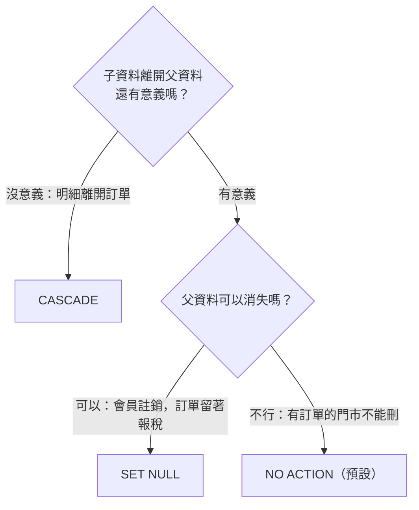

# 進階-9｜ON DELETE：刪資料前先看連帶後果

> 💻 DBeaver（資料庫：`cafe_shop`）｜ 📄 練習腳本：[`15on_delete_action.sql`](./15on_delete_action.sql) ｜ 🎯 學完你會：查出現有的刪除規則、預測刪除後果、事後修改規則

> 📖 三種規則的基本說明，請見 [DML-4 外來鍵](./7_0FOREIGN_KEY.md)。本課看它們在真實資料庫上的作用。

## 🎬 情境

有人問：「訂單 1 打錯了，可以刪嗎？刪了明細會怎樣？」

別猜，資料庫裡查得到答案。

## 1. 查出這個資料庫的所有規則

```sql
SELECT
    conrelid::regclass  AS 子表,
    confrelid::regclass AS 父表,
    CASE confdeltype
        WHEN 'a' THEN 'NO ACTION（不准刪）'
        WHEN 'r' THEN 'RESTRICT（不准刪）'
        WHEN 'c' THEN 'CASCADE（一起刪）'
        WHEN 'n' THEN 'SET NULL（變空值）'
        WHEN 'd' THEN 'SET DEFAULT（變預設值）'
    END AS 父資料被刪時
FROM pg_constraint
WHERE contype = 'f'
ORDER BY conrelid::regclass::TEXT, confrelid::regclass::TEXT;
```

**執行結果**

| 子表 | 父表 | 父資料被刪時 |
|---|---|---|
| order_items | orders | CASCADE（一起刪） |
| order_items | products | NO ACTION（不准刪） |
| orders | customers | NO ACTION（不准刪） |
| orders | staff | NO ACTION（不准刪） |
| orders | stores | NO ACTION（不准刪） |
| products | categories | NO ACTION（不准刪） |
| staff | stores | NO ACTION（不准刪） |

**只有 `order_items` 會跟著 `orders` 一起刪**，其他都受保護。這段語法不用背，需要時回來複製即可。

DBeaver 也看得到：雙擊資料表 → **Properties** → **Foreign Keys**。

## 2. 實測 CASCADE：刪訂單，明細跟著走

用交易做實驗，看完就退回，不會真的刪掉：

```sql
BEGIN;
```

```sql
SELECT COUNT(*) AS 刪除前的明細 FROM order_items WHERE order_id = 1;
```

**執行結果**

| 刪除前的明細 |
|---:|
| 2 |

```sql
DELETE FROM orders WHERE order_id = 1;

SELECT COUNT(*) AS 刪除後的明細 FROM order_items WHERE order_id = 1;
```

**執行結果**

| 刪除後的明細 |
|---:|
| 0 |

```sql
ROLLBACK;
```

## 3. 實測 NO ACTION：刪商品被擋

```sql
DELETE FROM products WHERE product_id = 1;
```

> 🛑 **資料庫回應**：`update or delete on table "products" violates foreign key constraint "order_items_product_id_fkey" on table "order_items"`

賣過的商品不能直接刪，否則舊訂單就不知道賣了什麼。

**那商品下架怎麼辦？** 實務上不刪除，而是加一欄標記，這叫**軟刪除**：

```sql
ALTER TABLE products ADD COLUMN is_active BOOLEAN NOT NULL DEFAULT true;

UPDATE products SET is_active = false WHERE product_id = 1;

SELECT COUNT(*) AS 販售中商品 FROM products WHERE is_active;
```

**執行結果**

| 販售中商品 |
|---:|
| 17 |

## 4. 實測 SET NULL：會員註銷，訂單留著

`cafe_shop` 沒有設定這個規則，我們來改。外來鍵的規則不能直接修改，要**先刪再建**：

```sql
BEGIN;

ALTER TABLE orders DROP CONSTRAINT orders_customer_id_fkey;

ALTER TABLE orders
    ADD CONSTRAINT orders_customer_id_fkey
    FOREIGN KEY (customer_id) REFERENCES customers(customer_id)
    ON DELETE SET NULL;

SELECT COUNT(*) AS 刪除前散客單 FROM orders WHERE customer_id IS NULL;
```

**執行結果**

| 刪除前散客單 |
|---:|
| 154 |

```sql
DELETE FROM customers WHERE customer_id = 1;

SELECT COUNT(*) AS 刪除後散客單 FROM orders WHERE customer_id IS NULL;
```

**執行結果**

| 刪除後散客單 |
|---:|
| 164 |

```sql
ROLLBACK;
```

多出來的散客單，就是原本那位會員的訂單。金額還在，帳不會錯，也符合個資刪除的需求。

## 5. 怎麼選？



## ⚠️ 常見卡關

| 問題 | 原因 | 怎麼解 |
|---|---|---|
| `violates foreign key constraint` | 規則是不准刪 | 先處理子資料，或考慮軟刪除 |
| 設 `SET NULL` 時報 `not-null` 錯 | 外來鍵欄位是 `NOT NULL` | 先拿掉 `NOT NULL` |
| 不小心連帶刪了很多資料 | 有 `CASCADE` | 趕快 `ROLLBACK`；沒開交易就要靠備份 |

## ✍️ 動手練

**第 1 題**：預測 `DELETE FROM stores WHERE store_id = 1;` 的結果，再實際跑一次。

<details>
<summary>看答案</summary>

```sql
DELETE FROM stores WHERE store_id = 1;
```

> 🛑 **資料庫回應**：`update or delete on table "stores" violates foreign key constraint "staff_store_id_fkey" on table "staff"`

會失敗，因為 `staff` 和 `orders` 都參考這家門市。

</details>

**第 2 題**：`customers` 的 `orders` 外來鍵目前是什麼規則？如果要刪除會員，你會改成什麼？

<details>
<summary>看答案</summary>

目前是 `NO ACTION`。若公司要讓會員行使刪除權，改成 `SET NULL` 最合理：保留訂單金額報稅，去掉個人關聯。

</details>

## 🤖 問 AI 助教

> 請用 MCP 列出資料庫所有外來鍵的 ON DELETE 規則，用表格整理，再幫我評估哪些不合理。只要分析和 SQL 建議，修改由我自己執行。

## ✅ 過關檢查

- [ ] 我會查資料庫現有的刪除規則
- [ ] 我知道用 `BEGIN` 和 `ROLLBACK` 安全地做實驗
- [ ] 我能解釋軟刪除是什麼

---

| 上一步 | 目錄 | 下一步 |
|:---|:---:|---:|
| [⬅️ 進階-8 子查詢](./14子查詢.md) | [🏠 第 4 章目錄](./README.md) | [進階-10 AI 助教 ➡️](./關聯資料庫實作_用Prompt操作.md) |
