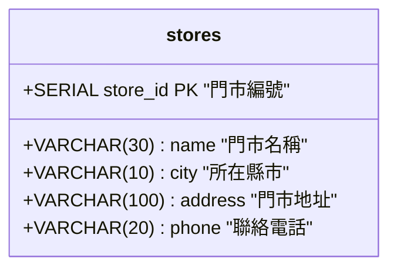

# 單元 3：建立與修改資料表 (CREATE & ALTER TABLE)

資料表（Table）是關聯式資料庫中儲存資料的基本單元。  
在本單元中，我們將以連鎖咖啡門市的**「門市資料表 (`stores`)」**為貫穿範例，學習如何定義欄位、設定主鍵、以及事後修改結構！

---

## 1. 建立資料表 (CREATE TABLE)

### 語法結構

```sql
CREATE TABLE [IF NOT EXISTS] 表格名稱 (
    欄位名稱1 資料型別 [欄位限制條件],
    欄位名稱2 資料型別 [欄位限制條件],
    ...
    [表格層級限制條件]
);
```

### ☕ 連鎖門市實戰：建立 `stores` 門市表

```sql
CREATE TABLE IF NOT EXISTS stores (
    store_id SERIAL PRIMARY KEY,     -- 門市流水號主鍵
    name VARCHAR(30) NOT NULL,       -- 門市名稱（如：台北忠孝店）
    city VARCHAR(10) NOT NULL,       -- 所在縣市（如：台北市）
    address VARCHAR(100),            -- 詳細門市地址
    phone VARCHAR(20)                -- 門市聯絡電話
);
```



---

## 2. 檢查資料表結構

在 DBeaver 中，你可以在左側導覽列展開資料表，切換到 **Properties** 分頁檢視欄位型別；  
若在命令列或 SQL 編輯器中，可執行：

```sql
SELECT column_name, data_type, character_maximum_length, is_nullable
FROM information_schema.columns
WHERE table_name = 'stores';
```

---

## 3. 修改資料表結構 (ALTER TABLE)

在企業營運過程中，業務需求經常會擴充（例如：門市開始提供內用座位、或需要記錄營業時間）。

### (1) 新增欄位 (ADD COLUMN)
為門市表新增「內用座位數 (`seating_capacity`)」欄位：
```sql
ALTER TABLE stores ADD COLUMN seating_capacity INT DEFAULT 0;
```

### (2) 刪除欄位 (DROP COLUMN)
若後來決定不記錄座位數，可直接刪除該欄位：
```sql
ALTER TABLE stores DROP COLUMN IF EXISTS seating_capacity;
```

---

## 4. 刪除資料表 (DROP TABLE)

```sql
DROP TABLE IF EXISTS stores;
```

> [!NOTE] 建立主鍵的兩種寫法
> 1. **欄位層級 (Column Level)**：如上例 `store_id SERIAL PRIMARY KEY`，簡潔直觀。
> 2. **表格層級 (Table Level)**：適合複合主鍵（由兩個以上欄位組成）時使用：
>    ```sql
>    CREATE TABLE stores (
>        store_id SERIAL,
>        name VARCHAR(30) NOT NULL,
>        PRIMARY KEY (store_id)
>    );
>    ```

---

## 🤖 助教提示詞：運用 MCP 產生建議 SQL（學生手動執行）

> 💡 **學習規範**：  
> 請直接在對話框中發問。AI 會透過 MCP 檢查資料表結構，並為你產生**建議的測試 SQL 語法**；請將語法**複製到 DBeaver 手動執行**！

### 練習 1：請 AI 依據門市業務需求產生擴充欄位的 SQL
> **Prompt 範例**：  
> 「在目前的 `stores` 門市表中，如果我們需要記錄『門市開店時間 (open_time)』與『是否有 Wi-Fi (has_wifi)』兩個新欄位，請透過 MCP 檢查現有結構後，給我建議的 `ALTER TABLE` 語法，我會在 DBeaver 中手動執行。」

### 練習 2：請 AI 示範如果刪除不存在的欄位該如何防呆
> **Prompt 範例**：  
> 「請給我一段安全刪除欄位的 SQL 範例，說明加上 `IF EXISTS` 的好處，並由我在 DBeaver 測試執行。」

---

## 🧭 課程導覽

| ⬅️ 上一單元 | 🏠 返回目錄 | ➡️ 下一單元 |
|:---|:---:|---:|
| [單元 2：資料表與基本型別](./2_0基本型別.md) | [第 4 章：SQL 語法與實戰練功](../README.md#ddl資料定義語言) | [單元 4：匯入 CSV](./2_1匯入csv.md) |
