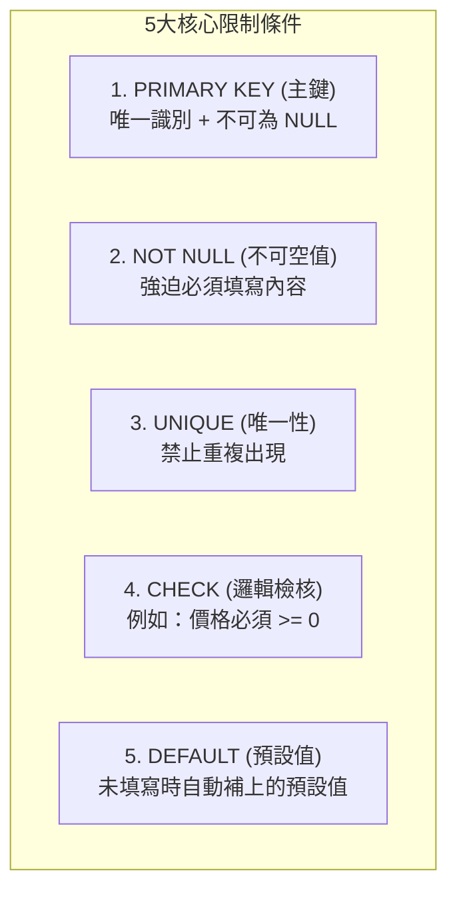

# 單元 6：限制條件 (Constraints)

限制條件（Constraints）是關聯式資料庫的「安全守衛」，用來確保資料庫內永遠不會出現「髒資料」或「邏輯矛盾的資料」。  
本單元以連鎖門市的**「商品資料表 (`products`)」**為例，學習 5 大核心限制！



---

## 1. 完整示範：包含 5 大限制條件的商品表

```sql
CREATE TABLE IF NOT EXISTS sample_products (
    product_id SERIAL PRIMARY KEY,                        -- 1. 主鍵 (PRIMARY KEY)
    name VARCHAR(50) NOT NULL UNIQUE,                     -- 2. 必填 (NOT NULL) 且 品名不可重複 (UNIQUE)
    price NUMERIC(10, 2) NOT NULL CHECK (price >= 0),     -- 4. 檢核條件 (CHECK)：單價不可為負數
    cost NUMERIC(10, 2) CHECK (cost >= 0),                -- 成本亦不可為負數
    is_active BOOLEAN NOT NULL DEFAULT true,              -- 5. 預設值 (DEFAULT)：預設為供應中
    created_at TIMESTAMPTZ DEFAULT CURRENT_TIMESTAMP      -- 預設填入當前建立時間
);
```

---

## 2. 限制條件防呆實測 (體驗資料庫的安全保護)

### 🚨 測試 1：NOT NULL 違規（品名未填寫）
```sql
INSERT INTO sample_products (price) VALUES (85);

-- 🛑 報錯：
-- ERROR: null value in column "name" of relation "sample_products" violates not-null constraint
```

### 🚨 測試 2：CHECK 違規（單價填入負數）
若前台店員手誤輸入 -50 元：
```sql
INSERT INTO sample_products (name, price) VALUES ('特價美式', -50);

-- 🛑 報錯：
-- ERROR: new row for relation "sample_products" violates check constraint "sample_products_price_check"
```

### 🚨 測試 3：UNIQUE 違規（重複的商品品名）
```sql
INSERT INTO sample_products (name, price) VALUES ('經典拿鐵', 120);
-- 再次新增相同品名：
INSERT INTO sample_products (name, price) VALUES ('經典拿鐵', 130);

-- 🛑 報錯：
-- ERROR: duplicate key value violates unique constraint "sample_products_name_key"
```

---

## 3. 在既有資料表追加入限制條件 (ALTER TABLE ADD CONSTRAINT)

若資料表已經建立，事後想補充防呆檢核：

```sql
-- 確保售價一定要高於成本 (避免虧本賣)
ALTER TABLE sample_products 
ADD CONSTRAINT check_price_gt_cost CHECK (price >= cost);
```

---

## 🤖 助教提示詞：運用 MCP 產生建議 SQL（學生手動執行）

> 💡 **學習規範**：  
> 請直接在對話框中發問。AI 會透過 MCP 檢查資料表的約束限制，並為你產生**建議的測試 SQL 語法**；請將語法**複製到 DBeaver 手動執行**！

### 練習 1：請 AI 檢查真實 `products` 資料表有哪些約束
> **Prompt 範例**：  
> 「請透過 MCP 檢查我們現有的 `products` 資料表定義了哪些 CHECK 或 NOT NULL 限制？並給我一個能故意觸發 CHECK 錯誤的測試 INSERT SQL，我會在 DBeaver 中親自驗證防呆機制。」

### 練習 2：請 AI 為會員表產生檢查電話號碼格式的 CHECK 限制
> **Prompt 範例**：  
> 「我們想限制 `customers` 會員表的電話長度必須至少 10 碼（如 09 開頭）。請給我建議的 `ALTER TABLE ADD CONSTRAINT` 語法，由我手動在 DBeaver 執行測試。」

---

## 🧭 課程導覽

| ⬅️ 上一單元 | 🏠 返回目錄 | ➡️ 下一單元 |
|:---|:---:|---:|
| [單元 5：新增資料](./3新增資料.md) | [第 4 章：SQL 語法與實戰練功](../README.md#ddl資料定義語言) | [單元 7：修改和刪除](./5修改和刪除.md) |
