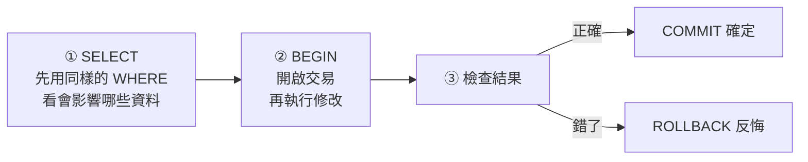

# DML-3｜修改與刪除：UPDATE、DELETE，以及保命的交易

> 💻 DBeaver（資料庫：`cafe_shop`）｜ 🎯 學完你會：安全地改資料、刪資料，做錯了能反悔

## 🎬 情境

王經理：「美式咖啡調漲成 75 元。另外，茶飲全部漲 5 元。」

簡單的工作，但也是職場最常出事的地方。先看規則：

> [!CAUTION]
> **`UPDATE` 和 `DELETE` 一定要寫 `WHERE`。**
> `UPDATE products SET price = 50;` 少了 `WHERE`，全部商品都會變 50 元。資料庫不會提醒你。

## 1. 修改：UPDATE

```sql
UPDATE 資料表
SET 欄位 = 新值, 欄位 = 新值
WHERE 條件;
```

```sql
UPDATE products
SET price = 75
WHERE name = '美式咖啡'
RETURNING product_id, name, price;
```

**執行結果**

| product_id | name | price |
|---:|---|---:|
| 1 | 美式咖啡 | 75 |

`RETURNING` 讓你立刻看到改了哪一筆。

**用舊值計算新值**，茶飲（分類 2）全部漲 5 元：

```sql
UPDATE products
SET price = price + 5
WHERE category_id = 2
RETURNING name, price;
```

**執行結果**

| name | price |
|---|---:|
| 蜜香紅茶 | 55 |
| 翡翠檸檬綠 | 65 |
| 珍珠醇奶茶 | 70 |
| 靜岡抹茶歐蕾 | 115 |
| 紅玉白桃烏龍 | 80 |

## 2. 刪除：DELETE

```sql
DELETE FROM 資料表
WHERE 條件;
```

先新增一個準備下架的商品來練習：

```sql
INSERT INTO products (category_id, name, price, cost, launched_on)
VALUES (1, '過季草莓拿鐵', 130, 50, '2024-01-01');

DELETE FROM products
WHERE name = '過季草莓拿鐵'
RETURNING product_id, name;
```

**執行結果**

| product_id | name |
|---:|---|
| 19 | 過季草莓拿鐵 |

## 3. 保命三步驟

寫了十年的工程師也是這樣做：



**交易（Transaction）** 就像 Word 的「復原」：`BEGIN` 開始後，所有變更都還沒定案，直到 `COMMIT` 才算數；`ROLLBACK` 則全部退回。

來試試最恐怖的情況，**故意忘記寫 WHERE**：

第 1 步，開啟交易：

```sql
BEGIN;
```

第 2 步，手滑把所有商品改成 1 元：

```sql
UPDATE products SET price = 1;
```

第 3 步，看看災情：

```sql
SELECT name, price FROM products ORDER BY product_id LIMIT 3;
```

**執行結果**

| name | price |
|---|---:|
| 美式咖啡 | 1 |
| 經典拿鐵 | 1 |
| 焦糖瑪奇朵 | 1 |

第 4 步，反悔：

```sql
ROLLBACK;
```

第 5 步，確認恢復了：

```sql
SELECT name, price FROM products ORDER BY product_id LIMIT 3;
```

**執行結果**

| name | price |
|---|---:|
| 美式咖啡 | 75 |
| 經典拿鐵 | 95 |
| 焦糖瑪奇朵 | 120 |

價格都回來了！如果第 4 步確認無誤，就改用 `COMMIT;` 定案。

> [!IMPORTANT]
> 請**一句一句**執行（`Ctrl/Cmd + Enter`）。`BEGIN` 之後一定要以 `COMMIT` 或 `ROLLBACK` 結束，否則變更不會生效，還可能卡住其他人的查詢。

## 4. 有些資料刪不掉，這是好事

試著刪除一家還有訂單的門市：

```sql
DELETE FROM stores WHERE store_id = 1;
```

> 🛑 **資料庫回應**：`update or delete on table "stores" violates foreign key constraint "staff_store_id_fkey" on table "staff"`

這是**外來鍵**在保護你，下一課就會學到。

## 5. DELETE、TRUNCATE、DROP 比一比

| 指令 | 刪掉什麼 | 表還在嗎 | 可以加 WHERE | 類別 |
|---|---|---|---|---|
| `DELETE FROM t WHERE ...` | 符合條件的資料 | ✅ | ✅ | DML |
| `TRUNCATE TABLE t` | 全部資料 | ✅ | ❌ | DDL |
| `DROP TABLE t` | 資料和結構 | ❌ | ❌ | DDL |

## ⚠️ 常見卡關

| 問題 | 原因 | 怎麼解 |
|---|---|---|
| `UPDATE 18`，但你只想改 1 筆 | 忘了 `WHERE` | 趕快 `ROLLBACK`；沒開交易就重新匯入 |
| `UPDATE 0` | `WHERE` 沒有符合的資料 | 先用 `SELECT` 確認條件 |
| `violates foreign key constraint` | 有其他表參考這筆資料 | 先處理子表資料，見下一課 |
| `current transaction is aborted` | 交易中有一句出錯 | 執行 `ROLLBACK;` 再重來 |

> [!TIP]
> 練習把資料改亂了？重新執行 [`cafe_shop.sql`](../範例資料庫/中文範例資料庫/cafe_shop.sql) 就恢復原狀。

## ✍️ 動手練

**第 1 題**：用保命三步驟，把「蜜香紅茶」改為 55 元。先用 `SELECT` 確認、開交易、修改、檢查，再決定 `COMMIT`。

<details>
<summary>看答案</summary>

```sql
SELECT name, price FROM products WHERE name = '蜜香紅茶';
BEGIN;
UPDATE products SET price = 55 WHERE name = '蜜香紅茶';
SELECT name, price FROM products WHERE name = '蜜香紅茶';
COMMIT;
```

實際操作時請一句一句執行，檢查過再 `COMMIT`。

</details>

**第 2 題**：售價超過 130 元的商品要打 9 折（四捨五入到整數）。寫出 `UPDATE`，在交易裡試，最後 `ROLLBACK`。

<details>
<summary>看答案</summary>

```sql
BEGIN;
UPDATE products
SET price = ROUND(price * 0.9)
WHERE price > 130
RETURNING name, price;
ROLLBACK;
```

</details>

**第 3 題**：想一想，下面這句的 `WHERE` 有什麼問題？

```sql
DELETE FROM orders WHERE status = '已完成' OR order_date < '2024-02-01' AND store_id = 1;
```

<details>
<summary>看答案</summary>

`AND` 優先於 `OR`，所以它等於 `status = '已完成' OR (order_date < '2024-02-01' AND store_id = 1)`，會把**所有已完成的訂單**都刪掉。這類條件要加括號寫清楚，並先用 `SELECT` 看看會影響幾筆。

</details>

## 🤖 問 AI 助教

> 我要把所有「已退款」訂單裡某一家門市的資料刪除。請先給我用來確認影響範圍的 SELECT，再給我包在 BEGIN 和 ROLLBACK 裡的 DELETE，我會自己在 DBeaver 一句一句執行。

**看 AI 給的 SQL 時，第一眼先檢查有沒有 `WHERE`。** AI 也會犯錯，按下執行的人是你。

## ✅ 過關檢查

- [ ] 我親手做過「忘記 WHERE 然後 ROLLBACK」的演練
- [ ] 我能說出保命三步驟
- [ ] 我分得清楚 `DELETE`、`TRUNCATE`、`DROP`

---

| 上一步 | 目錄 | 下一步 |
|:---|:---:|---:|
| [⬅️ DML-2 查詢資料](./6取得資料.md) | [🏠 第 4 章目錄](./README.md) | [DML-4 外來鍵 ➡️](./7_0FOREIGN_KEY.md) |
