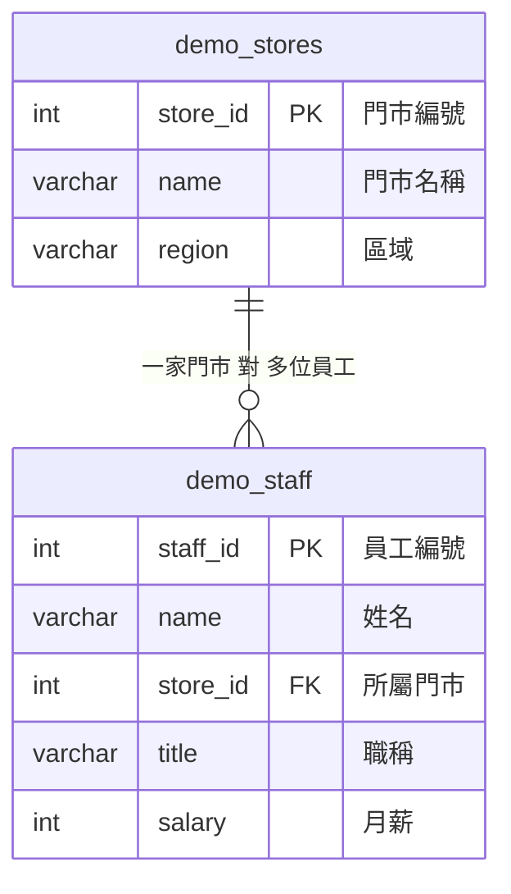

# 入門｜一對多關聯：最常見的兩表關係

> 💻 DBeaver（資料庫：`cafe_db`）｜ 🎯 學完你會：把一張 Excel 拆成兩張表，再用 JOIN 接回來

> 📖 還沒看過為什麼要拆表？先讀 [從 Excel 到關聯式資料庫](../範例資料庫/從Excel到關聯資料庫_正規化.md)。

## 🎬 情境

人事 Excel 長這樣：

| 員工 | 職稱 | 月薪 | 門市名稱 | 門市區域 |
|---|---|---:|---|---|
| 張志明 | 店長 | 52000 | 台北信義店 | 北部 |
| 陳美玲 | 正職咖啡師 | 38000 | 台北信義店 | 北部 |
| 許淑芬 | 店長 | 51000 | 台中逢甲店 | 中部 |

「台北信義店、北部」重複填了好幾次。門市要改名時，就得改很多列，漏改一列資料就矛盾了。

**解法：門市資訊只記一次，員工只記門市編號。**



一條線的那端是「一」，分岔的那端是「多」：**一家門市有多位員工，一位員工只屬於一家門市。**

## 1. 建表：先父後子

```sql
CREATE TABLE demo_stores (
    store_id SERIAL PRIMARY KEY,
    name     VARCHAR(30) NOT NULL,
    region   VARCHAR(10) NOT NULL
);

CREATE TABLE demo_staff (
    staff_id SERIAL PRIMARY KEY,
    name     VARCHAR(20) NOT NULL,
    store_id INT NOT NULL REFERENCES demo_stores(store_id),
    title    VARCHAR(20) NOT NULL,
    salary   INT NOT NULL CHECK (salary >= 0)
);
```

## 2. 寫入：也是先父後子

```sql
INSERT INTO demo_stores (name, region) VALUES
    ('台北信義店', '北部'),
    ('台中逢甲店', '中部'),
    ('高雄巨蛋店', '南部');

INSERT INTO demo_staff (name, store_id, title, salary) VALUES
    ('張志明', 1, '店長',       52000),
    ('陳美玲', 1, '正職咖啡師', 38000),
    ('許淑芬', 2, '店長',       51000),
    ('謝佩珊', 2, '工讀生',     26000),
    ('郭俊宏', 3, '店長',       53000);
```

## 3. 查詢：用 JOIN 還原成報表

資料分開存，要看的時候再接起來：

```sql
SELECT
    s.name   AS 門市,
    s.region AS 區域,
    e.name   AS 員工,
    e.title  AS 職稱,
    e.salary AS 月薪
FROM demo_staff e
JOIN demo_stores s ON e.store_id = s.store_id
ORDER BY s.store_id, e.salary DESC;
```

**執行結果**

| 門市 | 區域 | 員工 | 職稱 | 月薪 |
|---|---|---|---|---:|
| 台北信義店 | 北部 | 張志明 | 店長 | 52000 |
| 台北信義店 | 北部 | 陳美玲 | 正職咖啡師 | 38000 |
| 台中逢甲店 | 中部 | 許淑芬 | 店長 | 51000 |
| 台中逢甲店 | 中部 | 謝佩珊 | 工讀生 | 26000 |
| 高雄巨蛋店 | 南部 | 郭俊宏 | 店長 | 53000 |

## 4. 感受一下拆表的好處

門市改名，**只要改一格**，所有員工的報表都跟著變：

```sql
UPDATE demo_stores SET name = '台北信義旗艦店' WHERE store_id = 1;

SELECT e.name AS 員工, s.name AS 門市
FROM demo_staff e
JOIN demo_stores s ON e.store_id = s.store_id
WHERE s.store_id = 1;
```

**執行結果**

| 員工 | 門市 |
|---|---|
| 張志明 | 台北信義旗艦店 |
| 陳美玲 | 台北信義旗艦店 |

在 Excel 裡，同樣的事要搜尋取代，還可能漏改。

## ⚠️ 常見卡關

| 問題 | 原因 | 怎麼解 |
|---|---|---|
| `violates foreign key constraint` | 員工指定了不存在的門市 | 先建立門市，或修正編號 |
| 建表時 `relation "demo_stores" does not exist` | 先建了子表 | 先建 `demo_stores` |
| 外來鍵該放哪一邊？ | 判斷口訣 | **放在「多」的那一邊**：員工表記門市，不是門市表記員工 |

## ✍️ 動手練

**第 1 題**：查出「台中逢甲店」所有員工的姓名和月薪。

<details>
<summary>看答案</summary>

```sql
SELECT e.name, e.salary
FROM demo_staff e
JOIN demo_stores s ON e.store_id = s.store_id
WHERE s.name = '台中逢甲店';
```

**執行結果**

| name | salary |
|---|---:|
| 許淑芬 | 51000 |
| 謝佩珊 | 26000 |

</details>

**第 2 題**：試試把員工加到門市 99，看看資料庫怎麼回應。

<details>
<summary>看答案</summary>

```sql
INSERT INTO demo_staff (name, store_id, title, salary)
VALUES ('幽靈員工', 99, '工讀生', 26000);
```

> 🛑 **資料庫回應**：`insert or update on table "demo_staff" violates foreign key constraint "demo_staff_store_id_fkey"`

</details>

**第 3 題**：想一想，「學生」和「課程」是一對多嗎？

<details>
<summary>看答案</summary>

不是。一位學生修多門課，一門課也有多位學生，這是**多對多**。多對多要多開一張中間表（選課表），[下一課](./7創建關聯資料庫.md)的訂單明細就是這個做法。

</details>

## 🤖 問 AI 助教

> 我的 Excel 欄位有：訂單編號、日期、客戶名稱、客戶電話、客戶地址、金額。請幫我判斷該拆成哪兩張表，外來鍵放在哪一邊，為什麼？請給我 SQL，我會自己執行。

## ✅ 過關檢查

- [ ] 我知道外來鍵要放在「多」的那一邊
- [ ] 我親手建過父子表並用 JOIN 接回來
- [ ] 我能舉出工作中一組一對多關係

## 🚀 接著做實戰專案

一對多學完了，可以試著自己拆一張真實的 Excel。

👉 **[實戰專案 3：打卡表](../app_projects/excel3_attendance/README.md)**：把一張打卡總表拆成員工和打卡兩張表，再用 JOIN 完成五則工作需求。

---

| 上一步 | 目錄 | 下一步 |
|:---|:---:|---:|
| [⬅️ 觀念：Excel 到正規化](./../範例資料庫/從Excel到關聯資料庫_正規化.md) | [🏠 第 4 章目錄](./README.md) | [進階-1 建立七張表 ➡️](./7創建關聯資料庫.md) |
