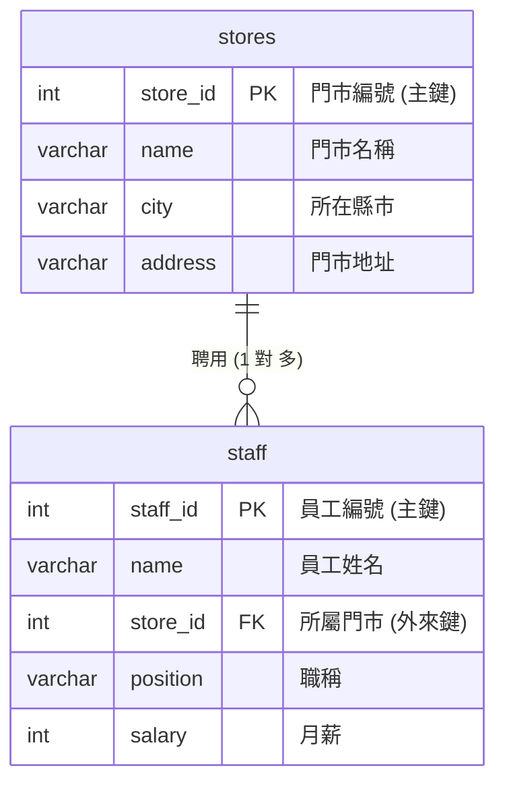

# 單元 9.1：適合初學者的關聯資料庫入門 (一對多關聯)

在 Excel 裡，當你想知道「哪位員工隸屬於哪家門市」時，通常會在同一個工作表裡填寫門市名稱與地址。  
但在資料庫正規化設計中，我們會將它們拆解為**「門市表 (`stores`)」**與**「員工表 (`staff`)」**兩張表，並透過**外來鍵 (Foreign Key)** 建立連結！



---

## 1. 建立兩張關聯資料表 (DDL)

> [!IMPORTANT] 建立順序守則
> 必須**「先建立被參考的父表 (`stores`)，再建立帶有外來鍵的子表 (`staff`)」**！

```sql
-- 1. 父表：連鎖門市主表
CREATE TABLE IF NOT EXISTS demo_stores (
    store_id SERIAL PRIMARY KEY,
    name VARCHAR(30) NOT NULL,
    city VARCHAR(10) NOT NULL
);

-- 2. 子表：門市員工表 (包含外來鍵 REFERENCES)
CREATE TABLE IF NOT EXISTS demo_staff (
    staff_id SERIAL PRIMARY KEY,
    name VARCHAR(20) NOT NULL,
    store_id INT NOT NULL REFERENCES demo_stores(store_id) ON DELETE CASCADE,
    position VARCHAR(20) NOT NULL,
    salary INT NOT NULL CHECK (salary >= 0)
);
```

---

## 2. 寫入關聯資料 (DML)

先建立門市，再指派員工至該門市：

```sql
-- 寫入門市資料
INSERT INTO demo_stores (store_id, name, city) VALUES
(1, '台北忠孝店', '台北市'),
(2, '台中勤美店', '台中市'),
(3, '高雄巨蛋店', '高雄市');

-- 寫入員工資料 (store_id 必須對應上面真實存在的門市)
INSERT INTO demo_staff (name, store_id, position, salary) VALUES
('陳小華', 1, '店長', 45000),
('林志明', 1, '咖啡師', 36000),
('黃雅婷', 2, '店長', 46000),
('張大同', 2, '工讀生', 22000),
('周美玲', 3, '店長', 44000);
```

---

## 3. 透過 JOIN 跨表還原完整報表

雖然資料在資料庫中分開儲存，但我們可以用一條 `JOIN` 指令將它們合併輸出，效果比 Excel 的 `VLOOKUP` 快上千倍：

```sql
SELECT 
    s.name AS 門市名稱,
    s.city AS 所在城市,
    e.name AS 員工姓名,
    e.position AS 職稱,
    e.salary AS 月薪
FROM demo_staff e
JOIN demo_stores s ON e.store_id = s.store_id
ORDER BY s.store_id, e.salary DESC;
```

**查詢結果**：
| 門市名稱 | 所在城市 | 員工姓名 | 職稱 | 月薪 |
|---|---|---|---|:---:|
| 台北忠孝店 | 台北市 | 陳小華 | 店長 | 45000 |
| 台北忠孝店 | 台北市 | 林志明 | 咖啡師 | 36000 |
| 台中勤美店 | 台中市 | 黃雅婷 | 店長 | 46000 |
| 台中勤美店 | 台中市 | 張大同 | 工讀生 | 22000 |
| 高雄巨蛋店 | 高雄市 | 周美玲 | 店長 | 44000 |

---

## 🤖 助教提示詞：運用 MCP 產生建議 SQL（學生手動執行）

> 💡 **學習規範**：  
> 請直接在對話框中發問。AI 會透過 MCP 檢查資料表結構，並為你產生**建議的測試 SQL 語法**；請將語法**複製到 DBeaver 手動執行**！

### 練習 1：請 AI 產生查詢特定門市員工清單的 JOIN 語法
> **Prompt 範例**：  
> 「在目前的 `stores` 與 `staff` 資料表中，請透過 MCP 檢查外來鍵關聯，並給我一段查詢『台北忠孝店』所有在職員工與月薪的 SQL，我會在 DBeaver 中手動執行。」

### 練習 2：驗證外來鍵違規防呆
> **Prompt 範例**：  
> 「如果我嘗試新增一位員工到不存在的門市（例如 `store_id = 99`），PostgreSQL 會回傳什麼錯誤？請給我測試 INSERT 語法與說明，由我親自至 DBeaver 執行體會。」

---

## 🧭 課程導覽

| ⬅️ 上一單元 | 🏠 返回目錄 | ➡️ 下一單元 |
|:---|:---:|---:|
| [單元 8：查詢資料](./6取得資料.md) | [第 4 章：SQL 語法與實戰練功](../README.md#關聯資料庫實作案例) | [單元 9.2：完整商業關聯庫實戰](./7創建關聯資料庫.md) |
