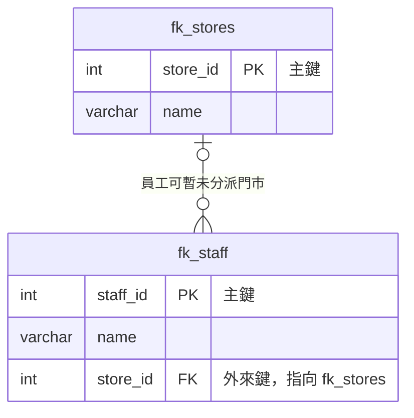

# DML-4｜外來鍵：讓資料不會變成孤兒

> 💻 DBeaver（`cafe_db`，最後會用到其他範例庫）｜ 🎯 學完你會：建立外來鍵，並依情境選對刪除規則

> 💡 從這一課開始會用到多張表。想先搞懂「為什麼要拆表」，可以先讀 [從 Excel 到關聯式資料庫](../範例資料庫/從Excel到關聯資料庫_正規化.md)，再回來。

## 📥 課前準備與範例下載

本課的 `fk_` 表是**本課專用練習表**，不在前幾課，也不在 `cafe_shop.sql` 裡。請先選一種準備方式：

| 方式 | 做法 | 適合誰 |
|---|---|---|
| 直接匯入 | 下載 [外來鍵範例資料交易檔](./範例資料/7_0_foreign_key_setup.sql)，一次建立第 1～3 節的 10 張練習表與資料 | 想先觀察外來鍵效果 |
| 親手建立 | 不匯入交易檔，依第 1～3 節的「手動建表與資料」區塊逐段建立 | 想練習建表語法 |

1. 在 DBeaver 切換到 `cafe_db`，用 `SELECT current_database();` 確認。還沒建立資料庫，先看 [建立資料庫](./1建立資料庫.md)。
2. 點上方 SQL 連結；在 GitHub 檔案頁右上角按 **Download raw file** 下載，或開啟 **Raw** 後另存成 `.sql`（UTF-8）。
3. 在 DBeaver 開啟下載檔，確認連線到 `cafe_db`，使用 **SQL Editor → Execute SQL Script** 執行整份檔案，最後重新整理資料表清單。
4. 匯入結果會列出各表筆數。**已匯入的同學略過所有「手動建表與資料」，直接執行「觀察／實測」區塊。**

> [!WARNING]
> 交易檔以 `BEGIN … COMMIT` 包住建表與寫入，整批成功才保留。重新匯入會清除並重建檔案內列出的 10 張 `fk_` 練習表，恢復起始資料；不會重建實作題的 `fk_categories`、`fk_products`。請在練習資料庫使用。
>
> 若匯入途中報錯，先執行 `ROLLBACK;`，排除原因後再執行整份交易檔；不要從失敗的位置只接著執行後半段。

**想一次觀察全部規則？** 先匯入資料，再下載 [外來鍵完整實測腳本](./範例資料/7_0_foreign_key_demo.sql)。它會顯示成功結果，並把預期錯誤轉成訊息，最後 `ROLLBACK` 還原實驗資料。腳本中的 `DO`／`EXCEPTION` 是為了整份執行不中斷，本課不用背。

> 本文的錯誤範例請**逐句執行**。建議使用自動提交（Auto-commit）；若使用手動提交，錯誤後先執行 `ROLLBACK;` 再繼續。不要把預期報錯的語句和其他操作一起包進 `BEGIN … COMMIT`，否則交易會進入失敗狀態。

## 🎬 情境

Excel 訂單表裡寫著「門市：台北忠孝店」，可是公司根本沒有這家店。是打錯字？還是倒閉了？沒人知道。

**外來鍵（Foreign Key）的工作**：訂單要填門市編號時，先去門市表核對，查無此店就不准寫入。



| 名詞 | 白話 | 例子 |
|---|---|---|
| **父表**（被參考） | 名冊本身 | 門市表 |
| **子表**（有外來鍵） | 要對照名冊的表 | 員工表 |
| **外來鍵** | 對照用的欄位，等於 Excel 的 XLOOKUP 查找值 | 員工表的 `store_id` |

## 1. 建立外來鍵

**一定要先建父表，再建子表。** 要刪除資料表時順序相反。

### 手動建表與資料（已匯入者略過）

```sql
CREATE TABLE fk_stores (
    store_id SERIAL PRIMARY KEY,
    name     VARCHAR(30) NOT NULL
);

CREATE TABLE fk_staff (
    staff_id SERIAL PRIMARY KEY,
    name     VARCHAR(20) NOT NULL,
    store_id INT REFERENCES fk_stores(store_id)  -- 這一句就是外來鍵
);

INSERT INTO fk_stores (name) VALUES ('台北信義店'), ('台中逢甲店');
INSERT INTO fk_staff (name, store_id) VALUES ('張志明', 1), ('陳美玲', 1), ('許淑芬', 2);
```

### 觀察：哪些員工參考了哪家門市？

```sql
SELECT * FROM fk_stores ORDER BY store_id;
SELECT * FROM fk_staff ORDER BY staff_id;
```

門市有 2 筆；員工有 3 筆。張志明、陳美玲的 `store_id` 是 1，許淑芬的是 2。

## 2. 它幫你擋下了什麼

**擋住「幽靈門市」**：門市 99 不存在。

```sql
INSERT INTO fk_staff (name, store_id) VALUES ('幽靈員工', 99);
```

> 🛑 **資料庫回應**：`insert or update on table "fk_staff" violates foreign key constraint "fk_staff_store_id_fkey"`

> `SERIAL` 的序號即使新增失敗或交易還原，也可能已被取用；後續編號跳號是正常現象，不代表有員工資料遺失。

**擋住「誤刪門市」**：門市 1 還有員工。

```sql
DELETE FROM fk_stores WHERE store_id = 1;
```

> 🛑 **資料庫回應**：`update or delete on table "fk_stores" violates foreign key constraint "fk_staff_store_id_fkey" on table "fk_staff"`

### 修改也會檢查：不能把員工改掛到不存在的門市

```sql
UPDATE fk_staff SET store_id = 99 WHERE staff_id = 1;
```

> 🛑 **預期結果**：同樣觸發 `fk_staff_store_id_fkey` 外來鍵錯誤，原本的門市編號仍是 1。

### 外來鍵可以是 NULL 嗎？

可以，除非欄位另有 `NOT NULL`。目前 `fk_staff.store_id` 允許空值，代表尚未分派門市：

```sql
BEGIN;
UPDATE fk_staff SET store_id = NULL WHERE staff_id = 1;
SELECT staff_id, name, store_id FROM fk_staff WHERE staff_id = 1;
ROLLBACK;
```

**預期結果**：張志明的 `store_id` 顯示 `NULL`，還原後恢復為 1。外來鍵只保證「有填編號時，編號必須存在」，不代表一定要填；必填要另外加 `NOT NULL`。

### 合法刪除：先處理子資料，再刪父資料

```sql
BEGIN;
DELETE FROM fk_staff WHERE store_id = 1;
DELETE FROM fk_stores WHERE store_id = 1;
SELECT COUNT(*) AS 門市剩餘筆數 FROM fk_stores WHERE store_id = 1;
ROLLBACK;
```

**預期結果**：筆數為 0；`ROLLBACK` 後門市 1 與兩位員工都恢復。這是刪除順序的示範，實務上仍應先確認員工應轉店或保留。

## 3. 父表資料被刪時，子表怎麼辦？

建立外來鍵時，可以用 `ON DELETE` 指定規則：

| 規則 | 父資料被刪時，子資料… | 生活比喻 | 適用情境 |
|---|---|---|---|
| `NO ACTION`（預設） | 還有子資料參考時，**不准刪** | 還有員工的店不能關 | 門市與訂單、客戶與訂單 |
| `RESTRICT` | 還有子資料參考時，不准刪 | 同上 | 同上 |
| `SET NULL` | 外來鍵變成空值，資料留著 | 部門裁撤，員工先變無部門 | 部門與員工、會員與歷史訂單 |
| `CASCADE` | **一起刪掉** | 刪除訂單，明細一起刪除 | 訂單與訂單明細 |
| `SET DEFAULT` | 外來鍵改成預設值，預設值仍須符合限制 | 改掛到預設部門 | 有「待分派」部門的情境 |

本課未設定延後檢查，所以 `NO ACTION` 與 `RESTRICT` 在這些例子都會擋下刪除。進階差異是：`NO ACTION` 配合可延後的限制時能延後檢查，`RESTRICT` 的刪除檢查不能延後。參考 [PostgreSQL 外來鍵說明](https://www.postgresql.org/docs/current/ddl-constraints.html#DDL-CONSTRAINTS-FK)。

> 只有「仍被參考」的父資料會被擋；沒有子資料參考的父資料可以刪除。以下成功的刪除實驗都用 `ROLLBACK` 還原，可重複執行。

### 實測 SET NULL：會員刪除，訂單紀錄保留

**手動建表與資料（已匯入者略過）**

```sql
CREATE TABLE fk_members (
    member_id INT PRIMARY KEY,
    name      VARCHAR(20)
);

CREATE TABLE fk_member_orders (
    order_id  INT PRIMARY KEY,
    member_id INT REFERENCES fk_members(member_id) ON DELETE SET NULL,
    amount    INT
);

INSERT INTO fk_members VALUES (1, '林家豪');
INSERT INTO fk_member_orders VALUES (888, 1, 350);
```

**實測（所有同學執行）**：先查再刪，比較刪除前後。

```sql
BEGIN;
SELECT * FROM fk_member_orders;  -- member_id 原本是 1
DELETE FROM fk_members WHERE member_id = 1;
SELECT * FROM fk_member_orders;
ROLLBACK;
```

**執行結果**

| order_id | member_id | amount |
|---:|---:|---:|
| 888 | *NULL* | 350 |

刪除後會員不見了，訂單還在，`member_id` 變成空值；`ROLLBACK` 後恢復原狀。此欄位不能加 `NOT NULL`，否則刪除時會因無法填入空值而失敗。這裡只示範解除關聯，完整的個資處理與保存政策仍需另行設計。

### 實測 CASCADE：刪除訂單，明細跟著走

**手動建表與資料（已匯入者略過）**

```sql
CREATE TABLE fk_orders (
    order_id INT PRIMARY KEY
);

CREATE TABLE fk_order_items (
    item_id   INT PRIMARY KEY,
    order_id  INT REFERENCES fk_orders(order_id) ON DELETE CASCADE,
    item_name VARCHAR(50)
);

INSERT INTO fk_orders VALUES (101);
INSERT INTO fk_order_items VALUES (1, 101, '美式咖啡'), (2, 101, '可頌');
```

**實測（所有同學執行）**

```sql
BEGIN;
SELECT COUNT(*) AS 刪除前明細筆數 FROM fk_order_items;  -- 2
DELETE FROM fk_orders WHERE order_id = 101;
SELECT COUNT(*) AS 剩餘明細筆數 FROM fk_order_items;
ROLLBACK;
```

**執行結果**

| 剩餘明細筆數 |
|---:|
| 0 |

> [!WARNING]
> `CASCADE` 很方便也很危險。誤刪一筆父資料，可能連帶刪掉上千筆子資料。**只用在「子資料離開父資料就沒有意義」的情況**。

### 實測 RESTRICT：有員工的部門不能刪

**手動建表與資料（已匯入者略過）**

```sql
CREATE TABLE fk_restrict_departments (
    dept_id INT PRIMARY KEY,
    name VARCHAR(30) NOT NULL
);
CREATE TABLE fk_restrict_staff (
    staff_id INT PRIMARY KEY,
    name VARCHAR(20) NOT NULL,
    dept_id INT REFERENCES fk_restrict_departments(dept_id) ON DELETE RESTRICT
);
INSERT INTO fk_restrict_departments VALUES (1, '業務部');
INSERT INTO fk_restrict_staff VALUES (1, '王小明', 1);
```

**實測（逐句執行）**

```sql
DELETE FROM fk_restrict_departments WHERE dept_id = 1;
```

> 🛑 **預期結果**：觸發 `fk_restrict_staff_dept_id_fkey` 外來鍵錯誤。部門與員工都保留。

### 實測 SET DEFAULT：改掛到「待分派」部門

**手動建表與資料（已匯入者略過）**

```sql
CREATE TABLE fk_default_departments (
    dept_id INT PRIMARY KEY,
    name VARCHAR(30) NOT NULL
);
CREATE TABLE fk_default_staff (
    staff_id INT PRIMARY KEY,
    name VARCHAR(20) NOT NULL,
    dept_id INT DEFAULT 0 REFERENCES fk_default_departments(dept_id) ON DELETE SET DEFAULT
);
INSERT INTO fk_default_departments VALUES (0, '待分派'), (1, '行銷部');
INSERT INTO fk_default_staff VALUES (1, '李小華', 1);
```

**實測（所有同學執行）**

```sql
BEGIN;
SELECT * FROM fk_default_staff;  -- dept_id 原本是 1
DELETE FROM fk_default_departments WHERE dept_id = 1;
SELECT * FROM fk_default_staff;
ROLLBACK;
```

**執行結果（還原之前）**

| staff_id | name | dept_id |
|---:|---|---:|
| 1 | 李小華 | 0 |

**預設值不是免檢查通行證。** 父表必須有編號 0；若只設定 `DEFAULT 0` 卻沒有「待分派」資料，刪除仍會失敗。可以用以下交易測試，錯誤後請執行最後的 `ROLLBACK`：

```sql
BEGIN;
DELETE FROM fk_default_departments WHERE dept_id = 0;  -- 此時沒人參考 0，可刪
DELETE FROM fk_default_departments WHERE dept_id = 1;  -- 預期外來鍵錯誤
```

```sql
ROLLBACK;
```

## 4. 在真實資料上驗證

這一節我們離開 `cafe_db` 的 `fk_` 練習表，改到三個真實職場範例庫來測試外來鍵。其中 `cafe_shop` 你在 [DML 導讀](./DML%28資料操作語言%29.md#️-開工前準備匯入-cafe_shop) 已經建好；另外兩個（`expense_tracker`、`assets_inventory`）是**第一次登場**，後面的 `JOIN`、聚合與子查詢課程也會繼續用到，現在一起準備好：

| 練習情境 | 資料庫名稱 | 下載 SQL 交易檔 | 狀態 |
|---|---|---|---|
| 門市訂單 | `cafe_shop` | [cafe_shop.sql](../範例資料庫/中文範例資料庫/cafe_shop.sql) | ✅ DML 導讀已匯入，直接切換即可 |
| 員工報帳（會計） | `expense_tracker` | [expense_tracker.sql](../範例資料庫/中文範例資料庫/expense_tracker.sql) | 🆕 首次使用，請依下方步驟建立並匯入 |
| 資產借用（總務） | `assets_inventory` | [assets_inventory.sql](../範例資料庫/中文範例資料庫/assets_inventory.sql) | 🆕 首次使用，請依下方步驟建立並匯入 |

### 📥 首次匯入 `expense_tracker` 與 `assets_inventory`（3 步驟）

1. **下載檔案**：點擊上表的 [expense_tracker.sql](../範例資料庫/中文範例資料庫/expense_tracker.sql) 與 [assets_inventory.sql](../範例資料庫/中文範例資料庫/assets_inventory.sql)，在 GitHub 右上角按 **Download raw file** 下載（與本課開頭下載 `7_0_foreign_key_setup.sql` 方式相同）。
2. **建立資料庫**：在 DBeaver 左側 **Databases** 按右鍵 → **Create New Database**，分別建立 `expense_tracker` 與 `assets_inventory` 兩個資料庫（或在 SQL 編輯器分別執行 `CREATE DATABASE expense_tracker;` 與 `CREATE DATABASE assets_inventory;`，再按 `F5` 重新整理）。
3. **切換並執行腳本**：
   - 在 DBeaver 開啟 `expense_tracker.sql`，確認上方工具列已切換到 **`expense_tracker`** 資料庫，按 `Alt + X`（Mac：`Opt + X`）或 **SQL Editor → Execute SQL Script** 執行整份檔案。
   - 開啟 `assets_inventory.sql`，確認上方工具列已切換到 **`assets_inventory`** 資料庫，同樣執行整份檔案。

> [!TIP]
> **不想多建兩個資料庫？** `expense_tracker.sql` 的表名都有 `expense_` 前綴（`expense_departments`、`expense_employees`、`expense_categories`、`expense_claims`），`assets_inventory.sql` 的表名都有 `asset` 前綴（`asset_categories`、`assets`、`asset_borrow_logs`、`asset_purchase_requests`），和 `cafe_db` 的表完全不會撞名！如果課堂時間有限，也可以**直接連線在 `cafe_db` 執行這兩份 `.sql` 檔**，下面的練習語句在 `cafe_db` 就能直接跑。

> 以下三個故意報錯的語句請**切換到對應資料庫後分別執行**；手動提交模式下，每次錯誤後先執行 `ROLLBACK;`。

**門市（`cafe_shop`）：不存在的門市不能開單**

```sql
INSERT INTO orders (order_date, order_time, store_id, staff_id, payment_method, status)
VALUES ('2024-03-31', '10:00', 999, 1, '現金', '已完成');
```

> 🛑 **資料庫回應**：`insert or update on table "orders" violates foreign key constraint "orders_store_id_fkey"`

**會計（`expense_tracker`）：不存在的員工不能報帳**

先確認類別 1 存在、員工 E99 不存在，並填入必填的發票號碼，才能測到外來鍵：

```sql
SELECT category_id, name FROM expense_categories WHERE category_id = 1;
SELECT emp_id FROM expense_employees WHERE emp_id = 'E99';
```

**預期結果**：類別查到 1 筆，員工查到 0 筆。

```sql
INSERT INTO expense_claims (claim_id, claim_date, emp_id, category_id, invoice_no, amount, status)
VALUES ('EXP-TEST', '2024-03-31', 'E99', 1, 'TEST-00000001', 500, '待審核');
```

> 🛑 **資料庫回應**：`insert or update on table "expense_claims" violates foreign key constraint "expense_claims_emp_id_fkey"`

**總務（`assets_inventory`）：有借用紀錄的筆電不能直接刪**

```sql
DELETE FROM assets WHERE asset_id = 'IT-NB-202401';
```

> 🛑 **資料庫回應**：`update or delete on table "assets" violates foreign key constraint "asset_borrow_logs_asset_id_fkey" on table "asset_borrow_logs"`

## ⚠️ 常見卡關

| 錯誤訊息 | 原因 | 怎麼解 |
|---|---|---|
| `insert or update ... violates foreign key` | 父表沒有這個值 | 先新增父資料，或修正編號 |
| `update or delete ... violates foreign key` | 還有子資料參考它 | 先處理子資料 |
| `relation "xxx" does not exist`（建表時） | 建表順序錯 | 先建父表 |
| `cannot drop table ... other objects depend on it` | 先刪了父表 | 先刪子表；`DROP TABLE ... CASCADE` 會連相依物件一起移除，初學時先不要用 |
| `there is no unique constraint matching given keys` | 參考的欄位不是主鍵或 UNIQUE | 外來鍵要指向主鍵或 UNIQUE 欄位 |
| `relation "fk_xxx" already exists` | 匯入後又執行手動建表 | 選一種準備方式；要重來就重新匯入交易檔 |
| `current transaction is aborted` | 交易中有語句失敗 | 先執行 `ROLLBACK;` 再繼續 |
| `SET NULL` 刪除時出現 `not-null` 錯誤 | 子表外來鍵欄位不允許空值 | 重新評估規則，或讓該欄位允許 NULL |
| `SET DEFAULT` 刪除時仍報外來鍵錯誤 | 預設編號在父表不存在 | 先建立預設的父資料 |

## ✍️ 動手練

判斷這三組關係該用哪種 `ON DELETE`？先想再看答案。

1. 部門 → 員工　2. 客戶 → 訂單　3. 報銷單 → 報銷明細

<details>
<summary>看答案</summary>

| 關係 | 建議 | 理由 |
|---|---|---|
| 部門 → 員工 | `SET NULL` | 部門裁撤了，員工還在，只是暫時沒有部門 |
| 客戶 → 訂單 | `NO ACTION` | 訂單是帳務紀錄，有訂單的客戶不該被隨便刪除 |
| 報銷單 → 報銷明細 | `CASCADE` | 明細離開報銷單就沒有意義 |

合理的答案不只一種，重點是想清楚商業後果。

</details>

**實作題**：從延伸範例庫切回 `cafe_db`。在 `cafe_db` 建立 `fk_categories`（分類）和 `fk_products`（商品），讓商品參考分類，並禁止刪除還有商品的分類。

<details>
<summary>看答案</summary>

```sql
CREATE TABLE fk_categories (
    category_id SERIAL PRIMARY KEY,
    name        VARCHAR(30) NOT NULL UNIQUE
);

CREATE TABLE fk_products (
    product_id  SERIAL PRIMARY KEY,
    name        VARCHAR(50) NOT NULL,
    category_id INT NOT NULL REFERENCES fk_categories(category_id)
);
```

不寫 `ON DELETE` 就是預設的 `NO ACTION`，會禁止刪除仍被商品參考的分類。

建表完成後，補上測試資料，實際驗證。以下交易最後會還原，可重複測試；不要重複執行上面的建表語句。

```sql
BEGIN;
INSERT INTO fk_categories (name) VALUES ('外來鍵練習分類') RETURNING category_id;
INSERT INTO fk_products (name, category_id)
SELECT '外來鍵練習商品', category_id FROM fk_categories WHERE name = '外來鍵練習分類';
SAVEPOINT before_delete;
```

單獨執行刪除，預期出現 `fk_products_category_id_fkey` 外來鍵錯誤：

```sql
DELETE FROM fk_categories WHERE name = '外來鍵練習分類';
```

錯誤後先退回儲存點，再查兩筆資料仍在，最後還原測試資料：

```sql
ROLLBACK TO SAVEPOINT before_delete;
SELECT * FROM fk_categories WHERE name = '外來鍵練習分類';
SELECT * FROM fk_products WHERE name = '外來鍵練習商品';
ROLLBACK;
```

預期兩個查詢各有 1 筆。`SAVEPOINT` 讓交易內發生預期錯誤後，仍能繼續查詢；直接整筆 `ROLLBACK` 也可以，但剛新增的測試資料就會一起消失。

</details>

## 🤖 問 AI 助教

> 在我們公司，「固定資產」和「借用紀錄」這兩張表應該用哪種 ON DELETE？請說明商業上的考量，以及選錯會發生什麼事。

---

| 上一步 | 目錄 | 下一步 |
|:---|:---:|---:|
| [⬅️ DML-3 修改與刪除](./5修改和刪除.md) | [🏠 第 4 章目錄](./README.md) | [DML-5 JOIN ➡️](./JOIN.md) |
