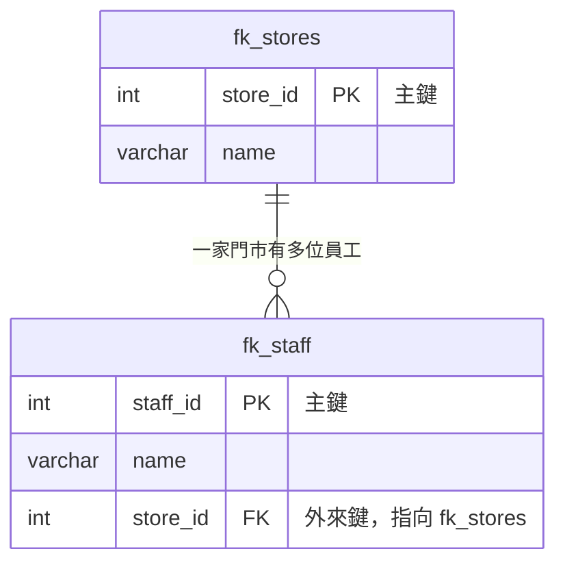

# DML-4｜外來鍵：讓資料不會變成孤兒

> 💻 DBeaver（`cafe_db`，最後會用到其他範例庫）｜ 🎯 學完你會：建立外來鍵，並依情境選對刪除規則

> 💡 從這一課開始會用到多張表。想先搞懂「為什麼要拆表」，可以先讀 [從 Excel 到關聯式資料庫](../範例資料庫/從Excel到關聯資料庫_正規化.md)，再回來。

## 🎬 情境

Excel 訂單表裡寫著「門市：台北忠孝店」，可是公司根本沒有這家店。是打錯字？還是倒閉了？沒人知道。

**外來鍵（Foreign Key）的工作**：訂單要填門市編號時，先去門市表核對，查無此店就不准寫入。



| 名詞 | 白話 | 例子 |
|---|---|---|
| **父表**（被參考） | 名冊本身 | 門市表 |
| **子表**（有外來鍵） | 要對照名冊的表 | 員工表 |
| **外來鍵** | 對照用的欄位，等於 Excel 的 VLOOKUP 查找值 | 員工表的 `store_id` |

## 1. 建立外來鍵

**一定要先建父表，再建子表。** 要刪除時順序相反。

```sql
CREATE TABLE fk_stores (
    store_id SERIAL PRIMARY KEY,
    name     VARCHAR(30) NOT NULL
);

CREATE TABLE fk_staff (
    staff_id SERIAL PRIMARY KEY,
    name     VARCHAR(20) NOT NULL,
    store_id INT REFERENCES fk_stores(store_id)  -- 這一句就是外來鍵
);

INSERT INTO fk_stores (name) VALUES ('台北信義店'), ('台中逢甲店');
INSERT INTO fk_staff (name, store_id) VALUES ('張志明', 1), ('陳美玲', 1), ('許淑芬', 2);
```

## 2. 它幫你擋下了什麼

**擋住「幽靈門市」**：門市 99 不存在。

```sql
INSERT INTO fk_staff (name, store_id) VALUES ('幽靈員工', 99);
```

> 🛑 **資料庫回應**：`insert or update on table "fk_staff" violates foreign key constraint "fk_staff_store_id_fkey"`

**擋住「誤刪門市」**：門市 1 還有員工。

```sql
DELETE FROM fk_stores WHERE store_id = 1;
```

> 🛑 **資料庫回應**：`update or delete on table "fk_stores" violates foreign key constraint "fk_staff_store_id_fkey" on table "fk_staff"`

## 3. 父表資料被刪時，子表怎麼辦？

建立外來鍵時，可以用 `ON DELETE` 指定規則：

| 規則 | 父資料被刪時，子資料… | 生活比喻 | 適用情境 |
|---|---|---|---|
| `NO ACTION`（預設） | **不准刪**，報錯 | 還有員工的店不能關 | 門市與訂單、客戶與訂單 |
| `RESTRICT` | 不准刪，幾乎同上 | 同上 | 同上 |
| `SET NULL` | 外來鍵變成空值，資料留著 | 部門裁撤，員工先變無部門 | 部門與員工、會員與歷史訂單 |
| `CASCADE` | **一起刪掉** | 訂單作廢，明細一起作廢 | 訂單與訂單明細 |
| `SET DEFAULT` | 變成預設值 | 改掛到預設部門 | 較少用 |

### 實測 SET NULL：會員註銷，訂單要留著報稅

```sql
CREATE TABLE fk_members (
    member_id INT PRIMARY KEY,
    name      VARCHAR(20)
);

CREATE TABLE fk_member_orders (
    order_id  INT PRIMARY KEY,
    member_id INT REFERENCES fk_members(member_id) ON DELETE SET NULL,
    amount    INT
);

INSERT INTO fk_members VALUES (1, '林家豪');
INSERT INTO fk_member_orders VALUES (888, 1, 350);

DELETE FROM fk_members WHERE member_id = 1;
SELECT * FROM fk_member_orders;
```

**執行結果**

| order_id | member_id | amount |
|---:|---:|---:|
| 888 | *NULL* | 350 |

會員不見了，訂單還在，`member_id` 變成空值。

### 實測 CASCADE：訂單作廢，明細跟著走

```sql
CREATE TABLE fk_orders (
    order_id INT PRIMARY KEY
);

CREATE TABLE fk_order_items (
    item_id   INT PRIMARY KEY,
    order_id  INT REFERENCES fk_orders(order_id) ON DELETE CASCADE,
    item_name VARCHAR(50)
);

INSERT INTO fk_orders VALUES (101);
INSERT INTO fk_order_items VALUES (1, 101, '美式咖啡'), (2, 101, '可頌');

DELETE FROM fk_orders WHERE order_id = 101;
SELECT COUNT(*) AS 剩餘明細筆數 FROM fk_order_items;
```

**執行結果**

| 剩餘明細筆數 |
|---:|
| 0 |

> [!WARNING]
> `CASCADE` 很方便也很危險。誤刪一筆父資料，可能連帶刪掉上千筆子資料。**只用在「子資料離開父資料就沒有意義」的情況**。

## 4. 在真實資料上驗證

先確認已匯入對應的範例庫（各自建立同名資料庫，再執行同名 `.sql` 檔）。

**門市（`cafe_shop`）：不存在的門市不能開單**

```sql
INSERT INTO orders (order_date, order_time, store_id, staff_id, payment_method, status)
VALUES ('2024-03-31', '10:00', 999, 1, '現金', '已完成');
```

> 🛑 **資料庫回應**：`insert or update on table "orders" violates foreign key constraint "orders_store_id_fkey"`

**會計（`expense_tracker`）：不存在的員工不能報帳**

```sql
INSERT INTO expense_claims (claim_id, claim_date, emp_id, category_id, amount, status)
VALUES ('EXP-TEST', '2024-03-31', 'E99', 1, 500, '待審核');
```

> 🛑 **資料庫回應**：`null value in column "invoice_no" of relation "expense_claims" violates not-null constraint`

**總務（`assets_inventory`）：有借用紀錄的筆電不能直接刪**

```sql
DELETE FROM assets WHERE asset_id = 'IT-NB-202401';
```

> 🛑 **資料庫回應**：`update or delete on table "assets" violates foreign key constraint "asset_borrow_logs_asset_id_fkey" on table "asset_borrow_logs"`

## ⚠️ 常見卡關

| 錯誤訊息 | 原因 | 怎麼解 |
|---|---|---|
| `insert or update ... violates foreign key` | 父表沒有這個值 | 先新增父資料，或修正編號 |
| `update or delete ... violates foreign key` | 還有子資料參考它 | 先處理子資料 |
| `relation "xxx" does not exist`（建表時） | 建表順序錯 | 先建父表 |
| `cannot drop table ... other objects depend on it` | 先刪了父表 | 先刪子表，或用 `DROP TABLE ... CASCADE` |
| `there is no unique constraint matching given keys` | 參考的欄位不是主鍵或 UNIQUE | 外來鍵要指向主鍵或 UNIQUE 欄位 |

## ✍️ 動手練

判斷這三組關係該用哪種 `ON DELETE`？先想再看答案。

1. 部門 → 員工　2. 客戶 → 訂單　3. 報銷單 → 報銷明細

<details>
<summary>看答案</summary>

| 關係 | 建議 | 理由 |
|---|---|---|
| 部門 → 員工 | `SET NULL` | 部門裁撤了，員工還在，只是暫時沒有部門 |
| 客戶 → 訂單 | `NO ACTION` | 訂單是帳務紀錄，有訂單的客戶不該被隨便刪除 |
| 報銷單 → 報銷明細 | `CASCADE` | 明細離開報銷單就沒有意義 |

合理的答案不只一種，重點是想清楚商業後果。

</details>

**實作題**：在 `cafe_db` 建立 `fk_categories`（分類）和 `fk_products`（商品），讓商品參考分類，並禁止刪除還有商品的分類。

<details>
<summary>看答案</summary>

```sql
CREATE TABLE fk_categories (
    category_id SERIAL PRIMARY KEY,
    name        VARCHAR(30) NOT NULL UNIQUE
);

CREATE TABLE fk_products (
    product_id  SERIAL PRIMARY KEY,
    name        VARCHAR(50) NOT NULL,
    category_id INT NOT NULL REFERENCES fk_categories(category_id)
);
```

不寫 `ON DELETE` 就是預設的 `NO ACTION`，會禁止刪除。

</details>

## 🤖 問 AI 助教

> 在我們公司，「固定資產」和「借用紀錄」這兩張表應該用哪種 ON DELETE？請說明商業上的考量，以及選錯會發生什麼事。

---

| 上一步 | 目錄 | 下一步 |
|:---|:---:|---:|
| [⬅️ DML-3 修改與刪除](./5修改和刪除.md) | [🏠 第 4 章目錄](./README.md) | [DML-5 JOIN ➡️](./JOIN.md) |
