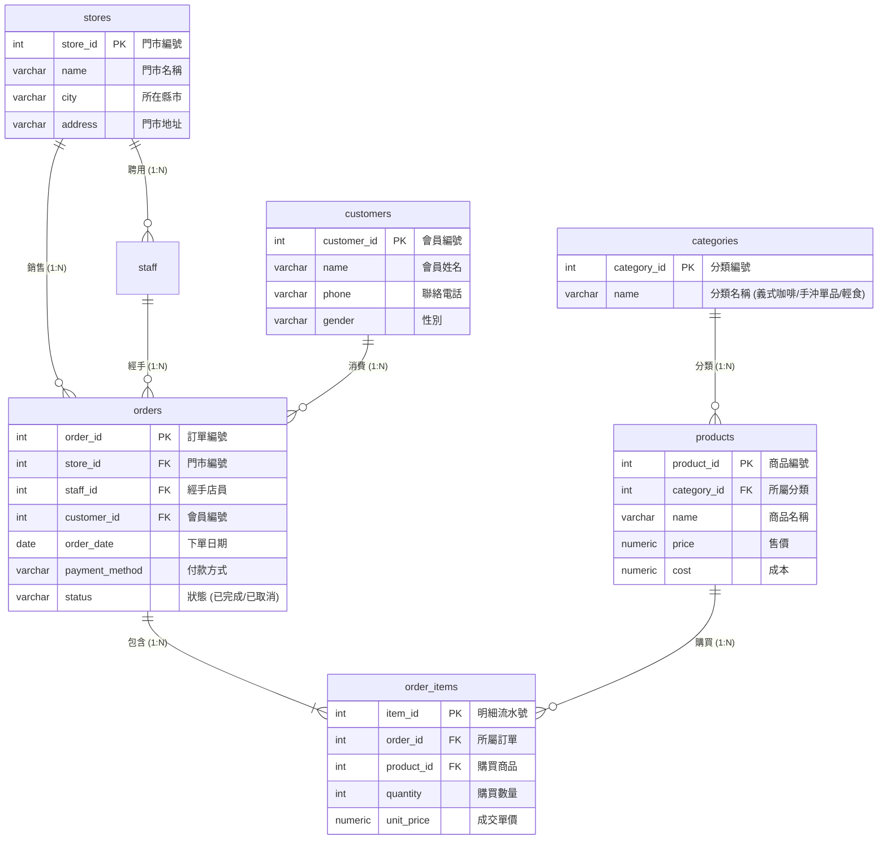

# 單元 9.2：完整商業關聯資料庫架構實戰 (cafe_shop)

當單一資料表無法滿足現代商業運作時，我們需要設計**多表關聯的資料庫架構**。  
本單元以本課程核心的**「連鎖咖啡門市營運資料庫 (`cafe_shop`)」**為例，深入拆解包含門市、商品、會員、訂單與明細的完整正規化架構！



---

## 1. 完整 DDL 建立順序與外來鍵設計

> [!IMPORTANT] 建表相依性原則
> 建立資料表時，**「必須先建立被引用的父表（獨立主檔），最後才能建立引用多個外來鍵的子表（交易紀錄表）」**！

```sql
-- 1. 刪除舊表 (若存在，先刪子表再刪父表，或使用 CASCADE)
DROP TABLE IF EXISTS order_items CASCADE;
DROP TABLE IF EXISTS orders CASCADE;
DROP TABLE IF EXISTS products CASCADE;
DROP TABLE IF EXISTS categories CASCADE;
DROP TABLE IF EXISTS customers CASCADE;
DROP TABLE IF EXISTS staff CASCADE;
DROP TABLE IF EXISTS stores CASCADE;

-- 2. 建立主檔父表：門市、分類、會員
CREATE TABLE stores (
    store_id SERIAL PRIMARY KEY,
    name VARCHAR(30) NOT NULL,
    city VARCHAR(10) NOT NULL,
    address VARCHAR(100),
    phone VARCHAR(20)
);

CREATE TABLE categories (
    category_id SERIAL PRIMARY KEY,
    name VARCHAR(30) NOT NULL UNIQUE
);

CREATE TABLE customers (
    customer_id SERIAL PRIMARY KEY,
    name VARCHAR(20) NOT NULL,
    phone VARCHAR(20) UNIQUE NOT NULL,
    gender VARCHAR(10),
    join_date DATE DEFAULT CURRENT_DATE
);

-- 3. 建立二級表：員工 (依賴 stores)、商品 (依賴 categories)
CREATE TABLE staff (
    staff_id SERIAL PRIMARY KEY,
    store_id INT NOT NULL REFERENCES stores(store_id),
    name VARCHAR(20) NOT NULL,
    position VARCHAR(20) NOT NULL,
    salary INT NOT NULL CHECK (salary >= 0)
);

CREATE TABLE products (
    product_id SERIAL PRIMARY KEY,
    category_id INT NOT NULL REFERENCES categories(category_id),
    name VARCHAR(50) NOT NULL,
    price NUMERIC(10, 2) NOT NULL CHECK (price >= 0),
    cost NUMERIC(10, 2) CHECK (cost >= 0)
);

-- 4. 建立核心交易主檔：訂單 (依賴 stores, staff, customers)
CREATE TABLE orders (
    order_id SERIAL PRIMARY KEY,
    store_id INT NOT NULL REFERENCES stores(store_id),
    staff_id INT NOT NULL REFERENCES staff(staff_id),
    customer_id INT REFERENCES customers(customer_id), -- 允許 NULL (非會員散客)
    order_date DATE NOT NULL,
    payment_method VARCHAR(20) NOT NULL,
    status VARCHAR(20) NOT NULL DEFAULT '已完成'
);

-- 5. 建立核心交易明細檔：訂單明細 (依賴 orders, products)
CREATE TABLE order_items (
    item_id SERIAL PRIMARY KEY,
    order_id INT NOT NULL REFERENCES orders(order_id) ON DELETE CASCADE,
    product_id INT NOT NULL REFERENCES products(product_id),
    quantity INT NOT NULL CHECK (quantity > 0),
    unit_price NUMERIC(10, 2) NOT NULL
);
```

---

## 2. 一鍵建庫方式

在後續的查詢練習中，你不必每次手動敲這段 DDL。  
我們已經為你準備好了包含真實 3 個月份銷售假資料的完整 `.sql` 腳本：  
👉 **[`範例資料庫/中文範例資料庫/cafe_shop.sql`](../範例資料庫/中文範例資料庫/cafe_shop.sql)**

直接在 DBeaver 或 Supabase SQL Editor 貼上執行，1 秒即可擁有這套 7 張關聯表的商業資料庫！

---

## 🤖 助教提示詞：運用 MCP 產生建議 SQL（學生手動執行）

> 💡 **學習規範**：  
> 請直接在對話框中發問。AI 會透過 MCP 檢查資料表外來鍵關聯，並為你產生**建議的測試 SQL 語法**；請將語法**複製到 DBeaver 手動執行**！

### 練習 1：請 AI 檢查真實 `orders` 表的關聯外來鍵
> **Prompt 範例**：  
> 「請透過 MCP 檢查目前資料庫中 `orders` 訂單表與哪些父表（門市、員工、會員）建立了外來鍵關聯？並給我一條可以查詢『訂單編號、門市名稱、經手員工、會員姓名』的四表 JOIN SQL，我會在 DBeaver 中手動執行。」

### 練習 2：請 AI 解析 ON DELETE CASCADE 的連帶刪除效果
> **Prompt 範例**：  
> 「在 `order_items` 表中，為什麼 `order_id` 要設定 `ON DELETE CASCADE`？請給我說明與一段測試 SQL，示範刪除訂單時明細如何自動連帶被清除。」

---

## 🧭 課程導覽

| ⬅️ 上一單元 | 🏠 返回目錄 | ➡️ 下一單元 |
|:---|:---:|---:|
| [單元 9.1：初學者關聯資料庫](./7.0適合初學者關聯資料庫.md) | [第 4 章：SQL 語法與實戰練功](../README.md#關聯資料庫實作案例) | [單元 10：關聯資料寫入](./8新增關聯資料庫資料.sql) |
