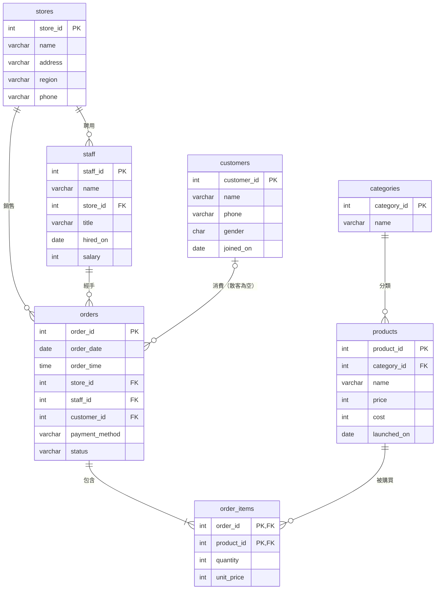
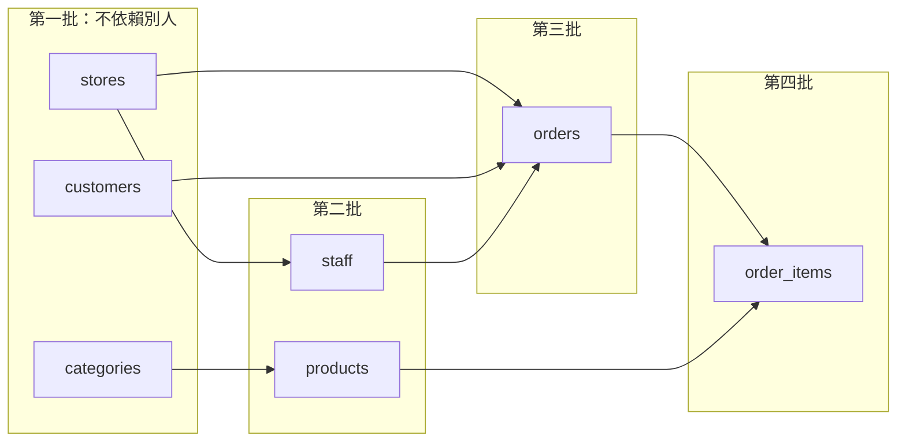

# 進階-1｜親手蓋出 cafe_shop 的七張表

> 💻 DBeaver（新資料庫：`cafe_lab`）｜ 🎯 學完你會：看懂 ER 圖、依相依順序建表、設計多對多的中間表

## 🎬 情境

你已經用過 `cafe_shop` 了，現在要知道它是怎麼設計的。每個表都不難，難的是**想清楚資料之間的關係**。

請先建立一個新資料庫 `cafe_lab` 並切換過去，免得動到匯入好的 `cafe_shop`。

## 1. 看懂關係圖



**三個設計重點：**

| 重點 | 說明 |
|---|---|
| **多對多要拆開** | 一張訂單有多項商品，一項商品也出現在多張訂單，所以中間多一張 `order_items` |
| **`unit_price` 為什麼明細也要存？** | 商品會調價。明細記當時成交價，日後調價才不會改到舊帳 |
| **`customer_id` 可以空白** | 散客沒有會員資料 |

## 2. 建表順序



**口訣：被參考的先建。**

```sql
-- 第一批：獨立的主檔
CREATE TABLE stores (
    store_id SERIAL PRIMARY KEY,
    name     VARCHAR(30)  NOT NULL UNIQUE,
    address  VARCHAR(100) NOT NULL,
    region   VARCHAR(10)  NOT NULL CHECK (region IN ('北部', '中部', '南部', '東部')),
    phone    VARCHAR(20)
);

CREATE TABLE categories (
    category_id SERIAL PRIMARY KEY,
    name        VARCHAR(30) NOT NULL UNIQUE
);

CREATE TABLE customers (
    customer_id SERIAL PRIMARY KEY,
    name        VARCHAR(20) NOT NULL,
    phone       VARCHAR(20) UNIQUE,
    gender      CHAR(1) CHECK (gender IN ('男', '女')),
    joined_on   DATE NOT NULL
);

-- 第二批：依賴第一批
CREATE TABLE staff (
    staff_id SERIAL PRIMARY KEY,
    name     VARCHAR(20) NOT NULL,
    store_id INT NOT NULL REFERENCES stores(store_id),
    title    VARCHAR(20) NOT NULL,
    hired_on DATE NOT NULL,
    salary   INT NOT NULL CHECK (salary >= 0)
);

CREATE TABLE products (
    product_id  SERIAL PRIMARY KEY,
    category_id INT NOT NULL REFERENCES categories(category_id),
    name        VARCHAR(50) NOT NULL,
    price       INT NOT NULL CHECK (price >= 0),
    cost        INT NOT NULL CHECK (cost >= 0),
    launched_on DATE NOT NULL
);

-- 第三批：訂單主檔
CREATE TABLE orders (
    order_id       SERIAL PRIMARY KEY,
    order_date     DATE NOT NULL,
    order_time     TIME NOT NULL,
    store_id       INT NOT NULL REFERENCES stores(store_id),
    staff_id       INT NOT NULL REFERENCES staff(staff_id),
    customer_id    INT REFERENCES customers(customer_id),  -- 沒寫 NOT NULL，散客可為空
    payment_method VARCHAR(20) NOT NULL,
    status         VARCHAR(10) NOT NULL CHECK (status IN ('已完成', '已退款', '已取消'))
);

-- 第四批：訂單明細（多對多的中間表）
CREATE TABLE order_items (
    order_id   INT NOT NULL REFERENCES orders(order_id) ON DELETE CASCADE,
    product_id INT NOT NULL REFERENCES products(product_id),
    quantity   INT NOT NULL CHECK (quantity > 0),
    unit_price INT NOT NULL CHECK (unit_price >= 0),
    PRIMARY KEY (order_id, product_id)  -- 同一張訂單的同一項商品只有一筆
);
```

確認七張表都建好了：

```sql
SELECT tablename AS 資料表
FROM pg_tables
WHERE schemaname = 'public'
ORDER BY tablename;
```

**執行結果**

| 資料表 |
|---|
| categories |
| customers |
| order_items |
| orders |
| products |
| staff |
| stores |

> [!TIP]
> 在 DBeaver 選取 `public` Schema，雙擊後切到 **ER Diagram** 分頁，會自動畫出這張關係圖，非常好用。

## 3. 看懂 ON DELETE 的安排

只有 `order_items → orders` 設了 `CASCADE`，因為**明細離開訂單就沒有意義**。門市、員工、商品都不能因為有人刪主檔就連帶消失，所以維持預設的「不准刪」。

## ⚠️ 常見卡關

| 問題 | 原因 | 怎麼解 |
|---|---|---|
| `relation "stores" does not exist` | 建表順序錯 | 依上面四批的順序 |
| `relation "stores" already exists` | 在錯的資料庫，或已建過 | 確認工具列是 `cafe_lab` |
| 想重來 | 要先刪子表 | `DROP TABLE order_items, orders, products, staff, customers, categories, stores;` |

## ✍️ 動手練

**第 1 題**：`order_items` 的主鍵是兩個欄位，這代表哪種資料會被擋下？

<details>
<summary>看答案</summary>

同一張訂單重複出現同一項商品。買兩杯拿鐵要記成一筆 `quantity = 2`，而不是兩筆。

</details>

**第 2 題**：公司要記錄「員工可以支援多家門市」，目前的設計夠嗎？要怎麼改？

<details>
<summary>看答案</summary>

不夠。`staff.store_id` 只能記一家店。員工和門市變成多對多，要新增中間表：

```sql
CREATE TABLE staff_support (
    staff_id INT NOT NULL REFERENCES staff(staff_id),
    store_id INT NOT NULL REFERENCES stores(store_id),
    PRIMARY KEY (staff_id, store_id)
);
DROP TABLE staff_support;
```

</details>

**第 3 題（自我挑戰）**：不看講義，畫出你工作中的三張表和它們的關係，標出主鍵和外來鍵。

## 🤖 問 AI 助教

> 請用 MCP 查看我的資料庫有哪些外來鍵，幫我畫成關係圖，並解釋為什麼 order_items 要用 (order_id, product_id) 當主鍵。我只需要說明，不要修改資料庫。

## ✅ 過關檢查

- [ ] `cafe_lab` 裡有七張空的資料表
- [ ] 我能解釋多對多為什麼需要中間表
- [ ] 我能解釋明細為什麼要存 `unit_price`

---

| 上一步 | 目錄 | 下一步 |
|:---|:---:|---:|
| [⬅️ 入門：一對多關聯](./7.0適合初學者關聯資料庫.md) | [🏠 第 4 章目錄](../README.md#4-sql-語法與實戰練功) | [進階-2 關聯新增 ➡️](./8新增關聯資料庫資料.md) |
