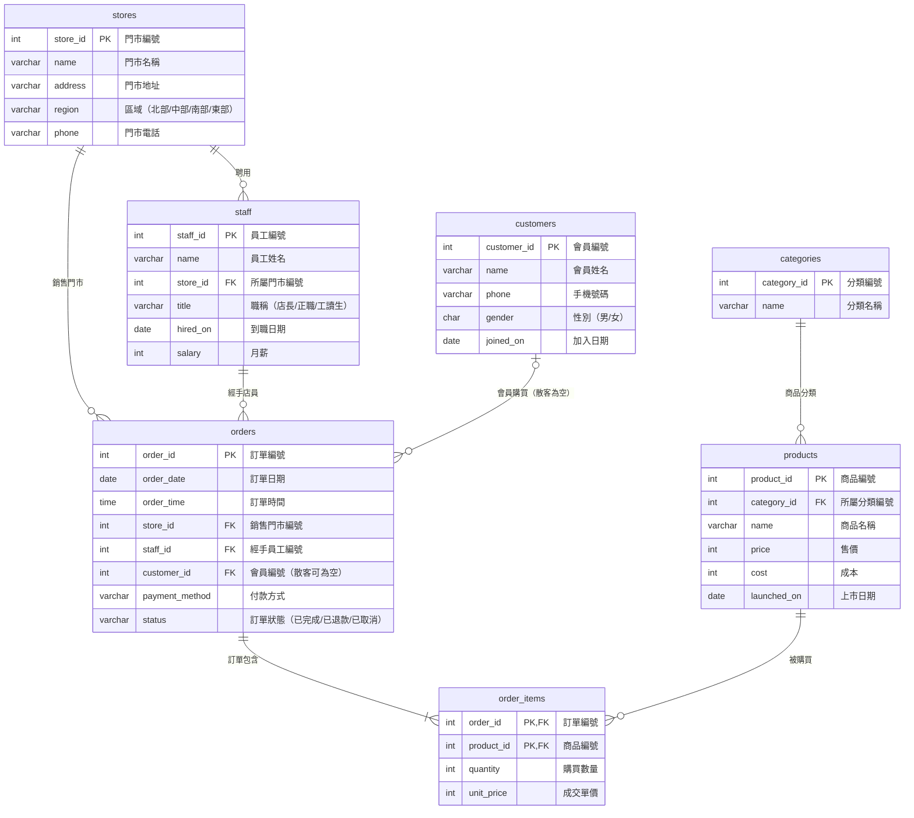
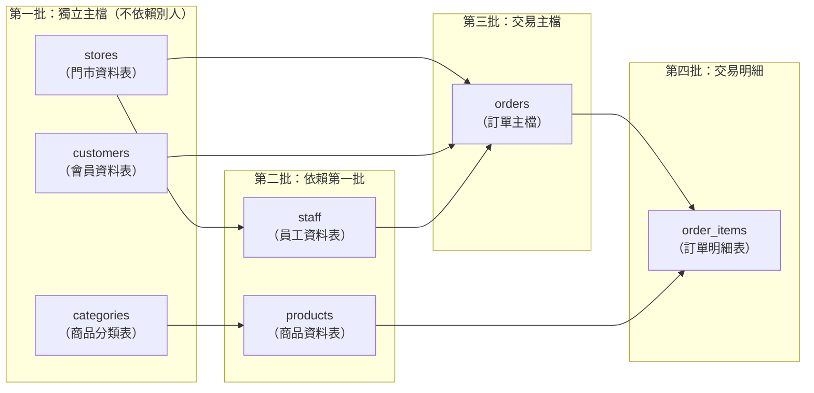

# 進階-1｜親手蓋出 cafe_shop 的七張表

> 💻 DBeaver（新資料庫：`cafe_lab`）｜ 🎯 學完你會：看懂 ER 圖、依相依順序建表、設計多對多的中間表

## 🎬 情境

你已經用過 `cafe_shop`（暖光咖啡門市）了，現在要知道它是怎麼設計的。每個表都不難，難的是**想清楚資料之間的關係**。

請先建立一個新資料庫 `cafe_lab` 並切換過去，免得動到匯入好的 `cafe_shop`。

> [!NOTE]
> **為什麼資料表和欄位名稱用英文？**  
> 實務上系統開發與跨工具串接（如 Python、MCP）通常以英文命名，打字也不用一直切換輸入法。為了方便對照，下方每張圖表與 SQL 程式碼都已附上完整的**繁體中文說明**。

## 1. 看懂關係圖



**三個設計重點：**

| 重點 | 說明 |
|---|---|
| **多對多要拆開** | 一張訂單有多項商品，一項商品也出現在多張訂單，所以中間多一張 `order_items`（訂單明細表） |
| **`unit_price`（成交單價）為什麼明細也要存？** | 商品日後會調價。明細記當時成交價，以後漲價或降價才不會改到舊帳 |
| **`customer_id`（會員編號）可以空白** | 現場散客沒有會員資料，所以允許填 `NULL` |

## 2. 建表順序



**口訣：被參考的先建。**

```sql
-- ==========================================
-- 第一批：獨立的主檔（沒有外來鍵）
-- ==========================================

-- 1. 門市資料表
CREATE TABLE stores (
    store_id SERIAL PRIMARY KEY,           -- 門市編號（自動編號）
    name     VARCHAR(30)  NOT NULL UNIQUE, -- 門市名稱（不可重複）
    address  VARCHAR(100) NOT NULL,        -- 門市地址
    region   VARCHAR(10)  NOT NULL CHECK (region IN ('北部', '中部', '南部', '東部')), -- 區域
    phone    VARCHAR(20)                   -- 門市電話
);

-- 2. 商品分類表
CREATE TABLE categories (
    category_id SERIAL PRIMARY KEY,        -- 分類編號（自動編號）
    name        VARCHAR(30) NOT NULL UNIQUE -- 分類名稱（不可重複）
);

-- 3. 會員資料表
CREATE TABLE customers (
    customer_id SERIAL PRIMARY KEY,        -- 會員編號（自動編號）
    name        VARCHAR(20) NOT NULL,      -- 會員姓名
    phone       VARCHAR(20) UNIQUE,        -- 手機號碼（不可重複）
    gender      CHAR(1) CHECK (gender IN ('男', '女')), -- 性別
    joined_on   DATE NOT NULL              -- 加入日期
);

-- ==========================================
-- 第二批：依賴第一批的資料表
-- ==========================================

-- 4. 員工資料表（必須先有 stores 門市）
CREATE TABLE staff (
    staff_id SERIAL PRIMARY KEY,           -- 員工編號（自動編號）
    name     VARCHAR(20) NOT NULL,         -- 員工姓名
    store_id INT NOT NULL REFERENCES stores(store_id), -- 所屬門市編號
    title    VARCHAR(20) NOT NULL,         -- 職稱
    hired_on DATE NOT NULL,                -- 到職日期
    salary   INT NOT NULL CHECK (salary >= 0) -- 月薪（不可為負數）
);

-- 5. 商品資料表（必須先有 categories 分類）
CREATE TABLE products (
    product_id  SERIAL PRIMARY KEY,        -- 商品編號（自動編號）
    category_id INT NOT NULL REFERENCES categories(category_id), -- 所屬分類編號
    name        VARCHAR(50) NOT NULL,      -- 商品名稱
    price       INT NOT NULL CHECK (price >= 0), -- 售價（不可為負數）
    cost        INT NOT NULL CHECK (cost >= 0),  -- 成本（不可為負數）
    launched_on DATE NOT NULL              -- 上市日期
);

-- ==========================================
-- 第三批：訂單主檔（同時依賴門市、員工、會員）
-- ==========================================

-- 6. 訂單主檔
CREATE TABLE orders (
    order_id       SERIAL PRIMARY KEY,     -- 訂單編號（自動編號）
    order_date     DATE NOT NULL,          -- 訂單日期
    order_time     TIME NOT NULL,          -- 訂單時間
    store_id       INT NOT NULL REFERENCES stores(store_id),   -- 銷售門市編號
    staff_id       INT NOT NULL REFERENCES staff(staff_id),    -- 經手員工編號
    customer_id    INT REFERENCES customers(customer_id),      -- 會員編號（沒寫 NOT NULL，散客可為空）
    payment_method VARCHAR(20) NOT NULL,   -- 付款方式
    status         VARCHAR(10) NOT NULL CHECK (status IN ('已完成', '已退款', '已取消')) -- 訂單狀態
);

-- ==========================================
-- 第四批：訂單明細（多對多的中間表）
-- ==========================================

-- 7. 訂單明細表（必須先有 orders 訂單與 products 商品）
CREATE TABLE order_items (
    order_id   INT NOT NULL REFERENCES orders(order_id) ON DELETE CASCADE, -- 訂單編號（刪訂單時一併刪除明細）
    product_id INT NOT NULL REFERENCES products(product_id),                -- 商品編號
    quantity   INT NOT NULL CHECK (quantity > 0),                           -- 購買數量（必須大於 0）
    unit_price INT NOT NULL CHECK (unit_price >= 0),                        -- 成交單價（不可為負數）
    PRIMARY KEY (order_id, product_id)  -- 複合主鍵：同一張訂單的同一項商品只會有一筆紀錄
);
```

確認七張表都建好了：

```sql
SELECT tablename AS 資料表
FROM pg_tables
WHERE schemaname = 'public'
ORDER BY tablename;
```

**執行結果**

| 資料表 | 中文說明 |
|---|---|
| `categories` | 商品分類表 |
| `customers` | 會員資料表 |
| `order_items` | 訂單明細表 |
| `orders` | 訂單主檔 |
| `products` | 商品資料表 |
| `staff` | 員工資料表 |
| `stores` | 門市資料表 |

> [!TIP]
> 在 DBeaver 選取 `public` Schema，雙擊後切到 **ER Diagram** 分頁，會自動畫出這張關係圖，非常好用。

## 3. 看懂 ON DELETE 的安排

只有 `order_items`（訂單明細）→ `orders`（訂單主檔）設了 `CASCADE`（連動刪除），因為**明細離開訂單就沒有意義**。門市（`stores`）、員工（`staff`）、商品（`products`）都不能因為有人刪主檔就連帶消失，所以維持預設的「不准刪」。

## ⚠️ 常見卡關

| 問題 | 原因 | 怎麼解 |
|---|---|---|
| `relation "stores" does not exist` | 建表順序錯（找不到被參考的門市表） | 依上面四批的順序建立 |
| `relation "stores" already exists` | 在錯的資料庫，或已經建過了 | 確認工具列切換在 `cafe_lab` |
| 想全部重來 | 刪除時要先刪子表，再刪主表 | `DROP TABLE order_items, orders, products, staff, customers, categories, stores;` |

## ✍️ 動手練

**第 1 題**：`order_items`（訂單明細表）的主鍵是 `(order_id, product_id)` 兩個欄位，這代表哪種資料會被擋下？

<details>
<summary>看答案</summary>

同一張訂單重複出現同一項商品。買兩杯拿鐵要記成一筆 `quantity = 2`（數量為 2），而不是兩筆相同的商品紀錄。

</details>

**第 2 題**：公司要記錄「員工可以支援多家門市」，目前的設計夠嗎？要怎麼改？

<details>
<summary>看答案</summary>

不夠。目前 `staff.store_id`（員工的所屬門市）只能記一家店。當員工和門市變成「多對多」關係時，要新增一張中間表（例如 `staff_support` 員工支援表）：

```sql
CREATE TABLE staff_support (
    staff_id INT NOT NULL REFERENCES staff(staff_id), -- 員工編號
    store_id INT NOT NULL REFERENCES stores(store_id), -- 支援門市編號
    PRIMARY KEY (staff_id, store_id)
);

-- 練習完如果不需要這張表，可以刪除：
DROP TABLE staff_support;
```

</details>

**第 3 題（自我挑戰）**：不看講義，畫出你工作中的三張表和它們的關係，標出主鍵（PK）和外來鍵（FK）。

## 🤖 問 AI 助教

> 請用 MCP 查看我的資料庫有哪些外來鍵，幫我畫成關係圖，並用繁體中文解釋為什麼 order_items 要用 (order_id, product_id) 當主鍵。我只需要說明，不要修改資料庫。

---

| 上一步 | 目錄 | 下一步 |
|:---|:---:|---:|
| [⬅️ 入門：一對多關聯](./7.0適合初學者關聯資料庫.md) | [🏠 第 4 章目錄](./README.md) | [進階-2 關聯新增 ➡️](./8新增關聯資料庫資料.md) |
