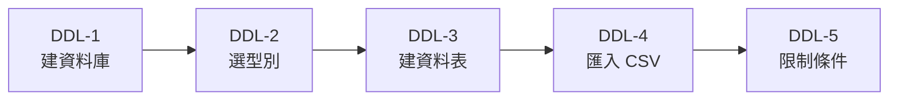

# DDL 導讀：先蓋房子，再搬家具

> 💻 不用開電腦，先看懂觀念

## 一句話看懂

把資料庫想成一間倉庫：

| 動作 | 倉庫的比喻 | Excel 的比喻 | SQL 類別 |
|---|---|---|---|
| 蓋倉庫、釘貨架、規定每格放什麼 | 改「**結構**」 | 新增工作表、設定欄位 | **DDL**（資料定義語言） |
| 把貨品放上去、拿下來、改標籤 | 改「**內容**」 | 在儲存格打字 | **DML**（資料操作語言） |

這一段先學 DDL，共四個指令：

| 指令 | 白話 | 例子 |
|---|---|---|
| `CREATE` | 蓋新的 | 建一張門市表 |
| `ALTER` | 改裝 | 門市表多加一欄「座位數」 |
| `DROP` | 整個拆掉（結構和資料都沒了） | 刪掉整張門市表 |
| `TRUNCATE` | 清空貨架，貨架還在（結構留著） | 留下門市表，清掉所有門市 |

> [!WARNING]
> `DROP` 和 `TRUNCATE` 不會問你「確定嗎？」。按下去就執行了，所以這兩個指令永遠先確認連線的是不是練習用資料庫。

## PostgreSQL 的貼心之處

很多資料庫的 DDL 一執行就回不去。PostgreSQL 可以把 DDL 放進交易，反悔時用 `ROLLBACK` 退回（`CREATE DATABASE`、`DROP DATABASE` 除外）。交易會在 [DML-3](./5修改和刪除.md) 練到。

## 本段路線

> [!NOTE]
> **本課程 AI 的角色是助教，不是代工**：MCP 一律設為唯讀（`--access-mode=restricted`），AI 只能看結構、給建議。每一句 SQL 都由你親手貼進 DBeaver 執行，這樣才學得起來。

## 🤖 問 AI 助教

> 請用「蓋倉庫」的比喻，再舉一個總務管理固定資產（assets 資料表）的例子，說明 CREATE、ALTER、DROP、TRUNCATE 的差別。請給我 SQL，我會自己在 DBeaver 執行。

---

| 上一步 | 目錄 | 下一步 |
|:---|:---:|---:|
| （本章起點） | [🏠 第 4 章目錄](./README.md) | [DDL-1 建立資料庫 ➡️](./1建立資料庫.md) |
