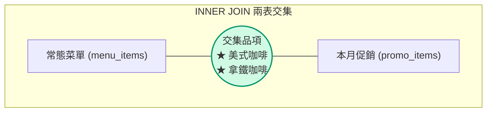
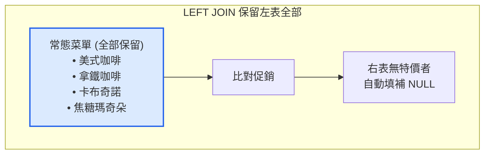

# 單元 14：多表連接查詢全指南 (JOIN)

在關聯式資料庫中，資料被正規化拆分存放在不同的資料表（例如：常態菜單表、本期促銷表、門市表、訂單表）。  
`JOIN` 指令就是用來**依據指定的關聯鍵，將多張資料表的資料橫向拼接合併為一張完整報表**的核心武器！

---

## 1. 準備示範資料庫：咖啡菜單 vs 本月促銷

為了最直觀地理解 7 種不同的 JOIN 行為，我們先建立兩張簡單易懂的對照表：
* **`menu_items` (常態菜單表)**：店內常規販售的咖啡
* **`promo_items` (本月促銷表)**：本月享有特價折扣的商品

```sql
DROP TABLE IF EXISTS promo_items CASCADE;
DROP TABLE IF EXISTS menu_items CASCADE;

-- 常態菜單表 (左表)
CREATE TABLE menu_items (
    item_id INT PRIMARY KEY,
    name VARCHAR(50) NOT NULL
);

-- 本月促銷表 (右表)
CREATE TABLE promo_items (
    promo_id INT PRIMARY KEY,
    name VARCHAR(50) NOT NULL,
    discount_price INT NOT NULL
);

INSERT INTO menu_items (item_id, name) VALUES
    (1, '美式咖啡'),
    (2, '拿鐵咖啡'),
    (3, '卡布奇諾'),
    (4, '焦糖瑪奇朵');

INSERT INTO promo_items (promo_id, name, discount_price) VALUES
    (101, '拿鐵咖啡', 99),
    (102, '美式咖啡', 69),
    (103, '西西里檸檬咖啡', 89),
    (104, '燕麥奶拿鐵', 109);
```

### 資料現況對照

| `menu_items` (常態菜單/左表) | `promo_items` (本月促銷/右表) |
|---|---|
| 1: 美式咖啡 | 101: 拿鐵咖啡 (特價 99) |
| 2: 拿鐵咖啡 | 102: 美式咖啡 (特價 69) |
| 3: 卡布奇諾 | 103: 西西里檸檬咖啡 (特價 89) |
| 4: 焦糖瑪奇朵 | 104: 燕麥奶拿鐵 (特價 109) |

---

## 2. INNER JOIN (內連接 / 交集)

只保留**兩張表都有匹配成功**的資料列（交集部分）。



```sql
SELECT 
    m.item_id,
    m.name AS 菜單商品,
    p.promo_id,
    p.name AS 促銷商品,
    p.discount_price AS 特價
FROM menu_items m
INNER JOIN promo_items p ON m.name = p.name;
```

**查詢結果**：
| item_id | 菜單商品 | promo_id | 促銷商品 | 特價 |
|:---:|---|:---:|---|:---:|
| 1 | 美式咖啡 | 102 | 美式咖啡 | 69 |
| 2 | 拿鐵咖啡 | 101 | 拿鐵咖啡 | 99 |

---

## 3. LEFT JOIN (左外連接 / 保留左表全部)

**完整保留左表 (`menu_items`) 的所有資料**。右表有對應就顯示特價，若無對應則填補 `NULL`。



```sql
SELECT 
    m.item_id,
    m.name AS 菜單商品,
    p.promo_id,
    p.discount_price AS 特價
FROM menu_items m
LEFT JOIN promo_items p ON m.name = p.name;
```

**查詢結果**：
| item_id | 菜單商品 | promo_id | 特價 | 說明 |
|:---:|---|:---:|:---:|---|
| 1 | 美式咖啡 | 102 | 69 | 有促銷特價 |
| 2 | 拿鐵咖啡 | 101 | 99 | 有促銷特價 |
| 3 | 卡布奇諾 | *NULL* | *NULL* | 無促銷（維持原價） |
| 4 | 焦糖瑪奇朵 | *NULL* | *NULL* | 無促銷（維持原價） |

---

## 4. LEFT JOIN + WHERE IS NULL (只在左表、不在右表)

找出「屬於常態商品，但**本月沒有任何促銷特價**」的品項（差集）。

```mermaid
flowchart LR
    subgraph 差集：只在左表
        L["卡布奇諾<br>焦糖瑪奇朵"] --- X["排除有促銷者 (p.promo_id IS NULL)"]
    end
    style L fill:#fee2e2,stroke:#dc2626,stroke-width:2px;
```

```sql
SELECT 
    m.item_id,
    m.name AS 未特價常態商品
FROM menu_items m
LEFT JOIN promo_items p ON m.name = p.name
WHERE p.promo_id IS NULL;
```

---

## 5. RIGHT JOIN (右外連接 / 保留右表全部)

**完整保留右表 (`promo_items`) 的所有資料**。用來檢查本期促銷活動中，有哪些是「促銷限定新品（常態菜單未登錄）」。

```sql
SELECT 
    m.item_id,
    m.name AS 菜單品名,
    p.name AS 促銷活動品名,
    p.discount_price AS 特價
FROM menu_items m
RIGHT JOIN promo_items p ON m.name = p.name;
```

**查詢結果**：
| item_id | 菜單品名 | 促銷活動品名 | 特價 | 說明 |
|:---:|---|---|:---:|---|
| 2 | 拿鐵咖啡 | 拿鐵咖啡 | 99 | 常規品有特價 |
| 1 | 美式咖啡 | 美式咖啡 | 69 | 常規品有特價 |
| *NULL* | *NULL* | 西西里檸檬咖啡 | 89 | 促銷限定新品！ |
| *NULL* | *NULL* | 燕麥奶拿鐵 | 109 | 促銷限定新品！ |

---

## 6. FULL OUTER JOIN (全外連接 / 兩表聯集全收)

無論左表或右表，**只要存在任一張表中，全部列出對照**；對應不到的欄位補 `NULL`。

```sql
SELECT 
    m.name AS 菜單商品,
    p.name AS 促銷商品,
    p.discount_price AS 特價
FROM menu_items m
FULL OUTER JOIN promo_items p ON m.name = p.name;
```

---

## 🤖 助教提示詞：運用 MCP 產生建議 SQL（學生手動執行）

> 💡 **學習規範**：  
> 請直接在對話框中發問。AI 會透過 MCP 檢查資料表結構，並為你產生**建議的測試 SQL 語法**；請將語法**複製到 DBeaver 手動執行**！

### 練習 1：請 AI 產生連鎖咖啡門市跨 3 表 JOIN 的 SQL
> **Prompt 範例**：  
> 「在目前的 `cafe_shop` 資料庫中，我想查詢每張訂單明細包含的：門市名稱、下單日期、經手員工、購買商品名稱、購買數量、成交金額。請透過 MCP 檢查外來鍵關聯後，給我標準的四表 JOIN SQL，我會在 DBeaver 中手動執行。」

### 練習 2：用 LEFT JOIN 找出潛水未消費會員
> **Prompt 範例**：  
> 「請給我一條使用 `LEFT JOIN ... WHERE ... IS NULL` 的標準 SQL，從 `customers` 與 `orders` 中抓出註冊至今從未下單過的會員名單，我會在 DBeaver 中親自執行驗證。」

---

## 🛠️ 實戰演練：連鎖咖啡門市 (`cafe_shop`) 多表關聯手寫題

> 💡 **資料來源**：在資料庫匯入 [`cafe_shop.sql`](../範例資料庫/中文範例資料庫/cafe_shop.sql)。

請在 DBeaver 開啟 SQL 編輯器，親自動手挑戰以下經典題目：

### 題目 1：查詢「台北市」門市在 2024 年 3 月份的所有已完成訂單
```sql
SELECT 
    o.order_id AS 訂單編號,
    o.order_date AS 銷售日期,
    s.name AS 門市名稱,
    o.payment_method AS 付款方式
FROM orders o
JOIN stores s ON o.store_id = s.store_id
WHERE s.city = '台北市'
  AND o.order_date BETWEEN '2024-03-01' AND '2024-03-31'
  AND o.status = '已完成'
ORDER BY o.order_date ASC;
```

### 題目 2：跨 3 表 JOIN（明細 ➡️ 商品 ➡️ 門市）
```sql
SELECT 
    o.order_id AS 訂單編號,
    s.name AS 門市,
    p.name AS 商品名稱,
    i.quantity AS 購買數量,
    i.unit_price AS 成交單價,
    (i.quantity * i.unit_price) AS 小計
FROM order_items i
JOIN orders o ON i.order_id = o.order_id
JOIN stores s ON o.store_id = s.store_id
JOIN products p ON i.product_id = p.product_id
ORDER BY o.order_id ASC, i.item_id ASC;
```

### 題目 3：會計實戰 (expense_tracker) - 員工報銷跨表查詢（部門 ➡️ 員工 ➡️ 單據 ➡️ 類別）
```sql
-- 需先在 DBeaver 執行 expense_tracker.sql
SELECT 
    d.name AS 部門,
    e.name AS 員工姓名,
    c.claim_id AS 報銷單號,
    cat.name AS 費用類別,
    i.amount AS 明細金額,
    c.status AS 審核狀態
FROM expense_items i
JOIN expense_claims c ON i.claim_id = c.claim_id
JOIN employees e ON c.employee_id = e.employee_id
JOIN departments d ON e.department_id = d.department_id
JOIN expense_categories cat ON i.category_id = cat.category_id
WHERE c.status = '待審核'
ORDER BY d.name, c.claim_id;
```

### 題目 4：總務實戰 (assets_inventory) - 耗材領用歷程跨表查詢（部門 ➡️ 耗材品項）
```sql
-- 需先在 DBeaver 執行 assets_inventory.sql
SELECT 
    l.log_date AS 領用日期,
    l.department AS 領用部門,
    l.recipient_name AS 領用人,
    c.name AS 耗材名稱,
    l.quantity AS 領用數量,
    c.current_stock AS 目前剩餘庫存
FROM consumable_logs l
JOIN consumables c ON l.consumable_id = c.consumable_id
ORDER BY l.log_date DESC;
```

---

## 🧭 課程導覽

| ⬅️ 上一單元 | 🏠 返回目錄 | ➡️ 下一單元 |
|:---|:---:|---:|
| [單元 9.2：完整商業關聯庫實戰](./7創建關聯資料庫.md) | [第 4 章：SQL 語法與實戰練功](../README.md#關聯資料庫實作案例) | [單元 15：聚合函式與分組](./10聚合函式.sql) |
