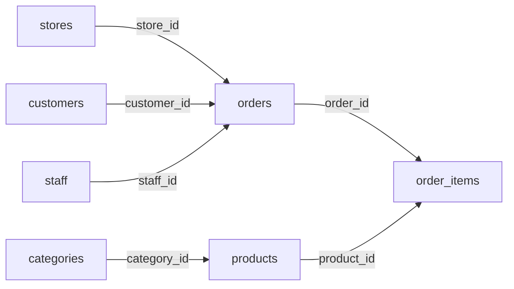

# DML-5｜JOIN：SQL 版的 VLOOKUP

> 💻 DBeaver（`cafe_db` 加 `cafe_shop`）｜ 🎯 學完你會：INNER、LEFT、RIGHT、FULL、CROSS JOIN，以及何時用哪一種

## 🎬 情境

訂單表只記門市**編號**，王經理卻想看門市**名稱**。在 Excel 你會用 `VLOOKUP`，在 SQL 就是 `JOIN`：**用共同的欄位，把兩張表左右拼起來。**

本課先用一個超小的例子看懂差別，再做真題。

## 1. 準備範例：菜單與本月促銷

```sql
CREATE TABLE menu_items (
    item_id INT PRIMARY KEY,
    name    VARCHAR(50) NOT NULL
);

CREATE TABLE promo_items (
    promo_id       INT PRIMARY KEY,
    name           VARCHAR(50) NOT NULL,
    discount_price INT NOT NULL
);

INSERT INTO menu_items VALUES
    (1, '美式咖啡'), (2, '拿鐵咖啡'), (3, '卡布奇諾'), (4, '焦糖瑪奇朵');

INSERT INTO promo_items VALUES
    (101, '拿鐵咖啡', 99), (102, '美式咖啡', 69),
    (103, '西西里檸檬咖啡', 89), (104, '燕麥奶拿鐵', 109);
```

兩張表的關係：

| 只在菜單（左） | 兩邊都有 | 只在促銷（右） |
|:---:|:---:|:---:|
| 卡布奇諾、焦糖瑪奇朵 | **美式咖啡、拿鐵咖啡** | 西西里檸檬咖啡、燕麥奶拿鐵 |

> 寫在 `FROM` 後面的是**左表**，寫在 `JOIN` 後面的是**右表**。

## 2. INNER JOIN：兩邊都有才留下

「菜單上的品項，哪些本月有促銷？」

```sql
SELECT m.name AS 菜單品項, p.discount_price AS 特價
FROM menu_items m
INNER JOIN promo_items p ON m.name = p.name;
```

**執行結果**

| 菜單品項 | 特價 |
|---|---:|
| 美式咖啡 | 69 |
| 拿鐵咖啡 | 99 |

逐段看懂：

| 片段 | 白話 |
|---|---|
| `menu_items m` | 幫表取短名字（別名）`m`，少打字 |
| `INNER JOIN promo_items p` | 接上促銷表，別名 `p` |
| `ON m.name = p.name` | **對照規則**：品名相同的配成一列 |
| `m.name` | `name` 兩邊都有，要指明是哪張表的 |

`INNER` 可以省略，只寫 `JOIN` 就是 `INNER JOIN`。

## 3. LEFT JOIN：左表全留

「**全部**菜單品項都列出來，有促銷的顯示特價。」

```sql
SELECT m.name AS 菜單品項, p.discount_price AS 特價
FROM menu_items m
LEFT JOIN promo_items p ON m.name = p.name
ORDER BY m.item_id;
```

**執行結果**

| 菜單品項 | 特價 |
|---|---:|
| 美式咖啡 | 69 |
| 拿鐵咖啡 | 99 |
| 卡布奇諾 | *NULL* |
| 焦糖瑪奇朵 | *NULL* |

對不到的地方會顯示 `NULL`，就像 VLOOKUP 的 `#N/A`。實務上最常用的就是 `INNER` 和 `LEFT`。

## 4. 找「沒有對應」的資料：LEFT JOIN + IS NULL

「哪些品項**沒有**促銷？」這個技巧超級實用，可以找沒下單的會員、沒賣出的商品：

```sql
SELECT m.name AS 沒促銷的品項
FROM menu_items m
LEFT JOIN promo_items p ON m.name = p.name
WHERE p.promo_id IS NULL;
```

**執行結果**

| 沒促銷的品項 |
|---|
| 卡布奇諾 |
| 焦糖瑪奇朵 |

## 5. RIGHT JOIN：右表全留

「全部促銷都列出來，哪些是菜單上沒有的限定新品？」

```sql
SELECT m.item_id AS 菜單編號, p.name AS 促銷品項, p.discount_price AS 特價
FROM menu_items m
RIGHT JOIN promo_items p ON m.name = p.name
ORDER BY p.promo_id;
```

**執行結果**

| 菜單編號 | 促銷品項 | 特價 |
|---:|---|---:|
| 2 | 拿鐵咖啡 | 99 |
| 1 | 美式咖啡 | 69 |
| *NULL* | 西西里檸檬咖啡 | 89 |
| *NULL* | 燕麥奶拿鐵 | 109 |

> [!TIP]
> `A RIGHT JOIN B` 等於 `B LEFT JOIN A`。大多數人習慣都寫成 `LEFT JOIN`，比較好讀。

## 6. FULL OUTER JOIN：兩邊全留

「菜單和促銷對帳，全部攤開來看。」

```sql
SELECT m.name AS 菜單品項, p.name AS 促銷品項
FROM menu_items m
FULL OUTER JOIN promo_items p ON m.name = p.name
ORDER BY m.item_id, p.promo_id;
```

**執行結果**

| 菜單品項 | 促銷品項 |
|---|---|
| 美式咖啡 | 美式咖啡 |
| 拿鐵咖啡 | 拿鐵咖啡 |
| 卡布奇諾 | *NULL* |
| 焦糖瑪奇朵 | *NULL* |
| *NULL* | 西西里檸檬咖啡 |
| *NULL* | 燕麥奶拿鐵 |

## 7. CROSS JOIN：所有組合

每種飲料配每種甜度，用來產生組合清單。不需要 `ON`。

```sql
SELECT m.name AS 飲料, s.sugar AS 甜度
FROM menu_items m
CROSS JOIN (VALUES ('無糖'), ('半糖')) AS s(sugar)
WHERE m.item_id <= 2
ORDER BY m.item_id;
```

**執行結果**

| 飲料 | 甜度 |
|---|---|
| 美式咖啡 | 無糖 |
| 美式咖啡 | 半糖 |
| 拿鐵咖啡 | 無糖 |
| 拿鐵咖啡 | 半糖 |

## 一張表記住五種 JOIN

| JOIN | 保留什麼 | 白話 | 常見用途 |
|---|---|---|---|
| `INNER` | 兩邊都有的 | 配對成功才留 | 訂單配門市名稱 |
| `LEFT` | 左表全部 | VLOOKUP | 列出所有門市，含沒訂單的 |
| `RIGHT` | 右表全部 | 反向 LEFT | 少用 |
| `FULL OUTER` | 兩邊全部 | 對帳 | 比對兩份名單差異 |
| `CROSS` | 所有組合 | 排列組合 | 產生規格表 |

## 8. 真題：回到 `cafe_shop`

切換到 `cafe_shop`。看一下這些表怎麼連：



**訂單配上門市名稱**（兩張表）

```sql
SELECT o.order_id AS 訂單, o.order_date AS 日期, s.name AS 門市, o.payment_method AS 付款
FROM orders o
JOIN stores s ON o.store_id = s.store_id
WHERE s.region = '中部'
  AND o.status = '已完成'
ORDER BY o.order_date, o.order_id
LIMIT 3;
```

**執行結果**

| 訂單 | 日期 | 門市 | 付款 |
|---:|---|---|---|
| 29 | 2024-01-01 | 台中逢甲店 | 街口支付 |
| 97 | 2024-01-01 | 台中逢甲店 | 信用卡 |
| 109 | 2024-01-01 | 台中逢甲店 | LINE Pay |

**每筆明細的門市、商品、小計**（四張表，一路接下去）

```sql
SELECT
    o.order_id AS 訂單,
    s.name     AS 門市,
    p.name     AS 商品,
    i.quantity AS 數量,
    i.quantity * i.unit_price AS 小計
FROM order_items i
JOIN orders o   ON i.order_id = o.order_id
JOIN stores s   ON o.store_id = s.store_id
JOIN products p ON i.product_id = p.product_id
ORDER BY o.order_id, p.product_id
LIMIT 5;
```

**執行結果**

| 訂單 | 門市 | 商品 | 數量 | 小計 |
|---:|---|---|---:|---:|
| 1 | 台北信義店 | 經典拿鐵 | 1 | 95 |
| 1 | 台北信義店 | 靜岡抹茶歐蕾 | 1 | 110 |
| 2 | 台北信義店 | 焦糖瑪奇朵 | 1 | 120 |
| 3 | 台北信義店 | 燕麥奶拿鐵 | 1 | 130 |
| 4 | 台中逢甲店 | 珍珠醇奶茶 | 1 | 65 |

> [!TIP]
> **多表 JOIN 的寫法**：順著關係圖一次接一張。每多接一張，就先跑一次看結果對不對，不要一口氣寫完才執行。

## ⚠️ 常見卡關

| 問題 | 原因 | 怎麼解 |
|---|---|---|
| `column reference "name" is ambiguous` | 兩張表都有 `name` | 寫成 `s.name` |
| `missing FROM-clause entry for table "s"` | 用了沒定義的別名 | 檢查 `FROM` 和 `JOIN` 的別名 |
| 筆數暴增好幾倍 | `ON` 條件寫錯或太寬 | 檢查 `ON` 是否連對欄位 |
| `LEFT JOIN` 變得和 `INNER` 一樣 | `WHERE` 篩了右表欄位 | 把條件移到 `ON` 後面 |

## ✍️ 動手練

**第 1 題（`cafe_shop`）**：列出每位員工的姓名、職稱和所屬門市名稱，依門市編號排序。

<details>
<summary>看答案</summary>

```sql
SELECT e.name AS 員工, e.title AS 職稱, s.name AS 門市
FROM staff e
JOIN stores s ON e.store_id = s.store_id
ORDER BY s.store_id, e.staff_id;
```

**執行結果**

| 員工 | 職稱 | 門市 |
|---|---|---|
| 張志明 | 店長 | 台北信義店 |
| 陳美玲 | 正職咖啡師 | 台北信義店 |
| 林家豪 | 工讀生 | 台北信義店 |
| 黃雅婷 | 店長 | 台北車站店 |

<sub>（只列前 4 筆，實際共 12 筆）</sub>

</details>

**第 2 題（`cafe_shop`）**：列出每項商品和它的分類名稱。

<details>
<summary>看答案</summary>

```sql
SELECT c.name AS 分類, p.name AS 商品, p.price AS 售價
FROM products p
JOIN categories c ON p.category_id = c.category_id
ORDER BY c.category_id, p.price DESC;
```

**執行結果**

| 分類 | 商品 | 售價 |
|---|---|---:|
| 義式咖啡 | 冰滴咖啡 | 150 |
| 義式咖啡 | 燕麥奶拿鐵 | 130 |
| 義式咖啡 | 焦糖瑪奇朵 | 120 |
| 義式咖啡 | 摩卡咖啡 | 115 |

<sub>（只列前 4 筆，實際共 18 筆）</sub>

</details>

**第 3 題（`cafe_shop`）**：先新增一位會員「新來的」，再用 `LEFT JOIN ... IS NULL` 找出沒下過單的會員。

<details>
<summary>看答案</summary>

```sql
INSERT INTO customers (name, phone, gender, joined_on)
VALUES ('新來的', '0900-000-000', '女', '2024-04-01');

SELECT c.name AS 沒下單的會員
FROM customers c
LEFT JOIN orders o ON c.customer_id = o.customer_id
WHERE o.order_id IS NULL;
```

**執行結果**

| 沒下單的會員 |
|---|
| 新來的 |

</details>

**第 4 題（`expense_tracker`，會計）**：列出所有「待審核」報銷單的部門、員工、費用類別和金額。

<details>
<summary>看答案</summary>

```sql
SELECT
    d.name AS 部門, e.name AS 員工, c.name AS 費用類別,
    x.claim_id AS 單號, x.amount AS 金額
FROM expense_claims x
JOIN expense_employees e   ON x.emp_id = e.emp_id
JOIN expense_departments d ON e.dept_id = d.dept_id
JOIN expense_categories c  ON x.category_id = c.category_id
WHERE x.status = '待審核'
ORDER BY d.name, x.claim_id;
```

**執行結果**

| 部門 | 員工 | 費用類別 | 單號 | 金額 |
|---|---|---|---|---:|
| 業務部 | 陳小華 | 市區交通 | EXP20240313 | 320.00 |
| 行銷部 | 黃雅婷 | 商務餐敘 | EXP20240312 | 2500.00 |

</details>

**第 5 題（`assets_inventory`，總務）**：列出還沒歸還的設備、借用人和應還日期。

<details>
<summary>看答案</summary>

```sql
SELECT a.name AS 設備, l.borrower_name AS 借用人, l.expected_return_date AS 應還日
FROM asset_borrow_logs l
JOIN assets a ON l.asset_id = a.asset_id
WHERE l.actual_return_date IS NULL
ORDER BY l.expected_return_date;
```

**執行結果**

| 設備 | 借用人 | 應還日 |
|---|---|---|
| 無線便攜雷射投影機 | 黃雅婷 | 2024-03-12 |
| MacBook Pro 14吋 M3 | 林志明 | 2024-03-15 |

</details>

## 🤖 問 AI 助教

> 我寫了這段 JOIN，結果筆數比預期多很多，請幫我找原因，用「VLOOKUP」的概念解釋。請不要幫我執行：（貼上你的 SQL）

## ✅ 過關檢查

- [ ] 我能用自己的話解釋 INNER 和 LEFT 的差別
- [ ] 我會用 `LEFT JOIN ... IS NULL` 找「沒有對應」的資料
- [ ] 我能依關係圖寫出三張表以上的 JOIN

---

| 上一步 | 目錄 | 下一步 |
|:---|:---:|---:|
| [⬅️ DML-4 外來鍵](./7_0FOREIGN_KEY.md) | [🏠 第 4 章目錄](./README.md) | [DML-6 JSON ➡️](./16json.md) |
