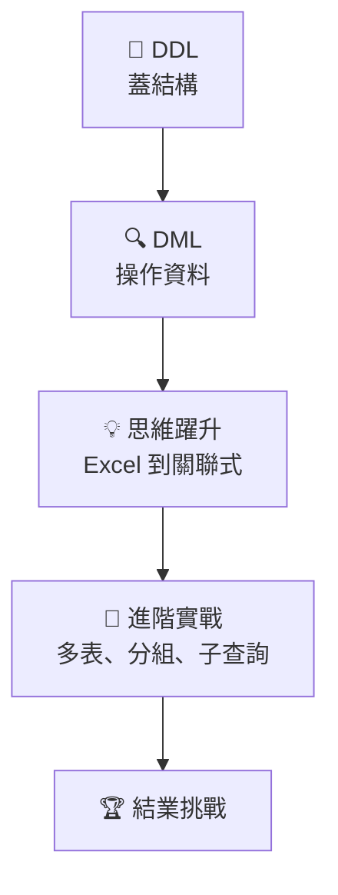

# 第 4 章：SQL 語法與實戰練功

> 跟著「暖光咖啡」總部的王經理，把一堆 Excel 問題變成一句 SQL。
> 建議一次一課，每課都親手打過，再進下一課。

[← 回課程首頁](../README.md)

## 怎麼用這份講義

每一課都是同樣的結構，自學時照順序做就好：

| 區塊 | 做什麼 |
|---|---|
| 🎬 **情境** | 先知道這個語法解決什麼工作問題 |
| 📘 **內容** | 把 SQL **親手打進 DBeaver**，對照「執行結果」 |
| ⚠️ **常見卡關** | 報錯時先查這裡 |
| ✍️ **動手練** | 先自己寫，再點開「看答案」 |
| 🤖 **問 AI 助教** | 卡住就問，但由你自己執行 |
| ✅ **過關檢查** | 都打勾了再往下走 |

> [!TIP]
> **講義中的 SQL 和結果都實際執行過。** 你的結果若不同，通常是資料被改過：重新執行範例 `.sql` 檔就會恢復。

## 開始之前

- [ ] 已完成 [第 1 章](../README.md#1-環境安裝)，DBeaver 連得上資料庫
- [ ] 知道按 `Ctrl/Cmd + Enter` 執行一句，`Alt/Opt + X` 執行全部

## 課程地圖



### 📐 DDL：蓋結構

| 單元 | 主題 | 一句話 | 資料庫 |
|---|---|---|---|
| 導讀 | [DDL 是什麼](./DDL%28定義資料語言%29.md) | 蓋倉庫的指令 | — |
| DDL-1 | [建立資料庫](./1建立資料庫.md) | 開一本新帳本 | `cafe_db` |
| DDL-2 | [基本型別](./2_0基本型別.md) | 金額為什麼不能用 FLOAT | `cafe_db` |
| DDL-3 | [建立資料表](./2建立資料表.md) | Excel 標題列變規格 | `cafe_db` |
| DDL-4 | [匯入 CSV](./2_1匯入csv.md) | 不用一筆一筆打 | `cafe_db` |
| DDL-5 | [限制條件](./4限制.md) | 替資料庫請警衛 | `cafe_db` |

### 🔍 DML：操作資料

| 單元 | 主題 | 一句話 | 資料庫 |
|---|---|---|---|
| 導讀 | [DML 是什麼](./DML%28資料操作語言%29.md) | **這裡要匯入 `cafe_shop`** | `cafe_shop` |
| DML-1 | [新增資料](./3新增資料.md) | INSERT 與 RETURNING | `cafe_db` |
| DML-2 | [查詢資料](./6取得資料.md) | 最常用的 SELECT | `cafe_shop` |
| DML-3 | [修改與刪除](./5修改和刪除.md) | 保命三步驟與交易 | `cafe_shop` |
| DML-4 | [外來鍵](./7_0FOREIGN_KEY.md) | 不讓資料變孤兒 | `cafe_db` 等 |
| DML-5 | [JOIN](./JOIN.md) | SQL 版的 VLOOKUP | `cafe_db`、`cafe_shop` |
| DML-6 | [JSONB](./16json.md) | 每筆都不一樣的資料 | `cafe_db` |

### 💡 思維躍升

| 單元 | 主題 | 一句話 |
|---|---|---|
| 觀念 | [從 Excel 到正規化](../範例資料庫/從Excel到關聯資料庫_正規化.md) | 為什麼要拆表 |
| 入門 | [一對多關聯](./7.0適合初學者關聯資料庫.md) | 最常見的兩表關係 |

### 🧩 進階實戰

| 單元 | 主題 | 一句話 | 資料庫 | 腳本 |
|---|---|---|---|:---:|
| 進階-1 | [建立七張表](./7創建關聯資料庫.md) | 親手蓋出 cafe_shop | `cafe_lab` | — |
| 進階-2 | [關聯新增](./8新增關聯資料庫資料.md) | 順序與交易 | `cafe_lab` | [.sql](./8新增關聯資料庫資料.sql) |
| 進階-3 | [關聯搜尋](./9搜尋關聯資料庫.md) | 回答五個問題 | `cafe_shop` | [.sql](./9搜尋關聯資料庫.sql) |
| 進階-4 | [聚合與分組](./10聚合函式.md) | SQL 版樞紐分析表 | `cafe_shop` 等 | [.sql](./10聚合函式.sql) |
| 進階-5 | [模糊搜尋](./11萬用字元.md) | 只記得一部分也找得到 | `cafe_shop` | [.sql](./11萬用字元.sql) |
| 進階-6 | [聯集](./12聯集.md) | 上下疊兩份名單 | `cafe_shop` | [.sql](./12聯集.sql) |
| 進階-7 | [綜合連結](./13連結.md) | 條件放 ON 還是 WHERE | `cafe_shop` | [.sql](./13連結.sql) |
| 進階-8 | [子查詢](./14子查詢.md) | NOT IN 的大坑 | `cafe_shop` 等 | [.sql](./14子查詢.sql) |
| 進階-9 | [ON DELETE](./15on_delete_action.md) | 刪除前先看後果 | `cafe_shop` | [.sql](./15on_delete_action.sql) |
| 進階-10 | [AI 助教與結業挑戰](./關聯資料庫實作_用Prompt操作.md) | 抓出 AI 的錯 | 五大範例庫 | — |

## 🚀 學完接實戰專案

本章專心學 SQL。章節最下面會連到實戰專案，讓你把語法用在真實的 Excel 上，最後做出個人 App。

| 學完 | 可以接著做 |
|---|---|
| DDL 全部 | [專案 1 耗材庫存表](../app_projects/excel1_supplies/) 步驟 1、2 |
| DML-1 到 DML-3 | [專案 1 耗材庫存表](../app_projects/excel1_supplies/) 步驟 3、4 |
| DML-4、DML-5、一對多入門 | [專案 2 打卡表](../app_projects/excel2_attendance/) |
| 進階-1、進階-2 | [專案 3 差旅報銷單](../app_projects/excel3_expense/) |
| 進階-1、進階-3 | [專案 4 網路商店訂單](../app_projects/excel4_shop/) |
| 進階-4 到進階-9 | [專案 5 連鎖門市月報](../app_projects/excel5_stores/) |
| 全部總覽 | 查看[實戰專案大綱](../app_projects/實戰專案大綱.md) |

## 用到哪些資料庫？

**一個範例放一個資料庫，資料庫名稱和檔名相同。**

| 資料庫 | 怎麼來的 | 用途 |
|---|---|---|
| `cafe_db` | 自己從零建立 | DDL 和 DML 的手寫練習 |
| `cafe_lab` | 自己從零建立 | 進階-1、2 親手蓋七張表 |
| `cafe_shop` | 匯入 [`cafe_shop.sql`](../範例資料庫/中文範例資料庫/cafe_shop.sql) | 主要查詢練習，改壞了重匯即可 |
| `expense_tracker` | 匯入 [`expense_tracker.sql`](../範例資料庫/中文範例資料庫/expense_tracker.sql) | 會計案例 |
| `hr_attendance` | 匯入 [`hr_attendance.sql`](../範例資料庫/中文範例資料庫/hr_attendance.sql) | 人資案例 |
| `assets_inventory` | 匯入 [`assets_inventory.sql`](../範例資料庫/中文範例資料庫/assets_inventory.sql) | 總務案例 |
| `shop` | 匯入 [`shop.sql`](../範例資料庫/中文範例資料庫/shop.sql) | 業務案例 |

## SQL 速查表

**查詢的書寫順序**

```sql
SELECT   欄位, 聚合函式(欄位)
FROM     表 a
JOIN     表 b ON a.鍵 = b.鍵
WHERE    分組前的條件
GROUP BY 欄位
HAVING   分組後的條件
ORDER BY 欄位 DESC
LIMIT    筆數;
```

**常用語法**

| 想做什麼 | 語法 |
|---|---|
| 新增 | `INSERT INTO t (a, b) VALUES (1, 'x') RETURNING id;` |
| 修改 | `UPDATE t SET a = 1 WHERE id = 1;` |
| 刪除 | `DELETE FROM t WHERE id = 1;` |
| 安全修改 | `BEGIN;` → 改 → 檢查 → `COMMIT;` 或 `ROLLBACK;` |
| 找空值 | `WHERE a IS NULL` |
| 模糊搜尋 | `WHERE a LIKE '%拿鐵%'` |
| 空值換預設 | `COALESCE(a, '散客')` |
| 條件判斷 | `CASE WHEN a > 1 THEN 'x' ELSE 'y' END` |
| 條件計數 | `COUNT(*) FILTER (WHERE a > 1)` |
| 不在清單中 | `WHERE NOT EXISTS (SELECT 1 FROM t WHERE ...)` |
| 暫時的表 | `WITH x AS (SELECT ...) SELECT * FROM x;` |

**看到錯誤訊息怎麼辦**

| 訊息關鍵字 | 通常是 |
|---|---|
| `column ... does not exist` | 欄位打錯、文字用了雙引號 |
| `relation ... does not exist` | 表名打錯、連到錯的資料庫 |
| `syntax error at or near` | 那個字的**前面**寫錯了 |
| `violates foreign key` | 父資料不存在，或還有子資料 |
| `violates unique` / `duplicate key` | 資料重複 |
| `must appear in the GROUP BY` | 欄位沒分組也沒聚合 |
| `current transaction is aborted` | 先執行 `ROLLBACK;` |

**還是解不開？** 把 SQL 和完整的錯誤訊息貼給 AI，問它「錯在哪裡，為什麼」。

## 👉 開始

[從 DDL 導讀開始 →](./DDL%28定義資料語言%29.md)
