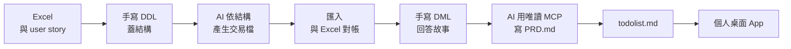

# 第 5 章：實戰專案（五張 Excel，五個個人 App）

[← 回課程首頁](../README.md)

本章結合 **PostgreSQL、你親手寫的 SQL，以及 AI 產生的桌面視窗（Tkinter / PyQt）**，做出自己的小工具。  
**專門為企業各部門上班族打造：將每天面對的混亂 Excel 報表，轉化為在自己個人電腦上隨開即用的專業管理小 App！**

## 📋 五個 Excel 專案

每個專案都從一張職場 Excel 開始，由淺入深，最後做成自己電腦上的小工具。完整規劃請見[實戰專案大綱](./實戰專案大綱.md)。

| 專案 | Excel | 職場角色 | 結構 | 這個專案的重點 | 先學完 |
|:---:|---|---|---|---|---|
| 1 | [耗材庫存表](./excel1_supplies/) | 🏢 總務 | 單表 | 從 Excel 訂欄位規格、限制條件、基本 DML | DDL、DML-1～3 |
| 2 | [打卡表](./excel2_attendance/) | 👥 人資 | 一對多 | 拆成兩張表、處理矛盾資料、`JOIN` 與 `LEFT JOIN` | DML-4、DML-5、一對多入門 |
| 3 | [差旅報銷單](./excel3_expense/) | 💼 會計 / 出納 | 一張拆四張 | 自動編號與 `setval`、防重複報帳、審核流程 | 進階-1、進階-2 |
| 4 | [網路商店訂單](./excel4_shop/) | 🛒 業務 / 客服 | 多對多 | 明細表、成交單價與目前售價、用交易建立訂單 | 進階-1、進階-3 |
| 5 | [連鎖門市月報](./excel5_stores/) | ☕ 店長 / 營運 | 跨月多檔 | CSV 暫存表、每月重複匯入、SQL 版樞紐分析 | 進階-4～9 |

**怎麼進行：** 每個專案的步驟 1～4（看懂 Excel、建表、匯入對帳、用 SQL 完成需求）只需要第 4 章的內容。步驟 5 之後（PRD、todolist、App）由 AI 協助完成，請先依照 [MCP 設定教學](../MCP操作資料庫/1_antigravity設定.md)連線。

| 工作 | 學員 | AI |
|---|:---:|:---:|
| 寫 user story、驗收條件 | ✅ | 協助檢查 |
| 手寫 DDL、DML | ✅ | 只當助教 |
| 把 Excel 轉成資料交易檔 | 檢查與對帳 | ✅ |
| `PRD.md`、`todolist.md` | 審核與修改 | ✅ 用唯讀 MCP 讀結構 |
| Python 與視窗程式 | 依 `todolist.md` 驗收 | ✅ |

## 🎓 畢業專題：換你的 Excel

做完專案後，拿自己工作上的 Excel 走一次同樣的流程：先脫敏、自己手寫建表，再請 AI 處理資料，最後做成自己的小工具。

👉 **[開始畢業專題](./畢業專題_換你的Excel.md)**

## 教到哪裡可以用（教師對照表）

照第 4 章的順序上課，**教完左邊這一課，就可以帶學生做右邊的專案**。每個專案的步驟 1～4 只用到 SQL，步驟 5～8 才做 PRD 和 App。

| 教完這一課 | 可以做 | 步驟 | 課堂上要提醒 |
|---|---|:---:|---|
| DDL-5 限制條件 | [專案 1 耗材庫存表](./excel1_supplies/) | 1、2 | 步驟 2 的測試 `INSERT` 直接貼上即可，DML-1 才正式教 |
| DML-3 修改與刪除 | [專案 1 耗材庫存表](./excel1_supplies/) | 3、4 | `SUM` 講義有一句說明，當成 Excel 的 SUM 即可 |
| 一對多入門 | [專案 2 打卡表](./excel2_attendance/) | 1～4 | 不需要先學 DML-6 JSONB |
| 進階-2 關聯新增 | [專案 3 差旅報銷單](./excel3_expense/) | 1～4 | `SUM` 講義有一句說明 |
| 進階-3 關聯搜尋 | [專案 4 網路商店訂單](./excel4_shop/) | 1～4 | `SUM` 講義有一句說明；`INSERT ... SELECT` 專案內會解釋 |
| 進階-9 ON DELETE | [專案 5 連鎖門市月報](./excel5_stores/) | 1～4 | 暫存表、`ON CONFLICT` 專案內會解釋 |
| 學完第 4 章 | 任一專案 | 5～8 | 建議挑 1～2 個專案做到 App；需要第 3 章的 MCP 設定 |

🎓 五個專案之後：[畢業專題：換你的 Excel](./畢業專題_換你的Excel.md)

---

## ✅ 專案驗收

- [ ] `python app.py` 能開啟視窗，資料來自資料庫
- [ ] 所有 SQL 都是我看得懂、驗收過的
- [ ] 使用者輸入一律用 `%s` 傳遞，密碼放在 `.env`
- [ ] 故意輸入錯誤資料，App 不會當掉，也會顯示中文訊息
