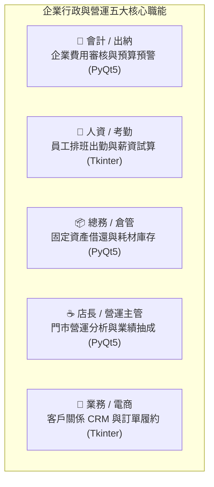

# 職場實戰：五大職能個人桌面 App 專區 (會計・人資・總務・店長・業務)

本目錄包含結合 **PostgreSQL + Python 原生手寫 SQL (psycopg2) + 現代桌面視窗 (PyQt5 & Tkinter)** 的綜合實戰專案。  
**專門為企業各部門上班族打造：將每天面對的混亂 Excel 報表，轉化為在自己個人電腦上隨開即用的專業管理小 App！**

---

## 🏢 五大職場核心職能完美對照



---

## 📁 實戰專案列表（完美對應繁體中文範例資料庫）

| 專案目錄 | 適用職務 | 對應範例資料庫 | 解決之 Excel 職場痛點 | 桌面 GUI 框架 |
|---|---|---|---|:---:|
| 💼 **[專案 1：企業費用報銷審核與預算系統](./project1_expense_manager/)** | **會計、出納、財務主管** | [`expense_tracker.sql`](../範例資料庫/中文範例資料庫/expense_tracker.sql)<br>([報銷單 Excel](../範例資料庫/excel範例/自備Excel轉SQL實戰示範/)) | • 員工差旅請款 Excel 滿天飛、公式損壞<br>• 部門預算防超支即時預警<br>• 一鍵批次審批（核准/駁回/出納撥款） | 🔵 **PyQt5**<br>(KPI 卡片 + QSS) |
| 👥 **[專案 2：員工排班考勤與薪資試算](./project2_hr_attendance/)** | **人資 (HR)、考勤計薪** | [`hr_attendance.sql`](../範例資料庫/中文範例資料庫/hr_attendance.sql) | • 手動排班撞期與連上 6 天違反勞基法<br>• 打卡鐘工時加總算到眼睛痛<br>• 遲到、加班、請假扣款自動結算薪資 | 🟢 **Tkinter**<br>(零設定免安裝) |
| 📦 **[專案 3：企業資產借還與耗材庫存](./project3_assets_inventory/)** | **總務、行政庶務、IT 網管** | [`assets_inventory.sql`](../範例資料庫/中文範例資料庫/assets_inventory.sql) | • 筆電/投影機借出沒還找不到人<br>• 耗材庫存斷貨才發現（低庫存警報）<br>• 固定資產盤點編號不再重複 | 🔵 **PyQt5**<br>(流通櫃台視窗) |
| ☕ **[專案 4：門市營運分析與業績抽成](./project4_cafe_dashboard/)** | **門市店長、營運經理** | [`cafe_shop.sql`](../範例資料庫/中文範例資料庫/cafe_shop.sql)<br>([門市月報 Excel](../範例資料庫/excel範例/連鎖門市月報表/)) | • 解決「每個月複製一份 Excel」痛點<br>• 跨月跨店營收即時動態對比<br>• 明星熱銷排行與 VIP 連續回購名冊 | 🔵 **PyQt5**<br>(商業 BI 多分頁) |
| 🛒 **[專案 5：業務客戶 CRM 與訂單履約](./project5_shop_crm/)** | **業務、業務助理、電商運營** | [`shop.sql`](../範例資料庫/中文範例資料庫/shop.sql)<br>([網路商店 Excel](../範例資料庫/從Excel到關聯資料庫_正規化.md)) | • 客戶電話地址在 Excel 容易矛盾衝突<br>• 訂單履約狀態追蹤與點選展開明細<br>• 客戶 RFM 價值模型自動貼標（VIP/流失客） | 🟢 **Tkinter**<br>(雙分頁工作台) |

---

## ⚠️ 核心教學規範：嚴禁 MCP 自動代勞，扎實學習手寫 SQL

本專案的核心目標是**「讓學生徹底學會手寫 SQL」**：
1. **嚴禁 Prompt 讓 MCP 直接在背後自動生成或修改資料庫**：
   - 所有的資料庫建立（DDL）與假資料匯入（DML），必須由 AI **輸出標準 SQL 交易腳本**，由學生**親自複製到 DBeaver 手動執行**，親眼看懂每一條約束與型別！
2. **Python 程式中全數手寫 SQL**：
   - 桌面 App 內部透過 `psycopg2` 連線，所有的按鈕查詢、表格刷新、分組統計，皆在 Python 中**手寫原生 SQL（`cursor.execute("SELECT ... JOIN ...")`）**，不使用 ORM 抽象化，讓學生真正體會手寫 SQL 與視窗元件的聯動。
3. **拒絕線上架站繁瑣，打造隨開即用的個人桌面 App**：
   - 不使用需要架站與雲端伺服器的 Web/Streamlit 線上版，專案全數於本機視窗執行。

---

## 🧭 怎麼選專案

| 你的狀況 | 建議 |
|---|---|
| 第一次做 App | **專案 2 或 5（Tkinter）**：Python 內建，環境最單純 |
| 想要質感更好的介面 | **專案 1、3、4（PyQt5）** |
| 想馬上用在工作上 | 選和你職務相同的專案 |

每個專案預計 **4～8 小時**。先修：[第 4 章 SQL](../SQL語法教學/README.md)、[第 5 章 Python](../python/)。

## 🛠️ 開發流程三步驟

1. **先在資料庫建好資料表**：
   開啟 DBeaver，執行對應專案的 `.sql` 腳本（例如 [`expense_tracker.sql`](../範例資料庫/中文範例資料庫/expense_tracker.sql) 或 [`hr_attendance.sql`](../範例資料庫/中文範例資料庫/hr_attendance.sql)），確認資料表建立無誤。
2. **安裝對應環境與設定檔**：
   ```bash
   pip install -r requirements.txt
   cp .env.example .env
   # 編輯 .env 填入你的 PostgreSQL 本機連線設定
   ```
3. **複製 Prompt 引導 AI 啟動 SDD 計畫**：
   打開該專案下的 `prompts/01_生成開發計畫_plan.md`，貼給 AI（告知 AI 資料表結構與需求，不使用 MCP 捷徑），開始打造你的個人桌面視窗 App！

## ✅ 專案驗收

- [ ] `python app.py` 能開啟視窗，資料來自資料庫
- [ ] 所有 SQL 都是我看得懂、驗收過的
- [ ] 使用者輸入一律用 `%s` 傳遞，密碼放在 `.env`（[第 5 章驗收五問](../python/#驗收五問)）
- [ ] 故意輸入錯誤資料，App 不會當掉，也會顯示中文訊息
