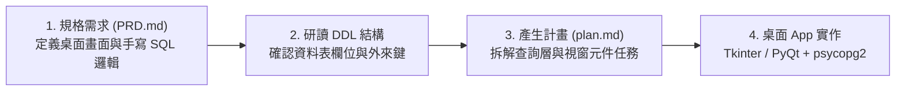

# 實戰專案：個人桌面版小 App 開發專區 (Tkinter / PyQt)

本目錄包含結合 **PostgreSQL + Python 原生手寫 SQL (psycopg2) + 桌面視窗 GUI (Tkinter / PyQt)** 的綜合實戰專案。  
**本專案專為上班族設計：告別過去混亂的 Excel 記帳與手動算表，將資料庫化為自己電腦上獨立運作的「個人版桌面小 App」！**

---

## ⚠️ 核心教學規範：嚴禁 MCP 自動代勞，扎實學習手寫 SQL

本專案的核心目標是**「讓學生徹底學會手寫 SQL」**：
1. **嚴禁 Prompt 讓 MCP 直接在背後自動生成或修改資料庫**：
   - 所有的資料庫建立（DDL）與假資料匯入（DML），必須由 AI **輸出標準 SQL 交易腳本**，由學生**親自複製到 DBeaver 手動執行**，親眼看懂每一條約束與型別！
2. **Python 程式中全數手寫 SQL**：
   - 桌面 App 內部透過 `psycopg2` 連線，所有的按鈕查詢、表格刷新、分組統計，皆在 Python 中**手寫原生 SQL（`cursor.execute("SELECT ... JOIN ...")`）**，不使用 ORM 抽象化，讓學生真正體會 SQL 與桌面介面的聯動。
3. **拒絕笨重線上版，打造輕量個人桌面 App**：
   - 不使用需要架站與雲端伺服器的 Web/Streamlit 線上版。
   - 全面採用 **Tkinter**（Python 內建，免安裝環境，雙擊 `.py` 立即跑出視窗）或 **PyQt / PySide**（精美個人桌面視窗），開發出隨開即用的個人專屬工具！

---

## 🧭 規格驅動開發 (SDD) 流程

---

## 📁 實戰專案列表（完美對應範例資料庫）

| 專案目錄 | 對應範例資料庫 | 桌面 App 產品定位 | 核心手寫 SQL 練習 | 推薦桌面技術 |
|---|---|---|---|---|
| 📈 **[專案 1：股市即時監控與增量同步](./project1_stock_market/)** | [`init_stock_db.sql`](./project1_stock_market/init_stock_db.sql) | **個人投資組合監控視窗** | • `ON CONFLICT ... DO UPDATE` 增量寫入 • `SELECT ... ORDER BY date DESC` 快速讀取 • 聚合計算投資組合總市值與損益 | Python 內建 **Tkinter** (可選 ttk / Matplotlib 嵌入) |
| ☕ **[專案 2：連鎖門市營運分析看板](./project2_cafe_dashboard/)** | [`cafe_shop.sql`](../範例資料庫/中文範例資料庫/cafe_shop.sql) ([門市月報 Excel](../範例資料庫/excel範例/連鎖門市月報表/)) | **門市店長營運分析桌面小 App** | • 多表 `JOIN` 門市、訂單與明細 • `GROUP BY` 與 `TO_CHAR` 跨月營收統計 • `HAVING` 抓出回購 VIP 常客清單 | **Tkinter** (ttk.Treeview) 或 **PyQt5** |
| 🛒 **[專案 3：電商訂單履約與客戶 CRM](./project3_shop_crm/)** | [`shop.sql`](../範例資料庫/中文範例資料庫/shop.sql) ([網路商店 Excel](../範例資料庫/從Excel到關聯資料庫_正規化.md)) | **電商訂單履約與客戶管理系統** | • 訂單狀態過濾 `WHERE status = %s` • 雙表 JOIN 展開訂單明細清單 • RFM 分群計算 (`COUNT`, `SUM`, 天數相減) | **Tkinter** / **PyQt5** |
| 🎓 **[專案 4：校園智慧選課與學分審查](./project4_school_enrollment/)** | [`school.sql`](../範例資料庫/中文範例資料庫/school.sql) | **個人選課與畢業學分審核小工具** | • 多對多關聯查詢已選課表 • 衝堂檢查 SQL (時段交集判斷) • `CASE WHEN` 分類統計必修與選修學分 | **Tkinter** (課表表格視圖) |
| 📚 **[專案 5：圖書館借閱與罰金系統](./project5_library_system/)** | [`library.sql`](../範例資料庫/中文範例資料庫/library.sql) | **圖書借還流通與逾期罰金計算機** | • 書籍模糊搜尋 `WHERE title LIKE %s` • `CURRENT_DATE - due_date` 動態結算罰金 • `RANK()` 視窗函式計算年度借閱榜 | **Tkinter** / **PySide** |

---

## 🛠️ 開發流程三步驟

1. **先在資料庫建好資料表**：
   開啟 DBeaver，執行對應專案的 `.sql` 腳本（例如 [`cafe_shop.sql`](../範例資料庫/中文範例資料庫/cafe_shop.sql) 或 [`shop.sql`](../範例資料庫/中文範例資料庫/shop.sql)），確認資料表建立無誤。
2. **複製環境設定檔**：
   在專案目錄下複製 `.env.example` 為 `.env`，設定 PostgreSQL 本機帳號密碼。
3. **複製 Prompt 引導 AI 啟動 SDD 計畫**：
   打開該專案下的 `prompts/01_生成開發計畫_plan.md`，貼給 AI（告知 AI 資料表結構與需求，不使用 MCP 捷徑），開始打造你的個人桌面視窗 App！
