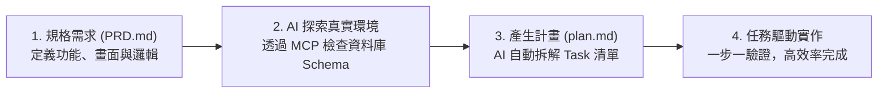

# 實戰專案：規格驅動開發 (SDD) 專區

本目錄包含結合 **PostgreSQL / Supabase + MCP + Python (Streamlit / GUI)** 的綜合實戰專案。  
**本目錄的所有實戰專案，均 100% 一對一完美對應 👉 [範例資料庫專區](../範例資料庫/) 的中文範例資料表！**

不同於傳統「照抄現成專案」的學習方式，本專區採用現代 AI 軟體工程的 **規格驅動開發 (SDD, Spec-Driven Development)** 流程：

> 💡 **環境提示**：使用 Devcontainer 時，資料夾路徑必須包含英文字母與數字（如 `app_projects`），避免純中文路徑可能造成的 Docker 掛載異常。

---

## 📁 實戰專案列表（完美對應範例資料庫）

| 專案目錄 | 對應範例資料庫 | 應用場景 | 核心功能與亮點 | 適合技術 |
|---|---|---|---|---|
| 📈 **[專案 1：股市即時監控與增量同步](./project1_stock_market/)** | [`init_stock_db.sql`](./project1_stock_market/init_stock_db.sql) | 金融投資、個人理財 | **Cache-Aside 快取與增量同步** • DB 有資料走 DB (0.1秒極速載入) • 缺歷史自動聯網爬取補齊 (Upsert) • 技術指標 (KD/MACD/MA) 即時畫線 | Streamlit yfinance PostgreSQL MCP |
| ☕ **[專案 2：連鎖門市營運分析看板](./project2_cafe_dashboard/)** | [`cafe_shop.sql`](../範例資料庫/中文範例資料庫/cafe_shop.sql) ([門市月報 Excel](../範例資料庫/excel範例/連鎖門市月報表/)) | 零售連鎖、商業 BI | **跨月商業報表與經理人儀表板** • 銜接職場 Excel 跨月整合痛點 • 門市/月份動態切換與成長率分析 • 明星商品 TOP 5 與 VIP 常客名冊 | Streamlit Plotly `cafe_shop.sql` |
| 🛒 **[專案 3：電商訂單履約與客戶 CRM](./project3_shop_crm/)** | [`shop.sql`](../範例資料庫/中文範例資料庫/shop.sql) ([網路商店 Excel](../範例資料庫/從Excel到關聯資料庫_正規化.md)) | 電商網店、客戶經營 | **訂單流水線履約與 RFM 會員分群** • 訂單狀態 Kanban 追蹤 (待出貨/已出貨) • 客戶 RFM 價值模型自動貼標 • 購物車熱門合購推薦 (Cross-Selling) | Streamlit PostgreSQL `shop.sql` |
| 🎓 **[專案 4：校園智慧選課與學分審查](./project4_school_enrollment/)** | [`school.sql`](../範例資料庫/中文範例資料庫/school.sql) | 大專院校、教務選課 | **選課防衝堂檢核與學分達成率** • 即時名額剩餘與排課防衝堂檢核 • 個人週課表視覺化展示 • 畢業學分達成率進度條 (必/選/通識) | Streamlit PostgreSQL `school.sql` |
| 📚 **[專案 5：圖書館借閱與罰金系統](./project5_library_system/)** | [`library.sql`](../範例資料庫/中文範例資料庫/library.sql) | 數位圖書、會員流通 | **館藏流通狀態與逾期罰金計算機** • 書籍在庫/借出狀態即時標記 • 逾期天數與罰款金額動態自動計算 • 年度最受歡迎圖書排行榜 (RANK) | Streamlit PostgreSQL `library.sql` |

---

## 🛠️ 開發流程三步驟

1. **先在資料庫建好對應資料表**：
   在 Supabase SQL Editor 或 DBeaver 中執行對應專案的 `.sql` 腳本（例如 [`cafe_shop.sql`](../範例資料庫/中文範例資料庫/cafe_shop.sql) 或 [`shop.sql`](../範例資料庫/中文範例資料庫/shop.sql)）。
2. **確認 Antigravity 的 PostgreSQL MCP 連線正常**：
   讓 AI 具備隨時查看資料表結構的能力。
3. **複製 Prompt 引導 AI 啟動 SDD**：
   打開該專案目錄下的 `prompts/01_生成開發計畫_plan.md`，貼給 AI 即可展開規格驅動開發！
