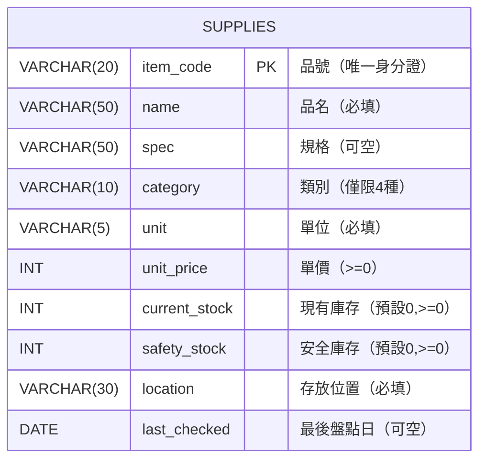

# 步驟 2｜手寫 DDL：親手建立資料庫、資料表與警衛規則

> **本步驟鐵則：完全不匯入任何現成 `.sql` 檔！**  
> 你要看著下方的業務規格卡與欄位設計，自己在 **DBeaver 的 Query Tool** 裡從頭敲出 `CREATE DATABASE` 與 `CREATE TABLE` 並按執行。

---

## 任務一：建立並切換到 `supplies` 資料庫

在 DBeaver 中連線到你的 PostgreSQL（以 `postgres` 資料庫或最高權限帳號連線），打開 **SQL 編輯器**：

```sql
-- 1. 建立獨立資料庫（執行完畢後，請在 DBeaver 左側重新整理並連進 supplies 再開新 SQL 視窗！）
CREATE DATABASE supplies;
```

> [!TIP]
> **如果你使用的是 Supabase 免費方案（不允許 `CREATE DATABASE`）**  
> 請直接連線現有的 `postgres` 資料庫，改用獨立 Schema 隔離本專案：
> ```sql
> CREATE SCHEMA IF NOT EXISTS supplies;
> SET search_path TO supplies;
> ```
> （若後續重新開啟 DBeaver 視窗，記得先執行 `SET search_path TO supplies;` 再執行查詢。）

---

## 任務二：看懂結構圖與手寫 DDL 規格卡

本專案只有 1 張核心資料表 **`supplies`**，但塞滿了最重要的守門員規則：



### 手寫規格卡（請逐欄敲出 `CREATE TABLE supplies (...)`）

| 英文欄位名 | 中文含義 | 建議資料型別 | 必填 / 預設值 | 必須加上哪條限制條件（Constraint）？ |
|---|---|---|---|---|
| `item_code` | 品號 | `VARCHAR(20)` | 必填＋唯一 | `PRIMARY KEY` |
| `name` | 品名 | `VARCHAR(50)` | 必填 | `NOT NULL` |
| `spec` | 規格 | `VARCHAR(50)` | 可空白 | （無） |
| `category` | 類別 | `VARCHAR(10)` | 必填 | `NOT NULL CHECK (category IN ('紙張', '碳粉墨水', '文具', '清潔用品'))` |
| `unit` | 單位 | `VARCHAR(5)` | 必填 | `NOT NULL` |
| `unit_price` | 單價 | `INT` | 必填 | `NOT NULL CHECK (unit_price >= 0)` |
| `current_stock` | 現有庫存 | `INT` | 必填、預設 `0` | `NOT NULL DEFAULT 0 CHECK (current_stock >= 0)` |
| `safety_stock` | 安全庫存 | `INT` | 必填、預設 `0` | `NOT NULL DEFAULT 0 CHECK (safety_stock >= 0)` |
| `location` | 存放位置 | `VARCHAR(30)` | 必填 | `NOT NULL` |
| `last_checked` | 最後盤點日 | `DATE` | 可空白 | （無） |

> ✍️ **現在請暫停閱讀，切到 DBeaver 自己手打 `CREATE TABLE supplies (...)` 並執行！**  
> 完成後再點開下方 `<details>` 逐字檢查你的欄位名稱與約束條件是否 100% 一致（因為步驟 3 的 AI 交易檔、步驟 4 的查詢題與步驟 5 的 PRD 都會對照這組英文欄位名）。

<details>
<summary>👀 自己寫完再打開：參考 DDL 解答（務必核對欄位名稱與限制條件）</summary>

```sql
CREATE TABLE supplies (
    item_code     VARCHAR(20) PRIMARY KEY,
    name          VARCHAR(50) NOT NULL,
    spec          VARCHAR(50),
    category      VARCHAR(10) NOT NULL CHECK (category IN ('紙張', '碳粉墨水', '文具', '清潔用品')),
    unit          VARCHAR(5)  NOT NULL,
    unit_price    INT         NOT NULL CHECK (unit_price >= 0),
    current_stock INT         NOT NULL DEFAULT 0 CHECK (current_stock >= 0),
    safety_stock  INT         NOT NULL DEFAULT 0 CHECK (safety_stock >= 0),
    location      VARCHAR(30) NOT NULL,
    last_checked  DATE
);
```

</details>

---

## 任務三：測試警衛！挑戰 7 筆「有問題的資料」

建好表之後，先手動寫進 **1 筆正常資料**，讓主鍵測試有東西可以碰撞：

```sql
INSERT INTO supplies
    (item_code, name, spec, category, unit, unit_price, current_stock, safety_stock, location, last_checked)
VALUES
    ('MAT-P-A470', 'A4 70g 影印紙', 'Double A 5包/箱', '紙張', '箱', 650, 3, 5, '3F 總務庫房 B-01', '2024-03-29');
```

接著打開 [耗材庫存表.xlsx](耗材庫存表.xlsx) 的 **`有問題的資料`** 工作表（共 7 筆）。  
**請先別看解答**，試著把那 7 筆寫成 `INSERT INTO supplies ...` 並在 DBeaver **一次執行一筆**，看看資料庫到底用什麼錯誤訊息把每筆壞資料擋在門外：

| 測試項 | Excel 錯誤資料特徵 | 你猜會觸發哪條規則／錯誤？ |
|---|---|---|
| 測試 1 | `MAT-P-A470`（與剛才新增的相同） | ？ |
| 測試 2 | `STA-GLUE-01` 品名空白（`NULL`） | ？ |
| 測試 3 | `STA-RULE-30` 現有庫存 `-3` | ？ |
| 測試 4 | `STA-ERAS-01` 單價 `-8` | ？ |
| 測試 5 | `OTH-FAN-01` 類別寫成 `'雜項'` | ？ |
| 測試 6 | `STA-CUT-01` 單價寫成 `'約30'` | ？ |
| 測試 7 | `STA-INK-01` 最後盤點日 `'2024/13/45'` | ？ |

<details>
<summary>👀 實測完再打開：7 筆壞資料測試 SQL 與真實 PostgreSQL 攔截訊息</summary>

```sql
-- 測試 1：重複品號 → duplicate key value violates unique constraint "supplies_pkey"
INSERT INTO supplies VALUES ('MAT-P-A470', 'A4 70g 影印紙（重複）', 'Double A 5包/箱', '紙張', '箱', 650, 1, 5, '3F 總務庫房 B-01', '2024-04-01');

-- 測試 2：品名為 NULL → null value in column "name" of relation "supplies" violates not-null constraint
INSERT INTO supplies VALUES ('STA-GLUE-01', NULL, '40g', '文具', '支', 30, 10, 5, '3F 總務庫房 D-02', '2024-04-01');

-- 測試 3：庫存為負 → violates check constraint "supplies_current_stock_check"
INSERT INTO supplies VALUES ('STA-RULE-30', '30cm 直尺', NULL, '文具', '支', 20, -3, 5, '3F 總務庫房 D-02', '2024-04-01');

-- 測試 4：單價為負 → violates check constraint "supplies_unit_price_check"
INSERT INTO supplies VALUES ('STA-ERAS-01', '橡皮擦', NULL, '文具', '個', -8, 10, 5, '3F 總務庫房 D-02', '2024-04-01');

-- 測試 5：非法類別 → violates check constraint "supplies_category_check"
INSERT INTO supplies VALUES ('OTH-FAN-01', '桌上型電扇', NULL, '雜項', '台', 590, 2, 1, '3F 總務庫房 D-02', '2024-04-01');

-- 測試 6：單價不是整數 → invalid input syntax for type integer: "約30"
INSERT INTO supplies VALUES ('STA-CUT-01', '美工刀', NULL, '文具', '支', '約30', 12, 5, '3F 總務庫房 D-02', '2024-04-01');

-- 測試 7：非法日期 → date/time field value out of range: "2024/13/45"
INSERT INTO supplies VALUES ('STA-INK-01', '印泥', NULL, '文具', '個', 45, 6, 2, '3F 總務庫房 D-02', '2024/13/45');
```

這就是為什麼資料庫不用靠人工「眼力檢查」：所有錯誤在按下執行那一秒就被擋掉，表裡依舊乾乾淨淨只有我們放進去測試的那 1 筆！

</details>

---

## ✍️ 動手練（3 題 DDL ／ `ALTER TABLE` 演練）

在清空測試資料準備進入步驟 3 之前，先練習修改與檢查結構（做完第 2 題記得復原）：

1. **只填必填欄位測 `DEFAULT`**：試著寫一句 `INSERT INTO supplies`，故意**不寫** `current_stock`、`safety_stock`、`spec`、`last_checked`，只填其他 6 個必填欄位新增 `TEST-01`，查出來看看 `current_stock` 和 `safety_stock` 是不是自動變成了 `0`？
   <details>
   <summary>👀 點開看解答</summary>

   ```sql
   INSERT INTO supplies (item_code, name, category, unit, unit_price, location)
   VALUES ('TEST-01', '測試便條紙', '文具', '本', 25, '3F 總務庫房 D-02');

   SELECT item_code, spec, current_stock, safety_stock, last_checked
   FROM supplies
   WHERE item_code = 'TEST-01';
   -- 結果：spec 和 last_checked 為 NULL，current_stock 和 safety_stock 皆為 0。
   ```
   </details>

2. **用 `ALTER TABLE` 加欄位再復原**：假設總務想暫時多記一個「供應商電話 (`vendor_phone VARCHAR(20)`)」，請用 `ALTER TABLE supplies ADD COLUMN ...` 加上去，用 `SELECT * FROM supplies;` 看見新欄位出現後，再用 `DROP COLUMN` 刪掉它（保持與原設計一致）。
   <details>
   <summary>👀 點開看解答</summary>

   ```sql
   ALTER TABLE supplies ADD COLUMN vendor_phone VARCHAR(20);
   SELECT item_code, name, vendor_phone FROM supplies LIMIT 2;
   ALTER TABLE supplies DROP COLUMN vendor_phone;
   ```
   </details>

3. **清空測試資料準備步驟 3**：用 `TRUNCATE TABLE supplies;` 把剛才測試的 `MAT-P-A470` 與 `TEST-01` 清空，再用 `SELECT COUNT(*) FROM supplies;` 確認目前是 `0` 筆乾淨空表！
   <details>
   <summary>👀 點開看解答</summary>

   ```sql
   TRUNCATE TABLE supplies;
   SELECT COUNT(*) FROM supplies; -- 應為 0
   ```
   </details>

---

## 🤖 用 Microsoft Postgres MCP 驗收結構（Prompt）

寫完 `CREATE TABLE` 後，直接叫 AI 透過 `@microsoft/postgres-mcp` 幫你檢查結構有沒有漏字、少 `CHECK` 或型別寫錯（**限唯讀檢查**）：

```text
請透過 Microsoft Postgres MCP 連線到我的 supplies 資料庫，檢查 public schema 底下 supplies 資料表的完整欄位型別、NOT NULL、DEFAULT、PRIMARY KEY 與 CHECK 限制條件。
嚴禁修改或新增任何資料，只用唯讀方式對照以下規格檢查是否有任何遺漏或不一致：
- item_code VARCHAR(20) PK
- name VARCHAR(50) NOT NULL
- spec VARCHAR(50) 可空
- category VARCHAR(10) NOT NULL 且限制為 ('紙張', '碳粉墨水', '文具', '清潔用品')
- unit VARCHAR(5) NOT NULL
- unit_price INT NOT NULL CHECK (>= 0)
- current_stock / safety_stock 皆為 INT NOT NULL DEFAULT 0 CHECK (>= 0)
- location VARCHAR(30) NOT NULL
- last_checked DATE 可空
```

---

👉 **結構與守門員都就緒了！前往 [步驟 3｜AI 產生資料交易檔](3_AI產生資料交易檔.md)**
