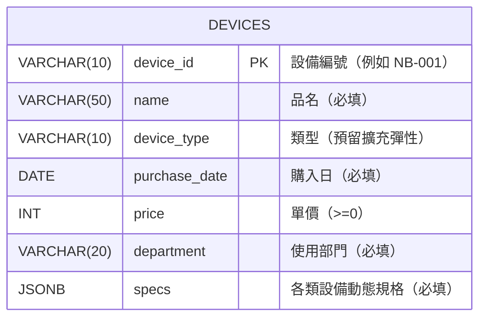

# 步驟 2｜手寫 DDL：親手建立包含 JSONB 欄位的 `devices` 資料表

> **本步驟鐵則：不匯入現成 `.sql` 救援檔！**  
> 打開 DBeaver Query Tool，照下方架構圖與欄位規格卡親手敲出建庫與建表語法。

---

## 任務一：建立並切換到 `devices` 資料庫

在 DBeaver 連線到 PostgreSQL 後先建立資料庫，**接著在左側重新整理並連進 `devices` 再開新 SQL 視窗**：

```sql
CREATE DATABASE devices;
```

> [!TIP]
> **Supabase 免費方案替代方案**：若無法執行 `CREATE DATABASE`，請連線 `postgres` 資料庫改建獨立 Schema：
> ```sql
> CREATE SCHEMA IF NOT EXISTS devices;
> SET search_path TO devices;
> ```

---

## 任務二：看懂架構圖與手寫 DDL 規格卡



### 手寫規格卡（請逐欄敲出 `CREATE TABLE devices (...)`）

| 英文欄位名 | 中文含義 | 建議資料型別 | 必填 / 制限條件（Constraint） | 設計原因 |
|---|---|---|---|---|
| `device_id` | 設備編號 | `VARCHAR(10)` | `PRIMARY KEY` | 唯一識別碼（`NB-001` 等） |
| `name` | 品名 | `VARCHAR(50)` | `NOT NULL` | 每台設備都要有名稱 |
| `device_type` | 類型 | `VARCHAR(10)` | `NOT NULL` | **故意不加 `CHECK IN`**，讓 S5 新增「平板」也不用改表結構 |
| `purchase_date` | 購入日 | `DATE` | `NOT NULL` | 自動擋下 `2024-02-30` 等非法日期 |
| `price` | 單價 | `INT` | `NOT NULL CHECK (price >= 0)` | 價格不得為負數 |
| `department` | 使用部門 | `VARCHAR(20)` | `NOT NULL` | 每台設備都需歸屬部門 |
| `specs` | 動態規格 | `JSONB` | `NOT NULL` | 必須提供合法雙引號 JSON，不可空白 |

> ✍️ **現在先在 DBeaver 自己敲完 `CREATE TABLE devices (...)` 並執行！**  
> 完成後再點開下方 `<details>` 逐字對照欄位名與型別。

<details>
<summary>👀 自己寫完再打開：參考 DDL 解答（務必核對欄位名稱與型別）</summary>

```sql
CREATE TABLE devices (
    device_id     VARCHAR(10) PRIMARY KEY,
    name          VARCHAR(50) NOT NULL,
    device_type   VARCHAR(10) NOT NULL,
    purchase_date DATE        NOT NULL,
    price         INT         NOT NULL CHECK (price >= 0),
    department    VARCHAR(20) NOT NULL,
    specs         JSONB       NOT NULL
);
```

</details>

---

## 任務三：測試警衛！挑戰 5 筆「有問題的資料」

先放入 **1 筆正常筆電**：

```sql
INSERT INTO devices VALUES
('NB-001', 'ThinkPad X1 Carbon', '筆電', '2023-03-15', 48500, '資訊技術部',
 '{"cpu": "i7-1365U", "ram_gb": 16, "screen_inch": 14}');
```

接著對照 [設備規格表.xlsx](設備規格表.xlsx) 的 **`有問題的資料`** 工作表（5 筆），**先別偷看解答**，自己試寫 `INSERT` 一筆一筆執行，看資料庫用哪個規則把關：

| 測試項 | 錯誤情形 | 你猜會觸發什麼錯誤？ |
|---|---|---|
| 測試 1 | `NB-001` 重複新增 | ？ |
| 測試 2 | `NB-101` 的 `specs` 填 `NULL` | ？ |
| 測試 3 | `NB-102` 單價 `-100` | ？ |
| 測試 4 | `NB-103` 購入日 `'2024-02-30'` | ？ |
| 測試 5 | `NB-104` 規格寫成單引號 JSON `'{''cpu'': ''i5''}'` | ？ |

<details>
<summary>👀 實測完再打開：5 筆壞資料測試 SQL 與真實攔截訊息</summary>

```sql
-- 測試 1：重複主鍵 → duplicate key value violates unique constraint "devices_pkey"
INSERT INTO devices VALUES ('NB-001', '重複的筆電', '筆電', '2024-04-01', 30000, '資訊技術部', '{"cpu": "i5"}');

-- 測試 2：specs 為 NULL → null value in column "specs" of relation "devices" violates not-null constraint
INSERT INTO devices VALUES ('NB-101', '規格沒填的筆電', '筆電', '2024-04-01', 30000, '資訊技術部', NULL);

-- 測試 3：單價負數 → violates check constraint "devices_price_check"
INSERT INTO devices VALUES ('NB-102', '單價錯誤的筆電', '筆電', '2024-04-01', -100, '資訊技術部', '{"cpu": "i5"}');

-- 測試 4：2 月沒有 30 號 → date/time field value out of range: "2024-02-30"
INSERT INTO devices VALUES ('NB-103', '日期錯誤的筆電', '筆電', '2024-02-30', 30000, '資訊技術部', '{"cpu": "i5"}');

-- 測試 5：JSON 用單引號 → invalid input syntax for type json
INSERT INTO devices VALUES ('NB-104', '規格格式錯誤', '筆電', '2024-04-01', 30000, '資訊技術部', '{''cpu'': ''i5''}');
```

</details>

---

## ✍️ 動手練（3 題 DDL ／ JSONB 結構實驗）

1. **測一測「空物件 `'{}'`」能不能過關？**：我們設定 `specs JSONB NOT NULL`，如果寫入 `INSERT INTO devices VALUES ('TEST-01', '無規格設備', '其他', CURRENT_DATE, 1000, '管理行政部', '{}');` 會成功還是失敗？想想 `NULL` 與 `'{}'` 的差別！
   <details>
   <summary>👀 點開看解答</summary>

   - **會成功**！`'{}'` 代表「一個合法的空 JSON 物件」，不是 `NULL`。試完記得順便做第 3 題 `TRUNCATE` 清掉。
   </details>

2. **幫 `specs` 體驗「加上 GIN 索引」再移除**：實務上當 JSONB 資料上萬筆時，替 `specs` 加上 `GIN` 索引可以大幅加速查詢。請試著執行 `CREATE INDEX idx_devices_specs ON devices USING GIN (specs);`，確認建好後再用 `DROP INDEX idx_devices_specs;` 清理（保持環境單純）。
   <details>
   <summary>👀 點開看解答</summary>

   ```sql
   CREATE INDEX idx_devices_specs ON devices USING GIN (specs);
   DROP INDEX idx_devices_specs;
   ```
   </details>

3. **清空測試資料準備步驟 3**：用 `TRUNCATE TABLE devices;` 把剛才測過的 `NB-001` 與 `TEST-01` 清乾淨，用 `SELECT COUNT(*) FROM devices;` 確認回傳 `0`。
   <details>
   <summary>👀 點開看解答</summary>

   ```sql
   TRUNCATE TABLE devices;
   SELECT COUNT(*) FROM devices; -- 應為 0
   ```
   </details>

---

## 🤖 用 Microsoft Postgres MCP 驗收結構（Prompt）

```text
請透過 Microsoft Postgres MCP 連線到我的 devices 資料庫，只用唯讀方式檢查 public schema 底下 devices 資料表的欄位定義、型別、NOT NULL、PRIMARY KEY 與 CHECK 限制條件。
嚴禁修改或新增任何資料，並確認以下規格是否全部符合：
- device_id VARCHAR(10) PRIMARY KEY
- name VARCHAR(50) NOT NULL
- device_type VARCHAR(10) NOT NULL
- purchase_date DATE NOT NULL
- price INT NOT NULL CHECK (price >= 0)
- department VARCHAR(20) NOT NULL
- specs JSONB NOT NULL
```

---

👉 **建表檢查完成！前往 [步驟 3｜AI 產生 JSONB 資料交易檔](3_AI產生資料交易檔.md)**
