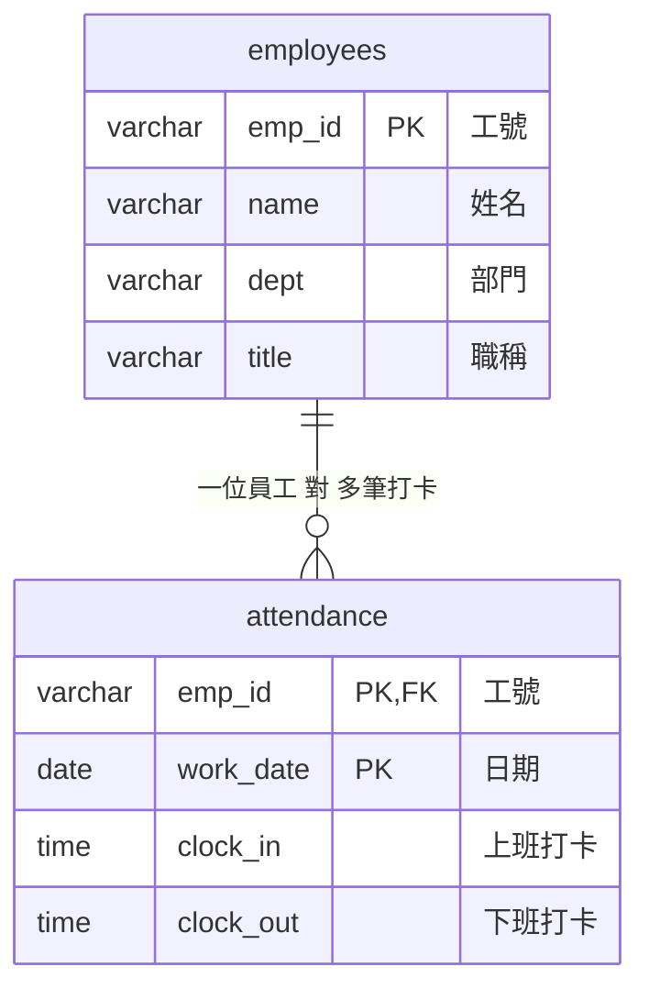

# 步驟 1｜為什麼要拆表：用四個問題檢查 Excel

> 💻 Excel ｜ 🎯 學完你會：用四個問題找出單一工作表的問題，並決定要拆成哪幾張表

> 📚 先修：[從 Excel 到關聯式資料庫](../../範例資料庫/從Excel到關聯資料庫_正規化.md)。這裡用自己的打卡表再做一次判斷。

## 🎬 情境

打開 [`打卡表.xlsx`](./打卡表.xlsx) 的「打卡紀錄」工作表，再看「需求」工作表：

| 編號 | 故事 | 驗收條件 |
|:---:|---|---|
| S1 | 身為人資，我想要輸入員工姓名，看到他的打卡明細和所屬部門，這樣才能在員工來問時馬上查到 | 輸入「林志明」列出本週 5 筆打卡，每筆都有部門，日期由早到晚 |
| S2 | 身為人資，我想要看到遲到名單，這樣才能在月底不用一列一列看 | 上班打卡晚於 09:00 的紀錄全部列出，09:00 整不算遲到 |
| S3 | 身為人資，我想要找出忘記打卡的紀錄，這樣才能提醒同事補登 | 上班或下班打卡空白的紀錄全部列出 |
| S4 | 身為人資，我想要員工調部門時只改一次，這樣報表才不會出現前後矛盾的部門 | 修改一次後，該員工所有打卡紀錄都顯示新部門 |
| S5 | 身為人資，我想要新進員工還沒打卡也能先登記，並找出沒有打卡紀錄的人，這樣才能確認每個人都開始打卡了 | 新進員工可以新增；完全沒有打卡紀錄的員工會被列出 |

## 1. 用四個問題檢查

| 問題 | 打卡表的情況 |
|---|---|
| **重複**：同樣的內容填了很多次嗎？ | 陳小華的姓名、部門、職稱，每天都填一次 |
| **修改**：改一件事要改很多地方嗎？ | 黃雅婷調部門，要改 4 列 |
| **刪除**：刪掉一列會失去別的資料嗎？ | 如果某人只有一筆打卡，刪掉後就不知道他屬於哪個部門 |
| **新增**：想新增時被迫缺資料嗎？ | 新人還沒打卡，沒有日期可以填，就放不進這張表 |

## 2. 找出已經發生的矛盾

用 Excel 的篩選功能，只看工號 `E05`，檢查「部門」這一欄。

發現了什麼？

周美玲 3 月 7 日的部門寫成「業務部」，其他天都是「業務發展部」。

這就是重複填寫的後果：同一個人有兩種部門，電腦無法判斷哪個才對。下一步的表結構會讓這種矛盾無法再發生。

## 3. 決定拆法

逐欄問：**這個資料是屬於「人」，還是屬於「某人的某一天」？**

| Excel 標題 | 屬於 | 放到哪張表 |
|---|---|---|
| 工號、姓名、部門、職稱 | 人 | `employees` 員工 |
| 日期、上班打卡、下班打卡 | 某人的某一天 | `attendance` 打卡紀錄 |

一位員工有很多筆打卡，一筆打卡只屬於一位員工，所以這是**一對多**。外來鍵放在「多」的那一邊，也就是 `attendance` 記工號，姓名和部門都不再重複。

> [!NOTE]
> **部門為什麼不再拆一張表？** 這個專案只用到部門名稱，為了專心學一對多，先放在員工表。專案 4 的報銷單會把部門拆成獨立的表，因為部門還有主管等資料。

## 4. 決定欄位規格

| 表 | 欄位 | 型別 | 規則 | 為什麼 |
|---|---|---|---|---|
| `employees` | `emp_id` | `VARCHAR(10)` | 主鍵 | 工號不會拿來計算 |
| `employees` | `name` | `VARCHAR(20)` | 必填 | |
| `employees` | `dept` | `VARCHAR(20)` | 必填 | |
| `employees` | `title` | `VARCHAR(30)` | 必填 | |
| `attendance` | `emp_id` | `VARCHAR(10)` | 必填、外來鍵 | 必須是存在的員工 |
| `attendance` | `work_date` | `DATE` | 必填 | |
| `attendance` | `clock_in` | `TIME` | 可空白 | 可能忘記打卡 |
| `attendance` | `clock_out` | `TIME` | 可空白，要晚於上班 | 可能忘記打卡 |

`attendance` 的主鍵是 **`emp_id` 加 `work_date` 兩欄一起**，意思是「同一個人同一天只能有一筆」。

## ⚠️ 常見卡關

| 狀況 | 怎麼想 |
|---|---|
| 不知道欄位該放哪張表 | 問自己：「這個資料會因為換一天而不同嗎？」會的話放打卡紀錄 |
| 外來鍵不知道放哪一邊 | 放在「多」的那一邊 |
| 主鍵只用 `emp_id` 可以嗎 | 不行，同一個人有很多天的打卡，只用工號會重複 |

## ✍️ 動手練

**第 1 題**：如果要多記「到職日」和「當天打卡地點」，各要放在哪張表？

看答案

到職日屬於人，放 `employees`。打卡地點每天可能不同，放 `attendance`。

**第 2 題**：打開你工作上的一張 Excel，用四個問題檢查，並試著寫下要拆成哪兩張表。

看提示

先找每一列都重複出現的那組資料，通常就是可以拆出去的「一」。

## 🤖 問 AI 助教

> 我想把打卡表拆成 employees 和 attendance 兩張表，欄位分配如下：（貼上你的規劃）。請用「重複、修改、刪除、新增」四個問題檢查我的拆法，說明還有沒有問題。先不要幫我寫 SQL。

---

| 上一步 | 目錄 | 下一步 |
|:---|:---:|---:|
| [⬅️ 專案導覽](./README.md) | [🏠 實戰專案大綱](../實戰專案大綱.md) | [步驟 2：手寫 DDL ➡️](./2_手寫DDL.md) |
