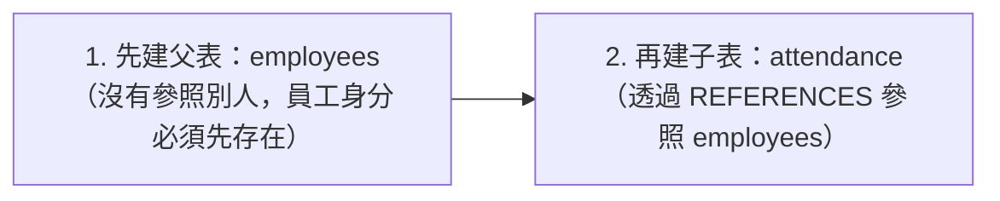
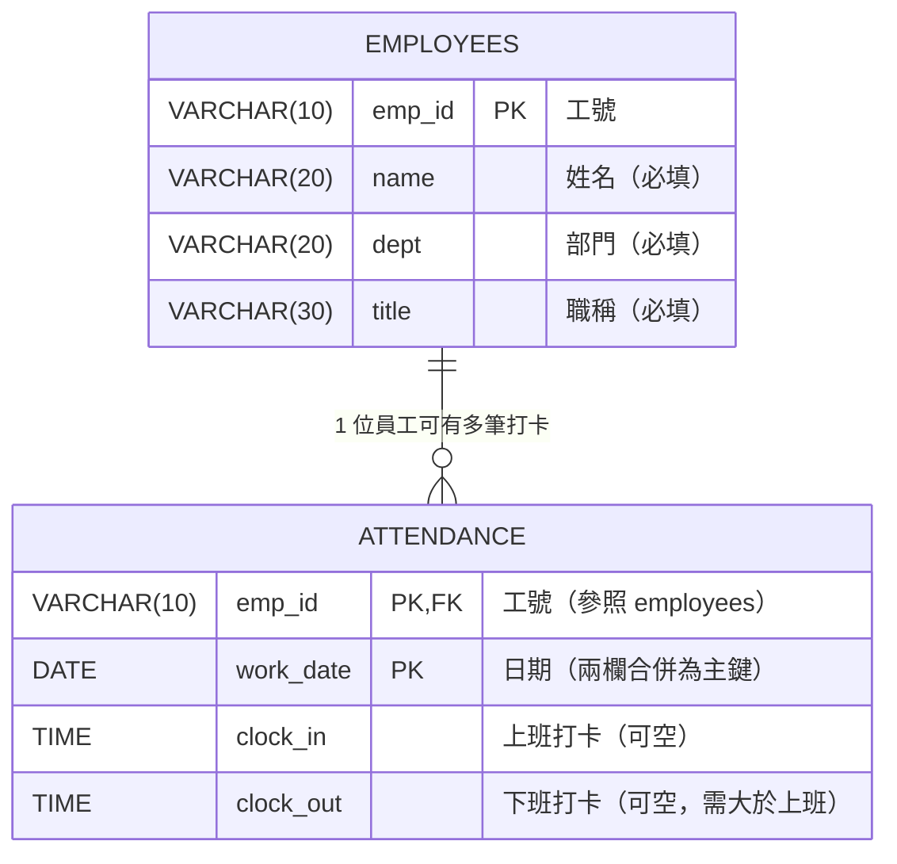

# 步驟 2｜手寫 DDL：親手建立「先父後子」兩張關聯表

> **本步驟鐵則：完全不匯入現成 `.sql` 檔！**  
> 你要看著 ER 關聯圖、相依順序與欄位規格卡，自己在 DBeaver Query Tool 親手敲出建庫、建表與外來鍵語法。

---

## 任務一：建立並切換到 `attendance` 資料庫

在 DBeaver 建立資料庫，**接著在左側重新整理、連進 `attendance` 後再開新的 SQL 編輯器**：

```sql
CREATE DATABASE attendance;
```

> [!TIP]
> **Supabase 免費方案替代方案**：若無法使用 `CREATE DATABASE`，請連線 `postgres` 資料庫改用獨立 Schema：
> ```sql
> CREATE SCHEMA IF NOT EXISTS attendance;
> SET search_path TO attendance;
> ```

---

## 任務二：看懂關聯架構、建表順序與 DDL 規格卡





### 手寫規格卡（請照「先父後子」順序在 DBeaver 親手敲出來）

#### 第 1 張（父表）：`employees`
| 英文欄位名 | 中文含義 | 建議型別 | 必填 / 約束條件 |
|---|---|---|---|
| `emp_id` | 工號 | `VARCHAR(10)` | `PRIMARY KEY` |
| `name` | 姓名 | `VARCHAR(20)` | `NOT NULL` |
| `dept` | 部門 | `VARCHAR(20)` | `NOT NULL` |
| `title` | 職稱 | `VARCHAR(30)` | `NOT NULL` |

#### 第 2 張（子表）：`attendance`
| 英文欄位名 | 中文含義 | 建議型別 | 必填 / 約束條件 |
|---|---|---|---|
| `emp_id` | 工號 | `VARCHAR(10)` | `NOT NULL REFERENCES employees(emp_id)` |
| `work_date` | 日期 | `DATE` | `NOT NULL` |
| `clock_in` | 上班打卡 | `TIME` | 可空白 |
| `clock_out` | 下班打卡 | `TIME` | 可空白 |
| *(表級約束)* | 複合主鍵 | — | `PRIMARY KEY (emp_id, work_date)`（一人一天只能一筆） |
| *(表級約束)* | 合理時間檢查 | — | `CHECK (clock_out > clock_in)` |

> 💡 **為什麼其中一邊是 `NULL` 時，`CHECK (clock_out > clock_in)` 不會擋下來？**  
> 在 SQL 裡任何東西跟 `NULL` 比較結果都是 `UNKNOWN`，`CHECK` 只在確定算出 `FALSE` 時才拒絕！這剛好允許「忘記打上班或下班卡」的真實紀錄寫進來，又能在兩邊都有時間時抓出下班早於上班的錯！

> ✍️ **現在請暫停閱讀，切到 DBeaver 自己手寫這兩條 `CREATE TABLE` 並執行！**  
> 完成後再點開 `<details>` 逐字對照欄位名稱、型別與表名是否一致。

<details>
<summary>👀 自己寫完再打開：參考 DDL 解答（務必核對欄位名稱與限制條件）</summary>

```sql
CREATE TABLE employees (
    emp_id VARCHAR(10) PRIMARY KEY,
    name   VARCHAR(20) NOT NULL,
    dept   VARCHAR(20) NOT NULL,
    title  VARCHAR(30) NOT NULL
);

CREATE TABLE attendance (
    emp_id    VARCHAR(10) NOT NULL REFERENCES employees(emp_id),
    work_date DATE        NOT NULL,
    clock_in  TIME,
    clock_out TIME,
    PRIMARY KEY (emp_id, work_date),
    CHECK (clock_out > clock_in)
);
```

</details>

---

## 任務三：測試警衛！挑戰 5 筆壞資料與孤兒防護

先放進 **1 位員工** 和 **1 筆正常打卡**（寫入一樣要**先父後子**）：

```sql
INSERT INTO employees VALUES ('E01', '陳小華', '業務發展部', '資深業務代表');
INSERT INTO attendance VALUES ('E01', '2024-03-11', '08:55', '18:00');
```

接著打開 [打卡表.xlsx](打卡表.xlsx) 的 **`有問題的資料`** 工作表（5 筆），**先自己推測會被哪條規則擋下**，並在 DBeaver 逐條寫成 `INSERT` / `DELETE` 測試：

| 測試項 | 錯誤情境 | 你猜會觸發什麼限制條件？ |
|---|---|---|
| 測試 1 | `E99` 不存在卻試圖打卡 | ？ |
| 測試 2 | `E01` 在 `2024-03-11` 重複打卡兩次 | ？ |
| 測試 3 | `E01` 上班 `18:00`、下班 `09:00` | ？ |
| 測試 4 | 日期寫 `'2024-02-30'` | ？ |
| 測試 5 | 時間寫 `'25:10'` | ？ |
| 測試 6 | 試圖直接 `DELETE FROM employees WHERE emp_id = 'E01';` | ？ |

<details>
<summary>👀 實測完再打開：6 個測試 SQL 與真實攔截訊息</summary>

```sql
-- 測試 1：查無員工 → violates foreign key constraint "attendance_emp_id_fkey"
INSERT INTO attendance VALUES ('E99', '2024-03-11', '08:55', '18:00');

-- 測試 2：同一人同一天打卡兩次 → duplicate key value violates unique constraint "attendance_pkey"
INSERT INTO attendance VALUES ('E01', '2024-03-11', '08:55', '18:00');

-- 測試 3：下班比上班早 → violates check constraint "attendance_check"
INSERT INTO attendance VALUES ('E01', '2024-03-12', '18:00', '09:00');

-- 測試 4：2 月沒有 30 號 → date/time field value out of range: "2024-02-30"
INSERT INTO attendance VALUES ('E01', '2024-02-30', '08:55', '18:00');

-- 測試 5：沒有 25 點 → date/time field value out of range: "25:10"
INSERT INTO attendance VALUES ('E01', '2024-03-13', '25:10', '18:00');

-- 測試 6：刪除仍有打卡紀錄的員工 → update or delete on table "employees" violates foreign key constraint
DELETE FROM employees WHERE emp_id = 'E01';
```

</details>

---

## ✍️ 動手練（3 題 DDL ／ 關聯清理演練）

1. **測試「忘記打下班卡」能否寫入**：只填 `E01`、`2024-03-12` 和 `clock_in = '08:55'`，讓 `clock_out` 為 `NULL`，看看是否成功寫入？
   <details>
   <summary>👀 點開看解答</summary>

   ```sql
   INSERT INTO attendance (emp_id, work_date, clock_in, clock_out)
   VALUES ('E01', '2024-03-12', '08:55', NULL);
   -- 會成功寫入！因為 clock_out > clock_in 遇到 NULL 會略過不擋。
   ```
   </details>

2. **體驗「只清空父表」為什麼失敗**：試著執行 `TRUNCATE TABLE employees;` 觀察報錯，再用正確方式同時清空兩張表。
   <details>
   <summary>👀 點開看解答</summary>

   ```sql
   -- 會報錯：cannot truncate a table referenced in a foreign key constraint
   TRUNCATE TABLE employees;

   -- 正確寫法：把有外來鍵相依的表一起清空
   TRUNCATE TABLE attendance, employees;
   ```
   </details>

3. **確認表是乾淨空表準備步驟 3**：用 `SELECT COUNT(*) FROM employees;` 和 `SELECT COUNT(*) FROM attendance;` 確認兩張表皆為 `0` 筆！

---

## 🤖 用 Microsoft Postgres MCP 驗收結構（Prompt）

```text
請透過 Microsoft Postgres MCP 連線到我的 attendance 資料庫，只用唯讀方式檢查 public schema 下 employees 與 attendance 兩張資料表的欄位型別、NOT NULL、PRIMARY KEY、FOREIGN KEY 與 CHECK 限制條件。
嚴禁修改任何資料，並請幫我確認：
1. employees 主鍵是否為 emp_id VARCHAR(10)，且 name/dept/title 皆 NOT NULL？
2. attendance 主鍵是否為複合主鍵 (emp_id, work_date)？
3. attendance 是否包含參照 employees(emp_id) 的外來鍵，以及 CHECK (clock_out > clock_in)？
```

---

👉 **建表完成且保護機制全數驗證通過！前往 [步驟 3｜AI 產生資料交易檔](3_AI產生資料交易檔.md)**
