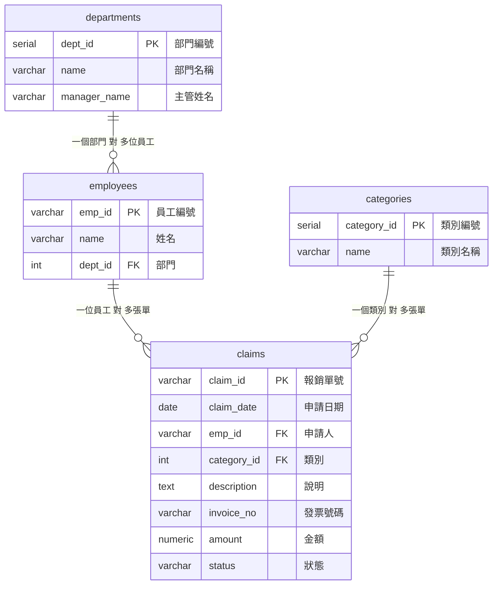

# 步驟 1｜一張拆四張：哪些資料該獨立出來

> 💻 Excel ｜ 🎯 學完你會：從一張工作表找出多個主題，決定編號方式，並判斷哪些重複不用處理

> 📚 先修：[進階-1 建立七張表](../../SQL語法教學/7創建關聯資料庫.md)。這裡換成自己設計。

## 🎬 情境

打開 [`差旅報銷單.xlsx`](./差旅報銷單.xlsx) 的報銷清單，再看「需求」工作表：

| 編號 | 故事 | 驗收條件 |
|:---:|---|---|
| S1 | 身為出納，我想要看到待撥款的單據，包含員工、部門、類別和金額，這樣才能不會漏撥款 | 狀態是「待撥款」的單據全部列出，並顯示合計金額 |
| S2 | 身為會計，我想要看到待審核的單據和負責審核的主管，這樣才能知道該催誰審核 | 狀態是「待審核」的單據全部列出，每筆都有部門主管 |
| S3 | 身為主管，我想要核准或駁回待審核的單據，這樣流程才不用靠 Excel 傳來傳去 | 只有待審核的單據能被審核；已經審核過的單據不會被改到 |
| S4 | 身為會計，我想要新增報銷單，發票重複時要被擋下；遇到新的費用類別可以先新增，這樣才能避免同一張發票重複報帳 | 發票號碼重複時不能新增；新類別會自動取得下一個編號 |
| S5 | 身為財務主管，我想要選一個部門，看到已撥款的總金額，這樣才能掌握各部門實際支出 | 輸入「業務部」，顯示該部門已撥款單據的金額加總 |

## 1. 找出工作表裡的主題

專案 3 問的是「這個資料屬於誰」。這張表要多問幾次：

| Excel 標題 | 描述的是 | 放到哪張表 |
|---|---|---|
| 部門名稱、主管姓名 | 部門 | `departments` |
| 費用類別 | 類別 | `categories` |
| 員工編號、員工姓名 | 員工 | `employees` |
| 報銷單號、申請日期、費用說明、發票號碼、報銷金額、審核狀態 | 一張報銷單 | `claims` |

報銷單不用記部門，因為從員工就能找到部門。

## 2. 主鍵從哪裡來

| 表 | Excel 有現成編號嗎 | 主鍵 |
|---|---|---|
| `employees` | 有，員工編號 | 沿用 `emp_id`，文字 |
| `claims` | 有，報銷單號 | 沿用 `claim_id`，文字 |
| `departments` | **沒有** | 新增 `dept_id`，用 `SERIAL` 自動編號 |
| `categories` | **沒有** | 新增 `category_id`，用 `SERIAL` 自動編號 |

名稱可能會改，例如部門改名，所以不適合當主鍵。編號永遠不變，其他表才能放心參照。

## 3. 不是所有重複都要處理

打開 Excel 找一下「李副總」，他同時是技術部和人事部的主管。拆表後，`departments` 裡還是會出現兩次「李副總」。

這樣可以嗎？可以。這裡的主管姓名是**部門的一個屬性**，而且我們沒有其他主管資料要管理。用四個問題檢查：李副總改名時只要改 2 列，不會影響報銷單，也沒有新增或刪除的問題。

如果之後要記主管的電話、職等和簽核權限，再把主管獨立成一張表。

> [!TIP]
> 拆表是為了解決問題，不是拆得越多越好。

## 4. 這次新增的規則

| 欄位 | 規則 | 為什麼 |
|---|---|---|
| `departments.name`、`categories.name` | `UNIQUE` | 不能有兩個同名部門或類別 |
| `claims.invoice_no` | `NOT NULL UNIQUE` | 同一張發票不能報兩次（S4） |
| `claims.amount` | `NUMERIC(10, 2)`，大於 0 | 金額要精確，不用 `FLOAT` |
| `claims.status` | 只能是五種狀態，預設待審核 | 待審核、已批准、待撥款、已撥款、已駁回 |

## ⚠️ 常見卡關

| 狀況 | 怎麼想 |
|---|---|
| 報銷單要不要記部門 | 能從員工找到的就不要再存一次 |
| 外來鍵放哪裡 | 放在「多」的那一邊，所以 `claims` 記 `emp_id` 和 `category_id` |
| 部門名稱可以當主鍵嗎 | 不建議，改名時所有參照它的資料都要跟著改 |

## ✍️ 動手練

**第 1 題**：如果員工會調部門，舊報銷單要顯示「當時的部門」，現在的設計做得到嗎？

看答案

做不到。報銷單透過員工找部門，員工調動後，舊單據也會顯示新部門。如果公司要保留當時的部門，就要在 `claims` 多存一欄 `dept_id`。這是故意保留的重複，專案 5 的成交單價也是相同的道理。

**第 2 題**：先決定四張表的建立順序，並說明原因。

看答案

先建沒有參照別人的 `departments`、`categories`，再建參照部門的 `employees`，最後建參照員工和類別的 `claims`。

## 🤖 問 AI 助教

> 我想把報銷單拆成 departments、categories、employees、claims 四張表，這是我的規劃：（貼上）。請用「重複、修改、刪除、新增」四個問題檢查，並告訴我有沒有拆過頭或拆不夠的地方。先不要幫我寫 SQL。

---

| 上一步 | 目錄 | 下一步 |
|:---|:---:|---:|
| [⬅️ 專案導覽](./README.md) | [🏠 實戰專案大綱](../實戰專案大綱.md) | [步驟 2：手寫 DDL ➡️](./2_手寫DDL.md) |
