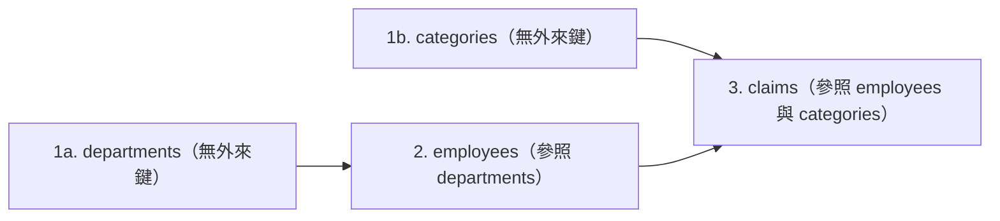
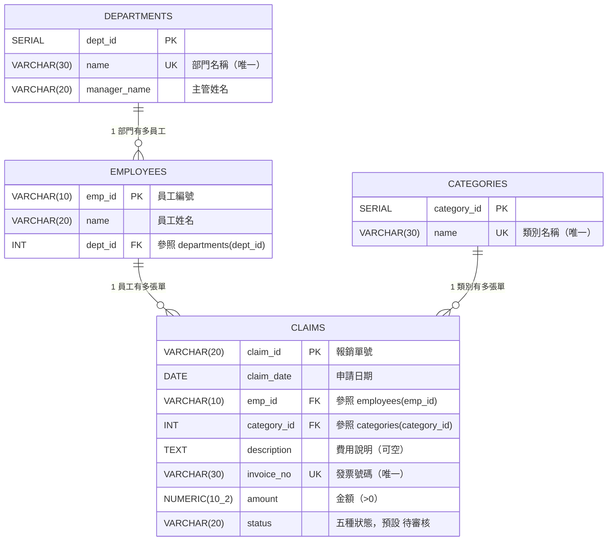

# 步驟 2｜手寫 DDL：依相依順序親手建立四張關聯表

> **本步驟鐵則：完全不匯入現成 `.sql` 檔！**  
> 打開 DBeaver Query Tool，看著下方建立順序流程圖與四張表規格卡，親手敲出建庫、建表、`SERIAL`、外來鍵與狀態檢查語法。

---

## 任務一：建立並切換到 `expense` 資料庫

在 DBeaver 建立獨立資料庫，**完成後在左側重新整理、連進 `expense` 再開新的 SQL 編輯器**：

```sql
CREATE DATABASE expense;
```

> [!TIP]
> **Supabase 免費方案替代方案**：若無法使用 `CREATE DATABASE`，請連線 `postgres` 資料庫改用獨立 Schema：
> ```sql
> CREATE SCHEMA IF NOT EXISTS expense;
> SET search_path TO expense;
> ```

---

## 任務二：看懂相依順序、ER 關聯圖與四表規格卡





### 手寫規格卡（務必照 1 → 2 → 3 順序在 DBeaver 手敲執行）

1. **`departments`（部門）**
   - `dept_id SERIAL PRIMARY KEY`
   - `name VARCHAR(30) NOT NULL UNIQUE`
   - `manager_name VARCHAR(20) NOT NULL`
2. **`categories`（費用類別）**
   - `category_id SERIAL PRIMARY KEY`
   - `name VARCHAR(30) NOT NULL UNIQUE`
3. **`employees`（員工）**
   - `emp_id VARCHAR(10) PRIMARY KEY`
   - `name VARCHAR(20) NOT NULL`
   - `dept_id INT NOT NULL REFERENCES departments(dept_id)`（註：被參照的 `SERIAL` 是整數，所以外來鍵寫 `INT`！）
4. **`claims`（報銷單）**
   - `claim_id VARCHAR(20) PRIMARY KEY`
   - `claim_date DATE NOT NULL`
   - `emp_id VARCHAR(10) NOT NULL REFERENCES employees(emp_id)`
   - `category_id INT NOT NULL REFERENCES categories(category_id)`
   - `description TEXT`（可空）
   - `invoice_no VARCHAR(30) NOT NULL UNIQUE`
   - `amount NUMERIC(10, 2) NOT NULL CHECK (amount > 0)`
   - `status VARCHAR(20) NOT NULL DEFAULT '待審核' CHECK (status IN ('待審核', '已批准', '待撥款', '已撥款', '已駁回'))`

> ✍️ **現在先在 DBeaver 自己敲出這四張表的 `CREATE TABLE` 並執行！**  
> 完成後再展開 `<details>` 核對每一個欄位名、資料型別、預設值與 `CHECK` 字眼。

<details>
<summary>👀 自己寫完再打開：參考 DDL 解答（務必核對欄位名稱與限制條件）</summary>

```sql
CREATE TABLE departments (
    dept_id      SERIAL PRIMARY KEY,
    name         VARCHAR(30) NOT NULL UNIQUE,
    manager_name VARCHAR(20) NOT NULL
);

CREATE TABLE categories (
    category_id SERIAL PRIMARY KEY,
    name        VARCHAR(30) NOT NULL UNIQUE
);

CREATE TABLE employees (
    emp_id  VARCHAR(10) PRIMARY KEY,
    name    VARCHAR(20) NOT NULL,
    dept_id INT NOT NULL REFERENCES departments(dept_id)
);

CREATE TABLE claims (
    claim_id    VARCHAR(20) PRIMARY KEY,
    claim_date  DATE NOT NULL,
    emp_id      VARCHAR(10) NOT NULL REFERENCES employees(emp_id),
    category_id INT NOT NULL REFERENCES categories(category_id),
    description TEXT,
    invoice_no  VARCHAR(30) NOT NULL UNIQUE,
    amount      NUMERIC(10, 2) NOT NULL CHECK (amount > 0),
    status      VARCHAR(20) NOT NULL DEFAULT '待審核'
                CHECK (status IN ('待審核', '已批准', '待撥款', '已撥款', '已駁回'))
);
```

</details>

---

## 任務三：測試警衛！挑戰 6 筆壞資料與部門防護

先由上層往下層放入 1 組正常測試資料：

```sql
INSERT INTO departments (name, manager_name) VALUES ('業務部', '張協理') RETURNING dept_id, name;
INSERT INTO categories (name) VALUES ('市區交通') RETURNING category_id, name;
INSERT INTO employees VALUES ('E01', '陳小華', 1);
INSERT INTO claims VALUES ('EXP20240301', '2024-03-01', 'E01', 1, '拜訪台北市內湖客戶計程車費', 'AB-98765431', 350, '已撥款');
```

接著打開 [差旅報銷單.xlsx](差旅報銷單.xlsx) 的 **`有問題的資料`** 工作表（6 筆），再加上 2 項保護測試（重複部門名、刪除有員工的部門），**先自己推測攔截規則**再逐句執行：

| 測試項 | 錯誤操作 | 你猜會觸發什麼限制？ |
|---|---|---|
| 測試 1 | 用同一張發票 `'AB-98765431'` 報 `EXP20240401` | ？ |
| 測試 2 | 重複報銷單號 `EXP20240301` | ？ |
| 測試 3 | 報銷金額填 `0` | ？ |
| 測試 4 | 審核狀態寫 `'審核中'` | ？ |
| 測試 5 | 員工寫不存在的 `'E99'` | ？ |
| 測試 6 | 類別編號寫不存在的 `99` | ？ |
| 測試 7 | 再新增一次 `'業務部'` | ？ |
| 測試 8 | 刪除 `dept_id = 1` 的部門 | ？ |

<details>
<summary>👀 實測完再打開：8 個壞資料／保護測試 SQL 與攔截訊息</summary>

```sql
-- 1. 發票重複 → duplicate key ... "claims_invoice_no_key"
INSERT INTO claims VALUES ('EXP20240401', '2024-04-01', 'E01', 1, '同一張發票又報一次', 'AB-98765431', 350, '待審核');

-- 2. 報銷單號重複 → duplicate key ... "claims_pkey"
INSERT INTO claims VALUES ('EXP20240301', '2024-04-01', 'E01', 1, '單號打錯', 'AB-00000001', 200, '待審核');

-- 3. 金額 <= 0 → violates check constraint "claims_amount_check"
INSERT INTO claims VALUES ('EXP20240402', '2024-04-02', 'E01', 1, '金額忘了填', 'AB-00000002', 0, '待審核');

-- 4. 非法狀態 → violates check constraint "claims_status_check"
INSERT INTO claims VALUES ('EXP20240403', '2024-04-03', 'E01', 1, '狀態自己亂寫', 'AB-00000003', 300, '審核中');

-- 5. 不存在的員工 → violates foreign key constraint "claims_emp_id_fkey"
INSERT INTO claims VALUES ('EXP20240404', '2024-04-04', 'E99', 1, '沒有這位員工', 'AB-00000004', 300, '待審核');

-- 6. 不存在的類別編號 → violates foreign key constraint "claims_category_id_fkey"
INSERT INTO claims VALUES ('EXP20240405', '2024-04-05', 'E01', 99, '類別表沒有這一項', 'AB-00000005', 300, '待審核');

-- 7. 部門名稱重複 → duplicate key ... "departments_name_key"
INSERT INTO departments (name, manager_name) VALUES ('業務部', '王經理');

-- 8. 刪除還有員工的部門 → violates foreign key constraint "employees_dept_id_fkey"
DELETE FROM departments WHERE dept_id = 1;
```

</details>

---

## ✍️ 動手練（3 題 DDL ／ 自動編號實戰）

1. **測試 `DEFAULT '待審核'` 與可空欄位 `description`**：只填入必填 7 欄（不填 `description` 與 `status`），看看報銷單 `EXP-TEST-01` 寫進去後，`status` 是否自動變成 `'待審核'`、`description` 是否是 `NULL`？
   <details>
   <summary>👀 點開看解答</summary>

   ```sql
   INSERT INTO claims (claim_id, claim_date, emp_id, category_id, invoice_no, amount)
   VALUES ('EXP-TEST-01', '2024-04-01', 'E01', 1, 'TEST-0001', 100)
   RETURNING claim_id, description, status;
   -- description 為 NULL，status 為 '待審核'。
   ```
   </details>

2. **驗證「失敗的 `INSERT` 也會跳號」**：上面第 7 題新增 `'業務部'` 失敗時，`departments` 下一次成功新增會拿幾號？試著再新增 `'測試部'` 看 `RETURNING dept_id` 是 `2` 還是 `3`！（提示：因為前面失敗用掉了 2 號，所以會跳成 `3`，這在資料庫是完全正常的現象！）
   <details>
   <summary>👀 點開看解答</summary>

   ```sql
   INSERT INTO departments (name, manager_name) VALUES ('測試部', '測試主管') RETURNING dept_id;
   -- 結果為 3（編號只求唯一識別，不需要強迫連續）。
   ```
   </details>

3. **清空四張表並重置 `SERIAL` 編號準備步驟 3**：請寫一條 `TRUNCATE ... RESTART IDENTITY;` 清空四張表，並查驗四張表筆數皆為 `0`。
   <details>
   <summary>👀 點開看解答</summary>

   ```sql
   TRUNCATE TABLE claims, employees, categories, departments RESTART IDENTITY;
   SELECT
       (SELECT COUNT(*) FROM departments) AS dept_cnt,
       (SELECT COUNT(*) FROM categories)  AS cat_cnt,
       (SELECT COUNT(*) FROM employees)   AS emp_cnt,
       (SELECT COUNT(*) FROM claims)      AS claim_cnt;
   ```
   </details>

---

## 🤖 用 Microsoft Postgres MCP 驗收結構（Prompt）

```text
請透過 Microsoft Postgres MCP 連線到我的 expense 資料庫，只用唯讀方式檢查 public schema 下 departments, categories, employees, claims 四張資料表的欄位型別、SERIAL、UNIQUE、PRIMARY KEY、FOREIGN KEY、DEFAULT 與 CHECK 限制條件。
嚴禁修改任何資料，請幫我核對：
1. claims.amount 型別是否為 NUMERIC(10, 2) 且有 CHECK (amount > 0)？
2. claims.invoice_no 是否有 NOT NULL 與 UNIQUE？
3. claims.status 是否有 DEFAULT '待審核' 與五種合法狀態 CHECK？
4. 所有外來鍵關聯順序與欄位型別是否完全正確？
```

---

👉 **四張表與所有守門員就緒！前往 [步驟 3｜AI 產生資料交易檔](3_AI產生資料交易檔.md)**
