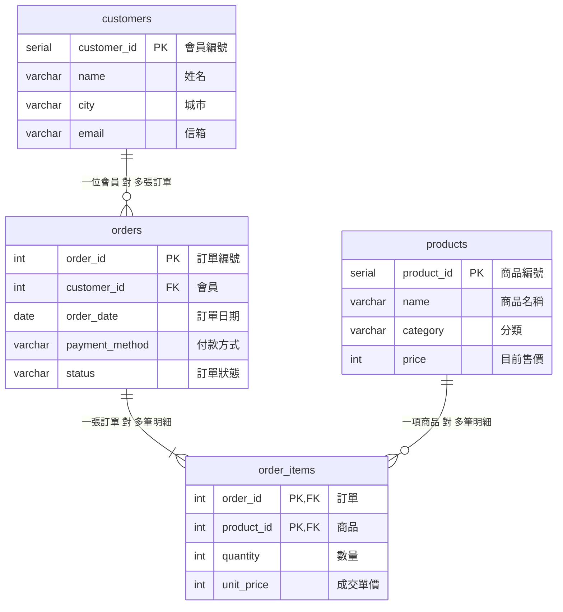

# 步驟 1｜多對多與歷史價格：哪些重複要拆，哪些要留

> 💻 Excel ｜ 🎯 學完你會：用明細表處理多對多，並判斷哪些看似重複的資料應該保留

> 📚 先修：[進階-1 建立七張表](../../SQL語法教學/7創建關聯資料庫.md)的多對多中間表。

## 🎬 情境

打開 [`網路商店訂單表.xlsx`](./網路商店訂單表.xlsx) 的「全部訂單」，再看「需求」工作表：

| 編號 | 故事 | 驗收條件 |
|:---:|---|---|
| S1 | 身為客服，我想要輸入訂單編號，看到買了什麼、當時單價、數量和總金額，這樣才能在客人來電時馬上回答 | 輸入 1001，列出 2 項商品、各自的成交單價與小計，並顯示訂單總額 |
| S2 | 身為業務，我想要輸入會員姓名，看到他買過的所有商品，這樣才能推薦適合的商品 | 輸入「林志明」，列出所有訂單的購買品項，日期由早到晚 |
| S3 | 身為業務主管，我想要調整商品售價，但舊訂單的金額不變，這樣歷史營收才會正確 | 調價後，新訂單用新價格；舊訂單的總額和調價前相同 |
| S4 | 身為行銷，我想要找出還沒賣出的商品和還沒下單的會員，這樣才能規劃促銷活動 | 沒有任何訂單明細的商品、沒有任何訂單的會員都要列出 |
| S5 | 身為客服，我想要幫客人建立一張有多項商品的訂單，建錯時可以整張刪除，這樣資料才不會只寫一半 | 訂單和明細一起成功；成交單價自動帶入目前售價；刪除訂單時明細一起刪除，會員資料保留 |

## 1. 找出問題

| 問題 | 這張表的情況 |
|---|---|
| **重複** | 訂單 1001 買兩項商品，訂單日期、付款方式和會員資料都填了兩次 |
| **修改** | 陳小華搬家，所有訂單列的城市都要改 |
| **刪除** | 黃雅婷如果只有那筆取消的訂單，刪掉就失去會員資料 |
| **新增** | 看看最後兩列：新商品沒有訂單、新會員沒有商品，只能留一堆空白 |

## 2. 訂單和商品是多對多

一張訂單可以有很多商品，一項商品也會出現在很多訂單。

資料庫不能直接表示多對多，要在中間多一張**明細表**，每筆明細是「某張訂單的某項商品」：

## 3. 這張表最重要的發現

用 Excel 篩選商品名稱「保溫鋼杯」，看「商品單價」這一欄。

發現了什麼？

3 月 10 日還賣 450，3 月 18 日起賣 490。「無線藍牙耳機」也從 1290 降到 1190。

這和專案 3 周美玲的部門不一樣。**部門寫錯是錯誤，價格不同卻是事實**：客人當時真的付了 450。

所以「單價」其實有兩種意思，要放在不同的表：

| 欄位 | 意思 | 會不會變 |
|---|---|---|
| `products.price` | 商品**目前**賣多少 | 調價時會改 |
| `order_items.unit_price` | 這筆訂單**當時**賣多少 | 成立後就不再改 |

如果明細不存成交單價，用 `products.price` 計算舊訂單，調價後舊訂單的金額就會跟著變，歷史營收也就錯了。

> [!IMPORTANT]
> 拆表的目標是「同一件事只記一次」。目前售價和當時成交價是**兩件不同的事**，所以兩邊都要存，這不是重複。

## 4. 其他決定

| 問題 | 決定 | 為什麼 |
|---|---|---|
| 會員用什麼辨識 | 新增 `customer_id`，`email` 設為 `UNIQUE` | 姓名可能相同，信箱不會 |
| 商品主鍵 | 新增 `product_id` | Excel 沒有編號，名稱也可能修改 |
| 訂單主鍵 | 沿用訂單編號，型別 `INT` | Excel 已有現成編號 |
| 小計要不要存 | 不存 | 查詢時用單價乘數量就好 |
| 明細主鍵 | `order_id` 加 `product_id` | 同一張訂單的同一項商品只有一筆 |
| 刪除訂單時的明細 | `ON DELETE CASCADE` | 明細離開訂單就沒有意義 |

## ⚠️ 常見卡關

| 狀況 | 怎麼想 |
|---|---|
| 分類要不要拆成一張表 | 這個專案只用分類名稱，先放在 `products` |
| 訂單要不要存總金額 | 不用，由明細加總才不會對不上 |
| 付款方式放哪裡 | 一張訂單只有一種付款方式，所以屬於 `orders` |

## ✍️ 動手練

**第 1 題**：`訂單狀態`應該放在 `orders` 還是 `order_items`？

看答案

放 `orders`，因為狀態是描述整張訂單。如果公司可以單項退貨，才需要在明細也記錄狀態。

**第 2 題**：你工作上有沒有類似「當時的價格」的資料？想想看哪些資料要保留當時的值。

看提示

例如報價單的折扣、薪資單的底薪、合約簽訂時的費率。這些資料日後改了，舊文件仍然要顯示當時的值。

## 🤖 問 AI 助教

> 我把訂單 Excel 規劃成 customers、products、orders、order_items 四張表。這是我的規劃：（貼上）。請特別檢查商品調價時，舊訂單的金額會不會改變，有問題的話告訴我原因。先不要幫我寫 SQL。

---

| 上一步 | 目錄 | 下一步 |
|:---|:---:|---:|
| [⬅️ 專案導覽](./README.md) | [🏠 實戰專案大綱](../實戰專案大綱.md) | [步驟 2：手寫 DDL ➡️](./2_手寫DDL.md) |
