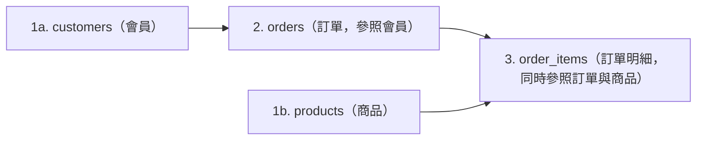
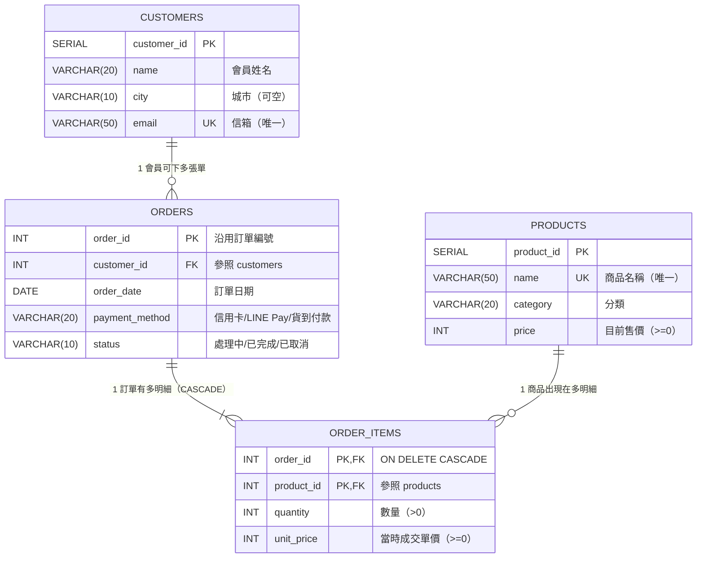

# 步驟 2｜手寫 DDL：親手建立多對多關聯與 `CASCADE` 保護規則

> **本步驟鐵則：完全不匯入現成 `.sql` 檔！**  
> 打開 DBeaver Query Tool，看著下方建立順序圖、ER 關聯圖與四表規格卡，親手敲出建庫與建表語法。

---

## 任務一：建立並切換到 `online_shop` 資料庫

在 DBeaver 建立獨立資料庫，**完成後在左側重新整理、連進 `online_shop` 再開新的 SQL 編輯器**：

```sql
CREATE DATABASE online_shop;
```

> [!TIP]
> **Supabase 免費方案替代方案**：若無法使用 `CREATE DATABASE`，請連線 `postgres` 資料庫改建獨立 Schema：
> ```sql
> CREATE SCHEMA IF NOT EXISTS online_shop;
> SET search_path TO online_shop;
> ```

---

## 任務二：看懂建表順序、ER 圖與四表規格卡





### 手寫規格卡（請照 1 → 2 → 3 順序在 DBeaver 手寫執行）

1. **`customers`（會員）**
   - `customer_id SERIAL PRIMARY KEY`
   - `name VARCHAR(20) NOT NULL`
   - `city VARCHAR(10)`（可空白）
   - `email VARCHAR(50) NOT NULL UNIQUE`
2. **`products`（商品）**
   - `product_id SERIAL PRIMARY KEY`
   - `name VARCHAR(50) NOT NULL UNIQUE`
   - `category VARCHAR(20) NOT NULL`
   - `price INT NOT NULL CHECK (price >= 0)`
3. **`orders`（訂單）**
   - `order_id INT PRIMARY KEY`（沿用 Excel 既有的 `1001..1010`，不加 `SERIAL`）
   - `customer_id INT NOT NULL REFERENCES customers(customer_id)`
   - `order_date DATE NOT NULL`
   - `payment_method VARCHAR(20) NOT NULL CHECK (payment_method IN ('信用卡', 'LINE Pay', '貨到付款'))`
   - `status VARCHAR(10) NOT NULL DEFAULT '處理中' CHECK (status IN ('處理中', '已完成', '已取消'))`
4. **`order_items`（訂單明細 — 多對多橋接表）**
   - `order_id INT NOT NULL REFERENCES orders(order_id) ON DELETE CASCADE`（刪訂單時明細連動刪除！）
   - `product_id INT NOT NULL REFERENCES products(product_id)`（被買過的商品不準亂刪！）
   - `quantity INT NOT NULL CHECK (quantity > 0)`
   - `unit_price INT NOT NULL CHECK (unit_price >= 0)`
   - `PRIMARY KEY (order_id, product_id)`（同張訂單同商品只有一列）

> ✍️ **現在請先在 DBeaver 自己敲出這四張表的 `CREATE TABLE` 並執行！**  
> 完成後再點開下方 `<details>` 逐字對照欄位名與連動規則。

<details>
<summary>👀 自己寫完再打開：參考 DDL 解答（務必核對欄位名稱與限制條件）</summary>

```sql
CREATE TABLE customers (
    customer_id SERIAL PRIMARY KEY,
    name        VARCHAR(20) NOT NULL,
    city        VARCHAR(10),
    email       VARCHAR(50) NOT NULL UNIQUE
);

CREATE TABLE products (
    product_id SERIAL PRIMARY KEY,
    name       VARCHAR(50) NOT NULL UNIQUE,
    category   VARCHAR(20) NOT NULL,
    price      INT NOT NULL CHECK (price >= 0)
);

CREATE TABLE orders (
    order_id       INT PRIMARY KEY,
    customer_id    INT NOT NULL REFERENCES customers(customer_id),
    order_date     DATE NOT NULL,
    payment_method VARCHAR(20) NOT NULL CHECK (payment_method IN ('信用卡', 'LINE Pay', '貨到付款')),
    status         VARCHAR(10) NOT NULL DEFAULT '處理中' CHECK (status IN ('處理中', '已完成', '已取消'))
);

CREATE TABLE order_items (
    order_id   INT NOT NULL REFERENCES orders(order_id) ON DELETE CASCADE,
    product_id INT NOT NULL REFERENCES products(product_id),
    quantity   INT NOT NULL CHECK (quantity > 0),
    unit_price INT NOT NULL CHECK (unit_price >= 0),
    PRIMARY KEY (order_id, product_id)
);
```

</details>

---

## 任務三：測試警衛！挑戰 8 筆壞資料與刪表保護

先放入一組正常資料作為基準：

```sql
INSERT INTO customers (name, city, email) VALUES ('陳小華', '台北市', 'hua@example.com');
INSERT INTO products (name, category, price) VALUES ('保溫鋼杯', '生活用品', 450);
INSERT INTO products (name, category, price) VALUES ('快充行動電源', '3C配件', 890);
INSERT INTO orders VALUES (1001, 1, '2024-03-01', '信用卡', '已完成');
INSERT INTO order_items VALUES (1001, 1, 2, 450);
```

接著打開 [網路商店訂單表.xlsx](網路商店訂單表.xlsx) 的 **`有問題的資料`** 工作表（8 筆）與刪會員／刪商品保護，**先猜會被哪條規則擋下**再逐句執行測試：

<details>
<summary>👀 實測完再打開：8 筆壞資料 ＋ 2 筆誤刪保護 SQL 與攔截訊息</summary>

```sql
-- 1. 同一張訂單同一商品重複列 → duplicate key ... "order_items_pkey"
INSERT INTO order_items VALUES (1001, 1, 1, 450);

-- 2. 數量為 0 → violates check constraint "order_items_quantity_check"
INSERT INTO order_items VALUES (1001, 2, 0, 890);

-- 3. 成交單價為負 → violates check constraint "order_items_unit_price_check"
INSERT INTO order_items VALUES (1001, 2, 1, -100);

-- 4. 訂單不存在 → violates foreign key constraint "order_items_order_id_fkey"
INSERT INTO order_items VALUES (9999, 1, 1, 450);

-- 5. 商品不存在 → violates foreign key constraint "order_items_product_id_fkey"
INSERT INTO order_items VALUES (1001, 99, 1, 100);

-- 6. 信箱重複 → duplicate key ... "customers_email_key"
INSERT INTO customers (name, city, email) VALUES ('冒名者', '台北市', 'hua@example.com');

-- 7. 付款方式不符 → violates check constraint "orders_payment_method_check"
INSERT INTO orders VALUES (1011, 1, '2024-04-01', '現金', '處理中');

-- 8. 訂單狀態不符 → violates check constraint "orders_status_check"
INSERT INTO orders VALUES (1012, 1, '2024-04-01', '信用卡', '退貨中');

-- 9/10. 刪除已有訂單的會員與已有明細的商品 → 被外來鍵擋下
DELETE FROM customers WHERE customer_id = 1;
DELETE FROM products WHERE product_id = 1;
```

</details>

---

## ✍️ 動手練（3 題 DDL ／ `ON DELETE CASCADE` 演練）

1. **測試 `DEFAULT '處理中'` 並驗證 `ON DELETE CASCADE`**：新增訂單 `1099`（不填 `status`）＋ 明細（購買商品 `2`），再用 `DELETE FROM orders WHERE order_id = 1099;` 刪除它，看看不用手動刪 `order_items`，明細是不是跟著自動消失、而會員 `陳小華` 依然安好？
   <details>
   <summary>👀 點開看解答</summary>

   ```sql
   INSERT INTO orders (order_id, customer_id, order_date, payment_method)
   VALUES (1099, 1, '2024-04-01', '信用卡')
   RETURNING order_id, status; -- status 自動為 '處理中'

   INSERT INTO order_items VALUES (1099, 2, 1, 890);

   DELETE FROM orders WHERE order_id = 1099;
   SELECT COUNT(*) FROM order_items WHERE order_id = 1099; -- 應為 0（CASCADE 成功）
   ```
   </details>

2. **思考外來鍵為什麼只在 `order_id` 加 `CASCADE`**：為什麼 `order_items.product_id` **沒有**加 `ON DELETE CASCADE`？（答：若允許刪商品就把全公司過去幾年的訂單明細一併刪光，歷史營收會整個消失！所以商品一定要擋刪，改用下架狀態。）
3. **清空測試資料並歸零序號準備步驟 3**：請寫一句 `TRUNCATE TABLE ... RESTART IDENTITY;` 清空四張表，確認皆為 `0` 筆。
   <details>
   <summary>👀 點開看解答</summary>

   ```sql
   TRUNCATE TABLE order_items, orders, products, customers RESTART IDENTITY;
   SELECT
       (SELECT COUNT(*) FROM customers)   AS cust_cnt,
       (SELECT COUNT(*) FROM products)    AS prod_cnt,
       (SELECT COUNT(*) FROM orders)      AS ord_cnt,
       (SELECT COUNT(*) FROM order_items) AS item_cnt;
   ```
   </details>

---

## 🤖 用 Microsoft Postgres MCP 驗收結構（Prompt）

```text
請透過 Microsoft Postgres MCP 連線到我的 online_shop 資料庫，只用唯讀方式檢查 public schema 下 customers, products, orders, order_items 四張資料表的欄位定義、主外來鍵與 CHECK / UNIQUE / CASCADE 設定。
嚴禁修改任何資料，確認：
1. order_items 是否為複合主鍵 (order_id, product_id)，且對 orders(order_id) 設有 ON DELETE CASCADE？
2. products.price 與 order_items.unit_price 兩邊是否各自存在且 CHECK >= 0？
3. orders.payment_method 與 status 是否設有 CHECK IN 與預設值 '處理中'？
```

---

👉 **四表與連動防護已就緒！前往 [步驟 3｜AI 產生資料交易檔](3_AI產生資料交易檔.md)**
