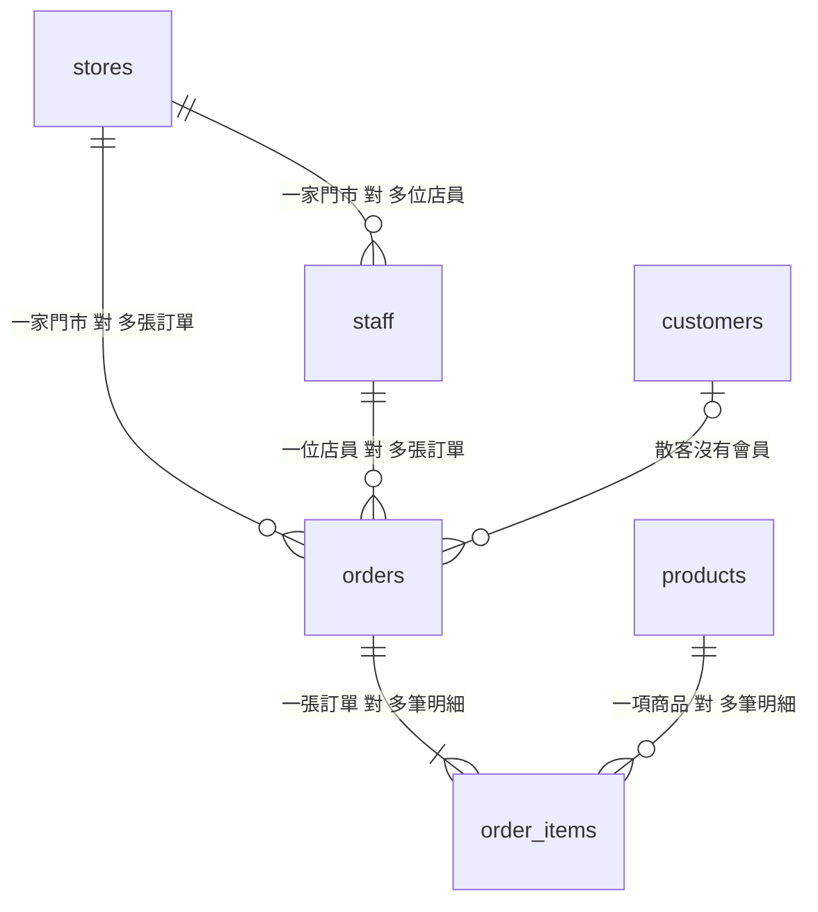

# 步驟 1｜跨月資料與暫存表：時間只是一個欄位

> 💻 Excel ｜ 🎯 學完你會：判斷會員該用什麼辨識，並說明暫存表為什麼能讓每月匯入變簡單

> 📚 先修：[DDL-4 匯入 CSV](../../SQL語法教學/2_1匯入csv.md)。這裡要把匯入的資料再拆進正式的表。

## 🎬 情境

打開三個月的 Excel，再看 [`門市月報_需求與樣本.xlsx`](./門市月報_需求與樣本.xlsx) 的「需求」工作表：

| 編號 | 故事 | 驗收條件 |
|:---:|---|---|
| S1 | 身為營運經理，我想要不開三個檔案，就看到各門市每個月的營業額，這樣才能在月會時馬上比較 | 只計算已完成訂單，每家門市每個月一列，總和等於已完成金額 |
| S2 | 身為店長，我想要看到本季最熱銷的前 5 項商品，這樣才能決定備料和促銷 | 依已完成訂單的銷售數量排序，數量相同時營業額高的在前 |
| S3 | 身為行銷，我想要找出 1、2、3 月都有消費的會員，這樣才能發送專屬優惠券 | 同名的不同會員要分開計算；只計算已完成訂單 |
| S4 | 身為營運經理，我想要找出業績高於全體店員平均的店員，這樣才能規劃獎勵名單 | 每位店員一列，只列出高於平均的人，業績高的在前 |
| S5 | 身為行政，我想要每月只要匯入新的 CSV，資料就自動歸位，這樣才能不用再複製 Excel 檔 | 匯入 4 月後新增 5 張訂單；同一份資料再匯入一次，筆數不會增加 |

## 1. 為什麼不用每月一張表

把月份放進檔名或表名，跨月就要合併很多地方。在資料庫裡，**時間只是一個欄位**：所有月份都在同一張表，要看哪個月用 `order_date` 篩選就好。

## 2. 決定拆法

| Excel 標題 | 描述的是 | 放到哪張表 |
|---|---|---|
| 門市名稱、區域 | 門市 | `stores` |
| 經手店員 | 店員 | `staff` |
| 商品分類、商品名稱、單價 | 商品 | `products` |
| 會員姓名、會員電話 | 會員 | `customers` |
| 銷售單號、日期、時間、付款方式、狀態 | 一張訂單 | `orders` |
| 商品、單價、數量 | 訂單中的一項商品 | `order_items` |

小計不用存，查詢時用單價乘數量。成交單價和專案 4 一樣放在 `order_items`。

## 3. 會員要用什麼辨識

打開 1 月的 Excel，用篩選看看「劉欣宜」，注意會員電話。

發現了什麼？

同一個姓名有不同的電話。整季資料裡，**20 個會員姓名其實對應 50 支電話**。這些是同名的不同人，而每支電話只對應一個姓名。

所以 `phone` 才是辨識會員的依據，要設成 `UNIQUE`，姓名可以重複。

那「散客」呢？他們沒有電話，也不是會員，不該放進 `customers`。訂單的 `customer_id` 允許是 `NULL`，代表這張單沒有會員。

## 4. 什麼是暫存表

直接把 CSV 匯入六張表做不到，因為 CSV 是一張大表。做法是分兩段：

| | 暫存表 `raw_sales` | 正式表 |
|---|---|---|
| 欄位 | 和 CSV 一模一樣，中文標題 | 拆開並正規化 |
| 型別 | 全部 `TEXT` | `DATE`、`INT` 等正確型別 |
| 規則 | 沒有限制，什麼都收 | 主鍵、外來鍵、`CHECK` |
| 用途 | 暫時放資料的中繼站 | 長期保存，給報表使用 |

暫存表全部用文字，匯入時才不會因為格式問題卡住。真正的檢查交給匯入腳本和正式表。

這份匯入腳本還要能重複使用，所以會用到 `ON CONFLICT DO NOTHING`：**已經有的資料就跳過**。

## ⚠️ 常見卡關

| 狀況 | 怎麼想 |
|---|---|
| 想為每個月建一張表 | 用同一張表加日期欄位 |
| 想用姓名辨識會員 | 先確認姓名會不會重複；這份資料就會 |
| 散客要不要建一筆「散客」會員 | 不用，`customer_id` 留 `NULL` |
| 店員要不要 `UNIQUE` | 不同門市可能同名，所以是「姓名加門市」不重複 |

## ✍️ 動手練

**第 1 題**：`staff` 的 `UNIQUE (name, store_id)` 和只寫 `UNIQUE (name)` 有什麼不同？

看答案

前者允許不同門市有同名的店員，後者整家公司不能有兩個同名店員。現實中不同門市可能有同名的人，所以用前者。

**第 2 題**：如果下個月有新商品，匯入腳本應該怎麼處理？

看答案

新商品要新增到 `products`，已經有的商品則跳過。這就是 `ON CONFLICT (name) DO NOTHING` 的效果。

## 🤖 問 AI 助教

> 我要把每月的門市銷售 CSV 匯入資料庫，打算先放進全 TEXT 的暫存表，再拆進六張正式表。請告訴我這樣設計的優缺點，以及同名會員和散客要注意什麼。先不要幫我寫 SQL。

## ✅ 過關檢查

- [ ] 我自己發現了同名不同人的問題
- [ ] 我能說明散客的 `customer_id` 為什麼是 `NULL`
- [ ] 我能說明暫存表和正式表的差別

---

| 上一步 | 目錄 | 下一步 |
|:---|:---:|---:|
| [⬅️ 專案導覽](./README.md) | [🏠 實戰專案大綱](../實戰專案大綱.md) | [步驟 2：手寫 DDL ➡️](./2_手寫DDL.md) |
