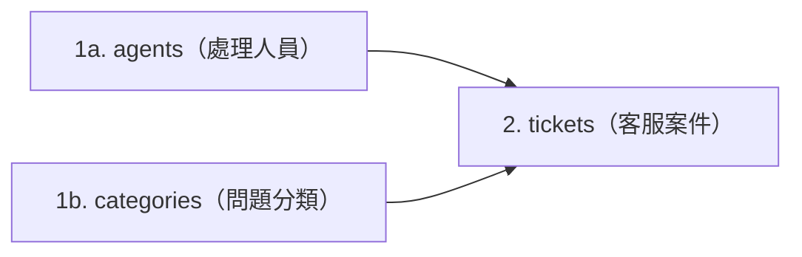
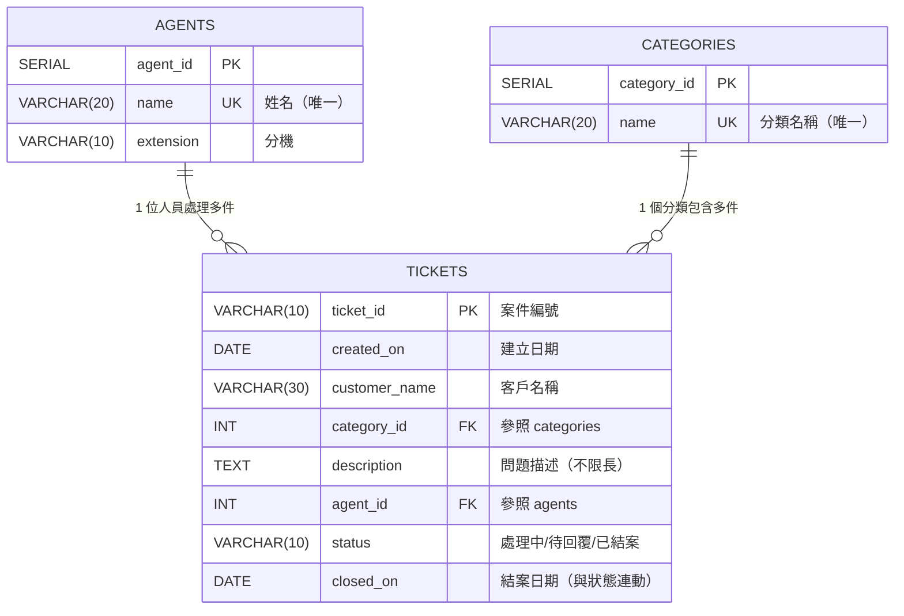

# 步驟 2｜手寫 DDL：親手建立三張表與雙重結案規則

> **本步驟鐵則：完全不匯入現成 `.sql` 檔！**  
> 打開 DBeaver Query Tool，看著下方建立順序圖、ER 關聯圖與三張表規格卡，親手敲出建庫、建表與結案日期保護規則。

---

## 任務一：建立並切換到 `tickets` 資料庫

在 DBeaver 建立獨立資料庫，**完成後在左側重新整理、連進 `tickets` 再開新的 SQL 編輯器**：

```sql
CREATE DATABASE tickets;
```

> [!TIP]
> **Supabase 免費方案替代方案**：若無法使用 `CREATE DATABASE`，請連線 `postgres` 資料庫改建獨立 Schema：
> ```sql
> CREATE SCHEMA IF NOT EXISTS tickets;
> SET search_path TO tickets;
> ```

---

## 任務二：看懂建表順序、ER 圖與三表規格卡





### 手寫規格卡（請照順序在 DBeaver 手敲執行）

1. **`agents`（處理人員）**
   - `agent_id SERIAL PRIMARY KEY`
   - `name VARCHAR(20) NOT NULL UNIQUE`
   - `extension VARCHAR(10) NOT NULL`
2. **`categories`（問題分類）**
   - `category_id SERIAL PRIMARY KEY`
   - `name VARCHAR(20) NOT NULL UNIQUE`
3. **`tickets`（客服案件）**
   - `ticket_id VARCHAR(10) PRIMARY KEY`
   - `created_on DATE NOT NULL`
   - `customer_name VARCHAR(30) NOT NULL`
   - `category_id INT NOT NULL REFERENCES categories(category_id)`
   - `description TEXT NOT NULL`
   - `agent_id INT NOT NULL REFERENCES agents(agent_id)`
   - `status VARCHAR(10) NOT NULL DEFAULT '處理中' CHECK (status IN ('處理中', '待回覆', '已結案'))`
   - `closed_on DATE`（可空）
   - **表級防呆 1**：`CHECK ((status = '已結案') = (closed_on IS NOT NULL))`（兩邊必須同時成立或同時不成立！）
   - **表級防呆 2**：`CHECK (closed_on >= created_on)`（若有結案日，不可早於建案日！）

> ✍️ **現在先在 DBeaver 自己敲出這三張表的 `CREATE TABLE` 並執行！**  
> 完成後再展開 `<details>` 逐字對照欄位名稱與兩條 `CHECK` 規則。

<details>
<summary>👀 自己寫完再打開：參考 DDL 解答（務必核對欄位名稱與限制條件）</summary>

```sql
CREATE TABLE agents (
    agent_id  SERIAL PRIMARY KEY,
    name      VARCHAR(20) NOT NULL UNIQUE,
    extension VARCHAR(10) NOT NULL
);

CREATE TABLE categories (
    category_id SERIAL PRIMARY KEY,
    name        VARCHAR(20) NOT NULL UNIQUE
);

CREATE TABLE tickets (
    ticket_id     VARCHAR(10) PRIMARY KEY,
    created_on    DATE        NOT NULL,
    customer_name VARCHAR(30) NOT NULL,
    category_id   INT         NOT NULL REFERENCES categories(category_id),
    description   TEXT        NOT NULL,
    agent_id      INT         NOT NULL REFERENCES agents(agent_id),
    status        VARCHAR(10) NOT NULL DEFAULT '處理中' CHECK (status IN ('處理中', '待回覆', '已結案')),
    closed_on     DATE,
    CHECK ((status = '已結案') = (closed_on IS NOT NULL)),
    CHECK (closed_on >= created_on)
);
```

</details>

---

## 任務三：測試警衛！挑戰 5 筆壞資料（特別檢查雙重結案規則）

先放進 1 組正確測試資料：

```sql
INSERT INTO agents (name, extension) VALUES ('陳怡君', '101');
INSERT INTO categories (name) VALUES ('網路連線');
INSERT INTO tickets VALUES ('T001', '2024-01-03', '順發貿易', 1, 'WiFi 連不上，重開機也沒用', 1, '已結案', '2024-01-04');
```

接著打開 [客服案件紀錄.xlsx](客服案件紀錄.xlsx) 的 **`有問題的資料`** 工作表（5 筆），**先猜會被哪條規則擋下**再逐句執行：

<details>
<summary>👀 實測完再打開：5 筆壞資料測試 SQL 與真實攔截訊息</summary>

```sql
-- 1. 案件編號重複 → duplicate key ... "tickets_pkey"
INSERT INTO tickets VALUES ('T001', '2024-04-01', '順發貿易', 1, '編號重複', 1, '處理中', NULL);

-- 2. 非法狀態 → violates check constraint "tickets_status_check"
INSERT INTO tickets VALUES ('T101', '2024-04-01', '順發貿易', 1, '狀態自己亂寫', 1, '暫緩', NULL);

-- 3. 不存在的處理人員 → violates foreign key constraint "tickets_agent_id_fkey"
INSERT INTO tickets VALUES ('T102', '2024-04-01', '順發貿易', 1, '處理人員不存在', 99, '處理中', NULL);

-- 4. 已結案卻沒有結案日期 → violates check constraint "tickets_check"
INSERT INTO tickets VALUES ('T103', '2024-04-01', '順發貿易', 1, '已結案卻沒有日期', 1, '已結案', NULL);

-- 5. 結案日期早於建立日期 → violates check constraint "tickets_check1"
INSERT INTO tickets VALUES ('T104', '2024-04-05', '順發貿易', 1, '結案比建立還早', 1, '已結案', '2024-04-01');
```

</details>

---

## ✍️ 動手練（3 題 DDL ／ 結案邏輯實戰）

1. **測試相反方向：「還沒結案，卻偷填結案日」會不會被攔？**：試著新增一筆 `status = '待回覆'`、卻填入 `closed_on = '2024-04-02'` 的資料，看 `CHECK ((status = '已結案') = (closed_on IS NOT NULL))` 是否同樣把關！
   <details>
   <summary>👀 點開看解答</summary>

   ```sql
   INSERT INTO tickets VALUES ('T-TEST-1', '2024-04-01', '順發貿易', 1, '測試', 1, '待回覆', '2024-04-02');
   -- 會失敗！violates check constraint "tickets_check"（左邊 FALSE、右邊 TRUE，兩邊不相等！）
   ```
   </details>

2. **測試同日結案（`closed_on = created_on`）能成功嗎？**：試著新增一筆當天建案、當天就結案（例如 `'2024-04-01'` 建案、`'2024-04-01'` 結案），看看 `>=` 允許同天結案嗎？
   <details>
   <summary>👀 點開看解答</summary>

   ```sql
   INSERT INTO tickets VALUES ('T-TEST-2', '2024-04-01', '順發貿易', 1, '當天解決', 1, '已結案', '2024-04-01');
   -- 會成功！因為約束寫的是 closed_on >= created_on（包含等於）。
   ```
   </details>

3. **清空測試資料並重置 `SERIAL` 序號準備步驟 3**：請執行 `TRUNCATE ... RESTART IDENTITY;` 清空三張表，確認三表皆為 `0` 筆。
   <details>
   <summary>👀 點開看解答</summary>

   ```sql
   TRUNCATE TABLE tickets, categories, agents RESTART IDENTITY;
   SELECT
       (SELECT COUNT(*) FROM agents)     AS agent_cnt,
       (SELECT COUNT(*) FROM categories) AS cat_cnt,
       (SELECT COUNT(*) FROM tickets)    AS ticket_cnt;
   ```
   </details>

---

## 🤖 用 Microsoft Postgres MCP 驗收結構（Prompt）

```text
請透過 Microsoft Postgres MCP 連線到我的 tickets 資料庫，只用唯讀方式檢查 public schema 下 agents, categories, tickets 三張資料表的欄位型別、主外來鍵、預設值與兩條 CHECK 限制條件。
嚴禁修改任何資料，確認：
1. tickets 是否同時具備 CHECK ((status = '已結案') = (closed_on IS NOT NULL)) 與 CHECK (closed_on >= created_on)？
2. tickets.status 預設值是否為 '處理中'，且只允許 ('處理中', '待回覆', '已結案')？
3. agents.name 與 categories.name 是否都設有 UNIQUE？
```

---

👉 **建表與結案守門員驗證完成！前往 [步驟 3｜AI 產生資料交易檔](3_AI產生資料交易檔.md)**
