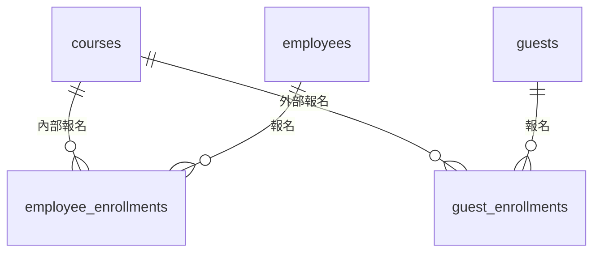

# 步驟 1｜兩份名單怎麼設計：欄位不同的人，分開存

> 💻 Excel ｜ 🎯 學完你會：判斷兩份名單要合併成一張表，還是分開存

> 📚 先修：[進階-6 聯集](../../SQL語法教學/12聯集.md)、[進階-7 綜合連結](../../SQL語法教學/13連結.md)。

## 🎬 情境

打開 [`教育訓練報名表.xlsx`](./教育訓練報名表.xlsx) 的前三張工作表，再看「需求」工作表：

| 編號 | 故事 | 驗收條件 |
|:---:|---|---|
| S1 | 身為訓練承辦，我想要看到一門課的完整名單，內部和外部都在同一份，這樣才能製作簽到表 | 輸入 C02，列出內部 4 人和外部 3 人，並標示身分 |
| S2 | 身為訓練承辦，我想要知道總共有多少人報名過課程，這樣才能回報訓練成果 | 同名但不同單位的人要分開計算 |
| S3 | 身為訓練承辦，我想要看到每門課的內部報名人數，這樣才能決定要不要加開 | 沒有人報名的課程也要出現，人數顯示 0 |
| S4 | 身為人資主管，我想要看到每門課有多少內部員工實際出席，這樣才能評估訓練成效 | 沒有人出席的課程也要出現，人數顯示 0 |
| S5 | 身為訓練承辦，我想要登記課程的出席情形，這樣才不用改 Excel | 只登記尚未登記的紀錄，已登記的不會被改到 |

## 1. 比較兩份名單

| | 內部員工報名 | 外部來賓報名 |
|---|---|---|
| 辨識方式 | 工號 | 信箱 |
| 其他資料 | 姓名、部門 | 姓名、公司 |

內部有部門，外部有公司，辨識方式也不同，所以分成 `employees` 和 `guests` 兩張表。

報名紀錄也分成兩張表，外來鍵才能分別指向員工和來賓：

要看完整名單時，再用 `UNION ALL` 上下疊起來。

## 2. 找出容易出錯的地方

打開「外部來賓報名」，再看「內部員工報名」，找找有沒有相同的姓名。

發現了什麼？

業務發展部的員工和金福食品的來賓都叫陳小華。兩個人同名，所以統計人數時不能只比對姓名。

## 3. 出席要存成三種狀態

Excel 的「出席」有是、否、空白三種：

| Excel | 資料庫 | 意思 |
|---|---|---|
| 是 | `true` | 有出席 |
| 否 | `false` | 沒出席 |
| 空白 | `NULL` | 還沒登記 |

「沒出席」和「還沒登記」是兩件不同的事，所以 `attended` 允許 `NULL`。

## ⚠️ 常見卡關

| 狀況 | 怎麼想 |
|---|---|
| 全部放一張人員表可以嗎 | 可以，但要多一欄身分，部門和公司也會有很多空白 |
| 空白要不要當成沒出席 | 不要，課程可能還沒開始 |

## ✍️ 動手練

**C05 這門課沒有人報名，在原本的 Excel 要怎麼看出來？**

看答案

要拿課程清單和兩份報名名單一一比對，很容易漏掉。資料庫用 `LEFT JOIN` 就能保留沒有報名的課程。

## 🤖 問 AI 助教

> 我把內部員工和外部來賓分成兩張表，報名紀錄也分兩張，這是我的規劃：（貼上）。請告訴我這樣設計的優缺點。先不要幫我寫 SQL。

---

| 上一步 | 目錄 | 下一步 |
|:---|:---:|---:|
| [⬅️ 回第 5 章目錄](../README.md) | [🏠 專案導覽](./README.md) | [步驟 2：手寫 DDL ➡️](./2_手寫DDL.md) |
