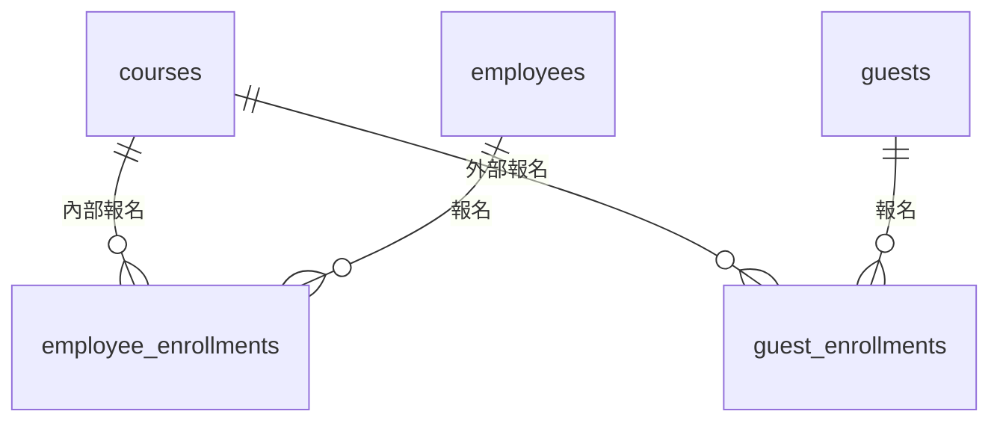

# 步驟 1｜兩份名單怎麼設計：欄位不同的人，分開存

> 💻 Excel ｜ 🎯 學完你會：判斷兩份名單要合併成一張表，還是分開存，並理解三態出席欄位

> 📚 先修：[進階-6 聯集](../../SQL語法教學/12聯集.md)、[進階-7 綜合連結](../../SQL語法教學/13連結.md)。

## 🎬 情境

打開 [`教育訓練報名表.xlsx`](./教育訓練報名表.xlsx) 的前三張工作表，再看「需求」工作表：

| 編號 | 故事 | 驗收條件 |
|:---:|---|---|
| S1 | 身為訓練承辦，我想要看到一門課的完整名單，內部和外部都在同一份，這樣才能製作簽到表 | 輸入 `C02`，列出內部 4 人和外部 3 人（共 7 人），並標示身分 |
| S2 | 身為訓練承辦，我想要知道總共有多少人報名過課程，這樣才能回報訓練成果 | 同名但不同單位的人要分開計算（共 11 人） |
| S3 | 身為訓練承辦，我想要看到每門課的內部報名人數，這樣才能決定要不要加開 | 沒有人報名的課程也要出現，人數顯示 0（共 6 門課） |
| S4 | 身為人資主管，我想要看到每門課有多少內部員工實際出席，這樣才能評估訓練成效 | 沒有人出席的課程也要出現，人數顯示 0（共 6 門課） |
| S5 | 身為訓練承辦，我想要登記課程的出席情形，這樣才不用改 Excel | 只登記尚未登記的紀錄，已登記的不會被改到 |

## 1. 比較兩份名單

| 項目 | 內部員工報名 | 外部來賓報名 |
|---|---|---|
| 辨識方式 | 工號（`emp_id`） | 信箱（`email`） |
| 其他資料 | 姓名、部門（`dept`） | 姓名、公司（`company`） |

內部有部門、用工號區分；外部有公司、用信箱區分。兩者屬性與主鍵設計不同，因此分成 `employees` 和 `guests` 兩張表。

報名紀錄也分成 `employee_enrollments` 與 `guest_enrollments` 兩張表，外來鍵才能分別嚴格指向員工與來賓：

要看完整名單時，再用 `UNION ALL` 把兩張報名明細上下疊起來。

## 2. 找出容易出錯的地方

打開「外部來賓報名」，再對照「內部員工報名」，找找看有沒有相同的姓名。

發現了什麼？

業務發展部的員工（`E01`）和金福食品的來賓（`xiaohua@example.com`）都叫「**陳小華**」。兩個人同名但不同身分、不同單位，所以統計總報名人數時**不能只用姓名去重**，否則 11 人會錯算成 10 人。

## 3. 出席要存成三種狀態

Excel 的「出席」有 `是`、`否`、空白三種：

| Excel | 資料庫 (`BOOLEAN`) | 意思 |
|---|---|---|
| 是 | `true` | 有出席 |
| 否 | `false` | 沒出席 |
| 空白 | `NULL` | 還沒登記（課還沒上或待補登） |

「明確沒出席（`false`）」和「還沒登記（`NULL`）」在業務上意義完全不同，所以 `attended` 必須**允許 `NULL`**（不能設 `NOT NULL`）。

## ⚠️ 常見卡關

| 狀況 | 怎麼想 |
|---|---|
| 全部放一張人員表可以嗎 | 可以，但得額外加身分欄位，而且員工沒有公司、來賓沒有工號與部門，會留下大量 `NULL` |
| 空白要不要先當成沒出席 (`false`) | 不要！如果把 `C06` 的空白存成 `false`，以後就分不出誰是真的缺席、誰是還沒上課，步驟 4 的「只登記尚未登記」也會失效 |

## ✍️ 動手練

**1. 觀察 Excel「課程清單」與「內部員工報名」，哪一門課完全沒有員工（也沒有來賓）報名？在 Excel 要怎麼檢查？**

看答案

`C05 AI 工具實務` 沒有任何人報名。在 Excel 必須用 `課程清單` 的課程代碼逐一對兩張報名表寫 `=COUNTIF(...)`，非常容易漏掉；資料庫只要用 `courses LEFT JOIN ...` 就能保留所有課程。

**2. 觀察 `C06 跨部門溝通`，哪些學員的出席狀態是空白？代表什麼意思？**

看答案

內部員工 `E01 陳小華`、`E04 張大同` 與外部來賓 `孫佳蓉` 的出席皆為空白，代表尚未開課或尚未點名登記（資料庫存成 `NULL`）。

## 🤖 問 AI 助教

> 我看過 `教育訓練報名表.xlsx` 的五張工作表，打算拆成 `courses`、`employees`、`guests`、`employee_enrollments`、`guest_enrollments` 五張表，而且 `attended` 允許 `NULL`。請用白話告訴我這樣設計為什麼能避免同名「陳小華」被誤合併，以及為什麼比把內部和外部硬塞進同一張表更好維護？先不要幫我寫 SQL。

---

| 上一步 | 目錄 | 下一步 |
|:---|:---:|---:|
| [⬅️ 回第 5 章目錄](../README.md) | [🏠 專案導覽](./README.md) | [步驟 2：手寫 DDL ➡️](./2_手寫DDL.md) |
