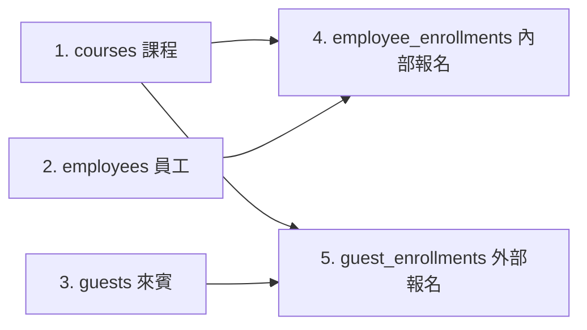
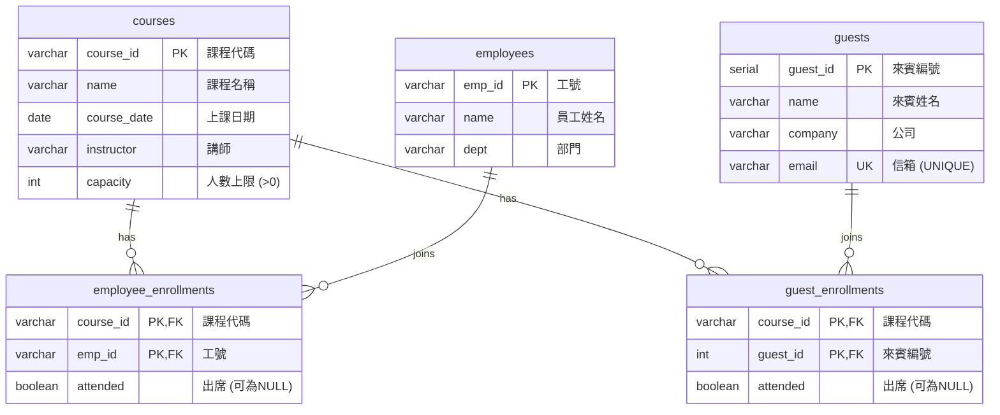

# 步驟 2｜手寫 DDL：親手建立五張表與約束

> 💻 DBeaver（資料庫：`training`）｜ 🎯 學完你會：自己寫出五張報名系統資料表的 DDL，包含複合主鍵、外來鍵、三態布林欄位與 `ALTER TABLE` 演練

## 0. 準備專屬練習空間

- **本機 / 樹莓派 PostgreSQL**：先執行一次 `CREATE DATABASE training;`，再到 DBeaver 上方工具列切換連線資料庫至 **`training`**。
- **雲端 Supabase**：免費版只有一個 `postgres` 資料庫，請改執行 `CREATE SCHEMA training; SET search_path TO training, public;`，並留意步驟 5 MCP 連線時加上 `-c search_path=training,public` 或於查詢中帶入 schema。

## 1. 看懂設計規格，親手挑戰寫出 DDL

這個專案要建立五張表，**必須先建主表（無外來鍵），再建明細表（有外來鍵）**：





請先對照下方的欄位與保護規則規格，**不要直接複製答案，先在 DBeaver SQL 編輯器自己試寫五句 `CREATE TABLE`**：

| 資料表 | 欄位名稱 | 型別與長度 | 約束條件（請親自寫出來） |
|---|---|---|---|
| `courses` | `course_id` | `VARCHAR(10)` | `PRIMARY KEY` |
| `courses` | `name` | `VARCHAR(50)` | `NOT NULL` |
| `courses` | `course_date` | `DATE` | `NOT NULL` |
| `courses` | `instructor` | `VARCHAR(20)` | `NOT NULL` |
| `courses` | `capacity` | `INT` | `NOT NULL CHECK (capacity > 0)` |
| `employees` | `emp_id` | `VARCHAR(10)` | `PRIMARY KEY` |
| `employees` | `name` | `VARCHAR(20)` | `NOT NULL` |
| `employees` | `dept` | `VARCHAR(20)` | `NOT NULL` |
| `guests` | `guest_id` | `SERIAL` | `PRIMARY KEY` |
| `guests` | `name` | `VARCHAR(20)` | `NOT NULL` |
| `guests` | `company` | `VARCHAR(30)` | `NOT NULL` |
| `guests` | `email` | `VARCHAR(50)` | `NOT NULL UNIQUE` |
| `employee_enrollments` | `course_id`, `emp_id`, `attended` | `VARCHAR(10)`, `VARCHAR(10)`, `BOOLEAN` | `course_id` 參照 `courses`、`emp_id` 參照 `employees`、`attended` 允許 `NULL`；`PRIMARY KEY (course_id, emp_id)` |
| `guest_enrollments` | `course_id`, `guest_id`, `attended` | `VARCHAR(10)`, `INT`, `BOOLEAN` | `course_id` 參照 `courses`、`guest_id` 參照 `guests`、`attended` 允許 `NULL`；`PRIMARY KEY (course_id, guest_id)` |

> [!IMPORTANT]
> 表名和欄位名稱請與規格表**完全一致**，後續步驟的查詢與 AI 產生交易 SQL 才能對得起來。

寫完並執行成功後，再打開下方對照確認是否有遺漏的 `NOT NULL`、`UNIQUE`、`CHECK` 或複合主鍵：

<details>
<summary>參考解答：五張表的完整 CREATE TABLE 語法</summary>

```sql
CREATE TABLE courses (
    course_id   VARCHAR(10) PRIMARY KEY,
    name        VARCHAR(50) NOT NULL,
    course_date DATE        NOT NULL,
    instructor  VARCHAR(20) NOT NULL,
    capacity    INT         NOT NULL CHECK (capacity > 0)
);

CREATE TABLE employees (
    emp_id VARCHAR(10) PRIMARY KEY,
    name   VARCHAR(20) NOT NULL,
    dept   VARCHAR(20) NOT NULL
);

CREATE TABLE guests (
    guest_id SERIAL PRIMARY KEY,
    name     VARCHAR(20) NOT NULL,
    company  VARCHAR(30) NOT NULL,
    email    VARCHAR(50) NOT NULL UNIQUE
);

CREATE TABLE employee_enrollments (
    course_id VARCHAR(10) NOT NULL REFERENCES courses(course_id),
    emp_id    VARCHAR(10) NOT NULL REFERENCES employees(emp_id),
    attended  BOOLEAN,
    PRIMARY KEY (course_id, emp_id)
);

CREATE TABLE guest_enrollments (
    course_id VARCHAR(10) NOT NULL REFERENCES courses(course_id),
    guest_id  INT         NOT NULL REFERENCES guests(guest_id),
    attended  BOOLEAN,
    PRIMARY KEY (course_id, guest_id)
);
```

</details>

## 2. 測試保護機制（對照 Excel「有問題的資料」）

先放進一組正確的種子資料：

```sql
INSERT INTO courses VALUES ('C01', 'Excel 樞紐分析', '2024-04-10', '李老師', 30);
INSERT INTO employees VALUES ('E01', '陳小華', '業務發展部');
INSERT INTO guests (name, company, email) VALUES ('趙文華', '順發貿易', 'wenhua@example.com');
INSERT INTO employee_enrollments VALUES ('C01', 'E01', true);
```

打開 Excel「有問題的資料」工作表，**先猜每一列會被哪個約束擋下**，再一句一句執行驗證：

```sql
-- 測試 1：同一門課重複報名（複合主鍵攔截）
INSERT INTO employee_enrollments VALUES ('C01', 'E01', NULL);

-- 測試 2：課程代碼不存在（外來鍵攔截）
INSERT INTO employee_enrollments VALUES ('C99', 'E01', NULL);

-- 測試 3：員工工號不存在（外來鍵攔截）
INSERT INTO employee_enrollments VALUES ('C01', 'E99', NULL);

-- 測試 4：來賓信箱重複（UNIQUE 攔截）
INSERT INTO guests (name, company, email) VALUES ('王小美', '順發貿易', 'wenhua@example.com');

-- 測試 5：課程人數上限是 0（CHECK 攔截）
INSERT INTO courses VALUES ('C07', '人數錯誤的課', '2024-07-01', '李老師', 0);
```

**執行結果：五句都應該被 PostgreSQL 擋下：**

| 測試 | 預期錯誤訊息關鍵字 | 擋下它的是 |
|:---:|---|---|
| 1 | `duplicate key ... "employee_enrollments_pkey"` | 複合主鍵 `PRIMARY KEY (course_id, emp_id)` |
| 2 | `violates foreign key constraint "employee_enrollments_course_id_fkey"` | `courses` 外來鍵 |
| 3 | `violates foreign key constraint "employee_enrollments_emp_id_fkey"` | `employees` 外來鍵 |
| 4 | `duplicate key ... "guests_email_key"` | `email UNIQUE` |
| 5 | `violates check constraint "courses_capacity_check"` | `CHECK (capacity > 0)` |

## 3. DDL 動手加練（練習 `ALTER TABLE` 與查閱約束）

做完基本建表後，請在 DBeaver 依序練習以下 3 個結構維護動作（最後會還原回標準結構）：

### 練習 A：替 `courses` 暫時加上「教室位置」欄位與預設值，再移除
```sql
ALTER TABLE courses ADD COLUMN location VARCHAR(30) NOT NULL DEFAULT '會議室 A';
SELECT course_id, name, location FROM courses;
ALTER TABLE courses DROP COLUMN location;
```

### 練習 B：替 `courses` 加上人數上限最大值檢查，測試擋下超過 200 人後移除
```sql
ALTER TABLE courses ADD CONSTRAINT chk_capacity_max CHECK (capacity <= 200);
-- 測試應該失敗：
INSERT INTO courses VALUES ('C98', '超大型年會', '2024-08-01', '李老師', 300);
-- 練習結束移除暫時約束：
ALTER TABLE courses DROP CONSTRAINT chk_capacity_max;
```

### 練習 C：查詢系統目錄，確認五張表的約束都存在
```sql
SELECT table_name, constraint_name, constraint_type
FROM information_schema.table_constraints
WHERE table_schema = 'public'
ORDER BY table_name, constraint_type, constraint_name;
```

## 4. 清空測試資料

進入步驟 3 之前，先把剛剛測試塞進去的 4 筆種子資料清乾淨，確保序列 (`SERIAL`) 也歸零：

```sql
TRUNCATE guest_enrollments, employee_enrollments, guests, employees, courses RESTART IDENTITY;
```

## 5. 🤖 用 Microsoft Postgres MCP 驗證建表成果（唯讀檢查）

在 Antigravity 對話框貼上以下提示詞，讓 AI 透過全域設定的 `@microsoft/postgres-mcp` 幫你檢查剛寫好的五張表是否零失誤（嚴禁 AI 幫你建表或改表）：

```markdown
請使用 Microsoft Postgres MCP 工具完成以下唯讀檢查，嚴禁使用 postgres_mcp_modify 修改任何資料或結構：
1. 若目前連線不在 training 資料庫，請先用 postgres_mcp_connect 切換（或確認連線目標）至 training。
2. 用 postgres_mcp_db_context 查看 public schema 裡所有資料表與欄位。
3. 確認是否確實存在 courses、employees、guests、employee_enrollments、guest_enrollments 五張表，以及欄位型別、主鍵、外來鍵、UNIQUE 與 CHECK 約束是否完整。
4. 用 postgres_mcp_query 查詢這五張表的資料筆數，確認目前皆為 0 筆（測試資料已清空）。
```

## ⚠️ 常見卡關

| 錯誤訊息 | 原因 | 怎麼解 |
|---|---|---|
| `relation "courses" does not exist` | 先建了報名表、後建主表 | 依序先建 `courses`、`employees`、`guests`，最後建兩張 `*_enrollments` |
| `cannot truncate a table referenced in a foreign key constraint` | 只清空主表沒連帶清空明細表 | 五張表寫在同一句 `TRUNCATE ... RESTART IDENTITY;` |
| `current transaction is aborted` | DBeaver 開啟了手動交易且前面出錯 | 先執行一次 `ROLLBACK;`，再繼續後面的指令 |

## ✍️ 動手練

**1. 為什麼 `employee_enrollments` 不另外建一個 `enrollment_id SERIAL PRIMARY KEY`，而是直接用 `PRIMARY KEY (course_id, emp_id)`？**

<details>
<summary>看答案</summary>

用 `(course_id, emp_id)` 當複合主鍵，資料庫會在結構層自動防止「同一位員工同一門課重複報名兩次」；如果改用流水號 `SERIAL`，就必須額外再加 `UNIQUE (course_id, emp_id)` 才擋得住重複報名。

</details>

**2. 如果把 `TRUNCATE` 句子最後的 `RESTART IDENTITY` 拿掉，接下來在步驟 3 寫入來賓時可能會遇到什麼現象？**

<details>
<summary>看答案</summary>

`guests.guest_id` 的計數器 (`SERIAL`) 不會歸零，下一筆新來賓會從 `2` 開始跳號，而不是重新從 `1` 開始。

</details>

## 🤖 問 AI 助教

> 這是我在 DBeaver 寫的五張表 DDL（貼上你的 SQL）。請幫我核對它和步驟 1 的 ER 圖、三態出席需求 (`attended`) 與外來鍵依賴順序是否一致，特別檢查有沒有漏掉哪個 `NOT NULL`、`UNIQUE` 或 `CHECK`。如果有問題請指出原因讓我自己改，不要直接幫我連線執行修改。

---

| 上一步 | 目錄 | 下一步 |
|:---|:---:|---:|
| [⬅️ 步驟 1：兩份名單怎麼設計](./1_兩份名單怎麼設計.md) | [🏠 專案導覽](./README.md) | [步驟 3：AI 產生資料交易檔 ➡️](./3_AI產生資料交易檔.md) |
