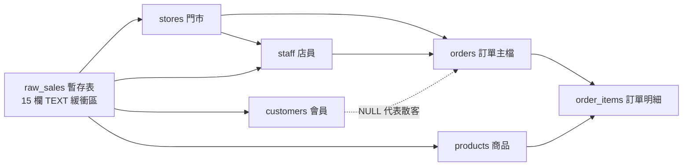

# 步驟 1｜跨月資料與暫存表：一張流水帳拆成六張表，加上 `raw_sales` 當緩衝區

> 💻 Excel ｜ 🎯 學完你會：把扁平的跨月門市流水帳正規化成六張關聯表，並看懂暫存表如何讓每月重複執行交易檔都不重複寫入

> 📚 先修：[進階-4 聚合函式](../../SQL語法教學/10聚合函式.md)、[進階-7 綜合連結](../../SQL語法教學/13連結.md)、[進階-8 子查詢](../../SQL語法教學/14子查詢.md)。

## 🎬 情境

打開 [`門市月報_需求與樣本.xlsx`](./門市月報_需求與樣本.xlsx)，依序看四張工作表（`需求`、`給AI的樣本`、`4月新銷售明細`、`有問題的資料`）：

| 編號 | 故事 | 驗收條件 |
|:---:|---|---|
| S1 | 身為營運經理，我想要不開三個檔案，就看到各門市每個月的營業額，這樣才好在月會上比較 | 只計算 `已完成` 訂單，每家門市每個月一列，總和等於已完成金額 |
| S2 | 身為店長，我想要看到本季最熱銷的前 5 項商品，這樣才能決定備料和促銷 | 依 `已完成` 訂單的銷售數量排序，數量相同時營業額高的在前 |
| S3 | 身為行銷，我想要找出 1、2、3 月都有消費的會員，這樣才能發送專屬優惠券 | 同名的不同會員要分開計算；只計算 `已完成` 訂單 |
| S4 | 身為營運經理，我想要找出業績高於全體店員平均的店員，這樣才能規劃獎勵名單 | 每位店員一列，只列出高於平均的人，業績高的在前 |
| S5 | 身為行政，我想要每月收到新的銷售明細表，不用匯入檔案、直接請 AI 產生交易檔讓資料自動歸位，這樣才不用再複製 Excel 檔 | 執行 4 月交易檔後新增 5 張訂單；同一份交易檔重複執行一次，筆數不會增加 |

## 1. 觀察原始 Excel 資料結構

看「給AI的樣本」工作表（31 筆第一季精選跨月樣本），一共 **15 欄**：
`銷售單號`、`銷售日期`、`時間`、`門市名稱`、`區域`、`經手店員`、`會員姓名`、`會員電話`、`商品分類`、`商品名稱`、`單價`、`數量`、`小計`、`付款方式`、`狀態`。

為什麼這 15 欄不能直接當成一張主資料表來長期使用？
1. **一張訂單買多個商品會拆成好幾列**：例如 `ORD00001` 買了「經典拿鐵」和「靜岡抹茶歐蕾」共兩列，直接用整張表算「訂單數」會多算！
2. **主檔資訊大量重複**：同一家門市名、會員電話與商品單價在每筆明細重複出現；「散客」沒有電話，不能硬塞進會員表。
3. **同名的人不同人**：仔細看樣本，「謝哲瑋」有三支不同電話（`0963-728-214`、`0943-645-351`、`0945-239-678`）、「劉欣宜」有兩支不同電話（`0936-805-870`、`0915-692-794`）。只看姓名分組會把不同人混成同一人！

## 2. 六張正規化主從表 ＋ 一張暫存表 `raw_sales`

把 15 欄流水帳整理成 **6 張標準關聯表**，再用 **1 張暫存表 `raw_sales`**（全 `TEXT` 型別）先收下 AI 轉出來的交易資料，最後透過 `INSERT ... SELECT ... ON CONFLICT DO NOTHING` 安全歸位：

| 資料表 | 用途 | 如何辨識不重複（Unique Key） |
|---|---|---|
| `stores` | 門市與區域 | `name` (`UNIQUE`)，區域限制北部/中部/南部/東部 |
| `staff` | 門市店員 | `(name, store_id)` 複合唯一（同一店同名不能重覆登記，不同店可同名） |
| `products` | 商品主檔 | `name` (`UNIQUE`)，含分類與定價 |
| `customers` | 會員主檔 | `phone` (`UNIQUE`)，散客不寫入這裡 |
| `orders` | 訂單主檔 | `order_id` (`PRIMARY KEY`)，`customer_id` 允許 `NULL`（代表散客） |
| `order_items` | 訂單明細 | `(order_id, product_id)` 複合主鍵，記錄當下成交 `unit_price` 與 `quantity` |
| `raw_sales` | 每月交易暫存區 | 無限制全 `TEXT`，方便任何月份先承接資料、再轉型配對寫入 |

## 3. 為什麼不直接從 `raw_sales` 寫死 `SELECT`，而要強調「可重複執行 (`ON CONFLICT`)」？

行政人員每個月都可能誤跑兩次同份「4月新銷售明細」交易檔。因為我們在每一張目標表都設好唯一的識別鍵（門市名、`staff(name, store_id)`、商品名、會員電話、`order_id`、`(order_id, product_id)`），搭配 PostgreSQL 的 **`ON CONFLICT DO NOTHING`**，即使整份 4 月交易檔被重跑第二次，也不會報錯、也不會讓 27 張訂單多出一筆重複數據！

## ⚠️ 常見卡關

| 狀況 | 怎麼想 |
|---|---|
| `order_items` 為什麼已經在 `products` 存了 `price`，還要再存 `unit_price`？ | 商品未來會調價，歷史訂單明細必須保留「成交當下的單價」，不能跟商品最新售價混在一起 |
| 為什麼「散客」在 Excel 裡有電話是空白，在 `orders` 裡卻設 `customer_id = NULL`？ | 因為散客本來就不建會員檔；寫進資料庫時若強塞一筆假電話給散客，反而無法分辨誰才是真正忠誠會員 |

## ✍️ 動手練

**1. 打開 [`門市月報_需求與樣本.xlsx`](./門市月報_需求與樣本.xlsx) 的「給AI的樣本」頁，找找看有哪幾支電話同為「謝哲瑋」或「劉欣宜」？為什麼 S3 絕對不能寫 `GROUP BY c.name`？**

看答案

樣本中「謝哲瑋」有三支不同電話（`0963-728-214`、`0943-645-351`、`0945-239-678`），「劉欣宜」有兩支不同電話（`0936-805-870`、`0915-692-794`）。如果用姓名分組，三位謝哲瑋會被合併計算；一定要用 `c.customer_id`（對應各自唯一手機號碼）分組才會正確。

**2. 觀察 `4月新銷售明細` 工作表（7 筆），哪幾項商品、店員或會員是第一季「給AI的樣本 (31 筆)」裡原本沒有的？暫存表歸位時要怎麼自動補齊他們？**

看答案

4 月新出現的包含：`許淑芬`（台中逢甲店員工）、`何宜庭`（會員 `0900-111-222`），以及 `美式咖啡`、`經典牛肉起司堡`、`桂花烏龍拿鐵` 三項商品。只要用 `raw_sales` 先寫入主表 `staff` / `products` / `customers` 並加 `ON CONFLICT DO NOTHING`，新實體會自動新增、既有的會自動略過，再由後面寫 `orders` / `order_items` 時用 `JOIN` 查出 ID 即可。

## 🤖 問 AI 助教

> 我看過 `門市月報_需求與樣本.xlsx` 的樣本，想設計成 `stores`、`staff`、`products`、`customers`、`orders`、`order_items` 六張核心表，加上一張全 `TEXT` 的 `raw_sales` 暫存表。請用白話告訴我「先把資料放進 `raw_sales`、再用 6 個 `INSERT ... SELECT ... ON CONFLICT DO NOTHING` 分流歸位」相比「直接在應用程式寫六段 INSERT」有什麼好處？先不要寫 SQL。

---

| 上一步 | 目錄 | 下一步 |
|:---|:---:|---:|
| [⬅️ 回第 5 章目錄](../README.md) | [🏠 專案導覽](./README.md) | [步驟 2：手寫 DDL ➡️](./2_手寫DDL.md) |
