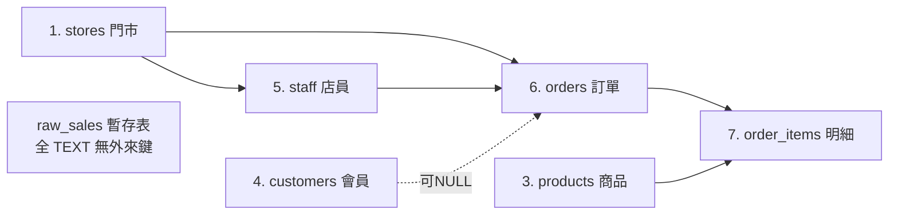
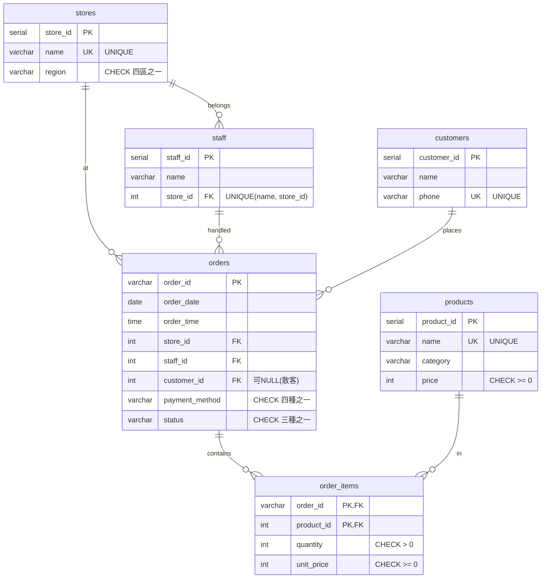

# 步驟 2｜手寫 DDL：親手建立七張表與完整商業防呆

> 💻 DBeaver（資料庫：`store_sales`）｜ 🎯 學完你會：依外來鍵相依順序手寫建表 DDL（6 張核心表 ＋ 1 張 `raw_sales` 暫存表）、驗證 8 種髒資料保護機制並演練 `ALTER TABLE`

## 0. 準備專屬練習空間

- **本機 / 樹莓派 PostgreSQL**：先執行一次 `CREATE DATABASE store_sales;`，再到 DBeaver 上方工具列切換連線資料庫至 **`store_sales`**。
- **雲端 Supabase**：免費版只有一個 `postgres` 資料庫，請改執行 `CREATE SCHEMA store_sales; SET search_path TO store_sales, public;`，並留意步驟 5 MCP 連線時加上對應 schema 設定。

## 1. 看懂相依順序與欄位規格，親手挑戰寫出 DDL

這個專案要建 **7 張表**。前 4 張主表彼此獨立，接著才能建依賴門市的 `staff`、依賴三張主表的 `orders`，以及依賴訂單與商品的 `order_items`；`raw_sales` 暫存表則可隨時獨立建立：





請先對照下表規格，**不要直接複製解答，先在 DBeaver SQL 編輯器自己試寫出這七句 `CREATE TABLE`**：

| 資料表 | 欄位名稱與型別 | 必須親自寫出的約束規則 |
|---|---|---|
| `stores` | `store_id SERIAL`, `name VARCHAR(30)`, `region VARCHAR(10)` | `store_id PK`；`name NOT NULL UNIQUE`；`region NOT NULL CHECK (region IN ('北部', '中部', '南部', '東部'))` |
| `staff` | `staff_id SERIAL`, `name VARCHAR(20)`, `store_id INT` | `staff_id PK`；`name NOT NULL`；`store_id NOT NULL REFERENCES stores(store_id)`；`UNIQUE (name, store_id)` |
| `products` | `product_id SERIAL`, `name VARCHAR(50)`, `category VARCHAR(20)`, `price INT` | `product_id PK`；`name NOT NULL UNIQUE`；`category NOT NULL`；`price NOT NULL CHECK (price >= 0)` |
| `customers` | `customer_id SERIAL`, `name VARCHAR(20)`, `phone VARCHAR(20)` | `customer_id PK`；`name NOT NULL`；`phone NOT NULL UNIQUE` |
| `orders` | `order_id VARCHAR(20)`, `order_date DATE`, `order_time TIME`, `store_id INT`, `staff_id INT`, `customer_id INT`, `payment_method VARCHAR(20)`, `status VARCHAR(10)` | `order_id PK`；`store_id` 參照 `stores`、`staff_id` 參照 `staff`；`customer_id` 參照 `customers`（**允許 `NULL`**）；`payment_method CHECK IN ('現金', '信用卡', 'LINE Pay', '街口支付')`；`status CHECK IN ('已完成', '已退款', '已取消')` |
| `order_items` | `order_id VARCHAR(20)`, `product_id INT`, `quantity INT`, `unit_price INT` | `order_id` 參照 `orders`、`product_id` 參照 `products`；`quantity NOT NULL CHECK (quantity > 0)`；`unit_price NOT NULL CHECK (unit_price >= 0)`；`PRIMARY KEY (order_id, product_id)` |
| `raw_sales` | 15 個中文 `TEXT` 欄：`銷售單號`, `銷售日期`, `時間`, `門市名稱`, `區域`, `經手店員`, `會員姓名`, `會員電話`, `商品分類`, `商品名稱`, `單價`, `數量`, `小計`, `付款方式`, `狀態` | 全部設為 `TEXT`（無約束，當暫存緩衝區使用） |

> [!IMPORTANT]
> 七張表的表名與所有欄位名稱（含 `raw_sales` 的 15 個中文欄名）請與規格**完全相同**，步驟 3 與步驟 4 的交易查詢才對得起來。

寫完執行成功後，再展開下方參考解答檢查每個約束名稱與細節：

<details>
<summary>參考解答：七張表的完整 CREATE TABLE 語法</summary>

```sql
CREATE TABLE stores (
    store_id SERIAL PRIMARY KEY,
    name     VARCHAR(30) NOT NULL UNIQUE,
    region   VARCHAR(10) NOT NULL CHECK (region IN ('北部', '中部', '南部', '東部'))
);

CREATE TABLE staff (
    staff_id SERIAL PRIMARY KEY,
    name     VARCHAR(20) NOT NULL,
    store_id INT         NOT NULL REFERENCES stores(store_id),
    UNIQUE (name, store_id)
);

CREATE TABLE products (
    product_id SERIAL PRIMARY KEY,
    name       VARCHAR(50) NOT NULL UNIQUE,
    category   VARCHAR(20) NOT NULL,
    price      INT         NOT NULL CHECK (price >= 0)
);

CREATE TABLE customers (
    customer_id SERIAL PRIMARY KEY,
    name        VARCHAR(20) NOT NULL,
    phone       VARCHAR(20) NOT NULL UNIQUE
);

CREATE TABLE orders (
    order_id       VARCHAR(20) PRIMARY KEY,
    order_date     DATE        NOT NULL,
    order_time     TIME        NOT NULL,
    store_id       INT         NOT NULL REFERENCES stores(store_id),
    staff_id       INT         NOT NULL REFERENCES staff(staff_id),
    customer_id    INT         REFERENCES customers(customer_id),
    payment_method VARCHAR(20) NOT NULL CHECK (payment_method IN ('現金', '信用卡', 'LINE Pay', '街口支付')),
    status         VARCHAR(10) NOT NULL CHECK (status IN ('已完成', '已退款', '已取消'))
);

CREATE TABLE order_items (
    order_id   VARCHAR(20) NOT NULL REFERENCES orders(order_id),
    product_id INT         NOT NULL REFERENCES products(product_id),
    quantity   INT         NOT NULL CHECK (quantity > 0),
    unit_price INT         NOT NULL CHECK (unit_price >= 0),
    PRIMARY KEY (order_id, product_id)
);

CREATE TABLE raw_sales (
    銷售單號 TEXT,
    銷售日期 TEXT,
    時間     TEXT,
    門市名稱 TEXT,
    區域     TEXT,
    經手店員 TEXT,
    會員姓名 TEXT,
    會員電話 TEXT,
    商品分類 TEXT,
    商品名稱 TEXT,
    單價     TEXT,
    數量     TEXT,
    小計     TEXT,
    付款方式 TEXT,
    狀態     TEXT
);
```

</details>

## 2. 測試保護機制（對照 Excel「有問題的資料」）

先塞進一組測試用種子資料：

```sql
INSERT INTO stores (name, region) VALUES ('台北信義店', '北部');
INSERT INTO staff (name, store_id) VALUES ('張志明', 1);
INSERT INTO products (name, category, price) VALUES ('經典拿鐵', '義式咖啡', 95);
INSERT INTO products (name, category, price) VALUES ('靜岡抹茶歐蕾', '特調茶飲', 110);
INSERT INTO customers (name, phone) VALUES ('劉欣宜', '0936-805-870');
INSERT INTO orders VALUES ('ORD00001', '2024-01-24', '19:04', 1, 1, 1, '信用卡', '已完成');
INSERT INTO order_items VALUES ('ORD00001', 1, 1, 95);
```

對照 Excel 的「有問題的資料」工作表（共 8 種錯誤），**先自己猜擋下它的是哪一條規則**，再一句一句執行驗證：

```sql
-- 1. 同一張訂單重複加入「經典拿鐵」（複合主鍵攔截）
INSERT INTO order_items VALUES ('ORD00001', 1, 1, 95);

-- 2. 數量填 0（CHECK 攔截）
INSERT INTO order_items VALUES ('ORD00001', 2, 0, 110);

-- 3. 訂單狀態不在允許的三種內（CHECK 攔截）
INSERT INTO orders VALUES ('ORD99002', '2024-01-26', '16:10', 1, 1, NULL, '現金', '已作廢');

-- 4. 付款方式填「支票」（CHECK 攔截）
INSERT INTO orders VALUES ('ORD99003', '2024-01-26', '16:10', 1, 1, NULL, '支票', '已完成');

-- 5. 區域填「離島」（CHECK 攔截）
INSERT INTO stores (name, region) VALUES ('澎湖馬公店', '離島');

-- 6. 門市編號 99 不存在（外來鍵攔截）
INSERT INTO orders VALUES ('ORD99004', '2024-01-26', '16:10', 99, 1, NULL, '現金', '已完成');

-- 7. 不同會員想使用已被註冊的電話（UNIQUE 攔截）
INSERT INTO customers (name, phone) VALUES ('王小美', '0936-805-870');

-- 8. 同一門市重複登記同一店員姓名（複合 UNIQUE 攔截）
INSERT INTO staff (name, store_id) VALUES ('張志明', 1);
```

**執行結果：八句應該全數被 PostgreSQL 擋下：**

| 測試 | 預期錯誤訊息關鍵字 | 擋下它的是 |
|:---:|---|---|
| 1 | `duplicate key ... "order_items_pkey"` | 複合主鍵 `PRIMARY KEY (order_id, product_id)` |
| 2 | `violates check constraint "order_items_quantity_check"` | `CHECK (quantity > 0)` |
| 3 | `violates check constraint "orders_status_check"` | `CHECK (status IN ...)` |
| 4 | `violates check constraint "orders_payment_method_check"` | `CHECK (payment_method IN ...)` |
| 5 | `violates check constraint "stores_region_check"` | `CHECK (region IN ...)` |
| 6 | `violates foreign key constraint "orders_store_id_fkey"` | `stores` 外來鍵 |
| 7 | `duplicate key ... "customers_phone_key"` | `phone UNIQUE` |
| 8 | `duplicate key ... "staff_name_store_id_key"` | `UNIQUE (name, store_id)` |

## 3. DDL 動手加練（3 題 `ALTER TABLE` 與結構盤點）

### 練習 A：幫 `stores` 暫時增加門市電話欄位與預設值，查看後移除
```sql
ALTER TABLE stores ADD COLUMN store_phone VARCHAR(20) NOT NULL DEFAULT '02-0000-0000';
SELECT store_id, name, store_phone FROM stores;
ALTER TABLE stores DROP COLUMN store_phone;
```

### 練習 B：幫 `products` 增加合理單價上限 `CHECK (price <= 5000)`，驗證擋下錯誤後移除
```sql
ALTER TABLE products ADD CONSTRAINT chk_price_max CHECK (price <= 5000);
-- 測試應該失敗：
INSERT INTO products (name, category, price) VALUES ('天價豆', '義式咖啡', 9999);
-- 練習完成後移除暫時約束：
ALTER TABLE products DROP CONSTRAINT chk_price_max;
```

### 練習 C：查詢系統目錄確認七張表與約束都到位
```sql
SELECT table_name, constraint_name, constraint_type
FROM information_schema.table_constraints
WHERE table_schema = 'public'
ORDER BY table_name, constraint_type, constraint_name;
```

## 4. 清空測試資料

進入步驟 3 前，一次清空所有測試資料並把序列 (`SERIAL`) 歸零：

```sql
TRUNCATE order_items, orders, customers, products, staff, stores, raw_sales RESTART IDENTITY;
```

## 5. 🤖 用 Microsoft Postgres MCP 驗證建表成果（唯讀檢查）

在 Antigravity 對話框貼上以下提示詞，讓 AI 透過全域設定的 `@microsoft/postgres-mcp` 幫你檢查剛寫好的七張表：

```markdown
請使用 Microsoft Postgres MCP 工具完成以下唯讀檢查，嚴禁使用 postgres_mcp_modify 修改任何資料或結構：
1. 若目前連線不在 store_sales 資料庫，請先用 postgres_mcp_connect 切換至 store_sales。
2. 用 postgres_mcp_db_context 查看 public schema 裡所有資料表結構，確認是否存在 stores、staff、products、customers、orders、order_items、raw_sales 共七張表。
3. 確認 orders.customer_id 是否允許 NULL、raw_sales 15 欄是否為 TEXT，以及 CHECK / UNIQUE / FOREIGN KEY 約束是否完整。
4. 用 postgres_mcp_query 查詢這七張表目前筆數是否皆為 0。
```

## ⚠️ 常見卡關

| 錯誤訊息 | 原因 | 怎麼解 |
|---|---|---|
| `relation "stores" does not exist` | 先建了 `staff` 或 `orders` | 先建 `stores`、`products`、`customers`，再建 `staff`、`orders`，最後建 `order_items` |
| `cannot truncate a table referenced in a foreign key constraint` | 漏掉清空被參照的主表或明細表 | 把七張表寫在同一句 `TRUNCATE ... RESTART IDENTITY;` |
| `current transaction is aborted` | 交易中發生錯誤後繼續執行 | 先執行 `ROLLBACK;` 結束失敗的交易再繼續 |

## ✍️ 動手練

**1. `staff` 表設了 `UNIQUE (name, store_id)` 而不是單純 `name UNIQUE`，原因是什麼？**

<details>
<summary>看答案</summary>

不同門市完全可能有同名店員（例如台北店與高雄店都各有叫張志明的員工），所以要以 `(name, store_id)` 聯合限制：同一門市不准同名，但不同門市允許同名。

</details>

**2. 為什麼 `orders` 的 `customer_id` 沒有像 `store_id` 和 `staff_id` 一樣加上 `NOT NULL`？**

<details>
<summary>看答案</summary>

因為每一筆訂單一定知道在哪家店結帳、由哪位店員經手（必不為空），但現場客人可能是未註冊會員的「散客」，此時沒有對應的 `customers` 紀錄，必須讓 `customer_id` 允許為 `NULL`。

</details>

## 🤖 問 AI 助教

> 這是我在 DBeaver 寫的七張表 DDL（貼上你的 SQL）。請幫我核對外來鍵建立順序、所有 `CHECK` 枚舉值與 `UNIQUE (name, store_id)` 是否完整，也檢查 `raw_sales` 是否 15 欄皆為 `TEXT`。如果有漏寫或命名不一致的地方請告訴我原因讓我自己改，不要直接連線修改。

---

| 上一步 | 目錄 | 下一步 |
|:---|:---:|---:|
| [⬅️ 步驟 1：跨月資料與暫存表](./1_跨月資料與暫存表.md) | [🏠 專案導覽](./README.md) | [步驟 3：AI 產生資料交易檔 ➡️](./3_AI產生匯入腳本.md) |
