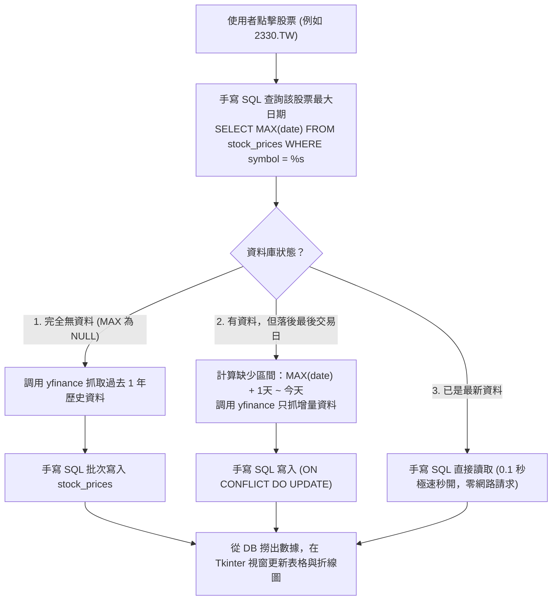

# 產品需求文件 (PRD)：股市即時監控與增量同步桌面小 App

* **專案代號**：`StockMarket-Desktop-App`
* **開發模式**：規格驅動開發 (SDD, Spec-Driven Development)
* **資料庫環境**：PostgreSQL (學生本機 Docker 或 Supabase)
* **前端框架**：Python 內建 **Tkinter** (個人桌面視窗 App) 或 **PyQt5**
* **資料庫存取方式**：Python 原生手寫 SQL (`psycopg2`)，嚴禁使用 MCP 或 ORM 遮蔽 SQL

---

## 1. 專案背景與目標

在金融與股票個人分析中，上班族最常遇到的痛點是：
1. **用 Excel 記錄股票極為繁瑣**：每天手動複製開高低收，遇到跨月跨年公式損壞。
2. **外部 API 速度慢且受限**：頻繁抓取容易被 Yahoo Finance 封鎖，且每次開啟都要等很久。

本專案旨在打造一個**在個人電腦上執行的獨立桌面視窗 App（Desktop GUI）**，透過 **PostgreSQL 手寫 SQL 快取 (Cache-Aside)**，實現**「有資料就用資料庫極速秒開、沒資料才上網抓、每日自動增量更新」**的個人操盤小工具。

---

## 2. 核心架構：快取旁路與手寫 SQL 增量同步

系統在使用者選擇股票時，執行手寫 SQL 邏輯：

---

## 3. 資料庫規範 (由 init_stock_db.sql 建立)

資料表結構已於 [`init_stock_db.sql`](./init_stock_db.sql) 定義，學生在 DBeaver 親自執行：
1. **`markets` (市場分類表)**：`market_id`, `name`, `currency`
2. **`stocks` (追蹤股票清單表)**：`symbol`, `market_id`, `name`, `sector`
3. **`stock_prices` (每日股價歷史表)**：`symbol`, `date`, `open`, `high`, `low`, `close`, `volume`
   - 複合主鍵：`PRIMARY KEY (symbol, date)`

---

## 4. 前端介面與功能需求 (Tkinter 桌面視窗)

使用 Python 內建 **Tkinter** 打造個人視窗（免額外伺服器，雙擊即可運行）：

### 4.1 視窗佈局 (Layout)
1. **頂部控制列 (Top Control Bar)**：
   - 股票選擇下拉選單（`ttk.Combobox`，讀取 `stocks` 表）。
   - 「立即同步最新報價」按鈕（觸發增量快取邏輯）。
2. **關鍵指標卡片區 (KPI Cards)**：
   - 最新收盤價、今日漲跌幅（%）、當日最高/最低價、成交量。
3. **歷史走勢圖表 (Matplotlib Canvas)**：
   - 嵌入式 Matplotlib 折線圖，即時繪製近 60 天收盤價與 20 日均線 (MA20)。
4. **歷史報價明細表格 (`ttk.Treeview`)**：
   - 顯示最新 30 筆交易明細（日期、開盤、最高、最低、收盤、成交量）。
   - 附帶可滾動捲軸。

---

## 5. 驗收標準 (Acceptance Criteria)

- [ ] 學生能在 DBeaver 執行 `init_stock_db.sql` 完成資料表建置。
- [ ] 執行 `python app.py` 立即跳出本機 Tkinter 視窗。
- [ ] 第二次查詢同一檔股票時，查詢時間在 **0.1 秒以內**（直接走手寫 SQL 讀取本地資料庫）。
- [ ] 程式內嚴禁讓 MCP 在背後直接代勞，所有的資料讀取與寫入均以 `psycopg2` 手寫 SQL 呈現。
