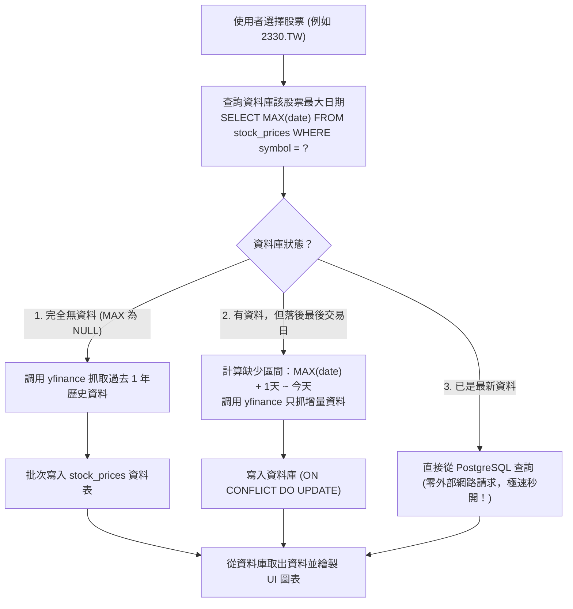

# 產品需求文件 (PRD)：股市即時監控與增量同步系統

* **專案代號**：`StockMarket-Sync-App`
* **開發模式**：規格驅動開發 (SDD, Spec-Driven Development)
* **資料庫環境**：PostgreSQL / Supabase (透過 MCP Server 存取)
* **前端框架**：Streamlit (線上分析看板) / Tkinter (個人桌面版，可選)

---

## 1. 專案背景與目標

在金融與股票分析應用中，直接從外部 API（如 Yahoo Finance）讀取數據有兩大致命問題：
1. **速度緩慢**：每次使用者切換股票或刷新頁面都要重新下載數百筆歷史資料，體驗極差。
2. **網路依賴與頻率限制**：頻繁調用 API 容易遭遇連線逾時或封鎖。

本專案旨在打造一個**「以 PostgreSQL 為核心快取的智能股票分析系統」**，實現**「有資料就用資料庫、沒資料才上網抓、每日自動增量更新」**的工業級快取架構。

---

## 2. 核心架構：快取旁路與增量同步 (Cache-Aside & Incremental Sync)

系統在查詢任何個股時，必須遵循以下邏輯流程：



---

## 3. 資料庫規範 (由 MCP 讀取驗證)

資料庫已預先透過 `init_stock_db.sql` 建立，AI 必須使用 **PostgreSQL MCP 工具** 自行檢查結構：

1. **`markets` (市場分類表)**
   - `market_id` (PK, VARCHAR)
   - `name` (市場名稱，如台灣證券交易所、美股)
   - `currency` (幣別，如 TWD, USD)
2. **`stocks` (追蹤個股表)**
   - `symbol` (PK, VARCHAR，如 `2330.TW`, `^TWII`, `AAPL`)
   - `market_id` (FK 關聯 markets)
   - `name` (個股名稱)
   - `sector` (產業分類)
3. **`stock_prices` (每日股價歷史表)**
   - `symbol` (FK) + `date` (DATE) 組成複合主鍵 `PRIMARY KEY (symbol, date)`
   - `open`, `high`, `low`, `close`, `adj_close` (NUMERIC)
   - `volume` (BIGINT)

> 💡 **資料寫入規範**：向 `stock_prices` 新增資料時，必須使用 PostgreSQL 的 **Upsert 語法**，避免重複寫入報錯：
> ```sql
> INSERT INTO stock_prices (symbol, date, open, high, low, close, adj_close, volume)
> VALUES (...)
> ON CONFLICT (symbol, date) DO UPDATE 
> SET open = EXCLUDED.open, high = EXCLUDED.high, low = EXCLUDED.low, 
>     close = EXCLUDED.close, adj_close = EXCLUDED.adj_close, volume = EXCLUDED.volume;
> ```

---

## 4. 前端介面與功能需求 (UI Requirements)

### 4.1 核心介面 (建議使用 Streamlit)
1. **側邊欄控制項**：
   - 市場切換下拉選單（從 `markets` 表載入）。
   - 股票選擇清單（支援單選或多選對比）。
   - 手動強制刷新按鈕（「檢查並更新最新股價」）。
2. **頂部 KPI 指標卡片 (Metrics)**：
   - 最新收盤價 (Close Price)。
   - 當日漲跌幅 (%) 與漲跌金額。
   - 期間最高價 (High) 與最低價 (Low)。
   - 最新成交量 (Volume)。
3. **走勢圖表 (Charts)**：
   - 收盤價走勢折線圖（支援多股對比）。
   - 互動式 K 線圖 (Candlestick Chart，需包含均線 MA5 / MA20，可選用 Plotly)。
4. **歷史數據清單 (Data Table)**：
   - 顯示詳細日期、開高低收與成交量。
   - 支援分頁或可滾動表格。
   - 提供「下載 CSV」按鈕。

### 4.2 個人桌面版 (Tkinter，可選實作)
若學生選擇桌面 GUI 開發：
- 簡易視窗，包含股票下拉選單、更新按鈕與即時報價表格。

---

## 5. 例外處理與健壯性 (Robustness)

1. **週末與國定假日休市**：若今天為週六、日或國定假日，yfinance 無最新報價，程式應辨識並保留最後交易日資料，不可拋出例外崩潰。
2. **網路連線失敗**：當無法連線至 yfinance 時，應友善提示使用者，並降級為「僅顯示資料庫現存最新歷史數據」。
3. **時區處理**：台股（Asia/Taipei）與美股（America/New_York）時區不同，統一將日期正規化為 `YYYY-MM-DD` 存入 `date` 欄位。

---

## 6. 驗收標準 (Acceptance Criteria)

- [ ] 執行專案時，若資料庫為空，能自動從 yfinance 抓取資料並存入 PostgreSQL。
- [ ] 第二次查詢同一檔股票時，查詢時間應在 **0.3 秒以內**（直接走 DB 快取，不發送網路請求）。
- [ ] 跨日或盤後重新執行時，只向 yfinance 請求缺少天數的資料，並成功寫入資料庫。
- [ ] Streamlit 圖表能正確連動並清晰展示走勢。

