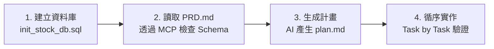

# 實戰專案 1：股市即時監控與增量同步系統

* **模式**：規格驅動開發 (SDD, Spec-Driven Development)
* **核心技術**：PostgreSQL / Supabase、MCP Server、yfinance、Streamlit (或 Tkinter)
* **難易度**：⭐⭐⭐ (中階實戰)

---

## 📖 專案核心思維：快取旁路與增量同步 (Cache-Aside & Incremental Sync)

在職場與實務系統中，呼叫外部 API 下載資料通常很慢且有配額限制。
本專案不提供寫死的現成專案程式碼，而是引導學生透過 **AI + MCP**，實作工業級的快取架構：
1. **無資料**：上網抓取完整歷史資料，批次寫入資料庫。
2. **已有資料但落後**：只抓取缺少的天數（`MAX(date) + 1` 到今天），並使用 `ON CONFLICT DO UPDATE` 寫入。
3. **已是最新**：直接從 PostgreSQL 查詢，**0.1 秒極速秒開**！

---

## 🚀 SDD 開發四部曲

### 第一步：在 Supabase / PostgreSQL 建立資料表
1. 開啟 [`init_stock_db.sql`](./init_stock_db.sql)，複製內容至 Supabase SQL Editor 或 DBeaver 執行。
2. 確認建立完成三張資料表：`markets`（市場）、`stocks`（個股）、`stock_prices`（股價歷史）。
3. 確認 Antigravity 的 **PostgreSQL MCP** 已成功連線至該資料庫。

### 第二步：研讀產品需求文件 (PRD)
打開 [`PRD.md`](./PRD.md)，了解系統的功能需求、增量更新邏輯、UI 畫面規劃與例外處理規範。

### 第三步：請 AI 透過 MCP 生成 `plan.md`
開啟 [`prompts/01_生成開發計畫_plan.md`](./prompts/01_生成開發計畫_plan.md)，將裡面的 Prompt 複製傳送給 Antigravity AI。
AI 將透過 MCP 查詢資料表真實結構，為你產出清晰具體的 `plan.md`！

### 第四步：依據計畫逐步開發
參考 [`prompts/02_SDD逐步實作引導.md`](./prompts/02_SDD逐步實作引導.md)，依照 `plan.md` 的四個 Task 逐項請 AI 撰寫程式碼並執行驗收：
* **Task 1**：`db.py`（連線與查詢模組）
* **Task 2**：`sync.py`（yfinance 增量同步核心）
* **Task 3**：`app.py`（Streamlit 前端儀表板）
* **Task 4**：邊界防呆與測試（休市日、API 逾時處理）

---

## 📁 專案檔案清單

| 檔案 | 說明 |
|---|---|
| 📄 [`PRD.md`](./PRD.md) | 產品需求文件 (需求規格核心) |
| 🗄️ [`init_stock_db.sql`](./init_stock_db.sql) | 一鍵建表與種子資料腳本 |
| 💡 [`prompts/`](./prompts/) | SDD 提示詞引導卡 (引導 AI 產出 plan.md 與逐步實作) |
| ⚙️ [`.env.example`](./.env.example) | 資料庫連線環境變數設定範本 |
| 📦 [`requirements.txt`](./requirements.txt) | Python 套件依賴清單 |
| 🗃️ [`legacy_reference/`](./legacy_reference/) | 歷史參考檔案備查庫 |
