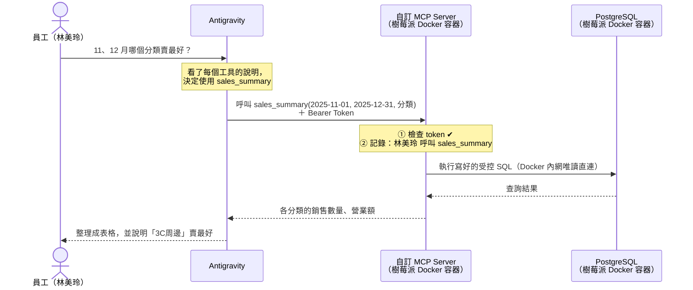
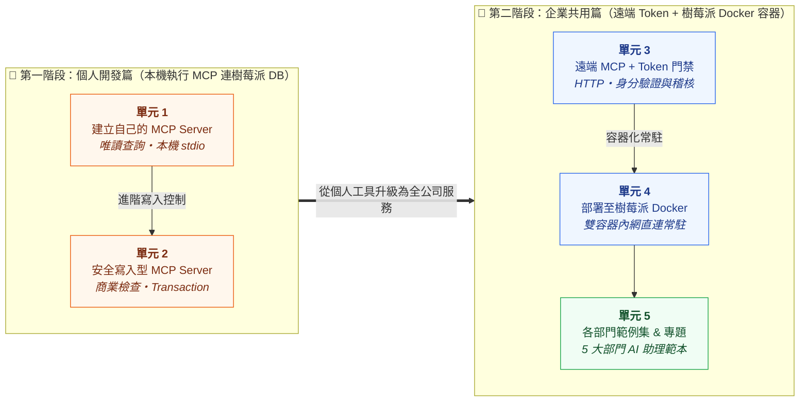

# 第 8 章：自訂 MCP Server（壓軸單元：從個人本機開發到企業容器化導入）

> 📌 **先修**：
> - [第 3 章 安裝現成 MCP](../MCP操作資料庫/)（體驗過自然語言查庫）
> - [第 4-5 章 SQL 語法與練習](../上課用sql/)（看得懂 SQL 與資料庫關聯）
> - [第 6-7 章 Python 串接與實戰專案](../README.md#6-python-串接psycopg2)（具備 Python 程式基礎）

在第 3 章中，我們使用的是別人寫好的開源 MCP（例如 `postgres-mcp`），AI 可以任意執行 SQL。
但在真實應用與企業環境中，**我們不能讓 AI 隨意下 SQL，也不能讓沒有權限的人隨意撈取機敏資料**。

**在全書的最後一章，我們要用 Python（FastMCP）親手打造專屬的自訂 MCP Server！**
本章採用最符合真實軟體工程的**「先個人（本機開發） $\rightarrow$ 後企業共用（樹莓派 Docker 容器化）」**兩階段路線：先在自己的電腦上快速開發唯讀與安全寫入工具，最後加上 Token 門禁與稽核紀錄，打包放進 **Raspberry Pi 的 Docker 容器**與 PostgreSQL 並肩運行，讓全公司員工安全共用！

---

## 個人開發 vs. 企業導入架構演進

學完這個章節，你要能掌握這四件事：

| | 重點 | 說明 |
|:---:|---|---|
| 1 | **MCP 是 AI 的標準接口** | 寫好一個 MCP Server，Antigravity、VS Code 等支援 MCP 的 AI 工具都可以掛載使用，不用為每個 AI 介面各寫一套 |
| 2 | **只開放設計好的工具** | AI 不能隨便亂下 SQL，只能呼叫我們設計好的受控 Tool（包含唯讀查詢與受交易保護的寫入），資料更安全、結果更穩定 |
| 3 | **先本機開發、後容器部署** | 開發除錯時在個人電腦用 `stdio` 秒改秒測；正式共用時打包進樹莓派 Docker，與 PostgreSQL 走容器內網高速直連 |
| 4 | **企業共用一定要使用 Token** | 沒有 Token 不能查資料。Token 用來確認身分、記錄誰查了什麼，員工離職也能在伺服器立刻註銷 |

### 員工問一個問題，背後發生了什麼事？

> 💡 **AI 從頭到尾都沒有自己拼湊危險的 SQL**，它只是「挑選合適的 Tool、填入參數」，真正的 SQL 是我們在 FastMCP 程式裡寫好的安全查詢。

---

## 本章兩階段學習路線（共 5 單元）

| 階段 | 單元 | 你的角色 | 內容 | 執行位置與連線方式 |
|:---:|---|---|---|---|
| **個人篇** | [1. 用 AI 建立自己的 MCP Server（唯讀）](./1_用AI建立MCP_server/) ⭐ | 需求設計者、開發者 | 規劃工具 → 撰寫 FastMCP 程式 → Inspector 測試 → 在 Antigravity 專案掛載 | 💻 本機執行（`stdio`） 連樹莓派 DB |
| **個人篇** | [2. 會寫入資料的 MCP Server（安全寫入）](./2_寫入型MCP_server/) ⭐ | 需求設計者、驗收者 | 圖書館借還書：只開放特定寫入、商業規則寫在程式裡、資料庫交易（Transaction）與鎖定 | 💻 本機執行（`stdio`） 連樹莓派 DB |
| **企業篇** | [3. 企業導入：遠端 MCP 與 Token 門禁](./3_企業導入_遠端MCP與token/) ⭐ | 系統導入者 | 從 `stdio` 升級為 `Streamable HTTP`，員工帶 Bearer Token 連線，留下即時稽核紀錄 | 💻 本機測試遠端架構 （`HTTP + Token`） |
| **企業篇** | [4. 正式上線：部署至樹莓派 Docker 雙容器](./4_樹莓派Docker容器部署/) ⭐ | 系統架構師 | 撰寫 `Dockerfile` 與 `docker-compose.yml`，將 MCP Server 放進樹莓派與 PostgreSQL 雙容器內網直連 | 🍓 樹莓派 Docker 常駐 （`HTTP + Token`） |
| **綜合篇** | [5. 企業各部門範例集](./5_範例集/) | 參考、示範 | 網路商店客服、教務處、圖書館、YouBike、股市，5 個部門的 AI 助理（共用 `common.py`） | 💻 本機或 🍓 樹莓派皆可 |
| **綜合篇** | [期末專題](#期末專題) | 全部 | 親手為一間「公司」打造專屬的 MCP Server 並部署上線 | 🍓 遠端容器 + Token |

---

## 你與 AI 的協同開發模式

在 Antigravity IDE 中開發 MCP Server 時，你不需要從空白文字檔自己刻全部語法，你可以透過 Antigravity AI 協作：

| 你負責 | AI 負責 |
|---|---|
| 想清楚使用者會問什麼問題、需要哪些受控工具 | 產生 FastMCP 骨架與 SQL 查詢函式 |
| 把資料表結構和安全限制清楚地告訴 AI | 修正錯誤與補齊型別檢查 |
| 測試、驗收，確認 Tool 的回傳格式正確 | 依照你的回饋微調工具參數與 docstring |

---

## 核心名詞對照

| 名詞 | 白話說明 |
|---|---|
| **MCP**（Model Context Protocol） | AI 連接外部工具與資料的標準規格，就像 USB 是電腦連接週邊的標準 |
| **MCP Client** | AI 這一端，本課程使用 **Antigravity** |
| **專案級 MCP** | 設定在專案目錄 `.agents/mcp_config.json`，免全域安裝，只在開啟專案時啟動 |
| **MCP Server** | 提供受控工具給 AI 呼叫的伺服程式，例如「查詢銷售統計」、「列出缺貨商品」 |
| **Tool（工具）** | MCP Server 裡定義的具體功能函式，AI 會根據 Tool 的 docstring 說明決定何時呼叫 |
| **stdio（本機）** | 個人開發階段使用：MCP Server 在本機作為子程序啟動，透過標準輸入輸出溝通 |
| **Streamable HTTP（遠端）** | 企業共用階段使用：MCP Server 架在樹莓派 Docker 容器上，透過網路 URL 提供多人共用 |
| **Token** | 身分驗證金鑰，連線時必須附帶，確保只有授權員工才能使用並留下稽核紀錄 |

---

## 期末專題

以小組或個人為單位，扮演一間公司的系統架構師，**打造一個自訂 MCP Server**，先在本機開發驗收，最後部署到樹莓派 Docker 容器中，讓使用者在 Antigravity 中帶 Token 連線查詢（亦可加入安全受控的寫入功能）。

**資料庫（擇一）**：課程中任何一個範例資料庫（[中文範例資料庫](../範例資料庫/中文範例資料庫/)、台鐵、YouBike、股市）

| 項目 | 要求 |
|---|---|
| 情境設計 | 說明目標使用者是誰，以及他們最常問的 5 個業務問題 |
| 工具規劃 | 至少 3 個自訂工具，附上工具規劃表（輸入參數、回傳結構） |
| 安全規範 | 堅持參數化查詢（防止 SQL Injection）、限制單次最大回傳筆數 |
| 寫入控制（加分） | 若有寫入工具，需實作身分檢查、業務條件驗證與資料庫交易（Transaction） |
| 容器部署與掛載 | 部署為遠端 HTTP + Token 服務（可放進樹莓派 Docker），並在 `.agents/mcp_config.json` 掛載展示 |
