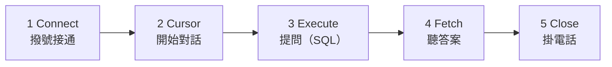

# 單元 2：基本步驟，永遠是這五個動作

> ⏱️ **30 分鐘** ｜ 🎯 學完你會：用 Python 執行查詢，並把結果印出來

## 🎬 情境

王經理：「高單價商品清單，每次改價後都要看一次。」寫成 Python，以後跑一下就好。

## 五個固定動作

像打電話一樣：



| 動作 | 程式 | 說明 |
|---|---|---|
| Connect | `conn = psycopg2.connect(...)` | 連上資料庫 |
| Cursor | `cur = conn.cursor()` | 建立游標，用來下指令 |
| Execute | `cur.execute(sql)` | 執行 SQL |
| Fetch | `cur.fetchall()` | 取回結果 |
| Close | `cur.close()`、`conn.close()` | 關閉，釋放資源 |

## 完整範例

`get_products.py`：

```python
import os
import psycopg2
from dotenv import load_dotenv

load_dotenv()

# 1. Connect
conn = psycopg2.connect(
    host=os.getenv("DB_HOST"), port=os.getenv("DB_PORT"), dbname=os.getenv("DB_NAME"),
    user=os.getenv("DB_USER"), password=os.getenv("DB_PASSWORD"),
)

# 2. Cursor
cur = conn.cursor()

# 3. Execute：這段 SQL 是你第 4 章學的
cur.execute("""
    SELECT name, price, cost
    FROM products
    WHERE price > 120
    ORDER BY price DESC;
""")

# 4. Fetch：每一列是一個 tuple
products = cur.fetchall()

print(f"共 {len(products)} 項高單價商品")
for name, price, cost in products:
    print(f"- {name}：售價 {price} 元，毛利 {price - cost} 元")

# 5. Close
cur.close()
conn.close()
```

**執行結果**

```text
共 3 項高單價商品
- 冰滴咖啡：售價 150 元，毛利 90 元
- 草莓生乳千層：售價 140 元，毛利 85 元
- 燕麥奶拿鐵：售價 130 元，毛利 80 元
```


## 三種取回資料的方法

| 方法 | 回傳 | 適合 |
|---|---|---|
| `fetchone()` | 一筆（tuple），沒有就是 `None` | 查總數、查單筆 |
| `fetchmany(n)` | 最多 n 筆（list） | 資料量大，分批處理 |
| `fetchall()` | 全部（list） | 一般清單 |

```python
import os, psycopg2
from dotenv import load_dotenv
load_dotenv()
conn = psycopg2.connect(host=os.getenv("DB_HOST"), port=os.getenv("DB_PORT"), dbname=os.getenv("DB_NAME"),
                        user=os.getenv("DB_USER"), password=os.getenv("DB_PASSWORD"))
cur = conn.cursor()

cur.execute("SELECT COUNT(*) FROM orders;")
print("訂單總數：", cur.fetchone()[0])  # [0] 是第一個欄位

cur.execute("SELECT name FROM stores ORDER BY store_id;")
print("前兩家：", cur.fetchmany(2))

cur.close()
conn.close()
```

**執行結果**

```text
訂單總數： 490
前兩家： [('台北信義店',), ('台北車站店',)]
```


> [!TIP]
> 每列是 tuple，所以 `fetchone()` 回傳 `(490,)`。要用 `[0]` 才拿得到 `490`。

## ⚠️ 常見卡關

| 問題 | 原因 | 怎麼解 |
|---|---|---|
| `TypeError: 'NoneType' object is not subscriptable` | `fetchone()` 查無資料回傳 `None` | 先判斷 `if row:` |
| `no results to fetch` | 對 INSERT、UPDATE 用了 fetch | 寫入類指令要加 `RETURNING` 才有結果 |
| SQL 在 Python 裡換行出錯 | 用了單行字串 | 改用三引號 `"""..."""` |
| 程式新增資料，DBeaver 卻看不到 | 沒有 commit | 看下一單元 |

## ✍️ 動手練

**第 1 題**：印出所有門市的名稱和電話。

<details>
<summary>看答案</summary>

```python
import os, psycopg2
from dotenv import load_dotenv
load_dotenv()
conn = psycopg2.connect(host=os.getenv("DB_HOST"), port=os.getenv("DB_PORT"), dbname=os.getenv("DB_NAME"),
                        user=os.getenv("DB_USER"), password=os.getenv("DB_PASSWORD"))
cur = conn.cursor()
cur.execute("SELECT name, phone FROM stores ORDER BY store_id;")
for name, phone in cur.fetchall():
    print(name, phone)
cur.close()
conn.close()
```

</details>

**第 2 題**：把第 4 章「各門市營業額排名」的 SQL 放進 Python，印出排名。

<details>
<summary>看答案</summary>

```python
import os, psycopg2
from dotenv import load_dotenv
load_dotenv()
conn = psycopg2.connect(host=os.getenv("DB_HOST"), port=os.getenv("DB_PORT"), dbname=os.getenv("DB_NAME"),
                        user=os.getenv("DB_USER"), password=os.getenv("DB_PASSWORD"))
cur = conn.cursor()
cur.execute("""
    SELECT s.name, SUM(i.quantity * i.unit_price) AS revenue
    FROM orders o
    JOIN stores s ON o.store_id = s.store_id
    JOIN order_items i ON o.order_id = i.order_id
    WHERE o.status = '已完成'
    GROUP BY s.name
    ORDER BY revenue DESC;
""")
for rank, (name, revenue) in enumerate(cur.fetchall(), start=1):
    print(f"第 {rank} 名 {name}：{revenue:,} 元")
cur.close()
conn.close()
```

**執行結果**

```text
第 1 名 台中逢甲店：18,795 元
第 2 名 高雄巨蛋店：16,440 元
第 3 名 台北信義店：16,170 元
第 4 名 新竹巨城店：15,365 元
第 5 名 台北車站店：14,215 元
```


</details>

## 🤖 問 AI 助教

> 這段 SQL 我已經在 DBeaver 測試過了：（貼上 SQL）。請幫我包成 Python 程式，遵守五個步驟，把結果印成整齊的表格。請逐行解釋。

## ✅ 過關檢查

- [ ] 我能講出五個動作的順序
- [ ] 我知道 `fetchone()[0]` 為什麼要 `[0]`
- [ ] 第 2 題我跑出了門市排名

---

| 上一步 | 目錄 | 下一步 |
|:---|:---:|---:|
| [⬅️ 單元 1 安裝和環境](../安裝和介紹/) | [🏠 第 5 章目錄](../) | [單元 3 with 語法 ➡️](../with/) |
