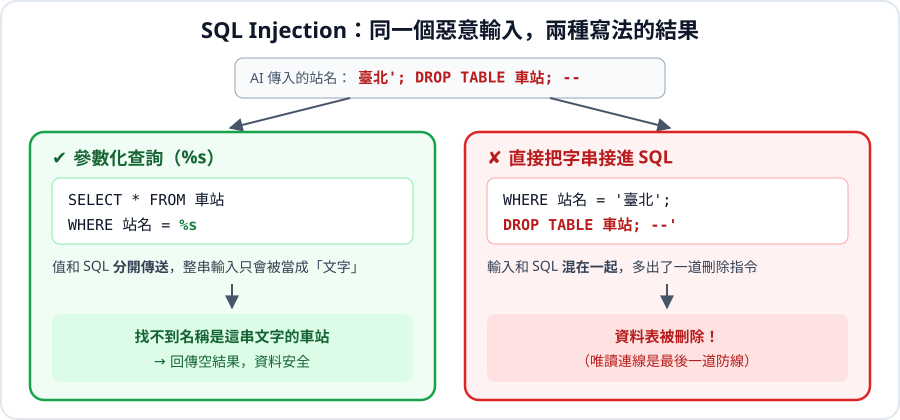

# 單元 4：參數傳遞，親眼看 SQL Injection 怎麼發生

> 🎯 學完你會：解釋 SQL Injection，並一律用 `%s` 傳遞輸入

## 🎬 情境

你做了一個「輸入電話查會員」的小工具，用 f-string 把電話接進 SQL。某天有人在輸入框打了一串奇怪的文字，**全部會員資料都跑出來了**。

## 1. 攻擊示範

在自己的練習資料庫跑一次，你就永遠忘不掉。

```python
import os, psycopg2
from dotenv import load_dotenv
load_dotenv()
conn = psycopg2.connect(host=os.getenv("DB_HOST"), port=os.getenv("DB_PORT"), dbname=os.getenv("DB_NAME"),
                        user=os.getenv("DB_USER"), password=os.getenv("DB_PASSWORD"))
cur = conn.cursor()

user_input = "' OR '1'='1"  # 使用者在輸入框打的字

# ❌ 危險：用 f-string 把輸入接進 SQL
sql = f"SELECT name, phone FROM customers WHERE phone = '{user_input}'"
print("實際送出的 SQL：", sql)

cur.execute(sql)
print("查到幾筆：", len(cur.fetchall()))

cur.close()
conn.close()
```

**執行結果**

```text
實際送出的 SQL： SELECT name, phone FROM customers WHERE phone = '' OR '1'='1'
查到幾筆： 50
```


**它做了什麼？** 輸入的單引號把字串提早結束了，條件變成「電話是空字串 **或** 1=1」。`1=1` 永遠成立，於是**所有會員**都被查出來。

如果輸入的是刪除指令，後果更嚴重。

## 2. 正確做法：用 %s

```python
import os, psycopg2
from dotenv import load_dotenv
load_dotenv()
conn = psycopg2.connect(host=os.getenv("DB_HOST"), port=os.getenv("DB_PORT"), dbname=os.getenv("DB_NAME"),
                        user=os.getenv("DB_USER"), password=os.getenv("DB_PASSWORD"))
cur = conn.cursor()

user_input = "' OR '1'='1"

# ✅ 安全：值另外傳，psycopg2 會把它當成純文字處理
cur.execute("SELECT name, phone FROM customers WHERE phone = %s;", (user_input,))
print("查到幾筆：", len(cur.fetchall()))

cur.close()
conn.close()
```

**執行結果**

```text
查到幾筆： 0
```


同一段攻擊字串，現在只是一組「查無此號」的電話。

> [!IMPORTANT]
> **`%s` 不用加引號，不論字串、數字或日期都寫 `%s`。** 只有一個參數時，要寫成 `(value,)`，逗號不能少，這才是 tuple。



## 3. 實用範例：查門市業績

把查詢包成函式，日後的 App 可以直接呼叫：

```python
import os
import psycopg2
from dotenv import load_dotenv

load_dotenv()


def get_store_sales(store_name):
    """查詢某門市已完成訂單的訂單數與營業額"""
    conn = psycopg2.connect(
        host=os.getenv("DB_HOST"), port=os.getenv("DB_PORT"), dbname=os.getenv("DB_NAME"),
        user=os.getenv("DB_USER"), password=os.getenv("DB_PASSWORD"),
    )
    with conn:
        with conn.cursor() as cur:
            cur.execute(
                """
                SELECT COUNT(DISTINCT o.order_id), COALESCE(SUM(i.quantity * i.unit_price), 0)
                FROM stores s
                LEFT JOIN orders o ON s.store_id = o.store_id AND o.status = '已完成'
                LEFT JOIN order_items i ON o.order_id = i.order_id
                WHERE s.name = %s;
                """,
                (store_name,),
            )
            result = cur.fetchone()
    conn.close()
    return result


orders, revenue = get_store_sales("台北信義店")
print(f"台北信義店：{orders} 筆訂單，營業額 {revenue:,} 元")
```

**執行結果**

```text
台北信義店：82 筆訂單，營業額 16,170 元
```


## 4. 例外：欄位名稱不能用 %s

`%s` 只能傳「值」。排序欄位這類**結構**不能用 `%s`，要用白名單檢查：

```python
import os, psycopg2
from dotenv import load_dotenv
load_dotenv()
conn = psycopg2.connect(host=os.getenv("DB_HOST"), port=os.getenv("DB_PORT"), dbname=os.getenv("DB_NAME"),
                        user=os.getenv("DB_USER"), password=os.getenv("DB_PASSWORD"))
cur = conn.cursor()

ALLOWED = {"售價": "price", "成本": "cost"}  # 白名單
choice = "售價"  # 使用者的選擇

if choice not in ALLOWED:
    raise ValueError("不允許的排序方式")

cur.execute(f"SELECT name FROM products ORDER BY {ALLOWED[choice]} DESC LIMIT 1;")
print("最高的是：", cur.fetchone()[0])

cur.close()
conn.close()
```

**執行結果**

```text
最高的是： 冰滴咖啡
```


這裡的 f-string 是安全的，因為接進去的只會是白名單裡你自己寫的字。

## ⚠️ 常見卡關

| 問題 | 原因 | 怎麼解 |
|---|---|---|
| `not all arguments converted during string formatting` | 參數不是 tuple | 寫成 `(value,)` |
| `syntax error at or near "$1"` 或引號錯亂 | `'%s'` 多加了引號 | 拿掉引號，只寫 `%s` |
| LIKE 怎麼寫？ | `%` 要放在值裡 | `LIKE %s`，傳入 `(f"%{kw}%",)` |
| 想保留 `%` 字元 | 字串裡的 `%` 會被當格式符 | 在 SQL 裡寫成 `%%` |

## ✍️ 動手練

**第 1 題**：寫函式 `search_products(keyword)`，用 `LIKE` 搜尋包含關鍵字的商品。

<details>
<summary>看答案</summary>

```python
import os, psycopg2
from dotenv import load_dotenv
load_dotenv()


def search_products(keyword):
    conn = psycopg2.connect(host=os.getenv("DB_HOST"), port=os.getenv("DB_PORT"), dbname=os.getenv("DB_NAME"),
                            user=os.getenv("DB_USER"), password=os.getenv("DB_PASSWORD"))
    with conn:
        with conn.cursor() as cur:
            cur.execute("SELECT name, price FROM products WHERE name LIKE %s ORDER BY price;", (f"%{keyword}%",))
            rows = cur.fetchall()
    conn.close()
    return rows


print(search_products("拿鐵"))
```

**執行結果**

```text
[('經典拿鐵', 95), ('燕麥奶拿鐵', 130)]
```


</details>

**第 2 題**：下面哪些寫法是危險的？

```text
A. cur.execute("... WHERE name = %s", (name,))
B. cur.execute(f"... WHERE name = '{name}'")
C. cur.execute("... WHERE name = '" + name + "'")
D. cur.execute("... WHERE name = '%s'" % name)
```

<details>
<summary>看答案</summary>

**B、C、D 都危險**，全都是自己把字串接進 SQL。特別注意 D 長得很像 `%s`，但用的是 Python 的 `%` 運算子，並不是參數化。只有 A 安全。

</details>

## 🤖 問 AI 助教

> 請檢查這段程式有沒有 SQL Injection 風險，指出是哪一行，並用 %s 改寫：（貼上你的程式）

**AI 偶爾也會用 f-string 組 SQL，檢查它是你的工作。**

## ✅ 過關檢查

- [ ] 我跑過攻擊示範，能解釋 `' OR '1'='1` 為什麼有效
- [ ] 我知道 `%s` 不用加引號，單一參數要加逗號
- [ ] 我知道欄位名稱要用白名單

---

| 上一步 | 目錄 | 下一步 |
|:---|:---:|---:|
| [⬅️ 單元 3 with 語法](../with/) | [🏠 第 5 章目錄](../) | [單元 5 型別對照 ➡️](../type/) |
