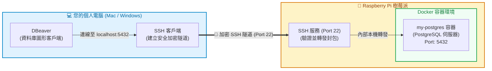
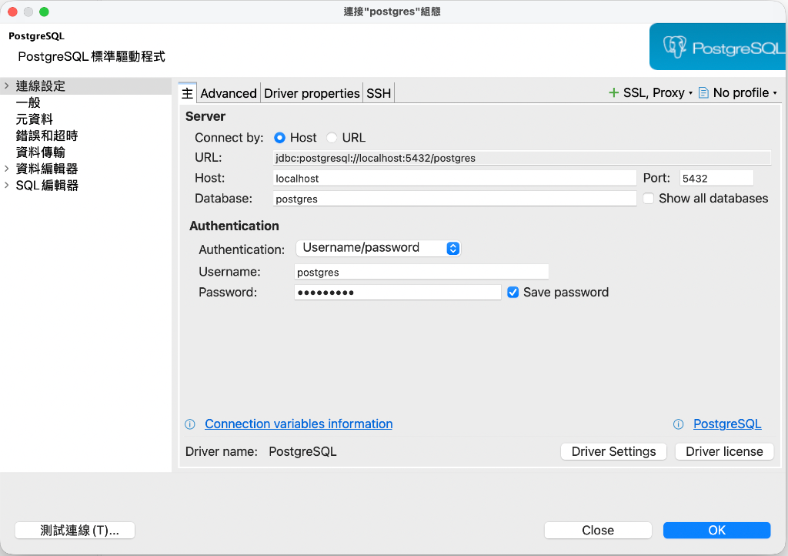
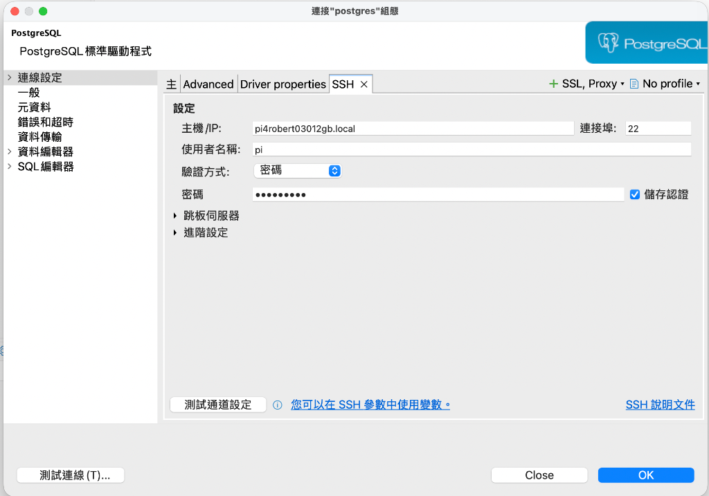

# 3. 使用 DBeaver 透過 SSH 隧道連線至 Raspberry Pi

在個人電腦（Mac / Windows）上管理樹莓派的 PostgreSQL，最推薦且最安全的方式是**使用 DBeaver 內建的 SSH 隧道（SSH Tunnel）**。

---

## 🏗️ SSH 隧道運作架構

> [!NOTE]
> ### 💡 為什麼推薦 SSH 隧道？
> * 🛡️ **極致安全**：所有傳輸皆通過 SSH 加密通道，不需要將 PostgreSQL 的 `5432` 埠對外開放至公網或不安區域。
> * 🌐 **免開額外防火牆**：只要電腦能夠透過 SSH（預設埠 `22`）連線進樹莓派，就能暢通無阻地存取資料庫。
> * 🔒 **內外分明**：資料庫僅對樹莓派內部本機開放，杜絕外部暴力破解風險。

---

## 步驟 3.1：確認樹莓派連線資訊

在開始設定 DBeaver 前，請確認手邊備齊以下三項資訊：

| 項目 | 範例 / 說明 | 查詢方式 |
|---|---|---|
| **① 樹莓派主機位址** | `raspberrypi.local` 或 `192.168.1.150` | 在樹莓派終端機執行 `hostname -I` 查詢區網 IP，或使用 mDNS 主機名稱 |
| **② 樹莓派 SSH 帳密** | 帳號：`pi` / 密碼：自訂密碼 | 安裝樹莓派系統時設定的使用者帳號與密碼 |
| **③ PostgreSQL 密碼** | 步驟 2.2 設定的密碼 | 即當初 `docker run` 時傳入的 `POSTGRES_PASSWORD` |

---

## 步驟 3.2：在 DBeaver 設定 SSH 隧道連線

打開個人電腦上的 **DBeaver**，點擊左上角 **「Database」 ➜ 「New Database Connection」**，選擇 **PostgreSQL** 後點擊 **Next**。

### 3.2.1 【主（Main）分頁】設定資料庫連線

依照下圖填入資料庫連線參數：

| 欄位名稱 | 填入內容 | 說明 |
|---|---|---|
| **Connect by** | `Host` | 採用主機位址連線 |
| **Host** | `localhost` | ⚠️ **注意**：必須填 `localhost`！因為 SSH 隧道轉發後，封包是從樹莓派內部本機發出 |
| **Port** | `5432` | PostgreSQL 預設連接埠 |
| **Database** | `postgres` | 連線預設的管理資料庫名稱 |
| **Authentication** | `Username/password` | 帳號密碼認證 |
| **Username** | `postgres` | PostgreSQL 預設管理者帳號 |
| **Password** | 輸入步驟 2.2 設定的密碼 | 建議勾選 **Save password**（儲存密碼） |

---

### 3.2.2 【SSH 分頁】設定 SSH 加密隧道（核心關鍵）

切換至上方的 **SSH** 分頁，依序配置 SSH 代理轉發資訊：

1. ✅ 勾選 **Use SSH Tunnel**（啟用 SSH 隧道）
2. 填寫連線參數：
   * **Host / IP**：填入樹莓派主機名稱（如 `pi4robert03012gb.local`）或區網 IP（如 `192.168.1.150`）
   * **Port**：`22`（SSH 預設連接埠）
   * **User Name**：樹莓派的系統帳號（例如預設的 `pi`）
   * **Authentication Method**：選擇 `Password`（若已配置免密碼金鑰則選 `Public Key`）
   * **Password**：輸入樹莓派該系統帳號的 SSH 密碼
   * ✅ 勾選 **Save password**（儲存密碼）

---

### 3.2.3 【PostgreSQL 分頁】與連線驗證

1. **顯示所有資料庫**：切換至 **PostgreSQL** 分頁，務必勾選 **Show all databases**（這樣後續新建的資料庫才會自動顯示於左側導航樹）。
2. **測試連線 (Test Connection)**：
   * 點選視窗左下角的 **Test Connection**。
   * *初次使用提示*：若跳出驅動程式下載對話框，直接點擊 **Download** 即可自動完成安裝。
   * 連線成功時會彈出 **`Connected`** 提示框（顯示 PostgreSQL 版本與連線耗時）。
3. 點選右下角 **Finish** 或 **OK**，即可在左側導航窗格看到您的樹莓派資料庫！

> [!TIP]
> 如果測試連線失敗，請檢查：
> 1. 個人電腦能否在終端機 `ping <樹莓派IP>` 或 `ssh <帳號>@<樹莓派IP>`？
> 2. 樹莓派上的 Docker 容器是否正常運行（在樹莓派輸入 `docker ps` 確認狀態為 `Up`）？
> 3. Main 分頁的主機位址是否為 `localhost`，而不是樹莓派的 IP？

---

## 步驟 3.3：DBeaver 常用操作與快捷鍵速查

### ⌨️ 高頻快捷鍵對照

| 功能操作 | Windows / Linux | macOS |
|---|:---:|:---:|
| **開啟新 SQL 編輯器** | <kbd>Ctrl</kbd> + <kbd>]</kbd> | <kbd>Cmd</kbd> + <kbd>]</kbd> |
| **執行游標所在的一句 SQL** | <kbd>Ctrl</kbd> + <kbd>Enter</kbd> | <kbd>Cmd</kbd> + <kbd>Enter</kbd> |
| **執行整個檔案的所有 SQL 腳本** | <kbd>Alt</kbd> + <kbd>X</kbd> | <kbd>Opt</kbd> + <kbd>X</kbd> |
| **重新整理左側資料庫樹狀結構** | <kbd>F5</kbd> | <kbd>F5</kbd> |
| **格式化選取的 SQL 程式碼** | <kbd>Ctrl</kbd> + <kbd>Shift</kbd> + <kbd>F</kbd> | <kbd>Cmd</kbd> + <kbd>Shift</kbd> + <kbd>F</kbd> |

---

### 🗄️ 常用介面操作指南

| 任務目標 | 介面操作路徑 |
|---|---|
| 📂 **開啟外部 `.sql` 檔** | 點擊上方選單 **File ➜ Open File...** 選擇檔案，再從工具列的 **Active datasource** 下拉選單指定目標資料庫。 |
| ➕ **建立新資料庫** | 在連線樹狀結構下的 **Databases** 按右鍵 ➜ **Create New Database**，輸入名稱後儲存。 |
| 📥 **匯入 CSV 資料檔** | 在目標資料表按右鍵 ➜ **Import Data** ➜ 選擇 **CSV** ➜ 選取檔案並核對欄位對應 ➜ 點擊 **Proceed**。 |
| 🔍 **檢視資料表結構與約束** | 在資料表按兩下開啟 ➜ 切換至 **Properties** 分頁（可瀏覽 Columns、Constraints、Foreign Keys 等）。 |
| 📊 **檢視資料庫實體關聯圖 (ERD)** | 在資料庫、Schema 或資料表按兩下 ➜ 切換至 **ER Diagram** 分頁，即時產出視覺化關聯圖。 |
| 📝 **快速逆向產生 DDL 語法** | 在資料表按右鍵 ➜ **Generate SQL ➜ DDL**，即可獲得完整的 `CREATE TABLE` 原始語法。 |

---

| 上一步 | 目錄 | 下一步 |
|:---|:---:|---:|
| [⬅️ 步驟 2：運行 PostgreSQL 容器](./2_單獨安裝postgresql.md) | [🏠 樹莓派 Docker 目錄](./README.md) | [步驟 4：本機 Antigravity 設定全域 MCP ➡️](./4_單獨安裝mcp_server.md) |
