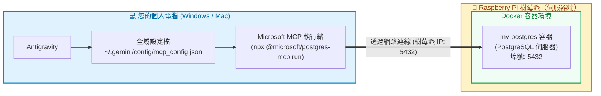

# 4. 在本機 Antigravity 設定 Microsoft 全域 MCP 連線至樹莓派資料庫

在前面單元 2 與單元 3 中，我們已經在**樹莓派（Raspberry Pi）的 Docker 內**順利啟動了 PostgreSQL 資料庫伺服器（埠號 `5432`）。

現在，我們回到**本機電腦（Windows / Mac）**，使用微軟官方推出的 **`@microsoft/postgres-mcp`**，透過 **`npx`** 免安裝指令直接在全域設定 MCP Server，讓 **Antigravity** 在任何工作區都能隨時連線至樹莓派資料庫，純中文自然語言查庫與操作！

> [!NOTE]
> **為什麼採用微軟 `@microsoft/postgres-mcp` 與全域設定？**
> * **微軟官方開源維護**：由 Microsoft 官方團隊開發，支援豐富的 PostgreSQL 診斷、執行計畫分析與查詢工具。
> * **完全免建 Python 虛擬環境**：透過 Node.js 的 `npx` 工具自動下載執行，**完全不需要建立 `.venv` 或安裝 Python 套件**。
> * **全域一次設定，處處可用**：寫入 `~/.gemini/config/mcp_config.json`，開任何專案都能直接調用。
> * **免建立 Profile 直接連線**：依據微軟官方的 [Connecting without a profile](https://github.com/microsoft/postgres-mcp/blob/main/USAGE.md#connecting-without-a-profile) 規範，透過環境變數 `POSTGRES_MCP_CONNECTION_STRING` 直接傳入連線字串，免去設定 OS Keyring 的複雜度。

---

## 🏗️ 連線運作架構



---

## 步驟 4.1：確認電腦安裝 Node.js（附帶 `npx`）

微軟的 `@microsoft/postgres-mcp` 是透過 npm 發行的工具，執行時使用 **`npx`**。

請確認您的電腦已安裝 Node.js（終端機可輸入 `node -v` 與 `npx -v` 驗證）。如果尚未安裝，可至 [Node.js 官方網站](https://nodejs.org/) 下載安裝 LTS 版本。

---

## 步驟 4.2：設定全域 `~/.gemini/config/mcp_config.json`

全域 MCP 設定檔位於使用者的個人家目錄下：
* **Mac / Linux**：`~/.gemini/config/mcp_config.json`（即 `/Users/使用者名稱/.gemini/config/mcp_config.json`）
* **Windows**：`%USERPROFILE%\.gemini\config\mcp_config.json`（即 `C:\Users\使用者名稱\.gemini\config\mcp_config.json`）

### 1. 設定內容（無 Profile 模式）

根據微軟官方文件，在不需要本機 Keyring 憑證管理的環境下，直接設定環境變數 `POSTGRES_MCP_CONNECTION_STRING` 即可：

```json
{
  "mcpServers": {
    "raspberry-postgres": {
      "command": "npx",
      "args": [
        "-y",
        "@microsoft/postgres-mcp",
        "run"
      ],
      "env": {
        "POSTGRES_MCP_CONNECTION_STRING": "postgresql://postgres:密碼@樹莓派IP:5432/postgres"
      }
    }
  }
}
```

> [!TIP]
> 如果希望關閉使用度遙測回傳，可以在 `args` 中加上 `"--no-telemetry"`：
> ```json
> "args": ["-y", "@microsoft/postgres-mcp", "run", "--no-telemetry"]
> ```

---

### 2. 關鍵參數說明

1. **`"command": "npx"`**：
   使用 Node.js 的免安裝執行工具，全自動下載最新版本的微軟 MCP 套件並在記憶體中啟動。
2. **`"args": ["-y", "@microsoft/postgres-mcp", "run"]`**：
   * `-y`：自動確認下載，免去互動提示。
   * `@microsoft/postgres-mcp`：微軟官方發布的套件名稱。
   * `run`：啟動 MCP stdio 監聽服務。
3. **`"POSTGRES_MCP_CONNECTION_STRING"`**：
   微軟官方指定用來直接連線的環境變數名稱，格式為標準的 libpq 連線字串：
   ```text
   postgresql://【使用者帳號】:【密碼】@【樹莓派主機位址】:【埠號】/【資料庫名稱】
   ```

| 欄位片段 | 代表意義 | 範例與白話說明 |
|---|---|---|
| `postgresql://` | **連線協定** | 指定連線至 PostgreSQL 資料庫 |
| `postgres` | **帳號** | 預設最高管理員為 `postgres` |
| `:密碼` | **密碼** | 單元 2 啟動容器時設定的密碼（例如 `:raspberry`） |
| `@樹莓派IP` | **主機位址** | 樹莓派在區網的 IP（例如 `192.168.1.150`）或主機名（例如 `pi3robert0301.local`） |
| `:5432` | **連接埠** | PostgreSQL 預設服務埠號 `5432` |
| `/postgres` | **資料庫名稱** | 目標資料庫名稱（預設為 `postgres`） |

---

## 步驟 4.3：重新載入與連線驗證

儲存設定後，**重新載入視窗**（或重開 Antigravity），即可在聊天框直接對 AI 提問測試：

1. **查看資料庫狀態**：
   > 「請連線到我的樹莓派資料庫，幫我列出目前所有的資料表。」
2. **查詢連線版本**：
   > 「請告訴我目前連線的 PostgreSQL 版本是什麼？」

當看到 Antigravity 自動調用微軟的 `postgres` MCP 工具並回傳資料庫內容時，就代表全域設定已成功運作！

---

## 步驟 4.4：實戰應用情境

### 🔍 情境 1：檢視資料表結構（Schema 探索）
> 「請連線樹莓派資料庫，幫我檢查目前資料庫有哪些資料表？並列出欄位型別與主鍵設定。」

### 💡 情境 2：查詢與效能分析
> 「請幫我查詢各商品類別的銷售總額，並提供 SQL 語法與解釋。」

### 🚀 情境 3：資料表維護與建立
> 「請在樹莓派資料庫中建立一張名為 `students` 的資料表，包含 id、姓名、成績，並插入 3 筆測試資料。」

---

👉 **下一步：[5. 樹莓派端 Docker Compose 伺服器維護指南](./5_docker_compose雙容器.md)**
