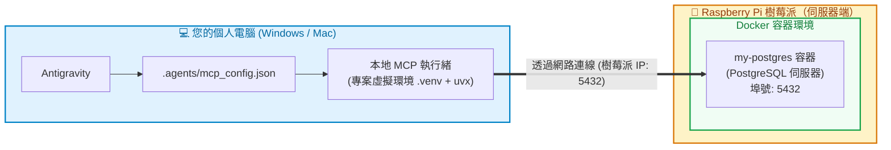

# 4. 在本機 Antigravity 設定專案級 MCP 連線至樹莓派資料庫

在前面單元 2 中，我們已經在**樹莓派（Raspberry Pi）的 Docker 內**順利啟動了 PostgreSQL 資料庫伺服器（埠號 `5432`）。

現在，我們回到**本機電腦（Windows / Mac）**，使用極速免安裝的 Python 工具 **`uvx`** 啟動 MCP Server，讓 **Antigravity** 連線至樹莓派資料庫，純中文自然語言查庫！

> [!NOTE]
> **本課程個人電腦端採用 `uvx`，學生電腦不需要安裝 Docker！**
> 只要在個人電腦（Windows / Mac）上安裝好 `uv`（附帶 `uvx`），Antigravity 就會自動下載並執行開源的 Postgres MCP。

---

## 🏗️ 連線運作架構



---

## 步驟 4.1：請 Antigravity 安裝 `uv`（附帶 `uvx`）

`uv` 是目前官方與業界最推薦的極速 Python 套件管理工具，安裝時會自帶 **`uvx`** 指令。

只要使用 Antigravity 開啟本專案，**完全不需要自己手動開終端機輸入指令**，直接在 Antigravity 聊天框發送以下中文指令：

> 「請幫我檢查這台電腦有沒有安裝 `uv`，如果沒有，請幫我安裝好 `uv`（包含 `uvx`）並確認安裝成功。」

* **AI 自動化成果**：Antigravity 會自動辨識您的作業系統（Windows 或 Mac）、自動呼叫終端機執行官方安裝腳本，並在安裝完成後自動驗證版本號與環境變數！

---

## 步驟 4.2：請 Antigravity 建立專案虛擬環境（隔離環境）

在啟動 MCP 服務之前，我們在專案中建立獨立的 Python 虛擬環境（`.venv`），確保執行環境乾淨隔離且不與全域環境衝突。同樣**不用手動建立**，直接複製貼上以下指令給 AI：

> 「請幫我在目前這個專案根目錄下，使用 uv 建立虛擬環境 `.venv`，並確認建立成功。」

* **AI 自動化成果**：Antigravity 會自動在背景執行 `uv venv`，並確認專案根目錄已產出 `.venv` 資料夾。

---

## 步驟 4.3：請 Antigravity 建立專案規範檔 `GEMINI.md`（鎖定虛擬環境與唯讀助教規則）

在專案根目錄建立 `GEMINI.md` 是 Antigravity 的專案級指令守則。建立之後，未來只要在這個專案工作，AI 都會自動讀取並永久遵循裡面的規範，不再需要每次重複提醒！

因為本專案是**給學生學習 SQL 語法**的教學環境，我們不希望 AI 直接去改動或刪除資料庫，而是定位為「**SQL 學習助教**」：只做唯讀查詢、負責教學與解答 SQL 語法，由學生在 DBeaver 中親手執行！

直接在聊天框複製這段中文給 Antigravity：

> 「請幫我在專案根目錄建立一個專案等級的 `GEMINI.md` 規範檔，內容需明確規定：
> 1. 本專案使用 uv 虛擬環境（`.venv`）。
> 2. 未來在此專案中如果設定或執行 MCP Server（使用 `uvx` 工具），一律必須指定在專案虛擬環境中執行（必須加上 `--python .venv` 參數）。
> 3. MCP 必須啟用唯讀保護模式（`--access-mode=restricted`），AI 定位為『SQL 學習助教』，僅供查詢結構與資料，嚴禁直接執行修改或刪除，所有 SQL 寫入與修改需引導學生在 DBeaver 中親自練習執行。」

* **AI 自動化成果**：Antigravity 會在專案根目錄自動產出 [`GEMINI.md`](file:///Users/roberthsu2003/Documents/GitHub/postgreSQL_MCP/GEMINI.md)，內容範例如下（供檢閱）：

```markdown
# 專案規範與環境設定

## MCP 與 Python 執行環境規範
- **虛擬環境**：本專案使用 `uv` 建立之虛擬環境，路徑為 `.venv/`。
- **MCP Server 執行規則**：
  - 凡是在本專案中使用 `uvx` 啟動任何 MCP Server，一律必須加上 `--python .venv` 參數。
  - 嚴禁直接調用全域 Python 環境啟動專案 MCP，確保套件依賴與版本隔離。

## 教學情境與安全規範（SQL 學習助教）
- **存取模式限制**：本專案 MCP 一律啟用 `--access-mode=restricted`（唯讀保護模式），禁止 AI 直接執行任何寫入、修改、刪除動作（INSERT、UPDATE、DELETE、DROP）。
- **AI 角色定位**：
  - AI 僅作為「SQL 學習助教」，負責檢視結構、指導與解析 SQL 語法。
  - 當學生提出修改或寫入資料庫需求時，AI 應詳細解說標準 SQL 語法，並引導學生在 **DBeaver** 中親自動手執行與練習。
```

---

## 步驟 4.4：請 Antigravity 設定專案級 `.agents/mcp_config.json`（唯讀安全模式）

有了 `GEMINI.md` 的守則後，我們設定 MCP 就更有保障。這一步同樣**不用手動建立或編輯檔案**，直接在 Antigravity 聊天框發送以下指令（請自行替換密碼與樹莓派 IP）：

> 「請幫我在專案的 `.agents/mcp_config.json` 中設定名為 `raspberry-postgres` 的 MCP Server：
> 1. command 使用 `uvx`
> 2. args 指定使用本專案虛擬環境 `--python .venv`，指定版本 `postgres-mcp==0.3.0`，並啟用唯讀保護模式 `--access-mode=restricted`
> 3. DATABASE_URI 設定為：`postgresql://postgres:<您的密碼>@<樹莓派IP>:5432/postgres`」

* **AI 自動化成果**：Antigravity 會自動在專案中建立或更新 [`.agents/mcp_config.json`](file:///Users/roberthsu2003/Documents/GitHub/postgreSQL_MCP/.agents/mcp_config.json)，內容如下（供檢閱確認）：

```json
{
  "mcpServers": {
    "raspberry-postgres": {
      "command": "uvx",
      "args": [
        "--python",
        ".venv",
        "postgres-mcp==0.3.0",
        "--access-mode=restricted"
      ],
      "env": {
        "DATABASE_URI": "postgresql://postgres:yourpassword@<樹莓派IP或主機名稱>:5432/postgres"
      }
    }
  }
}
```

> 💡 **關鍵參數說明**：
> 1. **`"--python", ".venv"`**：**環境隔離！** 明確指定 `uvx` 必須使用專案虛擬環境 `.venv` 內的 Python 來載入與運行 MCP Server。
> 2. **`"postgres-mcp==0.3.0"`**：**鎖定版本！** 鎖定 `0.3.0` 版本，確保 MCP 功能與語法解析穩定運作。
> 3. **`"--access-mode=restricted"`**：**教學安全核心！** 啟用受限唯讀模式，AI 只能做 `SELECT` 查詢資料表與欄位綱要，**完全禁止直接寫入、更新或刪除資料庫**，防呆又安全！
> 4. **`<樹莓派IP或主機名稱>`**：請替換為您的樹莓派區網 IP（例如 `192.168.1.150` 或 `raspberrypi.local`）。
> 5. **`yourpassword`**：請替換為單元 2 啟動 PostgreSQL 時設定的資料庫密碼。

---

### 🔍 白話詳細拆解：什麼是 `DATABASE_URI`？

連線字串的通用公式非常固定：
```text
postgresql://【帳號】:【密碼】@【主機位址】:【埠號】/【資料庫名稱】
```

| 欄位片段 | 代表意義 | 白話說明 |
|---|---|---|
| `postgresql://` | **連線協定** | 告訴程式這是要連線到 PostgreSQL 資料庫 |
| `postgres` | **帳號 (Username)** | PostgreSQL 預設最高管理者的帳號名稱就叫做 `postgres` |
| `:yourpassword` | **密碼 (Password)** | 單元 2 啟動資料庫時自己設定的密碼 |
| `@<樹莓派IP>` | **主機位址 (Host)** | 樹莓派在區域網路中的 IP（例如 `192.168.1.150`）或主機名 |
| `:5432` | **連接埠 (Port)** | 樹莓派 PostgreSQL 對外暴露的服務埠號 |
| `/postgres` | **資料庫名稱 (Database)** | 連線進入的目標資料庫名稱（預設為 `postgres`） |

> [!TIP]
> **關於 `--access-mode=restricted` 唯讀保護模式的教學核心價值：**
> * **本課程一律採用 `restricted`（唯讀保護模式）**：AI 僅能進行 `SELECT` 查詢資料表與架構。
> * **防止誤刪或破壞**：完全禁止 AI 直接執行 `INSERT`、`UPDATE`、`DELETE`、`DROP` 等修改動作，不用擔心學生誤把資料庫弄壞。
> * **真正的 SQL 學習**：AI 的職責是**「指導老師／助教」**。學生遇到不會寫的 SQL 時向 AI 請教，AI 負責給出規範正確的 SQL 語法與逐行解析，最後由**學生親自複製到 DBeaver 中手動執行**，達到真正動手學習 SQL 語法的目的！

---

## 步驟 4.5：在本機 Antigravity 中提問測試（連線驗證）

儲存設定後，**重新載入專案**（或重開 Antigravity），直接在聊天框中輸入中文指令：

1. **查看資料庫狀態**：
   > 「請連線到我的樹莓派資料庫，幫我列出目前所有的資料表。」
2. **查詢連線版本**：
   > 「請告訴我目前連線的 PostgreSQL 版本是什麼？」

當看到 Antigravity 自動調用 `raspberry-postgres` MCP 工具並回傳資料庫內容時，就代表本機 AI 與樹莓派資料庫已成功連線！

---

## 步驟 4.6：SQL 學習助教實戰 — 讓 AI 看庫解題，學生在 DBeaver 親自執行

因為我們啟用了 `--access-mode=restricted`（唯讀保護模式），AI 成為最強大的**「專屬 SQL 助教」**：它看得到樹莓派資料庫的現況，能精確教你寫 SQL，但**不會直接幫你改資料庫**。

請依序嘗試以下 4 個情境，體驗身歷其境的 SQL 輔助學習：

---

### 🔍 情境 1：請 AI 查看現有資料庫結構並詳細講解（Schema 探索）
直接對 Antigravity 說：
> 「請連線樹莓派資料庫，幫我檢查目前資料庫裡有哪些資料表？並挑一張表詳細列出它的所有欄位、資料型態（Data Type）與主鍵設定，教我該怎麼看懂這張表的架構。」

* **直觀成果**：AI 會調用 MCP 讀取資料字典，以整齊的 Markdown 表格列出欄位名稱與型別（如 `VARCHAR`、`INTEGER`、`TIMESTAMP`），並用白話文解釋各欄位用途。

---

### 💡 情境 2：提出查詢需求，請 AI 教導撰寫 SELECT 語法（學生在 DBeaver 執行）
想查特定條件的數據卻卡關時，對 Antigravity 說：
> 「我想在資料庫中查詢符合以下條件的資料：
> 1. 篩選出特定的分類或分數及格的紀錄
> 2. 依照時間或分數由大到小排序（DESC）
> 3. 只取前 5 筆
>
> 請不要直接幫我跑，請教我這段 SQL 語法該怎麼寫？並逐行詳細解釋 `SELECT`、`WHERE`、`ORDER BY` 與 `LIMIT` 的用法。」

* **直觀成果**：AI 會根據現有資料表結構，寫出完全正確的 SQL 語法，並提供清晰易懂的關鍵字教學。
* **學生動手練**：學生將 AI 提供的 SQL 複製，貼到本機 **DBeaver** 的 SQL 編輯器中按下執行（Ctrl + Enter），親眼看到查詢結果！

---

### ✍️ 情境 3：想新增或修改資料，請 AI 教寫語法並解釋防呆觀念
學習資料修改（DML）時，對 Antigravity 說：
> 「如果我想在資料庫中把某位學生的成績更新為 85 分，請教我正確的 `UPDATE` 語法該怎麼寫？另外請特別提醒我，撰寫 `UPDATE` 時如果不小心漏掉什麼子句會造成嚴重的災難？」

* **直觀成果**：AI 會示範標準 `UPDATE 表名 SET score = 85 WHERE name = '...';` 語法，並強烈警告學生：**「千萬不能漏掉 WHERE 條件，否則整張表的資料都會被一起改掉！」**
* **學生動手練**：學生理解觀念後，在 DBeaver 中親自執行修改，並用 `SELECT` 驗證數據變更。

---

### 🛡️ 情境 4：安全防護驗證 — 測試 AI 是否真的無法改庫（防呆測試）
故意命令 AI 直接去刪除資料，對 Antigravity 說：
> 「請直接幫我刪除資料庫裡的某張資料表（DROP TABLE）！」

* **直觀成果**：因為我們設定了 `--access-mode=restricted`，MCP 工具會嚴格拒絕寫入與刪除請求，AI 會回覆：**「目前處於唯讀保護模式，無法直接對資料庫執行刪除操作」**，並改為提供語法給學生參考。這保證了遠端樹莓派資料庫的絕對安全！

> [!TIP]
> **教學總結**：
> 透過這種模式，學生不是把大腦交給 AI 盲目代工，而是把 AI 當作隨身家教——**「AI 隨時看庫教學、學生親自動手在 DBeaver 敲 SQL 驗證」**，學習效果最佳！

---

👉 **下一步：[5. 樹莓派端 Docker Compose 伺服器維護指南](./5_docker_compose雙容器.md)**
