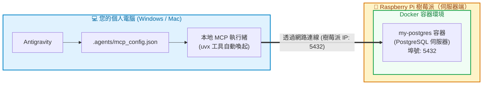

# 4. 在本機 Antigravity 設定專案級 MCP 連線至樹莓派資料庫

在前面單元 2 中，我們已經在**樹莓派（Raspberry Pi）的 Docker 內**順利啟動了 PostgreSQL 資料庫伺服器（埠號 `5432`）。

現在，我們回到**本機電腦（Windows / Mac）**，使用極速免安裝的 Python 工具 **`uvx`** 啟動 MCP Server，讓 **Antigravity** 連線至樹莓派資料庫，純中文自然語言查庫！

> [!NOTE]
> **本課程個人電腦端採用 `uvx`，學生電腦不需要安裝 Docker！**
> 只要在 Windows 上安裝好 `uv`（附帶 `uvx`），Antigravity 就會自動下載並執行開源的 Postgres MCP。

---

## 🏗️ 連線運作架構



---

## 步驟 4.1：在個人電腦安裝 `uv`（只需一行指令）

`uv` 是目前官方與業界最推薦的極速 Python 套件管理工具，安裝時會自帶 **`uvx`** 指令（功能就像 Node.js 的 `npx`，能直接免安裝執行工具）。

請根據您的作業系統開啟終端機執行：

### 🪟 Windows 使用者（推薦使用 PowerShell）
按鍵盤 `Win + X` 選擇 **PowerShell** 或 **終端機**，貼上以下一行指令並按 Enter：

```powershell
powershell -ExecutionPolicy ByPass -c "irm https://astral.sh/uv/install.ps1 | iex"
```

> 💡 安裝完成後，請**重新開啟** PowerShell 或重啟 Antigravity，輸入 `uvx --version` 驗證，有看到版本號即代表成功！

### 🍎 macOS / Linux 使用者
開啟終端機（Terminal），貼上以下指令：

```bash
curl -LsSf https://astral.sh/uv/install.sh | sh
```

---

## 步驟 4.2：編輯專案級 `.agents/mcp_config.json`

請在本機 Antigravity 開啟本專案根目錄下的 [`.agents/mcp_config.json`](file:///Users/roberthsu2003/Documents/GitHub/postgreSQL_MCP/.agents/mcp_config.json)，設定使用 **`uvx`** 啟動 `postgres-mcp`：

```json
{
  "mcpServers": {
    "raspberry-postgres": {
      "command": "uvx",
      "args": [
        "--with",
        "mcp<2",
        "postgres-mcp",
        "--access-mode=unrestricted"
      ],
      "env": {
        "DATABASE_URI": "postgresql://postgres:yourpassword@<樹莓派IP或主機名稱>:5432/postgres"
      }
    }
  }
}
```

> 💡 **參數替換提醒**：
> 1. 請將 `<樹莓派IP或主機名稱>` 替換為您的樹莓派區網 IP（例如 `192.168.1.150` 或 `raspberrypi.local`）。
> 2. 請將 `yourpassword` 替換為單元 2 啟動 PostgreSQL 時設定的資料庫密碼。

---

### 🔍 白話詳細拆解：什麼是 `DATABASE_URI`？

連線字串的通用公式非常固定：
```text
postgresql://【帳號】:【密碼】@【主機位址】:【埠號】/【資料庫名稱】
```

| 欄位片段 | 代表意義 | 白話說明 |
|---|---|---|
| `postgresql://` | **連線協定** | 告訴程式這是要連線到 PostgreSQL 資料庫 |
| `postgres` | **帳號 (Username)** | PostgreSQL 預設最高管理者的帳號名稱就叫做 `postgres` |
| `:yourpassword` | **密碼 (Password)** | 單元 2 啟動資料庫時自己設定的密碼 |
| `@<樹莓派IP>` | **主機位址 (Host)** | 樹莓派在區域網路中的 IP（例如 `192.168.1.150`）或主機名 |
| `:5432` | **連接埠 (Port)** | 樹莓派 PostgreSQL 對外暴露的服務埠號 |
| `/postgres` | **資料庫名稱 (Database)** | 連線進入的目標資料庫名稱（預設為 `postgres`） |

> [!TIP]
> **關於 `--access-mode` 存取模式：**
> * **教學實戰推薦**：`--access-mode=unrestricted`（不受限模式），AI 不僅能做查詢，還能協助建立資料表（CREATE TABLE）、新增與更新資料。
> * **正式唯讀模式**：`--access-mode=restricted`，AI 只能做 `SELECT` 查詢，不能改動資料。

---

## 步驟 4.3：在本機 Antigravity 中提問測試（連線驗證）

儲存設定後，**重新載入專案**（或重開 Antigravity），直接在聊天框中輸入中文指令：

1. **查看資料庫狀態**：
   > 「請連線到我的樹莓派資料庫，幫我列出目前所有的資料表。」
2. **查詢連線版本**：
   > 「請告訴我目前連線的 PostgreSQL 版本是什麼？」

當看到 Antigravity 自動調用 `raspberry-postgres` MCP 工具並回傳資料庫內容時，就代表本機 AI 與樹莓派資料庫已成功連線！

---

## 步驟 4.4：直觀實戰測試 — 讓 AI 新增、查詢選取、修改與刪除

因為我們在設定檔中啟用了 `--access-mode=unrestricted`（不受限模式），AI 具備完整的資料庫操作權限。請依序貼入以下 5 個指令，完整體驗資料庫的 **CRUD（建立、選取查詢、更新、刪除）** 與資料表管理：

---

### 🟢 測試 1：建立資料表並寫入多筆具體資料（CREATE TABLE & INSERT）
直接對 Antigravity 說：
> 「請在我的樹莓派資料庫中建立一張學生名單資料表 `students_test`，包含欄位：
> - 學號（id）：自動編號整數，主鍵
> - 姓名（name）：文字，必填
> - 年級（grade）：整數
> - 城市（city）：文字
> - 考試成績（score）：整數
>
> 建立好後，請幫我寫入以下 4 筆具體學生資料：
> 1. 陳小明，2年級，台北市，88分
> 2. 林美玲，3年級，新北市，95分
> 3. 張志豪，2年級，台中市，72分
> 4. 李佳穎，3年級，台北市，60分
>
> 新增完成後，請把整張資料表的所有內容列出來給我看。」

* **直觀成果**：AI 會調用 MCP 工具自動執行 `CREATE TABLE` 與 `INSERT INTO`，並立刻以漂亮的 Markdown 表格回傳這 4 位學生的完整資料。
* **DBeaver 驗證**：打開本機的 **DBeaver**，在左側連線的資料表清單按 `F5`（重新整理），立刻看到多出 `students_test`，點進去資料分頁也能看到這 4 筆資料！

---

### 🔍 測試 2：條件選取與篩選查詢（SELECT with WHERE & ORDER BY）
測試 AI 的條件選取與排序能力，對 Antigravity 說：
> 「請幫我從 `students_test` 選取查詢符合以下條件的學生：
> 1. 只選取住在『台北市』**或**成績大於等於 80 分的學生
> 2. 依照『考試成績』由高到低排序（ORDER BY DESC）
> 3. 只顯示學號、姓名、城市與成績 4 個欄位即可」

* **直觀成果**：AI 會在背後撰寫精準的 `SELECT id, name, city, score FROM students_test WHERE city = '台北市' OR score >= 80 ORDER BY score DESC;`，篩選出符合條件的學生並整齊列出。

---

### 🟡 測試 3：更新特定學生的資料（UPDATE）
接著測試資料修改，對 Antigravity 說：
> 「李佳穎同學補考通過了！請幫我把 `students_test` 資料表中『李佳穎』的成績更新為 85 分，並把她的最新資料單獨選取出來確認。」

* **直觀成果**：AI 會執行 `UPDATE students_test SET score = 85 WHERE name = '李佳穎';`，並重新選取顯示她修改後的成果。

---

### 🟠 測試 4：刪除特定一筆資料（DELETE FROM）
接著測試刪除單筆資料，對 Antigravity 說：
> 「張志豪同學轉學了，請幫我從 `students_test` 刪除他的資料，並列出目前剩下的所有學生確認。」

* **直觀成果**：AI 執行 `DELETE FROM students_test WHERE name = '張志豪';`，剩下的 3 筆資料會即時呈現，確認已被刪除。

---

### 🔴 測試 5：測試結束，刪除整張資料表（DROP TABLE）
最後清理測試環境，對 Antigravity 說：
> 「測試結束了，請幫我把剛剛建立的測試資料表 `students_test` 完全刪除（DROP TABLE），並確認資料庫內是否已經沒有這張表。」

* **直觀成果**：AI 會執行 `DROP TABLE IF EXISTS students_test;`，確認刪除後回覆「資料表已順利清除」。
* **DBeaver 驗證**：回到 DBeaver 重新整理（F5），確認資料表已消失，不留任何測試垃圾！

> [!TIP]
> 透過這個**「建表 $\rightarrow$ 寫入資料 $\rightarrow$ 條件選取 $\rightarrow$ 更新數據 $\rightarrow$ 刪除單筆 $\rightarrow$ 刪除整表」**的完整流程，學生能最直觀地體會：**不用自己記 SQL 語法，只要用白話中文跟 Antigravity 對話，AI 就能在遠端樹莓派的 PostgreSQL 容器內精準完成所有資料庫操作！**

---

👉 **下一步：[5. 樹莓派端 Docker Compose 伺服器維護指南](./5_docker_compose雙容器.md)**
