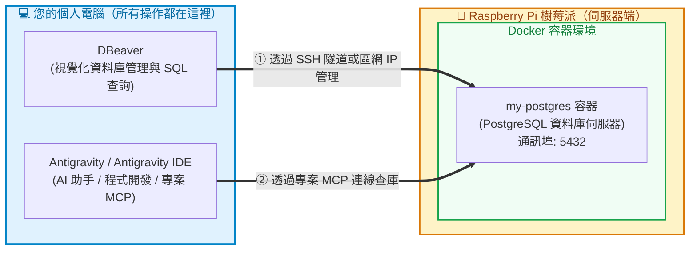

# 在 Raspberry Pi 上使用 Docker 運行伺服器與本機連線指南

本教學遵循**「伺服器端與操作端分離」**的現代化架構：
* 🍓 **所有 Server 都在 Raspberry Pi 內的 Docker 執行**（PostgreSQL 資料庫伺服器、未來的自訂 MCP 伺服器容器）。
* 💻 **所有操作都在您的個人電腦（Mac / Windows）執行**（DBeaver、Antigravity、Antigravity IDE）。

---

## 🏗️ 核心系統架構與分工

| 設備角色 | 負責項目 | 執行軟體與環境 | 說明 |
|---|---|---|---|
| 🍓 **Raspberry Pi（伺服器端）** | 跑 Docker 容器 | **Docker 引擎** • `my-postgres` 容器 (5432) • 具名磁碟卷 (資料持久化) | 專職當作 Backend 伺服器，開機常駐背景運行，不需在此寫程式或開桌面視窗。 |
| 💻 **個人電腦（操作與開發端）** | 視覺化管理 & 寫 SQL | **DBeaver** | 在自己電腦打開圖形介面，透過 SSH 隧道或區網 IP 遠端管理樹莓派資料庫。 |
| 💻 **個人電腦（操作與開發端）** | 一般人 AI 查庫 | **Antigravity** | 在自己電腦提問，透過本專案的專案級 MCP 直接用自然語言查詢樹莓派資料庫。 |
| 💻 **個人電腦（操作與開發端）** | 程式開發與進階客製 | **Antigravity IDE** | 在自己電腦撰寫 Python、開發自訂 MCP Server 與除錯。 |

---

## 🧭 學習路徑導覽

為了讓每一步都精準清晰，本單元已模組化拆分為以下教學步驟：

| 步驟 | 單元名稱 | 執行地點 | 你會學到 | 連結 |
|:---:|---|:---:|---|:---:|
| 1 | **安裝 Docker** | 🍓 樹莓派 | 樹莓派官方腳本安裝、免 sudo 權限、開機自動啟用與版本驗證 | [👉 前往單元 1](./1_安裝docker.md) |
| 2 | **運行 PostgreSQL 容器** | 🍓 樹莓派 | `docker run` 啟動資料庫、開機自動重啟（`--restart unless-stopped`）與資料持久化磁碟卷 | [👉 前往單元 2](./2_單獨安裝postgresql.md) |
| 3 | **DBeaver 遠端連線** | 💻 個人電腦 | 在自己電腦開啟 DBeaver，透過 SSH 隧道安全連線至樹莓派資料庫 | [👉 前往單元 3](./3_dbeaver連線.md) |
| 4 | **Antigravity 專案級 MCP 連線** | 💻 個人電腦 | 在自己電腦的 Antigravity 設定 `.agents/mcp_config.json`，讓 AI 透過自然語言查詢樹莓派資料庫 | [👉 前往單元 4](./4_單獨安裝mcp_server.md) |
| 5 | **Docker Compose 伺服器管理** ⭐ | 🍓 樹莓派 | **維護推薦**！使用 `docker-compose.yml` 宣告式管理樹莓派上的容器服務 | [👉 前往單元 5](./5_docker_compose雙容器.md) |

---

## 🛠️ 工具手冊速查

* 📖 **[Docker 常用指令速查](./docker基本指令.md)**：包含 `docker run`、`docker ps`、`docker logs`、`docker compose` 等伺服器維護必備指令。

