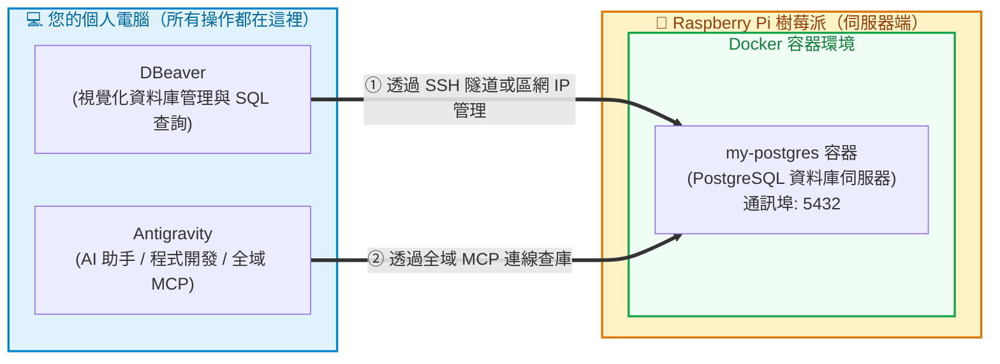

# 在 Raspberry Pi 上使用 Docker 運行伺服器與本機連線指南

> 🎯 學完你會：在樹莓派上常駐 PostgreSQL，並從自己的電腦連線
>
> 沒有樹莓派？改走 [Supabase 雲端方案](../supabase安裝/README.md)。

本教學遵循**「伺服器端與操作端分離」**的現代化架構：
* 🍓 **所有 Server 都在 Raspberry Pi 內的 Docker 執行**（PostgreSQL 資料庫伺服器、未來的自訂 MCP 伺服器容器）。
* 💻 **所有操作都在您的個人電腦（Mac / Windows）執行**（DBeaver、Antigravity）。

---

## 🏗️ 核心系統架構與分工

---

## 🧭 學習路徑導覽

為了讓每一步都精準清晰，本單元已模組化拆分為以下教學步驟：

| 步驟 | 單元名稱 | 執行地點 | 你會學到 | 連結 |
|:---:|---|:---:|---|:---:|
| 1 | **安裝 Docker** | 🍓 樹莓派 | 樹莓派官方腳本安裝、免 sudo 權限、開機自動啟用與版本驗證 | [👉 前往單元 1](./1_安裝docker.md) |
| 2 | **運行 PostgreSQL 容器** | 🍓 樹莓派 | `docker run` 啟動資料庫、開機自動重啟（`--restart unless-stopped`）與資料持久化磁碟卷 | [👉 前往單元 2](./2_單獨安裝postgresql.md) |
| 3 | **DBeaver 遠端連線** | 💻 個人電腦 | 在自己電腦開啟 DBeaver，透過 SSH 隧道安全連線至樹莓派資料庫 | [👉 前往單元 3](./3_dbeaver連線.md) |
| 4 | **Antigravity 全域 MCP 連線** | 💻 個人電腦 | 在自己電腦的 Antigravity 設定全域 `~/.gemini/config/mcp_config.json`，讓 AI 隨時連線樹莓派資料庫 | [👉 前往單元 4](./4_單獨安裝mcp_server.md) |
| 5 | **Docker Compose 伺服器管理** ⭐ | 🍓 樹莓派 | **維護推薦**！使用 `docker-compose.yml` 宣告式管理樹莓派上的容器服務 | [👉 前往單元 5](./5_docker_compose雙容器.md) |

---

## 🛠️ 工具手冊速查

* 📖 **[Docker 常用指令速查](./docker基本指令.md)**：包含 `docker run`、`docker ps`、`docker logs`、`docker compose` 等伺服器維護必備指令。

👉 **下一步：[第 2 章：匯入範例資料庫](../範例資料庫/README.md)**
